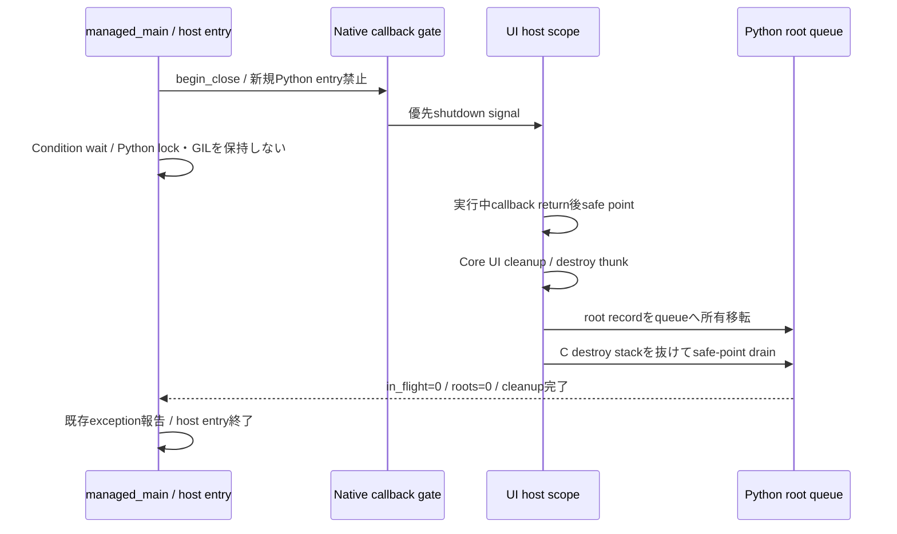

# 未設計レビュー / Python API・通常終了handshake・特殊method

- 文書版: 0.2
- 状態: 全判断承認済み・正本適用済み（2026-10-17）
- 判断ID: REM-PYTHON-01～10
- 入口: [全件索引](index.md)
- 根拠RQ: [RQ-03-004](../../11_requirements/RQ-03_language-support.md#rq-03-004)、[RQ-03-008](../../11_requirements/RQ-03_language-support.md#rq-03-008)、[RQ-03-009](../../11_requirements/RQ-03_language-support.md#rq-03-009)、[RQ-03-010](../../11_requirements/RQ-03_language-support.md#rq-03-010)、[RQ-06-003](../../11_requirements/RQ-06_threading-dispatch.md#rq-06-003)、[RQ-05-012](../../11_requirements/RQ-05_ownership-callbacks.md#rq-05-012)、[RQ-05-014](../../11_requirements/RQ-05_ownership-callbacks.md#rq-05-014)
- 具体化するBD: [BD-14](../../12_design/BD-14_python-wrapper-upper-design.md)、[BD-15](../../12_design/BD-15_python-lint-mcp-upper-design.md)、[BD-36](../../12_design/BD-36_runtime-shutdown-dispatch-upper-design.md)
- 適用対象DD/SD: [DD-21](../../13_detail_design/21-wrapper-python.md)

本書は承認したレビュー記録である。推奨案と代替理由は提案時点の比較として保持する。現行の方式・正式判断IDは[DD-35: Python API・通常終了handshake・特殊method](../../13_detail_design/35-python-lifecycle-api.md)を正本とする。採用済みでも本文に将来候補と記した範囲は初期必須へ昇格しない。

## 判断案

| 判断ID | 推奨案・具体的な選択 | 代替と選択理由 | 承認区分 |
| --- | --- | --- | --- |
| REM-PYTHON-01 | minimum CPython3.13、通常GIL版を正式profile候補、3.14tを追加検証profileとする。PyPy/subinterpreterは初期正式support外。 | GIL非依存の設計と各処理系の検証合格を区別する。 | RQ・REM-RQ-21 |
| REM-PYTHON-02 | ResourceOwnerはweakref.finalize+NativeOwnerCellで回収する。finalizerへbound methodやowner自身を渡さず、事前ticketをmanagerへ移す。 | __del__単独やownerをclosureで強保持するfinalizeは回収を妨げる。 | DD |
| REM-PYTHON-03 | 公開名はRuntime/Property/Binding/Command/TextBox/ErrorSnapshot/DecimalValue、close/try_close/withを提供する。 | ctypes object/raw handleを公開値として扱わせない。 | DD |
| REM-PYTHON-04 | 内部owner cell・root registryを明示Lockで保護し、native callとuser callbackはlock外。snapshot型はimmutable dataclass/readonly facade。 | dictの内部lockやGILをcompound operationの排他としない。 | DD |
| REM-PYTHON-05 | managed_main(entry)とHostRegistrationを終了通知の入口にする。標準構成はPython main threadをUI threadとし、外部専用UI threadは登録scopeで運用する。 | atexitだけでは生存UI threadの待ちに入る前に終了を始められない。 | DD |
| REM-PYTHON-06 | 終了はnative callback gate閉鎖→実行中callback return→UI cleanup/destroy→root safe-point drain→host exitの順。mainのCondition waitはGILとregistry lockを解放する。 | interpreter finalization開始後に新規ctypes callbackを起動しない。 | DD・REM-RQ-22 |
| REM-PYTHON-07 | shutdown時にも任意user callbackを強制中断できない。hostは停止前通知、callbackは有限returnしmainへの同期依存待ちを作らないという協調条件を要求案へ明記する。 | 無条件cleanup保証にはprocess分離/OS終了等の別architectureが必要。 | RQ・REM-RQ-22 |
| REM-PYTHON-08 | sys.excepthook/threading.excepthookは保存hookへ委譲する合成器。管理workerだけRuntimeへ関連付け、復元は現在hookが自分の合成器の場合のみ。 | 他libraryによる後のhook変更を上書きして戻さない。SystemExitはentry finally経由。 | DD |
| REM-PYTHON-09 | BaseExceptionをC trampolineで捕捉。SystemExit/KeyboardInterruptはentry coordinatorへpending control signalとして渡し、C境界をunwindさせない。 | 通知例外を自動的にすべてRuntime shutdownへ変換しない。 | DD |
| REM-PYTHON-10 | 基底__init__を一度実行するguard、close/__enter__/__exit__/native entryのoverride禁止を提案。__repr__/__eq__/__hash__はbase-call不要、__del__はcleanup正本にしない。 | 任意special methodに一律super呼出しを要求しない。動的monkey patchは解析unknown。 | RQ・REM-RQ-23 |

<a id="rem-python-01"></a>

<a id="rem-python-02"></a>

<a id="rem-python-03"></a>

<a id="rem-python-04"></a>

<a id="rem-python-05"></a>

<a id="rem-python-06"></a>

<a id="rem-python-07"></a>

<a id="rem-python-08"></a>

<a id="rem-python-09"></a>

<a id="rem-python-10"></a>

## 実現設計案

### Root / owner / coordinator

```text
NativeOwnerCell { lock, token, ticket, state, anchor }  // Python ownerを逆保持しない
CallbackRoot { callable, CFUNCTYPE, context, state, in_flight }
LifecycleCoordinator { host_registration, native_gate, owner_manager, root_queue }
```



gate検査はRust/native側でCFUNCTYPE呼出し前に行う。CallbackRootは登録成功前にRootPrepared、登録完了後Active。登録処理中の同期invokeはCore側で行わず、失敗ではPython managerがrootを回収する。destroy thunkはrootをregistryから切り離してqueueへ移すだけで、最後のPython参照dropをそのC stackから分離する。

managed_mainはtry/finallyで成功・一般例外・SystemExitを集約し、既存の例外をcleanup例外で置き換えない。`with RuntimeSession`は終了要求とdrainをhostの通常終了境界に結び、個別ownerのwith終了はそのtokenだけをcloseする。scopeの終了がUI callback内なら待たずreceiptを返し、outer host scopeのexitで全体drainする。

協調条件を満たさないin-flight callbackの永久停止、登録外host、UI threadをcleanup前に破棄したhostについては正常cleanup完遂を保証できない差異を要求レビューへ提示する。host停止確定時はwaitを未完了として解除し、ticketを管理下に残す。daemon thread化だけでcleanup済みとはしない。

override guardは内部metaclassの生成/呼出し処理で、__init__正常return時にowner cellの基底初期化済みflagを確認し、未達ならUninitializedOwnerError。初期化途中例外では既に取得したticketをmanagerへ戻す。readonly Property facadeのsetter追加等は別の通常Python操作であり、UI affinityを回避できる特権にしない。

公式根拠: [ctypes](https://docs.python.org/3.14/library/ctypes.html)、[weakref.finalize](https://docs.python.org/3.14/library/weakref.html)、[free threading](https://docs.python.org/3.14/howto/free-threading-python.html)。weakref.finalizeの存在は全回収時刻や任意process終了時の完遂保証ではない。本案は明示同期と管理entry境界を追加する方式である。

## 適用結果

全判断を[DD-35](../../13_detail_design/35-python-lifecycle-api.md)へ正式IDで適用した。関連要求の変更もRQ本文へ反映した。実装・試験実行は未完了。[全200件の適用表](../remaining-design-application-result.md)で旧新対応を確認できる。

## 承認履歴

| 日付 | 範囲 | 承認者 | 結果 |
| --- | --- | --- | --- |
| 2026-10-17 | 本書の案作成 | 利用者 | 一括生成指示。方式採用・正本適用は未承認 |

## 改訂履歴

| 版 | 日付 | 内容 | 作成者 |
| --- | --- | --- | --- |
| 0.1 | 2026-10-17 | 現行の未設計箇所を実現案・代替・interfaceへ具体化 | Codex |

## cleanup entryとinterpreter終了の補足

通常callback gateと内部cleanup entry gateを分ける。通常gate閉鎖後もinterpreterがRunningの間だけ内部destroy/root-drain trampolineを許可し、Core destroy stackを抜けたhost safe pointでrootをdropする。roots=0かつ内部entry in-flight=0を確認してcleanup gateも閉じ、その後に管理entryを終了する。finalization開始後のPython C API再attachで回収を試みない。root dropから走る利用者__del__/weakref callbackも有限に戻るという協調条件の対象である。

Runtime作成時にowner cellとweakref.finalizeを用意し、__weakref__ slotを公開ownerへ持たせる。finalize callbackの引数はowner cellのみでowner本体をcaptureしない。未実行finalizeをatexitで順に実行するだけの手順へ依存せず、coordinatorが登録owner cellとrootをdrainする。readonly snapshotへworkerが書込みできるfacadeを返さない。

## 承認履歴（具体化適用）

| 日付 | 対象版・範囲 | 承認者 | 結果・根拠 |
| --- | --- | --- | --- |
| 2026-10-17 | 0.2 / 本書の全推奨案と補足の採用・正本適用 | 利用者 | 全件反映を指示。設計採用・本文適用を承認。実装・公開・試験合格を意味しない |

## 改訂履歴（具体化適用）

| 版 | 日付 | 変更内容 | 作成者 |
| --- | --- | --- | --- |
| 0.2 | 2026-10-17 | 本書の全推奨案と補足の採用・正本適用を正本へ適用し、旧判断との対応を保持 | Codex |
