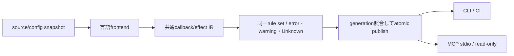

# 未設計レビュー / callback識別・禁止検知・lint/MCP

- 文書版: 0.2
- 状態: 全判断承認済み・正本適用済み（2026-10-17）
- 判断ID: REM-ANALYZER-01～08
- 入口: [全件索引](index.md)
- 根拠RQ: [RQ-03-011](../../11_requirements/RQ-03_language-support.md#rq-03-011)、[RQ-03-012](../../11_requirements/RQ-03_language-support.md#rq-03-012)、[RQ-05-013](../../11_requirements/RQ-05_ownership-callbacks.md#rq-05-013)、[RQ-07-008](../../11_requirements/RQ-07_binding.md#rq-07-008)
- 具体化するBD: [BD-03](../../12_design/BD-03_runtime-notification-upper-design.md)、[BD-15](../../12_design/BD-15_python-lint-mcp-upper-design.md)
- 適用対象DD/SD: [DD-04](../../13_detail_design/04-callback-lifecycle.md)、[DD-21](../../13_detail_design/21-wrapper-python.md)

本書は承認したレビュー記録である。推奨案と代替理由は提案時点の比較として保持する。現行の方式・正式判断IDは[DD-36: callback識別・禁止検知・lint/MCP](../../13_detail_design/36-callback-analyzer.md)を正本とする。採用済みでも本文に将来候補と記した範囲は初期必須へ昇格しない。

## 判断案

| 判断ID | 推奨案・具体的な選択 | 代替と選択理由 | 承認区分 |
| --- | --- | --- | --- |
| REM-ANALYZER-01 | Analyzer IRはCallbackKind/CallTarget/RuntimeAlias/Effect/SourceSpanを持つ。禁止効果、警告効果、Unknownを分けてreportする。 | 再帰検知だけのmarkerへ目的を狭めない。 | DD・REM-RQ-24 |
| REM-ANALYZER-02 | C++は[[clang::annotate]]のportable macro、C#は[UiCallback]属性、Rustは#[ui_callback] proc-macro、Pythonは@ui_callback decoratorを候補採用する。 | C++の任意[[ui::callback]]が標準compilerで意味解析されるとはしない。 | 範囲・REM-RQ-24 |
| REM-ANALYZER-03 | syntax/signature、async戻り不一致、禁止UI mutation/自己解除、destroy中UI entryをerror候補にする。終了要求受付は例外として許す。 | 既承認のcallback種別表を解析器独自の一律禁止にしない。 | DD |
| REM-ANALYZER-04 | 同Control Property書戻し、blocking wait/join/IO、強capture循環、間接再帰はwarning。dynamic dispatchはUnknownとして表示する。 | 静的に証明できない経路を安全と断定しない。 | DD |
| REM-ANALYZER-05 | Python JITは初期不採用。Python AST+型情報、C++ Clang AST、C# Roslyn、Rust macro入力+compiler diagnosticsのadapterへ分ける。 | JITでも全動的副作用の証明はできずnative artifact配布が増える。 | 範囲 |
| REM-ANALYZER-06 | base-call検査はPython owner.__init__だけ必須とし、基底到達flagをruntime guardへ委譲する。演算子全体のsuper必須化は行わない。 | 静的super()文字列検査では間接base callを判定できない。 | DD・REM-RQ-23 |
| REM-ANALYZER-07 | 解析cacheはworkspace ID+content digest+config+analyzer version、結果はgeneration単位でatomic publish。 | daemon再起動で診断意味が変わらない。 | DD/SD |
| REM-ANALYZER-08 | MCPはanalyze/get_diagnosticsのread-only入口、stdioを初期transport。URIは登録workspace内だけ、CLI/CIと同じJSON result schema。 | 任意file読み出しやbuild/command実行をMCP入口へ追加しない。 | DD/SD |

<a id="rem-analyzer-01"></a>

<a id="rem-analyzer-02"></a>

<a id="rem-analyzer-03"></a>

<a id="rem-analyzer-04"></a>

<a id="rem-analyzer-05"></a>

<a id="rem-analyzer-06"></a>

<a id="rem-analyzer-07"></a>

<a id="rem-analyzer-08"></a>

## 実現設計案

### Markerと診断schema案

```text
C++: UI_CALLBACK(property_validator)  // compiler別annotateへ展開
C#:  [UiCallback(UiCallbackKind.PropertyValidator)]
Rust: #[ui_callback(kind = "property_validator")]
Python: @ui_callback(kind="property_validator")
```

markerはcallback登録型との照合に使い、markerなしでも既知APIへ渡すcallableは解析対象になる。markerの有無でRuntime検査を外さない。Rust macroはtoken streamだけで任意call先の効果を判定できないため、証明不能をwarning/Unknownへ残し、コンパイル成功を純粋性の証明にしない。

| Rule候補 | 検知 | 位置・severity |
|---|---|---|
| CB001 | callback signature / owned-borrowed違反 | 定義/登録点、error |
| CB002 | 同Runtimeの禁止UI変更・自己解除 | call site、解決済みの場合error |
| CB003 | async/coroutineを同期callbackへ直接登録 | 戻り型解決時error |
| CB004 | destroy中UI操作 / C境界unwind | effect解決時error |
| CB101 | 同Control Propertyの書戻し/再帰可能性 | warning |
| CB102 | blocking wait/join/同期IO | warning、時間の閾値を推定しない |
| CB103 | owner captureによる参照循環 | warning |
| CB201 | 動的call先・alias未解決 | information/Unknown |

Diagnostic JSONは`schema_version, workspace_id, generation, input_digest, analyzer_version, rule_id, severity, file_uri, range, message, related_locations, certainty`。file URIはcanonicalizeしたworkspace relative pathから構成し、symlink脱出を拒否する。cacheは非秘密の解析結果だけを保存し、ソース全文を診断messageへ自動埋め込みしない。



MCPのtool入力は`workspace_id, relative_paths[], expected_generation?`、出力は同schemaのdiagnostics。世代不一致はstaleとして返し、旧結果を最新と表示しない。MCP toolの配布schema自体は本案の検証vectorへ含める。

## 適用結果

全判断を[DD-36](../../13_detail_design/36-callback-analyzer.md)へ正式IDで適用した。関連要求の変更もRQ本文へ反映した。実装・試験実行は未完了。[全200件の適用表](../remaining-design-application-result.md)で旧新対応を確認できる。

## 承認履歴

| 日付 | 範囲 | 承認者 | 結果 |
| --- | --- | --- | --- |
| 2026-10-17 | 本書の案作成 | 利用者 | 一括生成指示。方式採用・正本適用は未承認 |

## 改訂履歴

| 版 | 日付 | 内容 | 作成者 |
| --- | --- | --- | --- |
| 0.1 | 2026-10-17 | 現行の未設計箇所を実現案・代替・interfaceへ具体化 | Codex |

## C++識別方式の根拠

[Clang attribute reference](https://clang.llvm.org/docs/AttributeReference.html#annotate)のannotateをcompiler adapterで使用する。MSVC/GCCの通常buildではmacroを空または利用可能なannotationへ展開し、解析はClang compilation databaseを入力に行う案。通常compilerが全marker効果を検証すると保証しない。

## 解析実行の信頼境界

Clang compilation databaseをshell commandとして実行せず、LibToolingへ検査済みargument vectorを渡す。plugin/load-pass-plugin等の動的code load optionを拒否し、includeのVFSを登録workspaceとreadonly SDK rootsへ限定する。解析processはnetworkなし、CPU/memory budget付きで分離し、budget到達はAnalysisIncomplete/Unknownとして返す。sourceの解析結果を安全確認済みへ変換しない。MCP schemaにはresult status Complete/Partial/Failedを持たせ、診断0件と未解析を区別する。

## 承認履歴（具体化適用）

| 日付 | 対象版・範囲 | 承認者 | 結果・根拠 |
| --- | --- | --- | --- |
| 2026-10-17 | 0.2 / 本書の全推奨案と補足の採用・正本適用 | 利用者 | 全件反映を指示。設計採用・本文適用を承認。実装・公開・試験合格を意味しない |

## 改訂履歴（具体化適用）

| 版 | 日付 | 変更内容 | 作成者 |
| --- | --- | --- | --- |
| 0.2 | 2026-10-17 | 本書の全推奨案と補足の採用・正本適用を正本へ適用し、旧判断との対応を保持 | Codex |
