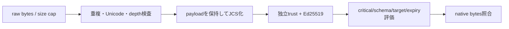

# 未設計レビュー / 署名envelope・schema・parser

- 文書版: 0.2
- 状態: 全判断承認済み・正本適用済み（2026-10-17）
- 判断ID: REM-MANIFEST-01～09
- 入口: [全件索引](index.md)
- 根拠RQ: [RQ-12-011](../../11_requirements/RQ-12_build-distribution.md#rq-12-011)、[RQ-12-012](../../11_requirements/RQ-12_build-distribution.md#rq-12-012)、[RQ-12-014](../../11_requirements/RQ-12_build-distribution.md#rq-12-014)、[RQ-12-015](../../11_requirements/RQ-12_build-distribution.md#rq-12-015)
- 具体化するBD: [BD-29](../../12_design/BD-29_artifact-provenance-upper-design.md)、[BD-31](../../12_design/BD-31_artifact-signing-trust-upper-design.md)、[BD-32](../../12_design/BD-32_artifact-manifest-schema-upper-design.md)
- 適用対象DD/SD: [DD-22](../../13_detail_design/22-build-distribution.md)

本書は承認したレビュー記録である。推奨案と代替理由は提案時点の比較として保持する。現行の方式・正式判断IDは[SD-06: 署名envelope・schema・parser](../../14_secure_design/06-manifest-wire-verifier.md)を正本とする。採用済みでも本文に将来候補と記した範囲は初期必須へ昇格しない。

## 判断案

| 判断ID | 推奨案・具体的な選択 | 代替と選択理由 | 承認区分 |
| --- | --- | --- | --- |
| REM-MANIFEST-01 | schema major1のUTF8 JSON envelope {payload,signatures}。payloadをJCS化しdomain separatorを先頭に付けPure Ed25519で署名する。 | 既存Ed25519をEd25519ph/ctxへ変更しない。domain separatorはmessage bytes内の固定prefix。 | SD/DD |
| REM-MANIFEST-02 | signatureはkey_id/algorithm/signatureの3field、key_idはraw公開鍵32byteのSHA256 lowercase hex。signatureはraw64byteのbase64url-no-padding。 | PEMやDERの複数表現をwireへ混在させない。 | SD/DD |
| REM-MANIFEST-03 | payloadにschema_major/minor、kind、release_id、runtime_version、abi_major、target、profile、features、artifact、signing_key_id、issued_at/expires_atを必須定義する。 | fieldを削って互換性/信頼情報をoptional化しない。 | SD/DD |
| REM-MANIFEST-04 | byte_size、revision/sequence等u64はleading-zeroなし十進文字列。小さいschema/ABI majorだけsafe整数JSON number。 | JCSのbinary64 number制約で大整数を失わない。 | SD/DD |
| REM-MANIFEST-05 | critはpayload内の必須理解field名配列。unknown optionalは署名検証後に意味処理で無視し、raw payloadからは削除しない。 | 未知fieldをcanonicalize前に捨てると署名対象が変わる。 | SD/DD |
| REM-MANIFEST-06 | parserは重複key、lone surrogate、不正UTF8、非finite number、trailing dataを拒否し、Unicode正規化をしない。 | 通常JSON deserializeで重複が消える前に検出する。 | SD/DD |
| REM-MANIFEST-07 | 初期local policyはmanifest1 MiB、depth32、object member4096、string64 KiB、signature8を上限候補とし構成可能にする。 | 数値は防御budget。利用者可視な拒否制限としてRQ案にも記す。 | SD・REM-RQ-25 |
| REM-MANIFEST-08 | readerはschema major1だけを初期対応。minorはunknown optional追加のみ、破壊変更はmajor更新。 | runtime ABI versionとmanifest schema versionを連動させない。 | SD/DD |
| REM-MANIFEST-09 | 公式RFC test vectorsと本schemaのnegative vectorsを併用。test-vector digest/expected classificationをrelease evidenceへ保存する。 | 署名成功例だけでは曖昧parseと誤schemaを検出できない。 | test設計 |

<a id="rem-manifest-01"></a>

<a id="rem-manifest-02"></a>

<a id="rem-manifest-03"></a>

<a id="rem-manifest-04"></a>

<a id="rem-manifest-05"></a>

<a id="rem-manifest-06"></a>

<a id="rem-manifest-07"></a>

<a id="rem-manifest-08"></a>

<a id="rem-manifest-09"></a>

## 実現設計案

### Envelope例（署名値は説明用で、有効な署名ではない）

```json
{
  "payload": {
    "schema_major": 1,
    "schema_minor": 0,
    "kind": "freemvvm.native-artifact",
    "release_id": "runtime-1.0.0-linux-x64-glibc236",
    "runtime_version": "1.0.0",
    "abi_major": 1,
    "target": {"os":"linux","arch":"x86_64","triple":"x86_64-unknown-linux-gnu"},
    "profile": "linux-x64-glibc236",
    "features": ["core.mvvm.v1"],
    "dependencies": [],
    "artifact": {"filename":"libfreemvvm_abi1.so","byte_size":"12345","sha256":"<64 lowercase hex>"},
    "signing_key_id": "<64 lowercase hex>",
    "issued_at": "2026-10-17T00:00:00Z",
    "expires_at": "2026-11-16T00:00:00Z",
    "crit": ["kind","abi_major","target","profile","features","dependencies","artifact","signing_key_id","expires_at"]
  },
  "signatures": [{"key_id":"<64 lowercase hex>","algorithm":"Ed25519","signature":"<base64url raw64>"}]
}
```

署名messageはASCII `freemvvm.artifact-manifest.v1` + NUL一個 + JCS(payload)のUTF8 bytes。key_idはpayloadのsigning_key_idと一致させる。envelope自体の署名配列の順は認証結果へ影響させず、同keyの重複signatureを拒否する。key roles/thresholdは独立trust bundleで評価する。

| field | 型・条件 | 意味利用前の検査 |
|---|---|---|
| schema_major/minor / abi_major | 0以上のsafe整数。major1のみ | 署名済みpayloadのschema reader選択 |
| target | os/arch/triple固定語彙 | consumer profileと完全照合 |
| profile / release_id | ASCII識別子、最大128byte | pathとして解釈せずcatalog keyにする |
| features | unique UTF8識別子配列 | 必要featureすべてがRuntime/manifest双方で対応 |
| artifact.filename | basenameのみ、区切り/..禁止 | fetch先や展開pathへ無検査結合しない |
| artifact.byte_size / sha256 | 十進u64 string / 64 hex | 実bytes長・digest照合 |
| issued_at/expires_at | UTC秒精度RFC3339、issued<expires | trust clockと期間policyで評価 |



方式の根拠は[RFC 8785](https://www.rfc-editor.org/rfc/rfc8785)と[RFC 8032](https://www.rfc-editor.org/rfc/rfc8032)。RFCの採用は本schemaのfieldやpolicy値を規格が定めているという意味ではない。JCSとEd25519のライブラリは既存の適合実装をpinして利用し、暗号を独自実装しない。exact依存版/hashはprofile lock生成手順で実値を固定する。

## 適用結果

全判断を[SD-06](../../14_secure_design/06-manifest-wire-verifier.md)へ正式IDで適用した。関連要求の変更もRQ本文へ反映した。実装・試験実行は未完了。[全200件の適用表](../remaining-design-application-result.md)で旧新対応を確認できる。

## 承認履歴

| 日付 | 範囲 | 承認者 | 結果 |
| --- | --- | --- | --- |
| 2026-10-17 | 本書の案作成 | 利用者 | 一括生成指示。方式採用・正本適用は未承認 |

## 改訂履歴

| 版 | 日付 | 内容 | 作成者 |
| --- | --- | --- | --- |
| 0.1 | 2026-10-17 | 現行の未設計箇所を実現案・代替・interfaceへ具体化 | Codex |

## 検証実装の候補と互換vector

Rust verifierの初期依存候補は [ed25519-dalek 2.2.0](https://docs.rs/ed25519-dalek/2.2.0/ed25519_dalek/)、[serde_jcs 0.1.0](https://docs.rs/serde_jcs/0.1.0/serde_jcs/)、[sha2 0.10.9](https://docs.rs/sha2/0.10.9/sha2/)。これらを現在の最新版・監査済みとして扱わず、RFC vector/Unicode key sort/number roundtrip/negative key vectorとminimum compilerでのbuildを採用gateにする。pin版の依存脆弱性検査で失敗すれば更新案を作り、wire schemeを変えずに代替適合実装へ交換する。

Ed25519はcanonical公開鍵と非weak keyをprovision条件にし、verify_strict相当の検査を候補とする。strict実装はRFCの許容表現すべてと同一の受入集合とは限らないため、公式publisherのkey/署名profileで互換vectorを固定し、RFC完全受入互換と無条件に表示しない。受入方針はschema/key profileのレビュー範囲として記録する。

dependenciesは必須配列（依存なしなら空）で、各native dependencyにbasename/byte_size/sha256を持たせる。Core artifactだけを検証して未検証の同名DLL/.soへ依存解決しない。配布archiveを使用する場合は署名済みentry inventoryを別payloadに含め、相対path、type、size、digestを各entryに束縛する。absolute/..、symlink/hardlink、未列挙entryは拒否する。

## 承認履歴（具体化適用）

| 日付 | 対象版・範囲 | 承認者 | 結果・根拠 |
| --- | --- | --- | --- |
| 2026-10-17 | 0.2 / 本書の全推奨案と補足の採用・正本適用 | 利用者 | 全件反映を指示。設計採用・本文適用を承認。実装・公開・試験合格を意味しない |

## 改訂履歴（具体化適用）

| 版 | 日付 | 変更内容 | 作成者 |
| --- | --- | --- | --- |
| 0.2 | 2026-10-17 | 本書の全推奨案と補足の採用・正本適用を正本へ適用し、旧判断との対応を保持 | Codex |
