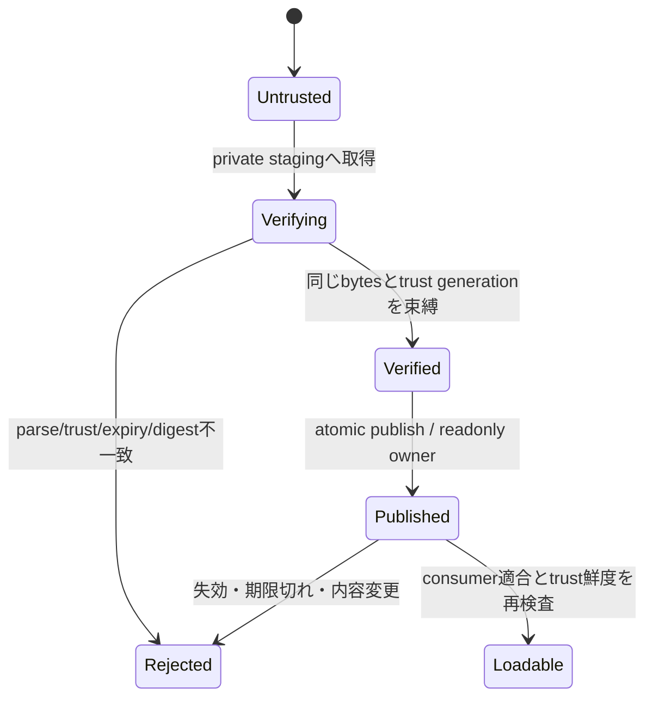

# 未設計レビュー / 鍵管理・失効・offline・staging

- 文書版: 0.2
- 状態: 全判断承認済み・正本適用済み（2026-10-17）
- 判断ID: REM-TRUST-01～09
- 入口: [全件索引](index.md)
- 根拠RQ: [RQ-12-013](../../11_requirements/RQ-12_build-distribution.md#rq-12-013)、[RQ-12-014](../../11_requirements/RQ-12_build-distribution.md#rq-12-014)、[RQ-12-015](../../11_requirements/RQ-12_build-distribution.md#rq-12-015)、[RQ-12-020](../../11_requirements/RQ-12_build-distribution.md#rq-12-020)
- 具体化するBD: [BD-29](../../12_design/BD-29_artifact-provenance-upper-design.md)、[BD-30](../../12_design/BD-30_artifact-distribution-upper-design.md)、[BD-31](../../12_design/BD-31_artifact-signing-trust-upper-design.md)、[BD-32](../../12_design/BD-32_artifact-manifest-schema-upper-design.md)
- 適用対象DD/SD: [DD-22](../../13_detail_design/22-build-distribution.md)

本書は承認したレビュー記録である。推奨案と代替理由は提案時点の比較として保持する。現行の方式・正式判断IDは[SD-07: 鍵管理・失効・offline・staging](../../14_secure_design/07-trust-key-staging.md)を正本とする。採用済みでも本文に将来候補と記した範囲は初期必須へ昇格しない。

## 判断案

| 判断ID | 推奨案・具体的な選択 | 代替と選択理由 | 承認区分 |
| --- | --- | --- | --- |
| REM-TRUST-01 | root/targets/revocationの役割を分ける。rootは2-of-3 offline鍵、targetsは1-of-2 release鍵をKMS/HSM、失効metadataはroot認証roleで発行する。 | 単一オンライン鍵がroot更新までできる構成を避ける。 | SD/運用 |
| REM-TRUST-02 | rotationはroot version単調増加、旧root閾値と新root閾値の両方で次rootを署名して逐次更新する。 | catalogから最新rootだけを取得して無条件置換しない。 | SD |
| REM-TRUST-03 | trust bundleはroot/keyset/revocation/sequence/issued/expiresを所有し、provision経路はwrapper配布物か運用者の明示ファイル導入。 | 取得先の鍵を自動信頼しない既存RQを具体化する。 | SD/DD |
| REM-TRUST-04 | 提案既定期間はroot365日、release manifest30日、revocation7日。期限切れはonline/offlineとも拒否し明示bundle更新を求める。 | 長期airgapには別の長期署名profileが必要。offline無期限許可はしない。 | RQ・REM-RQ-26 |
| REM-TRUST-05 | rollback対策は最大root/revocation sequenceと確認時刻を保存。time rollback/保存破損は不明としてfail closed。 | 時計が正しいと暗黙仮定して期限だけ比較しない。 | SD・REM-RQ-26 |
| REM-TRUST-06 | artifact cacheはidentity+digestの不変object、検証は同一open objectをpin。stagingからverifiedへの公開は同一filesystemのatomic rename。 | 検証後に任意pathから別bytesをloadしない。 | SD/DD |
| REM-TRUST-07 | Windowsはowner ACLのprivate dirと書込/削除共有を許さないopen handle、Linuxは0700 dir+openat/O_NOFOLLOW+fstatで候補を固定する。 | 同uidの任意コード実行まで防げるsandboxとしては扱わない。 | SD |
| REM-TRUST-08 | 秘密鍵は配布物に含めずrelease roleから署名serviceを呼ぶ。緊急失効は新metadata公開・影響一覧・再署名releaseを運用recordへ残す。 | 鍵侵害後の通知到達をoffline利用者へ即時保証しない。 | 運用・REM-RQ-26 |
| REM-TRUST-09 | cache失効/改ざんはpurge候補を報告し、既存固定版を別versionへ自動差替えしない。 | availability回復のためにtrust失敗をwarning-onlyへ落とさない。 | DD |

<a id="rem-trust-01"></a>

<a id="rem-trust-02"></a>

<a id="rem-trust-03"></a>

<a id="rem-trust-04"></a>

<a id="rem-trust-05"></a>

<a id="rem-trust-06"></a>

<a id="rem-trust-07"></a>

<a id="rem-trust-08"></a>

<a id="rem-trust-09"></a>

## 実現設計案

### 型・状態と所有

```text
TrustBundle { root_version, roles, keysets, revocations, sequence, issued, expires }
VerifiedArtifact { identity, digest, target_profile, trust_generation,
                   pinned_object, validated_at }
StagingObject { private_dir_owner, writable_fd, expected_size }
```



Linuxでは検証済みcacheを別private stagingへcopyし、そのcopyのfdからhashを計算してpublishする。loaderはその同じprivate directoryの不変objectを使い、同digestの再公開は既存内容照合後にreuseする。Windowsでは検証時からloadまで書込/削除共有を抑止したhandleを保持する。hardlink/symlink/archiveのpath traversalを拒否し、依存native libraryもprofileのallowlistとdigestで解決する。cache directoryの所有者/権限が不適切なら利用しない。

networkは明示fetch時のみHTTPS、redirectは同originまたは署名済みcatalogで列挙したoriginだけ。digest検査はtransportの認証と別に必須。signature/envelopeとtrust bundleのroleは別domain separatorで署名し、artifactのsignatureをroot metadataへ転用できないようにする。

時計・sequenceの保存はOSのユーザー専用config領域へatomic更新する。初回offline導入はbundle fingerprintと時刻の明示provisionを要求する案。verified cacheの既過去合格を現在の未失効証明に使わない。期限数値は利用者可視のoffline利用条件なので要求案として承認対象にする。

## 適用結果

全判断を[SD-07](../../14_secure_design/07-trust-key-staging.md)へ正式IDで適用した。関連要求の変更もRQ本文へ反映した。実装・試験実行は未完了。[全200件の適用表](../remaining-design-application-result.md)で旧新対応を確認できる。

## 承認履歴

| 日付 | 範囲 | 承認者 | 結果 |
| --- | --- | --- | --- |
| 2026-10-17 | 本書の案作成 | 利用者 | 一括生成指示。方式採用・正本適用は未承認 |

## 改訂履歴

| 版 | 日付 | 内容 | 作成者 |
| --- | --- | --- | --- |
| 0.1 | 2026-10-17 | 現行の未設計箇所を実現案・代替・interfaceへ具体化 | Codex |

## 時刻とmetadata期間の具体化

時刻はUTC epochを内部値とし、wireは秒精度のZ表記のみを受理する。issued_atが確認clockより5分超未来なら拒否する案。clockと保存済みlast-verified時刻が逆転したら自動的に期限を延長せず、明示clock再provisionを要求する。root更新は365日以内、revocationの通常再発行は日次、鍵侵害時はSecurityMaintainerが失効recordを作成しrelease停止→新bundle公開→影響release一覧公開の順で処理する。利用者が取得するまでの遅延は消せないため、7日既定と長期airgap profileの採否を要求案と一緒に審査する。

## 承認履歴（具体化適用）

| 日付 | 対象版・範囲 | 承認者 | 結果・根拠 |
| --- | --- | --- | --- |
| 2026-10-17 | 0.2 / 本書の全推奨案と補足の採用・正本適用 | 利用者 | 全件反映を指示。設計採用・本文適用を承認。実装・公開・試験合格を意味しない |

## 改訂履歴（具体化適用）

| 版 | 日付 | 変更内容 | 作成者 |
| --- | --- | --- | --- |
| 0.2 | 2026-10-17 | 本書の全推奨案と補足の採用・正本適用を正本へ適用し、旧判断との対応を保持 | Codex |
