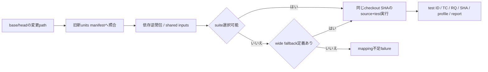

# 未設計レビュー / 実装unit台帳・test ID・CI・scenario

- 文書版: 0.2
- 状態: 全判断承認済み・正本適用済み（2026-10-17）
- 判断ID: REM-TEST-01～09
- 入口: [全件索引](index.md)
- 根拠RQ: [RQ-14-002](../../11_requirements/RQ-14_delivery-sequence.md#rq-14-002)、[RQ-14-005](../../11_requirements/RQ-14_delivery-sequence.md#rq-14-005)、[RQ-14-011](../../11_requirements/RQ-14_delivery-sequence.md#rq-14-011)、[RQ-13-001](../../11_requirements/RQ-13_nonfunctional-measurement.md#rq-13-001)、[RQ-13-011](../../11_requirements/RQ-13_nonfunctional-measurement.md#rq-13-011)、[RQ-16-003](../../11_requirements/RQ-16_document-governance.md#rq-16-003)
- 具体化するBD: [BD-16](../../12_design/BD-16_build-ci-target-matrix-upper-design.md)
- 適用対象DD/SD: [DD-01](../../13_detail_design/01-handle-registry.md)、[DD-03](../../13_detail_design/03-dispatcher.md)、[DD-08](../../13_detail_design/08-binding-graph.md)、[DD-22](../../13_detail_design/22-build-distribution.md)

本書は承認したレビュー記録である。推奨案と代替理由は提案時点の比較として保持する。現行の方式・正式判断IDは[UT-INVENTORY: 実装unit台帳・test ID・CI・scenario](../../32_unit_test/implementation-test-inventory.md)を正本とする。採用済みでも本文に将来候補と記した範囲は初期必須へ昇格しない。

## 判断案

| 判断ID | 推奨案・具体的な選択 | 代替と選択理由 | 承認区分 |
| --- | --- | --- | --- |
| REM-TEST-01 | 単位IDはUNIT-<domain>-NNN、実testはUT-/REQT-/ABI-/WRAP-/INT-/SYS-/PLAT-/PKG-/REL-/VER-を境界に合わせる。論理TCと別fieldにする。 | source file単位やTC prefixだけで実行境界を推定しない。 | test契約 |
| REM-TEST-02 | units.yamlにsource/config/generated inputs、depends_on、test command、RQ/DD/SD、logical casesを記録。未作成pathはplanned状態で実行対象と区別する。 | 存在しないtest commandを成功実行済みと扱わない。 | test/実装基盤 |
| REM-TEST-03 | source変更から依存逆閉包を選択。renameは旧新path、deletionは旧manifestのmapping、shared/config/header変更は該当全suite。 | 未知pathはwide fallback、fallbackも未定義ならfailure。 | CI設計 |
| REM-TEST-04 | pushとpull_requestのchecked-out SHAを同じsource/testへ使う。PR merge commitを試す場合はmerge SHAとhead/base SHAをすべて証跡に記す。 | headのテストをmerge resultへ偽って貼らない。 | CI設計 |
| REM-TEST-05 | Rust cargo test、C/C++ CTest、C# dotnet test、Python pytestを候補採用。fake host/clock/allocator/OS boundaryで異常注入する。 | 実装そのものをそのままassertするmirror testを増やさない。 | test設計 |
| REM-TEST-06 | laneはfast-unit、ABI/4wrapper、platform/package、board/releaseに分ける。required checkはselectionと対象fast/ABI結果、releaseは全必須profile。 | 実機jobを毎pushの短いunit jobと同一視しない。 | CI/運用 |
| REM-TEST-07 | changed mapping、unit/test inventory、実行reportを別schemaで保存。reportにSHA/profile/command/toolchain/artifact digestとassertion結果を持つ。 | 一つのstatus列でcase設計とpassを兼用しない。 | test契約 |
| REM-TEST-08 | 性能代表入力は計画文書にだけ置く。例として1k/10k items、128/129 delivery items、ASCII/日本語混在を用途付きで記録し、製品上限・合格閾値にしない。 | 要求から定まる値はRQの値を使用する。 | test計画 |
| REM-TEST-09 | CI actionsはfull commit SHA、pull_request_targetでuntrusted codeを実行しない。self-hosted boardは承認済みsourceのみ別queueで実行する。 | 未承認PRからrelease鍵/実機hostへ到達させない。 | SD/CI |

<a id="rem-test-01"></a>

<a id="rem-test-02"></a>

<a id="rem-test-03"></a>

<a id="rem-test-04"></a>

<a id="rem-test-05"></a>

<a id="rem-test-06"></a>

<a id="rem-test-07"></a>

<a id="rem-test-08"></a>

<a id="rem-test-09"></a>

## 実現設計案

### 台帳案

```yaml
schema: 1
units:
  - id: UNIT-CORE-001
    state: planned
    sources: ["crates/core-runtime/src/handle_registry/**"]
    config: ["Cargo.toml", "Cargo.lock"]
    depends_on: []
    design: ["DD-HND-01", "DD-HND-04"]
    requirements: ["RQ-04-018", "RQ-05-011"]
    cases: ["TC-CORE-OBJ-01", "TC-LIFE-01"]
    tests:
      - id: UT-CORE-HANDLE-001
        command: ["cargo", "test", "-p", "freemvvm-core", "handle_registry"]
```

上記path/crate/commandは提案構成で現repositoryに実装済みではない。state=plannedはCIのpass対象にならず、unit着手時に実在path/targetへ更新しreadyへ移す。readyに未存在path/commandがあればselection checkを失敗させる。

| unit候補 | 前提/操作 | 局所oracle | 上位logical case |
|---|---|---|---|
| Handle/owner | retain/release競合・発行不可注入 | 一参照一消費、他owner不変、failed release token保持 | TC-CORE-OBJ-01/TC-LIFE-01 |
| Dispatcher | enqueue/wake/stoppedをbarrierで競合 | lost wakeなし、callback後shutdown優先、未完了とClosed区別 | TC-THREAD-01 |
| Binding | hash衝突・256履歴・128/129 item | 意味snapshot未一致で停止しない、残件保持 | TC-BIND-01 |
| Collection | batch途中invalid/OOM・Selection同時更新 | revision/値/Selection/通知の全件commitか非変更 | TC-COL-01/TC-SEL-01 |
| TextBox | Commit copy failure・Reject・stale session | snapshot整合、候補回復可否、旧session不適用 | TC-IME-01 |
| wrappers | native call中close・handler交換・Drop/GC失敗 | lease保持、一回回収、元例外を保持 | TC-WRAP-* |
| SecurityVerifier | duplicate/unknown/expiry/鍵失効/cache差替え | invalidをVerifiedArtifact型へ昇格しない | TC-ARTIFACT-01 |



異常scenarioは、入力拒否後の独立更新保持、callback中shutdown、main例外終了、peer再所属失敗、Model batch拒否、artifact失効offlineを別々に組み立てる。test fixtureは共有しても各RQのassertionを省略しない。Release evidenceはCI reportをimmutable identityで参照し、Version testは変更RQと依存逆閉包の回帰を追加する。

運用根拠: [GitHub Actions secure use](https://docs.github.com/en/actions/reference/security/secure-use)。GitHub側の規則と本案のunit選択schemaを別に扱う。

## 適用結果

全判断を[UT-INVENTORY](../../32_unit_test/implementation-test-inventory.md)へ正式IDで適用した。関連要求の変更もRQ本文へ反映した。実装・試験実行は未完了。[全200件の適用表](../remaining-design-application-result.md)で旧新対応を確認できる。

## 承認履歴

| 日付 | 範囲 | 承認者 | 結果 |
| --- | --- | --- | --- |
| 2026-10-17 | 本書の案作成 | 利用者 | 一括生成指示。方式採用・正本適用は未承認 |

## 改訂履歴

| 版 | 日付 | 内容 | 作成者 |
| --- | --- | --- | --- |
| 0.1 | 2026-10-17 | 現行の未設計箇所を実現案・代替・interfaceへ具体化 | Codex |

## 承認履歴（具体化適用）

| 日付 | 対象版・範囲 | 承認者 | 結果・根拠 |
| --- | --- | --- | --- |
| 2026-10-17 | 0.2 / 本書の全推奨案と補足の採用・正本適用 | 利用者 | 全件反映を指示。設計採用・本文適用を承認。実装・公開・試験合格を意味しない |

## 改訂履歴（具体化適用）

| 版 | 日付 | 変更内容 | 作成者 |
| --- | --- | --- | --- |
| 0.2 | 2026-10-17 | 本書の全推奨案と補足の採用・正本適用を正本へ適用し、旧判断との対応を保持 | Codex |
