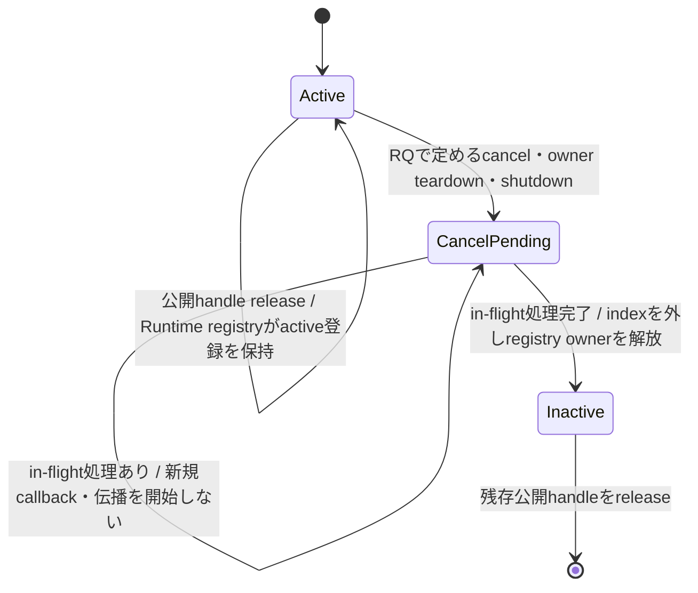
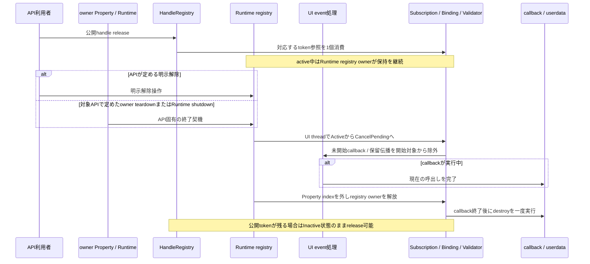

# 適用前記録 / 02-runtime-lifetime.md

- 記録日: 2026-10-17
- 区分: 2026-10-17改訂前の履歴。現行仕様として使用しない
- 元文書: [02-runtime-lifetime.md](../../13_detail_design/02-runtime-lifetime.md)

---

# DD-02 所有権と終了

- 文書版: 0.4
- 状態: DD-LIFE-01～08は承認済み（2026-09-29、DD-LIFE-03～05のX01改訂を2026-10-13承認）
- 作成日: 2026-09-29
- 対象: 公開参照・内部参照、Runtime anchor、Subscription / Bindingの寿命、shutdown、worker release後の破棄
- 上位出典: [Runtime契約](runtime-contract.md) R1～R4、[ABI仕様](abi-spec.md) A1～A32、[MVVM意味論](mvvm-semantics.md) P1～P4・B1～B4・D1～D4、[言語Binding](language-bindings.md) L1～L4、[BD-03](BD-03_runtime-notification-upper-design.md)、[BD-04](BD-04_ui-tree-lifetime-upper-design.md)、[BD-36](BD-36_runtime-shutdown-dispatch-upper-design.md)
- 先行詳細設計: [DD-01 Handle登録と検証](01-handle-registry.md) DD-HND-01～06承認済み

DD-LIFE-01～08は2026-09-29に承認された。X01でDD-LIFE-03～05を改訂し、公開tokenの破棄と登録解除を分ける内部所有関係・cleanup flowが2026-10-13に承認された。上位のshutdown dispatch境界はBD-36に従う。C宣言や擬似コードは配布用ヘッダ、実装済みAPIを意味しない。

## 1. 範囲と前提

R1は公開handleごとの強参照と内部所有参照を区別し、R2はRuntime/objectの生成をUI threadに限定、`retain` / `release`を任意threadに許可し、最後のUI状態破棄をUI threadへ集める。Runtimeの`shutdown`はUI threadで完了させ、停止後も残存handleのreleaseを許す。具体的な参照グラフ、購読・Bindingの所有方向、閉じたRuntime上の残存Core objectの扱いは本書の判断対象とする。

DD-01は、各tokenが独立した公開参照を表すこと、`retain` / `release`の線形化、登録表ロック内で破棄やcallbackを実行しないことを承認済みとした。本書はそのtoken規則を変えず、token参照とobject内部参照・Runtime寿命の関係を定める。

## 2. 判断案

| ID | 承認内容 | 根拠・境界 | 状態 |
|---|---|---|---|
| DD-LIFE-01 | 各有効handle tokenは対象objectの公開強参照を1個持つ。親子所属、Binding、SubscriptionなどCore内の所有関係は別の内部強参照として数える。ABI呼び出しはborrowed handleを検証するときに呼出し中の一時参照を確保し、同時releaseでobject本体が先に破棄されないようにする。 | [Runtime契約](runtime-contract.md) R1/R2、[DD-01](01-handle-registry.md) DD-HND-04/05の補完。handle table上の検証・pinningはDD-01、objectと内部参照の寿命は本書の対象。 | 承認済み（2026-09-29） |
| DD-LIFE-02 | Runtimeに属する各Core objectはRuntime stateへの内部anchorを持つ。Runtime stateは生存中objectの弱い登録だけを持ち、通常objectを強参照しない。これにより残存handleはshutdown後もRuntime stateを保持する一方、Runtimeとobjectの登録関係で循環を作らない。 | [Runtime契約](runtime-contract.md) R1/R2のRuntime所属・停止後releaseを満たし、shutdown時にlive objectを走査する。Runtime stateの最終解放時点は最後のanchor解放後。 | 承認済み（2026-09-29） |
| DD-LIFE-03 | tree親は子を内部強参照し、子の親所属は弱く保持する。Bindingはsource/target Propertyを強参照する。Property側のBinding indexはBindingへの弱参照とする。active Subscription/ValidatorはRuntimeの種別別registration registryから強参照し、Subscription/Validatorからowner Propertyへの参照およびProperty側indexは弱参照とする。Runtime registryは公開handle tokenとは別のCore内部所有者であり、object全体のweak live registryとは別管理にする。 | [BD-04](BD-04_ui-tree-lifetime-upper-design.md)、[MVVM意味論](mvvm-semantics.md) B1～B4/P1～P4、[RQ-05-002/006](../../11_requirements/RQ-05_ownership-callbacks.md)、[RQ-07-011](../../11_requirements/RQ-07_binding.md)。Property teardownがregistrationを失効させられる所有方向を具体化する。 | 承認済み（2026-10-13） |
| DD-LIFE-04 | Runtimeのactive Subscription registryはactive登録を強参照する。公開Subscription handleのreleaseは公開tokenだけを消費し、登録を解除しない。[RQ-05-006](../../11_requirements/RQ-05_ownership-callbacks.md)に定める明示cancel、owner Propertyのteardown、Runtime shutdownを受けると、UI thread上でActiveからCancelPendingへ遷移し、新規callback開始と未開始deliveryを止める。in-flight callbackの終了後に購読indexとRuntime registryから登録を外し、closureを一度だけdestroyする。公開handleが残る場合はInactive shellとしてreleaseできる。 | [RQ-05-002/006～008](../../11_requirements/RQ-05_ownership-callbacks.md)、[ABI仕様](abi-spec.md) A11/A12、[MVVM意味論](mvvm-semantics.md) P4、[言語Binding](language-bindings.md) L4、[Runtime契約](runtime-contract.md) R3。実際の解除契機・外部結果はRQを正本とし、本判断は所有・処理・cleanupの実現を定める。 | 承認済み（2026-10-13） |
| DD-LIFE-05 | Runtimeのactive Binding registryはactive接続を強参照し、Bindingは両端Propertyを強参照する。公開Binding handleのreleaseは公開tokenだけを消費し、接続を解除しない。[RQ-07-011](../../11_requirements/RQ-07_binding.md)に定める明示cancelまたはRuntime shutdownを受けると、Bindingをinactiveとしてから保留伝播を破棄し、Property側のweak index、Runtime registry、両端Propertyへの内部参照を解放する。公開handleが残る場合はInactive shellとしてreleaseできる。OneTimeは初期同期後にRuntime登録や端点参照を残さない。 | [RQ-05-002](../../11_requirements/RQ-05_ownership-callbacks.md)、[RQ-07-011](../../11_requirements/RQ-07_binding.md)、[ABI仕様](abi-spec.md) A13/A14、[MVVM意味論](mvvm-semantics.md) P4/B4。解除条件はRQを正本とし、本判断はowner registry・index・cleanup順を具体化する。 | 承認済み（2026-10-13） |
| DD-LIFE-06 | worker上のreleaseでUI-affineなobject stateの最後の参照がなくなる場合、release処理はfinalizer用内部参照を確保してからtokenを消費し、finalizerをRuntimeのUI-thread queueへ渡す。Running中だけでなくClosing中のreleaseもUI threadへ渡し、enqueueに失敗した場合はtokenを消費せず失敗を返す。UI thread上でfinalizerがUI stateを破棄してから内部参照を解放する。 | [Runtime契約](runtime-contract.md) R2のworker release後の遅延破棄を具体化する。queueはRuntimeのUI-thread dispatch経路を使う。失敗時の利用者可視結果は[RQ-06-002](../../11_requirements/RQ-06_threading-dispatch.md)との適合を確認する候補として記録し、statusは[ABI仕様](abi-spec.md) A2と[BD-27](BD-27_error-object-upper-design.md)のerror catalogに整合させる。 | 承認済み（2026-09-29） |
| DD-LIFE-07 | shutdownは`Running → Closing → Closed`の一方向遷移とし、UI threadで実行する。Closing開始後の新しいUI操作・投稿を受け付けない。保留postをcancelし、通知・Binding・Subscriptionを非活性化し、tree/PlatformのUI-affine stateとcallback closureをUI thread上で片付けた後にClosedとする。残存handleは有効なtokenとしてreleaseできるが、Error参照操作を除くRuntime UI操作は`UI_CLOSED`とする。 | [Runtime契約](runtime-contract.md) R2～R4、[MVVM意味論](mvvm-semantics.md) P4、[BD-03](BD-03_runtime-notification-upper-design.md)、[BD-04](BD-04_ui-tree-lifetime-upper-design.md)を尊重する。callback/event中shutdownのdispatch境界は[BD-36](BD-36_runtime-shutdown-dispatch-upper-design.md)に従う。 | 承認済み（2026-09-29） |
| DD-LIFE-08 | shutdown後は全Runtime objectからthread-affineなUI state、Platform peer、callbackとSubscription/Bindingの所有関係をUI thread上で取り除き、残存handleはrelease専用の閉じたCore shellを指す。Runtime state自体もUI-thread-affine資源を持たない状態にする。ClosingからClosedへの遷移はfinalizer登録と同期し、必要なUI-thread cleanupをすべて処理してから確定する。最後のshell/Runtime anchor解放は任意threadから安全に行える。`shutdown`の再呼出しは成功として扱い、追加副作用を起こさない案とする。 | [Runtime契約](runtime-contract.md) R2のUI state最終破棄と停止後releaseを両立する。Detached objectの通常時の状態は[BD-04](BD-04_ui-tree-lifetime-upper-design.md)に従う。 | 承認済み（2026-09-29） |

## 3. 参照グラフ案

| 所有者 | 強く保持する対象 | 弱く保持する対象・解除条件 |
|---|---|---|
| handle token | 対象Core objectへの公開参照1個 | `handle_release`でtoken参照を消費（DD-01） |
| Runtime-bound Core object | Runtime state anchor | Runtimeのlive-object registryはweak。shutdown時に各objectのUI stateを閉じる |
| Runtime active registration registry | 有効なSubscription / Binding / Validator登録 | handle tokenおよび各owner Property indexとは別の強所有。cancel、owner teardown、shutdown時に解除する |
| UI tree parent | 所属するchild object | childのparent所属情報はweak。detach時に親が保持するchildへの強参照を解放する（BD-04） |
| 活性Binding | Runtime registration registryとsource/target Property | PropertyのBinding indexはweak。明示cancelまたはshutdown時にindex・registryから除く。handle release単独では除かない（RQ-07-011） |
| 活性Subscription / Validator | Runtime registration registryとcallback closure。Subscription / Validatorはowner Propertyをweak参照 | Property indexはweak。明示解除、owner teardown、shutdown時にin-flight処理をdrainしregistryから除く。handle release単独では解除しない（RQ-05-002/006） |
| Runtimeの投稿/finalizer queue | 未実行workまたはUI-thread finalizer | work実行、cancel、shutdown cleanup後にqueueから外す。実行threadとshutdown境界はRuntime契約とBD-36に従う |

Core内の強参照は上表の所有関係だけを基本とし、object間の強参照循環を作らない。language wrapperのcallback userdataがアプリobjectを保持することによる言語側循環はCoreから解析できないため、wrapperがSubscription解除またはRuntime shutdown時に解放する（[言語Binding L4](language-bindings.md)）。

## 4. 状態遷移とregistration cleanup

### 4.1 Shutdown時の状態遷移案

| 状態 | 許される操作 | 遷移 |
|---|---|---|
| Running | UI操作、投稿、retain/release | UI threadからshutdownを開始してClosingへ |
| Closing | release、shutdown cleanupのみ。新規UI仕事は受け付けない | post cancel、Subscription/Binding無効化、通知破棄、worker release由来finalizerとUI state cleanupの完了後にClosed |
| Closed | handle release、immutable Errorの参照操作 | Runtime UI APIは`UI_CLOSED`。再openなし |

最終公開Runtime handleをreleaseする前にshutdownを完了させるのは[Runtime契約 R2](runtime-contract.md)の前提である。[DD-01](01-handle-registry.md)の汎用`handle_release`は有効tokenを消費する規則なので、本書では暗黙shutdownやRuntime種類専用のrelease例外を追加しない。前提違反時に診断・拒否を追加する必要がある場合は別判断にする。

### 4.2 Registration lifecycle flow

Subscriptionのclosureは`CancelPending → Inactive`処理のUI-thread safe pointで一度だけdestroyする。Bindingの同遷移では保留伝播を破棄し、Property値を変更しない。Subscription / Validatorのowner Property参照はweak、active registrationの保持はRuntime registryが担当する。外部トリガーと保証は対応するRQを正本とする。

### 4.3 公開handle releaseとregistration解除の内部flow

[RQ-05-002/006～008](../../11_requirements/RQ-05_ownership-callbacks.md)と[RQ-07-011](../../11_requirements/RQ-07_binding.md)が定める外部条件を入力として、内部参照は次の順で扱う。公開handle tokenとRuntime registry ownerは別の強参照であり、handle tokenの個数が0になってもactive registrationはRuntime registry ownerにより存続する。登録解除の条件が成立した場合だけ、UI thread上でregistration状態をInactiveへ進める。

owner teardownの条件はAPIごとに異なり、Bindingは[RQ-07-011](../../11_requirements/RQ-07_binding.md)に従って明示解除またはRuntime shutdownを契機とする。Subscription / Validatorは各APIの承認済み要求・ABI契約に定めるowner teardown条件を使う。

解除要求がcallback自身から発生した場合も、現在のcallback frameからそのframeのuserdataを破棄しない。解除処理はCancelPendingを記録し、callbackが戻った後のUI-thread cleanupでindex・Runtime owner・closureを順に解放する。自己解除時のAPI戻り時点と完了通知の外部契約は対応する要求に従い、本書は内部の遅延cleanupだけを定める。

| 処理段階 | 所有・参照の更新 | 対象 |
|---|---|---|
| 公開release | HandleRegistryが指定tokenの公開参照を一つ消費する。registration状態は変えない | Subscription / Binding / Validator |
| 解除開始 | UI threadでActiveをCancelPendingへ変更し、新規callback開始と未開始workの実行対象化を止める | Subscription / Validatorはcallback、Bindingは伝播 |
| in-flight完了 | 実行中callbackは保持中userdataを使って終了する。Binding処理は現在のUI event内で整合した境界まで進む | 該当する処理のみ |
| 内部owner解放 | Property側weak indexを除去し、Runtime registryの強参照を解放する | Subscription / Binding / Validator |
| cleanup | closure/userdataを最大一回destroyする。Bindingは両端Property参照と保留伝播を解放する | Subscription / Validator / Binding |
| shell解放 | 公開tokenが残る場合はInactive shellを保持し、最後のtoken解放後にobjectを破棄する | 各registration handle |

## 5. BD-36に基づくshutdown境界

[BD-36-01/02/04](BD-36_runtime-shutdown-dispatch-upper-design.md)により、callback/event中のshutdown要求は現在の処理完了後に通常workより優先してdispatchされ、cleanup本体はUI thread上で実行される。非同期呼出しは完了を待たず、workerからの同期呼出しは通常contextでcleanup完了を待つ。callback/event実行中は同期指定でも要求受付後に戻る。本書ではこの方針を前提とし、Runtime objectとUI stateのcleanup順を定める。

受付済みと完了済みを表すAPI上のstatus・完了観測、およびUI loop停止時の同期worker動作はBD-36の未決範囲であり、本書では決めない。DD-LIFE-07/08の承認済みshutdown状態遷移とcleanup内容は変更しない。

## 6. 承認記録

利用者は2026-09-29にDD-LIFE-01～08を承認した。2026-10-13にはDD-LIFE-03～05のv0.3改訂を承認した。2026-10-16のD02境界整理では承認済みの設計意味を変更せず、状態表記と文書ロールを整えた。

## X01改訂の承認履歴

| 日付 | 対象 | 承認者 | 結果・根拠 |
|---|---|---|---|
| 2026-09-29 | DD-LIFE-01～08 | 利用者 | 旧版内容を承認 |
| 2026-10-12 | DD-LIFE-03～05のX01改訂方針 | 利用者 | X01レビュー案を承認。改訂本文は2026-10-13に別途承認 |
| 2026-10-13 | DD-LIFE-03～05 / 文書版0.3 | 利用者 | 公開token releaseとregistration解除の分離、owner参照・state/cleanup flowを承認 |

## 改訂履歴

| 版 | 日付 | 変更内容・理由 | 作成者 | 承認履歴への対応 |
|---|---|---|---|---|
| 0.1 | 2026-09-29 | DD-LIFE-01～08を作成し利用者承認 | Codex | 2026-09-29承認記録 |
| 0.2 | 2026-10-12 | X01に基づき公開handle releaseとregistration lifetimeを分離し、Runtime owner・state/cleanup flowを追加 | Codex | 改訂案。利用者レビュー待ち |
| 0.3 | 2026-10-13 | RQ-05 v0.8/RQ-07 v0.5承認を反映し、公開token releaseとregistration解除の内部sequence・参照更新を明示 | Codex | 利用者承認済み（2026-10-13） |
| 0.4 | 2026-10-16 | 承認状態を履歴と整合。要求・上位設計への直接リンクを追加し、確認caseと下流DD参照を除去。BD-36の確定方針をshutdown前提として記載 | Codex | D02境界整理案を利用者承認 |
