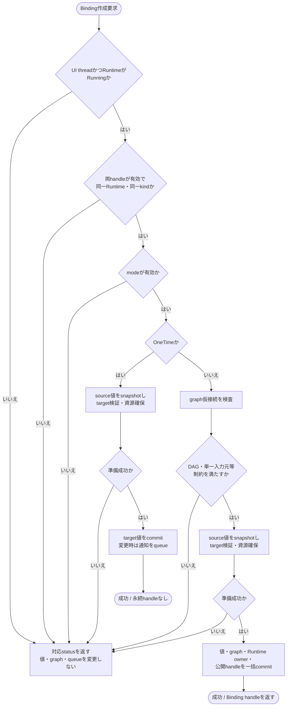
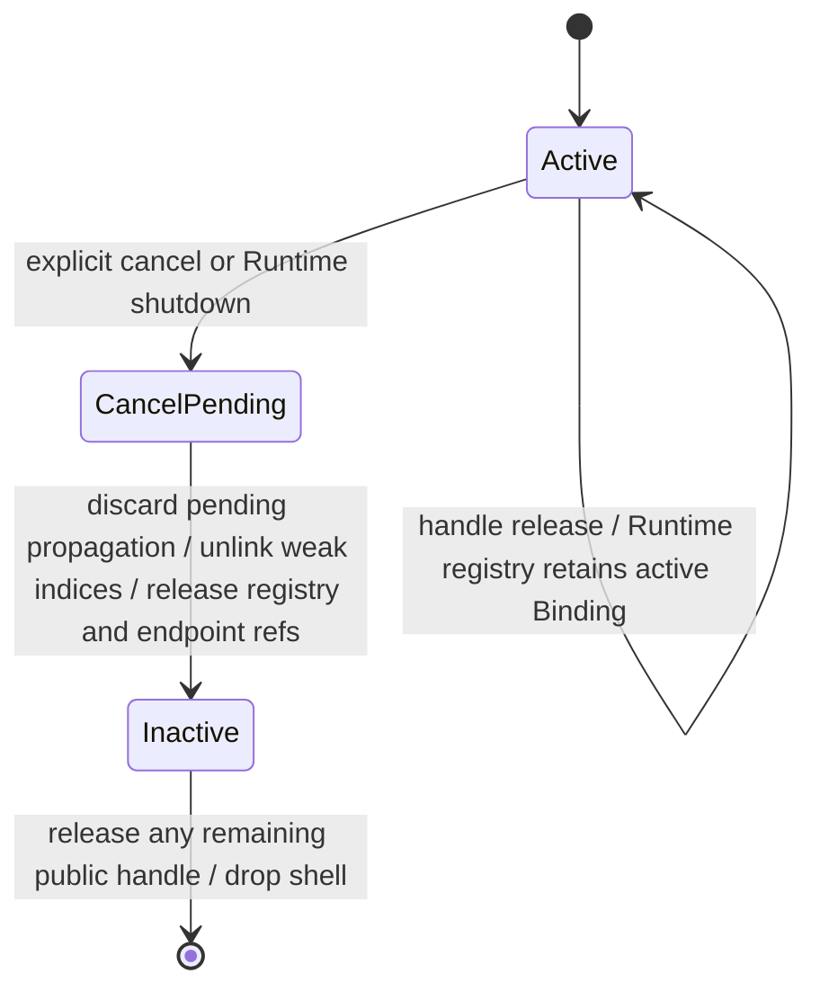

# 適用前記録 / 08-binding-graph.md

- 記録日: 2026-10-17
- 区分: 2026-10-17改訂前の履歴。現行仕様として使用しない
- 元文書: [08-binding-graph.md](../../13_detail_design/08-binding-graph.md)

---

# DD-08 Bindingの伝播とグラフ

- 文書版: 0.6
- 状態: DD-BIND-01～15は意味・動作の判断を承認済み（2026-10-14まで）。DD-BIND-04のX01 owner/lifecycle本文改訂とWatchDog公開設定のAPI形は別途具体化待ち
- 作成日: 2026-10-08
- 対象: Binding作成・初期同期、OneTime / OneWay / TwoWayの伝播、グラフ制約、解除、Bindingエラー、通知連鎖の診断境界
- 上位出典: `.docs/11_requirements/RQ-05_ownership-callbacks.md` RQ-05-002、`.docs/11_requirements/RQ-07_binding.md` RQ-07-011、`.docs/12_design/mvvm-semantics.md` B1～B4・D1～D4・P1～P4・BD-03、`.docs/12_design/abi-spec.md` A13～A16・第11節、`.docs/12_design/BD-03_runtime-notification-upper-design.md`
- 先行詳細設計: DD-01～07承認済み。特にDD-LIFE-03/05、DD-DSP-03/04/08、DD-CB-04、DD-PROP-05/07/09/10
- 関連作業計画: `.docs/20_todo/dd08-binding-graph.md`

DD-BIND-01～09の基礎判断は2026-10-09に利用者承認済みである。DD-BIND-10～15の意味・動作に関する判断は2026-10-14までに承認された。DD-BIND-11のWatchDog初期値は5秒。WatchDog設定APIの具体的な表現・適用時点は公開API具体化時に定める。DD-BIND-04のX01本文改訂はレビュー待ちである。BD-03等の承認済み上位意味論の範囲内で具体化し、製品保証の追加・変更が必要ならRQへ戻す。C宣言や擬似コードは配布用ヘッダ・実装済みAPIを意味しない。X01改訂方針は2026-10-12に承認されたが、この文書のDD-BIND-04本文改訂はレビュー待ちである。改訂案はDD-LIFE-05と同じactive Binding owner・handle release・cleanup順に整合させる。

## 1. 範囲と承認済み前提

- Bindingは同一Runtime内の同型Propertyを接続する。初期公開kindはBOOL / I64 / UTF8 / F64 / DECIMAL。変換、異種型、異なるRuntime、OBJECT、言語側ViewModelの直接接続は対象外。
- OneTimeは初期コピー後にBinding object・handle・接続を残さない。OneWay / TwoWayのrelease・cancel結果は[RQ-05-002](../../11_requirements/RQ-05_ownership-callbacks.md#rq-05-002)と[RQ-07-011](../../11_requirements/RQ-07_binding.md#rq-07-011)を正本とする。CoreのRuntime active Binding registryがactive接続を強参照し、公開handle tokenとは別に保持する。
- TwoWayで連結されたPropertyは同期グループとなり、グループ内の最後に成功した直接設定を優先する。OneWayの接続先グループは入力元を一つだけ持てる。OneWayグラフの循環は禁止（D1/D2）。
- Binding伝播は最外側UI処理後、外部Property通知より先に行う。Property通知はDD-PROP-09の上限で完了item単位にyieldし、単なる上限到達では停止扱いにしない。
- Binding作成時はグラフ・値・通知を原子的に扱う。遅延伝播の失敗は先行setterを遡及失敗させず、Bindingエラーとして記録する（A16）。

## 2. 承認された判断

| ID | 判断 | 根拠・境界 | 状態 |
|---|---|---|---|
| DD-BIND-01 | Binding作成はUI threadで、Runtime・kind・mode・グラフ制約を検査した後、初期同期先の値検証と必要資源確保を先に完了する。全て成功した時点で初期値と接続を一括commitし、Property変更通知はDD-PROP-07に従って一件だけqueueする。同値の初期同期は値も通知も変えない。OneTimeでは値commit後に永続接続を作らない。 | B1、D4、A13/A16、DD-PROP-04/05/07。検証・確保・初期setterのどれかが失敗した場合、値、グラフ、通知queueを変更せず、Binding handleを0にする。 | 承認済み（2026-10-09） |
| DD-BIND-02 | グラフはTwoWay同期グループを頂点、OneWay接続を有向辺とする。新規OneWayは自己辺・既存経路を戻る辺・入力元が既にある行先を拒否する。TwoWayによるグループ結合は、結合後に自己辺、DAG循環、行先の複数入力元が生じない場合だけcommitする。同じsourceから同じtargetへの重複接続は拒否する。 | D1/D2、A16。OneTimeはグラフに含めない。拒否statusの大分類はA2/A3、Binding domainの具体codeは共通error catalogの後続判断と整合させる。 | 承認済み（2026-10-09） |
| DD-BIND-03 | 各外側UI処理区間で、直接setterが成功したPropertyと順序を記録する。TwoWayグループは最後の成功した直接setterの値をグループ内へ伝播する。OneWayはDAGの上流から下流の順に評価し、同一区間で入力元・入力先の両方に直接変更があれば入力元の値を使う。伝播setterが作る変更は同じBindingを反射しないよう伝播元を識別し、同一配信中に無限往復させない。 | B2/B3、D1/D3、DD-PROP-07、DD-CB-04。直接setterで失敗した試行は勝者選択へ加えない。 | 承認済み（2026-10-09） |
| DD-BIND-04 | Binding propagation itemは開始時にBindingの活性状態、グラフ世代、入力Propertyの最新確定値を確認してから実行する。解除またはshutdown済みなら何も伝播しない。Binding作成後の保留変更は、作成時にsourceの最新値を使った初期同期で吸収し、同じ値の重複通知を作らない。解除後は保留itemを破棄し、両端の確定値を保つ。 | B1/B4、D4、A13/A14、RQ-05-002、RQ-07-011、承認済みDD-LIFE-05、DD-PROP-08。古い接続世代に属するqueue itemが新しい接続へ誤適用されないよう、内部世代を照合する。 | 基礎判断承認済み（2026-10-09）。X01 owner/lifecycle整合 v0.3はレビュー待ち |
| DD-BIND-05 | 初期同期時のValidation拒否はBinding作成失敗とし、返却できるエラー詳細をA15/A16に従って返す。作成後の伝播拒否・異常では入力元を保持し、拒否されたProperty・方向・不変error snapshotをBindingの現在エラーとして記録する。Binding error notificationはProperty notificationと同じ配信段階でBinding伝播の後に行い、同一配信区間の状態更新を一件にまとめる。新しい成功伝播で現在エラーをクリアし、取得済みsnapshotは不変のままとする。 | A15/A16、ABI §11.2～11.3、DD-06、DD-PROP-07。setterの成功を遡及変更せず、Property値も巻き戻さない。 | 承認済み（2026-10-09） |
| DD-BIND-06 | Binding起点のProperty変更から外部callbackが起こした変更まで、同一の因果連鎖IDを引き継ぐ。PropertyはDD-PROP-10の境界で連鎖IDを保持する。識別可能な同一因果連鎖内で、同一グラフ世代のPropertyが意味的に異なる値を経て同じ値へ再到達し、先行状態が再現した場合は循環の証拠として当該連鎖だけを停止する。 | BD-03、DD-PROP-10。値比較はDD-PROP-04のkind別等価規則を用いる。配信sliceの上限到達だけでは停止しない。他の連鎖・確定済み値へ影響させない。 | 承認済み（2026-10-09） |
| DD-BIND-07 | 循環の証拠が成立した連鎖の未実行Binding伝播と、その連鎖から発生した未実行Property通知だけを停止対象とし、すでに完了したProperty値・callbackを取り消さない。長時間保留だけで循環を立証できない連鎖は停止せず、UI loopへ譲る。Binding循環診断はProperty validation errorと分離したRuntime診断として扱い、診断記録に因果連鎖ID、観測したProperty/Binding識別子、停止理由を含める。 | BD-03、DD-DSP-04、DD-PROP-09/10。公開診断API、詳細payload、解除後の診断消去・再開操作はRuntime診断詳細の後続判断へ送る。 | 承認済み（2026-10-09） |
| DD-BIND-08 | DD-PROP-09のslice上限128はBinding伝播とProperty delivery itemを合わせた完了通知作業単位の上限に適用する。同期グループ伝播と一つのProperty delivery itemのsubscriber snapshotは途中でyieldせず完了し、上限到達後は未処理作業と順序を保ってRuntime通知queueへ残す。shutdown control taskは残件より優先する。 | BD-03、DD-DSP-03/04/08、DD-PROP-09。個々の内部処理が何単位を消費するかの実装粒度は通知queue設計に従う。 | 承認済み（2026-10-09） |
| DD-BIND-09 | Binding作成失敗理由は既存status（wrong runtime / wrong type / invalid argument / validation failure / closed runtime / internal failure）で分類し、循環・入力元重複の差はBinding error domain/codeで識別する。後続伝播失敗はBinding error snapshotのみで報告し、元setter statusを書き換えない。 | A2/A3/A15/A16、DD-ABI-05/06、DD-VAL-05。具体的な数値code割当はDD-06の共通ABI status/error catalogとの重複を避けるため、本判断では意味分類に限定する。 | 承認済み（2026-10-09） |

## 2.1 追加具体化判断

DD-BIND-10～15は保留理由を解消するための詳細設計判断であり、各行の状態欄に承認日を記録する。上位設計が定める「循環の因果連鎖だけを停止する」「作業枠の上限到達だけでは停止しない」「診断をUI threadから観測できる」「回復は明示操作とする」を実装可能な境界へ具体化する。

| ID | 詳細設計候補 | 候補と推奨案 | 状態 |
|---|---|---|---|
| DD-BIND-10 | 循環証拠の状態記録 | hashを索引に使い、候補一致時にProperty状態snapshotの意味的同値を確認する。比較キーは因果連鎖ID・graph generation・完了済みdelivery境界・対象Propertyのkind別値snapshot。履歴上限超過は「判定不能」として記録し、循環停止の根拠にしない。 | 承認済み（2026-10-14、候補(b)） |
| DD-BIND-11 | 長期保留のWatchDog | Runtime利用者が閾値を設定でき、初期値と無効化を選べるようにする。WatchDogは長期保留を診断するだけでchainを停止・破棄しない。初期値は経過時間5秒、無効化はwrapperで`None`相当とする。時間は単調時計で測り、最古の保留itemがqueueに入った時点から、対象chainが完了または明示破棄されるまでを計る。同一chainにつき一度だけ診断する。slice数はcallback数ではなく通知作業枠の反復数であり、診断閾値には加えない。WatchDogは同期callback実行中のhangをpreemptしない。公開設定表現と適用時点はAPI具体化で定める。 | 承認済み（2026-10-14） |
| DD-BIND-12 | 診断観測と明示回復 | UI thread上で取得できる不変diagnostic snapshotを基本とする。snapshotにはchain ID、診断種別（循環証拠成立／長期保留／履歴上限による判定不能）、観測時刻、関連Property/Binding識別子、停止または継続状態を含める。回復は「保留更新の破棄」と「停止chainの再開」を別の明示操作とする。再開は最新確定値から新しいchainとして再評価する。既存のRuntime診断通知機構がある場合はイベント通知もそこへ載せる。 | 承認済み（2026-10-14、推奨案） |
| DD-BIND-13 | sliceと128件計数単位 | sliceはRuntimeが通知作業を連続処理する一回のbounded passを指す。各passはBinding伝播itemとProperty delivery itemを完了境界まで処理し、累計128 itemでUI loopへyieldする。Property delivery itemは一Propertyのsubscriber snapshot内のcallback全員を完了する単位で、callbackごとに別itemとして数えない。OneWay edge伝播とTwoWay group全体の伝播も各1 itemとする。slice回数は購読callback数ではなく、chainが何回bounded passをまたいだかを数える。 | 承認済み（2026-10-14） |
| DD-BIND-14 | 配信中のgraph変更可視性 | chain開始時のgraph generationに対応する不変topology snapshotを使う。追加Bindingは初期同期commit後の次chainから対象とする。cancelはUI thread上で当該Bindingのactive generation/tokenを無効化し、そのBindingに属する既存queue itemだけを実行時照合で無効化する。現在chainの他のedgeやProperty deliveryは維持する。 | 承認済み（2026-10-14、推奨案） |
| DD-BIND-15 | Binding domainのcode割当 | DD-06のBinding domain（3）へ `GRAPH_CYCLE=1`、`TARGET_ALREADY_HAS_INPUT=2`、`DUPLICATE_EDGE=3` を割当てる。同じsource/target edgeの再登録は複数入力元の検査より先に重複と判定し、code 3を返す。wrong runtime/type/argument、closed runtime、validation failureは既存common statusを使い、遅延失敗の詳細はBinding error snapshotへ置く。数値は公開後に再利用・変更しない。 | 承認済み（2026-10-14、推奨案） |

WatchDog無効化は長期保留診断だけを抑止し、有限作業枠のyieldと証拠に基づく循環診断は無効にしない。WatchDogは同期callback実行中のhangをpreemptしない。

## 3. 責務と処理の概略

### 3.1 Binding作成

1. handleを検証し、両Propertyが有効・同一Runtime・同kindであること、RuntimeがRunning、呼出しがUI threadであることを確認する。
2. modeを検証する。OneTimeは初期値の準備とsetter検証までを行い、永続グラフへ登録しない。
3. OneWay / TwoWayでは、現在グラフに仮接続を加えた結果がDAG・単一入力元の条件を満たすか検査する。
4. sourceの現在値を安定して読み、targetへのsetter検証・必要な領域確保を行う。Validation拒否なら値もグラフも変更しない。
5. 値変更・接続登録・Binding handle公開を一つのcommit境界で実行する。変更があったときだけ通常のProperty通知を作る。

### 3.2 通知slice内の伝播

- 通知queueはDD-PROP-07の順序を保持する。各配信回では入力値のcoalescing後、Bindingによる更新を外部Property subscriber callbackより先に完了する。
- TwoWay同期グループでは直接設定の優先順を使い、同一グループ内の伝播書き込みを新しい直接変更として再解釈しない。
- OneWay edgeはDAG順に評価する。あるedgeの伝播でtarget groupが変われば、その値をさらに下流へ伝える。外部subscriberへのProperty notificationは該当するBinding伝播段階を終えてから実行する。
- Binding propagationが変えたtarget Propertyのnotificationは次の配信回へ進む。callbackがその配信回で作る直接setterも次回の入力となる（B2）。
- 伝播先のsetterが失敗した場合、グラフ接続と入力元値は維持し、Binding error状態を更新する。後続に別の独立edge/連鎖があればBD-03の隔離規則に沿って処理する。

### 3.3 Binding registration lifecycle

active中はRuntime registryがBindingをstrong ownerとして保持し、Bindingは両端Propertyをstrong参照する。公開handle releaseは対応するtoken参照だけを消費し、Bindingの状態を変えない。RQ-07-011で定める明示cancelまたはRuntime shutdownをUI thread上で受けると、BindingをCancelPendingとして保留propagation itemを無効化する。UI thread上の処理順序により進行中propagation境界を完了した後、Propertyのweak index、Runtime registry owner、両端Property参照の順に解放してInactiveにする。公開handleが残っていればInactive shellとしてreleaseできる。外部結果はRQ-07-011、内部所有関係は承認済みDD-LIFE-03/05、本処理順は本案に従う。

## 4. 保留理由と残る決定候補

第2.1節の各項目を初版で保留したのは、上位設計だけではアルゴリズム・データ構造・公開境界が決まらなかったためである。2026-10-14の判断を反映し、承認済み候補は決定結果として扱い、残る値・境界だけをレビュー対象にする。

| 対象 | 保留した理由 | 決定候補 |
|---|---|---|
| 循環証拠の状態記録 | BD-03は証拠のある因果連鎖だけを停止するが、任意callbackの状態履歴には有限上限が必要で、fingerprint衝突による誤停止も避ける必要があった。 | DD-BIND-10はhash索引 + 意味的snapshot照合、上限超過は判定不能とする案を承認済み。具体的な履歴上限値は未決。 |
| 長期保留のWatchDog | 「長い」の定量値が上位設計にない。作業枠到達を非収束と誤認すると正当な遅延処理を停止してしまう。 | DD-BIND-11のユーザー設定・無効化方針は承認済み。初期値5秒は承認済み。設定APIの表現・適用時点は後続のAPI具体化で決める。 |
| 診断APIと回復操作 | 上位設計は診断の観測可能性と明示回復を要求するが、snapshot項目・取得方法・再開と破棄の意味が定まっていなかった。 | DD-BIND-12の不変snapshot、明示破棄/再開、最新確定値から新chainを始める案は承認済み。公開名/signatureと診断保持期間はAPI設計との整合待ち。 |
| slice計数単位 | DD-BIND-08は合計128件とだけ規定し、edge/group/deliveryの不可分境界を定義していなかった。 | DD-BIND-13として、OneWay edge、TwoWay group全体、Property subscriber snapshot全体を各1 itemと数える決定を承認済み。subscriber callback数とは別に数える。 |
| 配信中のgraph変更 | Binding作成/cancelはUI callbackから起き得るため、処理途中でgraphを参照し直すと一つのchain内で評価対象が不安定になる。 | DD-BIND-14のchain開始時generation固定、追加は次chain、cancel時の即時無効化を承認済み。 |
| error code数値 | 共通statusとの使い分け、およびdomain固有codeの一意性・将来互換性を確認する必要があった。 | DD-BIND-15のBinding domain code 1～3を承認済み。DD-06 catalogへ追記済み。 |

### 今回の詳細設計の対象外

型変換は未決の実装方式ではなく、承認済みBinding意味論が同kind接続に限定しているため、このDDの対象外である。将来parse/formatや異種kind変換を提供する場合は、先に要求・BDの変更を行い、その承認後に詳細設計へ追加する。

## 5. 検証ケース案

1. OneTimeは初期source値を一度だけ反映し、handle・接続を残さない。OneWay / TwoWayは初期source値を同期してhandleを返す。
2. 初期同期時のkind違い、別Runtime、循環、入力元重複、validation拒否、資源確保失敗は値・グラフ・notification queueを変えない。
3. TwoWayグループの複数直接設定は最後に成功した直接setterが勝ち、失敗setterは勝者にならない。伝播更新は反射しない。
4. OneWay分岐は許可し、複数入力元・自己循環・間接循環およびTwoWay結合後に発生する循環を拒否する。
5. OneWay接続先の直接変更はsourceへ戻らず、次のsource変更で上書きされる。同一区間で両端を直接変更した場合はsource側が勝つ。
6. Binding伝播は外部Property callbackより先に終わる。callbackのProperty変更は次回配信へ進み、途中値を配信しない。
7. 明示解除・shutdown後の保留伝播は行わず、既存Property値を保持する。公開Binding handle releaseだけでは接続を解除しない。
8. 遅延validation拒否は入力元値を保ち、方向・拒否Property・immutable error snapshotを返す。後の成功伝播でBindingの現在エラーをクリアし、過去snapshotは変化しない。
9. 128件の作業枠に達した場合は完了境界でyieldして保留分を保持し、連鎖を停止しない。shutdown controlは残件より先に実行する。
10. 証拠条件を満たす循環では原因連鎖の未実行分だけを止め、独立連鎖・確定値を保つ。検出不能な長期反復を必ず停止すると扱わない。
11. WatchDog閾値を指定すると長期保留診断を一度記録し、無効化時はその診断だけを抑止する。WatchDog設定は作業枠のyieldや証拠に基づく循環停止を変更しない。
12. Binding error snapshotは循環・入力元重複・重複edgeをdomain 3の安定code 1～3で区別する。

## 6. 上位文書への差し戻し候補

DD-BIND-01～09はB/D/A意味論とBD-03の境界内で承認された。第2.1節の候補がBD-03またはDD-PROP-09の意図を変える必要を生じた場合は、該当上位文書へ差し戻す。X01改訂方針は2026-10-12に承認され、DD-BIND-04本文の整合改訂はレビュー待ちである。

## X01改訂の承認履歴

| 日付 | 対象 | 承認者 | 結果・根拠 |
|---|---|---|---|
| 2026-10-12 | DD-BIND-04 / DD-LIFE-05との所有・flow整合 | 利用者 | X01改訂方針を承認。具体的なDD改訂本文はレビュー待ち |

## DD-BIND-10～15の承認記録

| 日付 | 対象 | 承認者 | 結果 |
|---|---|---|---|
| 2026-10-14 | DD-BIND-10 | 利用者 | 候補(b)のhash索引 + snapshot意味的同値確認を承認 |
| 2026-10-14 | DD-BIND-11 | 利用者 | WatchDogのユーザー設定・無効化方針と初期値5秒を承認 |
| 2026-10-14 | DD-BIND-12 | 利用者 | 推奨案を承認 |
| 2026-10-14 | DD-BIND-13 | 利用者 | 完了item計数とslice境界を承認 |
| 2026-10-14 | DD-BIND-14 | 利用者 | 推奨案を承認 |
| 2026-10-14 | DD-BIND-15 | 利用者 | 推奨案を承認。code 1～3をDD-06へ反映 |

## 改訂履歴

| 版 | 日付 | 変更内容・理由 | 作成者 | 承認履歴への対応 |
|---|---|---|---|---|
| 0.1 | 2026-10-09 | DD-BIND-01～09を作成・承認 | Codex | 2026-10-09承認記録 |
| 0.2 | 2026-10-12 | Runtime active registryの所有とhandle release後のBinding処理flowを補足 | Codex | X01改訂案。利用者レビュー待ち |
| 0.3 | 2026-10-13 | 承認済みDD-LIFE-03/05に合わせ、cancel pending・queue無効化・owner参照解放のflowを明示 | Codex | DD-BIND-04 X01改訂案。利用者レビュー待ち |
| 0.4 | 2026-10-13 | §3の連番を修正し、Binding作成flowchartを追加。保留理由を説明し、DD-BIND-10～15の決定候補と推奨案を提示。DD-09と誤記していたerror catalog参照をDD-06へ修正 | Codex | DD-BIND-10～15はレビュー待ち |
| 0.5 | 2026-10-14 | DD-BIND-10/12/14/15の承認結果とDD-BIND-11のWatchDog設定方針を反映。sliceをcallback数と区別して定義 | Codex | DD-BIND-10/12/14/15承認済み |
| 0.6 | 2026-10-14 | WatchDog初期値5秒とDD-BIND-13の計数単位に対する利用者承認を反映。公開設定APIの表現・適用時点は後続具体化へ整理 | Codex | DD-BIND-11/13承認済み |
