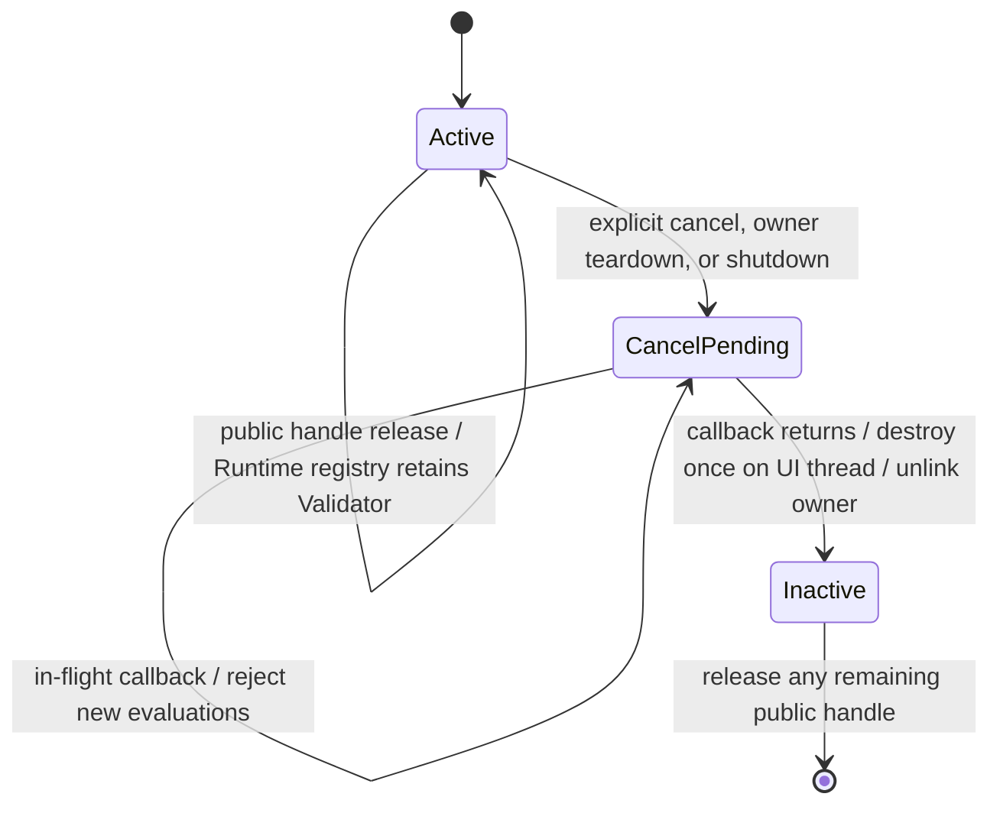

# 適用前記録 / 09-validation-input.md

- 記録日: 2026-10-17
- 区分: 2026-10-17改訂前の履歴。現行仕様として使用しない
- 元文書: [09-validation-input.md](../../13_detail_design/09-validation-input.md)

---

# DD-09 ValidationとView入力

- 状態: DD-VALID-01～10の基礎判断は承認済み（2026-10-11）。DD-VALID-06のX01 Runtime owner・cleanup改訂 v0.3はレビュー待ち（2026-10-13、DD-LIFE-03/04承認後の整合案）
- 作成日: 2026-10-09
- 対象: Property Validator、TextBoxユーザー入力Validator、確定値/編集値、入力状態と理由、Binding検証失敗との接続
- 上位出典: `.docs/11_requirements/RQ-05_ownership-callbacks.md` RQ-05-002/006、`.docs/12_design/mvvm-semantics.md` V1～V8、`.docs/12_design/abi-spec.md` A17/A18・A25～A28・A30～A32・第13/17/20節、BD-01/02/03
- 先行詳細設計: DD-01～08承認済み。特にDD-VAL-01～07、DD-CB-01～09、DD-PROP-01～10、DD-BIND-01～09
- 関連作業計画: `.docs/20_todo/dd09-validation-input.md`

本書のDD-VALID-01～10は2026-10-11に利用者承認済みである。第7節の未決事項は本承認の対象外として残す。V1～V8およびA17/A18・A25～A28・A30～A32の承認済み意味論を変更しない。Cの型や処理例は設計資料であり、配布用headerや実装済みAPIを意味しない。

## 1. 範囲と境界

- Property Validatorは候補Property値に対する同期的なアプリ規則を扱う。プログラムからのsetterとBinding伝播の両方に適用する。
- View入力ValidatorはTextBoxに対するユーザー起点の編集候補だけを扱う。初期値やプログラムからのProperty設定には適用しない。
- ViewModel側のProperty ValidatorとView入力Validatorは別の防御層である。Viewを通らない設定もあるため、業務上の不変条件はViewModel側に置く（V8）。
- 初期Property kind BOOL/I64/UTF8/F64/DECIMALのすべてについてValidatorを扱う。BOOL/I64/UTF8の既存callback規則を保ち、F64/DECIMALはDD-PROP-03の型別signatureに従う。
- 対象はTextBoxの基本的な候補・編集値・確定値・状態・理由までとする。IME composition内部状態、Undo/Redo、caret移動、selection操作、描画、エラー表示優先順位、他のControlの入力規則はInput/Control設計へ送る。

## 2. 承認済み前提

- Property setterは検証に成功した後に値を同期確定する。同値candidateもValidatorへ渡すが、成功して同値なら値通知を増やさない（P2、V1、DD-PROP-04）。
- Property ValidatorはPropertyごとに最大一つ。登録時の現在値検証・差替え時の再検証は行わない。明示cancelで以後の検証を止め、handle releaseだけではcancelしない（A17、abi-spec §13.1）。
- Binding伝播先のValidation失敗では入力元を巻き戻さず、Bindingが拒否先・方向・エラーsnapshotを保持する。TwoWayでは不一致を許し、次の有効更新で同期する（V2/V3、DD-BIND-05）。
- TextBoxの確定値Propertyと編集中の文字列は別状態であり、確定値Propertyは通常Bindingへ接続できる（A30）。外部から異なる値が確定すれば編集値・入力状態・理由を更新する（A31）。
- `Accept / Incomplete / Reject`は判定処理結果ではなく入力判断である。callback自体はstatusを返し、判断値と任意の理由handleは出力する（A25～A27）。

## 3. 承認された判断

| ID | 判断 | 根拠・境界 | 状態 |
|---|---|---|---|
| DD-VALID-01 | Propertyごとに同期Validatorを最大一つ登録する。登録・cancelはUI thread専用。登録時には現在値を再検証しない。既存登録がある場合は新規登録を失敗させ、既存closureを維持する。BOOL/I64/UTF8/F64/DECIMALすべてを対象にする。 | A17/A18、DD-PROP-03、DD-ABI-07。差替えや既存値の再検証は別APIとして後続判断へ送る。 | 承認済み（2026-10-11） |
| DD-VALID-02 | callbackには型に合うcandidateを同期で渡す。BOOL/I64/UTF8はA17の型別callbackを維持し、F64/DECIMALは`double`/`uint64_t` signatureを使う。UTF8 bytesはcallback中だけ借用可能とし、保持が必要ならcallback内でcopyする。callbackの入力はsetterがcommitする前のcandidateである。 | A17/A18、DD-PROP-03、DD-VAL-01/02。F64比較とDECIMAL値域・等価性はBD-01/DD-PROP-04に従う。 | 承認済み（2026-10-11） |
| DD-VALID-03 | Validator callbackは`UI_OK`なら受理、`UI_VALIDATION_FAILED`なら拒否、`UI_INTERNAL_ERROR`または不正status/outputなら検証処理の異常とする。拒否時はProperty値と値通知を変えず、statusを通常API引数失敗と区別する。直接setterでは拒否を呼出し側へ返す。 | V1、A18、DD-VAL-04～07。Binding遅延伝播の失敗表示はDD-BIND-05に従う。 | 承認済み（2026-10-11） |
| DD-VALID-04 | Property Validator中は同一RuntimeのUI状態を変更するAPIを禁止し、禁止APIは状態変更前に拒否する。callback内で許す処理はcandidate判定、言語側の読取り専用状態参照、および`validation_error_create`に限定する。callback自身によるregistration cancelも禁止する。 | ABI §13.3、DD-CB-05。callback例外・panicはwrapper/Core境界で捕捉し、ABIを越えない。 | 承認済み（2026-10-11） |
| DD-VALID-05 | 検証理由は任意の不変error handleとして返す。`validation_error_create`はmessage UTF8を呼出し中にcopyし、domain/code/messageを持つ`UI_VALIDATION_FAILED` errorを作る。statusが拒否理由の一次識別子で、理由handleを作れない場合はhandle 0でも拒否を表せる。callbackから渡された有効な所有handleは、受理・拒否・異常いずれでも一度だけ消費または解放する。 | A18、DD-VAL-04/05、DD-ABI-07/10。具体的なProperty Validator code catalogは後続error catalog設計へ送る。 | 承認済み（2026-10-11） |
| DD-VALID-06 | 成功登録したValidator closureはCoreが保持する。Runtimeのactive Validator registryが登録をstrong ownerとして保持し、Validatorとowner Property間はweak参照とする。明示cancelはactiveを先に落として以後の検証呼出しを止める。最後のin-flight callback後、UI thread safe pointでclosureを一度だけdestroyし、Property indexとregistry ownerを外す。 | RQ-05-002/006～008、A17、承認済みDD-LIFE-03/04/06、DD-CB-01～03/07、DD-PROP-08。handle releaseの外部効果・Property破棄/shutdownの保証はRQ/ABIを正本とする。 | 基礎判断承認済み（2026-10-11）。X01 owner/cleanup改訂 v0.3はレビュー待ち |
| DD-VALID-07 | TextBox入力callbackには編集後候補全文、selection start/end、originをUTF8 byte offsetで渡し、callback判定は`ACCEPT / INCOMPLETE / REJECT`の三値とする。Keyboard・paste・drop・accessibilityの編集を同じ判定経路に通し、IME composition中は呼ばず、確定候補を`IME_COMMIT`として評価する。 | V5/V7、A25、abi-spec §17.1。候補・selectionは有効UTF8と文字境界を満たす。IME中の内部state遷移は別設計。 | 承認済み（2026-10-11） |
| DD-VALID-08 | `ACCEPT`では候補をTextBoxの確定値Propertyへ設定し、既存Bindingへ伝播する。`INCOMPLETE`では編集値とselectionだけを更新し、確定Property・ViewModelへ送らない。通常`REJECT`では編集値・確定値・selectionを保ち、入力状態と任意理由だけを更新する。 | V5/V6、A26、A30、abi-spec §17.1。Property setterがViewModel側Validatorで拒否された場合の値保持・Binding errorはV2/V3・DD-BIND-05に従う。 | 承認済み（2026-10-11） |
| DD-VALID-09 | IME確定candidateが`REJECT`された場合は通常Rejectと区別し、candidateを編集値として保持しつつ状態を`REJECT`にし、任意理由を観測可能にする。Validatorなしの場合は有効UTF8候補をAcceptする。プログラムsetterとTextBox生成初期値はView入力Validatorを通さない。 | V7/V8、A26、A29、abi-spec §17.1/17.3/20.1。 | 承認済み（2026-10-11） |
| DD-VALID-10 | TextBox入力状態は読取専用I64 Propertyとして公開し、状態値は既存enum `ACCEPT / INCOMPLETE / REJECT`を使う。reason snapshotは不変error handleまたは0を返し、editing UTF8はDD-VAL-03のbuffer規則を使う。入力subscriptionは状態・理由・編集中文字列のいずれかが変わったとき通知し、初期通知をしない。 | A27、A31、DD-PROP-01/06～09、abi-spec §17.2。具体的な数値enum IDは既存ABI表と整合する。 | 承認済み（2026-10-11） |

### 3.1 Validator registration lifecycle

各評価開始時にactive stateを確認する。解除要求を受けた後は新規評価を開始せず、実行中評価の戻りを待ってclosureをdestroyする。外部解除契機はRQ-05-006、Runtime ownerとProperty参照はDD-LIFE-03/04に従う。

## 4. Property Validatorの評価とエラー経路

1. setterはhandle/kind/thread/runtimeとscalar/UTF8の妥当性を検査し、必要なUTF8 copyとcandidate準備を行う。
2. 登録済みValidatorがあればUI threadで同期呼出しする。候補が現在値と等しくてもValidatorは実行する。
3. 受理時はDD-PROP-05のcommit境界で値を確定する。値が変わったときだけProperty notificationを作る。
4. 直接setterの拒否・異常ではProperty値・通知queueを変更しない。呼出し元へstatusと可能ならerror snapshotを返す。
5. Binding起点では入力元値を保ち、DD-BIND-05に従ってBinding errorを更新する。Binding作成時の初期同期失敗はDD-BIND-01の原子性を適用する。

Property Validator自体は値を変更せず、アプリの副作用や別Propertyのsetterも行わない。Property Validator解除後もProperty値および既存Binding errorを自動的に書き換えない。Binding errorの解消はDD-08の成功再伝播または解除規則に従う。

## 5. TextBox入力状態の更新表

| 入力経路・判定 | 編集文字列 / selection | 確定値Property | 入力状態・理由 | Binding |
|---|---|---|---|---|
| ユーザー候補 `ACCEPT` | candidateへ更新 | candidateでsetter | `ACCEPT`、理由なし | setter成功後に通常伝播 |
| ユーザー候補 `INCOMPLETE` | candidateへ更新 | 変更なし | `INCOMPLETE`、任意理由 | 伝播しない |
| 通常の `REJECT` | 編集前を維持 | 変更なし | `REJECT`、任意理由 | 伝播しない |
| IME確定候補 `REJECT` | candidateを保持 | 変更なし | `REJECT`、任意理由 | 伝播しない |
| 外部経路が異なる値を確定 | 確定値へ置換 | 外部setterでcommit済み | `ACCEPT`、理由なし | Binding規則に従う |
| プログラムsetterが同値を再設定 | 現在の編集値を維持 | 同値のため既存表現を維持 | 状態・理由を変更しない | 新しい値伝播なし |

表の外部更新・同値規則はA31およびABI §20.2に従う。ユーザー候補が`ACCEPT`後にViewModel側のProperty Validatorで拒否された場合は、入力表示とTextBox確定値を保ち、Binding errorを保持する（V2/V3、DD-BIND-05）。

## 6. 所有権・通知・失敗

- Property Validator登録とTextBox input Validator登録は、成功時にCoreがcallback/userdata/destroy closureを所有する。失敗時にCoreはcallbackまたはdestroyを呼ばない。
- TextBox input subscription callbackの所有・解除・自己解除・destroyはDD-CB-01～07とA28に従う。TextBox破棄時とRuntime shutdown時にinput Validatorとinput subscriptionを無効化し、in-flight callbackの後にclosureをUI thread上で一度だけ破棄する。
- `INCOMPLETE`/`REJECT`のreason error handleはimmutable snapshotである。状態が更新しても外部が取得済みのhandleは変わらない。
- 入力候補の確定、編集値、selection、状態、reasonの更新は一つの編集操作として原子的にcommitする。callback異常・不正判定値・必要領域確保失敗ではpartial updateしない。ただしIME確定candidateの退避失敗処理はInput詳細設計へ送る。
- 状態値が同じでもreasonまたはediting textが変わる場合、input subscriptionは変化をまとめて通知できる。callbackは引数なしとし、利用者はstate/reason/editing getterから現在値を読み直す。
- Property notificationとBinding error notificationの順序はDD-PROP-07とDD-BIND-05の順を保つ。TextBox input subscriptionと他callback群の相互順序、同一編集内の複数通知の統合単位は本案で明示的に保留する。

## 7. 未決事項

- F64/DECIMALを含む5値型すべてのValidator ABI symbol追加はDD-PROP-03で型signatureが決まっているが、symbol一覧・wrapper表現・error catalogはDD-18～23と合わせる。
- TextBoxの確定値Property自体にProperty Validatorを登録した場合の、ユーザー入力Acceptからsetter拒否となった際の編集状態・reasonへの反映はABI §20.2がInput/Control詳細設計へ送っているため未決とする。
- Property Validator解除後にBinding errorを消す時点は、基本設計14.3の「次の伝播またはBinding解除」で扱う。後続の別値・同値setter時のerror clearはDD-BIND-05とV1の組合せを維持し、ここでBinding動作を変更しない。
- TextBox input subscriptionとProperty/Binding subscriberの厳密な相対順、state/error/editingの一体snapshot、表示優先順位は未決。
- IME composition、IME確定候補退避失敗、Undo/Redo、caret/grapheme移動、selection置換、アクセシビリティ編集の詳細、描画・focusはInput/Control詳細設計へ送る。
- Property Validatorの同期実行時間制限・timeout・診断はRuntime診断設計へ送る。同期callbackを非同期化しない。
- 値変換・parse/format、async/server validation、依存Property・複数Property validation、View入力規則の再適用は対象外。

## 8. 検証ケース案

1. BOOL/I64/UTF8/F64/DECIMALで型の一致したValidatorを登録でき、型違い・重複登録・wrong threadでは既存状態とclosure所有権が変わらない。
2. 登録時に既存値を呼ばず、以後は異値・同値candidateとも同期検証する。同値受理は値通知を増やさず、同値拒否は既存値を保つ。
3. Property Validator拒否・callback例外・不正status/error handleを区別し、setterをcommitせず、出力とerror handleをDD-VAL-04～06に従って扱う。
4. Property Validator callback中のUI状態変更・自己cancelを拒否し、例外/panicをABI境界の外へ出さない。
5. 明示cancel、Property破棄、shutdownでは新しいcallbackを始めず、in-flight callback完了後にdestroyをUI threadで一度だけ実行する。handle releaseだけではcancelしない。
6. TextBoxのkeyboard/paste/drop/accessibility候補が全文・selection byte位置・originとともにValidatorへ届く。登録なしでは候補をAcceptする。
7. `ACCEPT`のみ確定Property/Bindingへ進み、`INCOMPLETE`は編集値のみ、通常`REJECT`は編集値とselectionを保つ。各経路の状態・理由を取得できる。
8. IME composition中にValidatorを呼ばず、IME commitのReject候補を編集値として保持し、確定値とViewModelを変更しない。
9. ViewModel側ValidatorがTwoWay伝播を拒否してもTextBoxの入力表示・確定値を保ち、Binding errorを報告する。次の有効な伝播で再同期・error clearする。
10. 外部から異なる確定値が届くと編集中の値・状態・理由が初期化される。同値setterは入力途中の編集値を上書きしない。
11. 取得済みerror/reason snapshotは後続状態変化で不変。入力状態・理由・editing textの変化は初期通知なしのsubscriptionで観測する。

## 9. 上位文書へ戻す境界

DD-VALID-01～10は承認済みV/A意味論とDD-07/08の接点を具体化した。未決事項のうち上位契約と整合しない点が見つかった場合は本書だけで確定せず、該当する基本設計またはABI判断へ戻す。特にTextBox自身のProperty Validator拒否時の編集処理とIME退避失敗は、ABI §17/20およびInput/Control設計との接続確認を要する。 X01レビュー案は2026-10-12に承認され、Validator registration ownerとcleanup flowを補足する改訂案を作成した。

## X01改訂の承認履歴

| 日付 | 対象 | 承認者 | 結果・根拠 |
|---|---|---|---|
| 2026-10-12 | DD-VALID-06 Runtime owner補足案 | 利用者 | X01改訂方針を承認。具体的なDD改訂本文はレビュー待ち |

## 改訂履歴

| 版 | 日付 | 変更内容・理由 | 作成者 | 承認履歴への対応 |
|---|---|---|---|---|
| 0.1 | 2026-10-11 | DD-VALID-01～10を作成・承認 | Codex | 2026-10-11承認記録 |
| 0.2 | 2026-10-12 | Runtime active Validator ownerと解除後のevaluation/cleanup flowを補足 | Codex | X01改訂案。利用者レビュー待ち |
| 0.3 | 2026-10-13 | 承認済みDD-LIFE-03/04とValidator teardown条件を照合し、handle/token・cleanup順を明確化 | Codex | DD-VALID-06 X01改訂案。利用者レビュー待ち |
