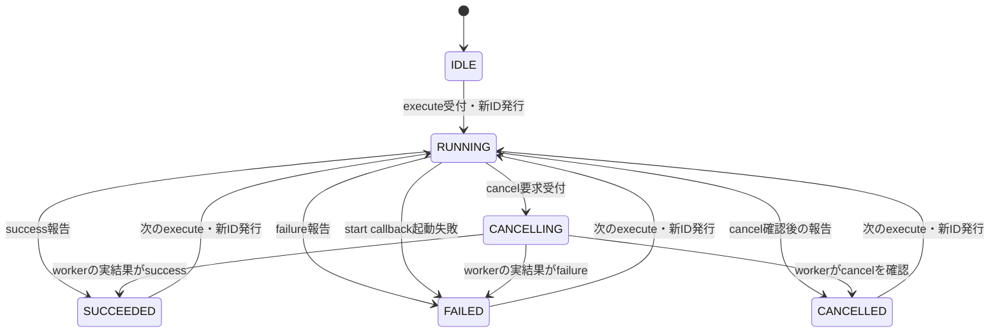
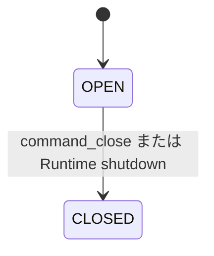

# 適用前記録 / 10-async-command.md

- 記録日: 2026-10-17
- 区分: 2026-10-17改訂前の履歴。現行仕様として使用しない
- 元文書: [10-async-command.md](../../13_detail_design/10-async-command.md)

---

# DD-10 非同期Command

- 状態: 内容承認済み（2026-10-11）
- 作成日: 2026-10-11
- 対象: Async Commandの生成・実行可否・operation状態、start callback、協調キャンセル、完了/失敗報告、closeとshutdown時のworker境界
- 上位出典: `.docs/12_design/mvvm-semantics.md` C1～C4・BD-26、`.docs/12_design/abi-spec.md` A21～A24・第15節、Runtime R2～R4
- 先行詳細設計: DD-01～09承認済み。特にDD-DSP-01～08、DD-CB-01～09、DD-ABI-05～10、DD-PROP-01～10
- 関連作業計画: `.docs/20_todo/dd10-async-command.md`

本書のDD-CMD-01～12は2026-10-11に利用者承認済みである。第9節の未決事項は本承認の対象外として残す。C1～C4、A21～A24、BD-26の承認済み意味論を具体化し、Command専用の進捗・結果値API、worker scheduler、screen ownership APIは追加しない。C宣言や状態表は設計資料であり、配布用header・実装済みAPIを意味しない。

## 1. 承認済み前提

- `execute`はUI threadで呼び、成功したoperationを`RUNNING`にしてからstart callbackを一度だけ呼ぶ。既定では`RUNNING`/`CANCELLING`中の再実行を拒否する（C1、A21）。
- 状態値は`IDLE / RUNNING / CANCELLING / SUCCEEDED / FAILED / CANCELLED`。実行可否はCommandの条件Propertyと実行状態から導出する（A21）。
- 実行ごとにRuntime内で再利用しない非zero operation IDを割り当てる。進捗・完了は`runtime_post`経由でUI threadへ反映し、ID一致の報告だけ一度適用する（C2、A22/A23）。
- キャンセル要求は協調的であり、要求しただけでは`CANCELLED`にならない。最終状態はworkerの実結果を表す（C3）。
- closeとshutdownは新規実行を止め、実行中workerへキャンセルを要求するが、UI threadでworker終了を待たない。閉じたCommand/Runtimeへ後着の結果を反映しない（C4）。
- Property通知・Binding・handle・callback closureのthread/lifetime規則はDD-01～09を適用する。Commandの状態Propertyおよび実行可否Propertyは読取専用である。
- Core管理のasync Validatorやpending validation stateは設けない。remote/long-running validationはViewModelのAsync Commandと状態Propertyで表現し、stale resultの識別はアプリ側で行う（BD-25）。

## 2. 承認された判断

| ID | 判断 | 根拠・境界 | 状態 |
|---|---|---|---|
| DD-CMD-01 | `command_create_async`はUI thread専用とし、RuntimeがRunningであること、必須のstart/destroy closure、実行条件Propertyが0または同RuntimeのBOOLであることを検査する。成功時に所有Command handleを返し、Coreはstart closureを所有する。失敗時はhandleを0にしclosureを呼び出し側に残す。実行条件0は常時true。 | A21、DD-01/02/04/06、DD-VAL-06。Property参照は活性Commandが保持する。 | 承認済み（2026-10-11） |
| DD-CMD-02 | `can_execute = command_open && eligibility_current && state not in {RUNNING, CANCELLING}`とする。条件引数0なら`eligibility_current=true`。実行可否Propertyは読取専用BOOL、state Propertyは読取専用I64とし、Command生成時に作成する。生成はProperty値変更通知を発生させない。 | C1、A21、DD-PROP-02/07。実行可否Propertyは条件Propertyが変わった後、最外側UI処理終了時までに同期的に値を更新し、通知はDD-PROPに従う。 | 承認済み（2026-10-11） |
| DD-CMD-03 | operation IDはRuntime内で単調に発行する非zero `uint64_t`とし、終端・過去operationを含め一度使ったIDを再利用しない。採番・operation record確保の失敗ではID出力を0、Command状態を変更せず、workerを起動しない。ID空間枯渇時は周回再利用せず新規実行を拒否する。 | A22/A23、DD-VAL-06。枯渇時statusと実現可能な採番方式は未決であり、追加statusや数値を本案で定めない。 | 承認済み（2026-10-11） |
| DD-CMD-04 | `execute`可能なら新IDを確保し、失敗snapshotを消し、stateを`RUNNING`・can-executeをfalseへ切り替えた後にstart callbackを同期で一度呼ぶ。callbackはworker/async taskを開始して速やかに戻る。operation生成成功後は、start callbackが失敗statusや例外を返しても`execute`は`UI_OK`と発行済みIDを返し、該当operationを`FAILED`にする。 | C1/A21、ABI §15.1、DD-CB-05/06。失敗したstart callbackはworkerを有効に起動できていないことを前提とする。 | 承認済み（2026-10-11） |
| DD-CMD-05 | 起動不可（eligibility false、同じCommandが`RUNNING`/`CANCELLING`、closed）ではoperationを作らず、required operation IDを0にする。実行不可を`UI_COMMAND_EXECUTION_FAILED`で返さず、通常API statusとoptional errorで表す。statusはDD-ABI既定値を使い、Command独自numeric codeを本書で追加しない。 | C1、A21、DD-ABI-05～07。実行不可の共通status割当・error codeはerror catalogの後続判断と整合させる。 | 承認済み（2026-10-11） |
| DD-CMD-06 | operation状態は`IDLE → RUNNING → CANCELLING? → SUCCEEDED / FAILED / CANCELLED`とする。`CANCELLING`は要求受付済みでworker未終端を示す。直接の成功/失敗も許し、キャンセル要求後にworkerが成功/失敗を報告すれば実結果どおり`SUCCEEDED`/`FAILED`となる。終端後の再実行では新IDで`RUNNING`へ移り、前回failure snapshotを消す。 | C1～C3、A21～A23。前IDの終端状態は次の実行まで保持する。 | 承認済み（2026-10-11） |
| DD-CMD-07 | 状態遷移とcan-execute値の相互依存更新は一つの内部遷移としてcommitし、外部通知を開始する前に両Propertyの値を整合させる。状態変更のProperty通知はDD-PROP-07～09に従い、Binding伝播はDD-08の順序で扱う。公開setterからの変更は`UI_UNSUPPORTED`とし、状態Propertyそのものを変更しない。 | A21、DD-PROP-05/07～09、DD-BIND-03/05。Property通知callbackは外側処理後に開始し、状態/実行可否getterでは更新済み組を観測できる。 | 承認済み（2026-10-11） |
| DD-CMD-08 | `command_cancel(command, id)`はUI thread専用とする。現在operationが`RUNNING`ならcancel token flagをthread-safeにtrueへし、stateを`CANCELLING`、can-executeをfalseにする。同じIDへの重複cancelおよび既に終端した同じIDへのcancelは冪等成功とし、古い/未知IDは状態を変えず失敗させる。cancelはworkerを待たない。 | C3、A22/A24、DD-ABI-05、DD-CB-05。具体statusはABI共通分類へ対応させる。 | 承認済み（2026-10-11） |
| DD-CMD-09 | cancel tokenはworkerから任意threadで要求状態だけを照会できる。UI操作やCommand状態の読み書きには使えない。cancel、Command close、Runtime shutdownはいずれも実行中operationのtokenを要求済みにする。workerがcancelを確認して中断した場合のみ`CANCELLED`を報告し、正常終了や実失敗ならその結果を報告できる。 | C3/C4、A22/A24、ABI §15.2、DD-DSP-08。workerは必要なhandleをcallback中にretainし、終了後にreleaseする。 | 承認済み（2026-10-11） |
| DD-CMD-10 | complete success/failure/cancelledはUI thread専用であり、workerから直接呼ばず`runtime_post`の短いcallback内で呼ぶ。報告は現在operation IDに一度だけ適用する。過去ID・重複・close後の報告は状態を変えず失敗し、Runtime shutdown後は`UI_CLOSED`。failure報告はdomain/code/messageをimmutable errorへcopyし、snapshotで新しい所有handleを返す。failure snapshotは次operation開始で消す。 | C2、A23、DD-DSP-02/08、DD-VAL-02/04/05、DD-ABI-06/07。failure報告の引数/確保失敗では終端にせず、worker側に再試行可能性を残す。 | 承認済み（2026-10-11） |
| DD-CMD-11 | `command_close`はUI threadで冪等に実行し、Commandをclosingにして新しいexecuteを拒否し、実行中ならcancelを要求する。closeはworkerを待たず、以後Command状態/条件Propertyの内部更新、failure snapshotの新規取得、UI向け完了適用を開始しない。start closureはin-flight start callback完了後に一度destroyする。公開handle releaseだけではcloseしない。 | C4、A21/A24、DD-LIFE-07/08、DD-CB-02/07、ABI §15.2。状態/can-execute Property handleは独立した所有参照としてrelease可能だが、close後は値更新しない。 | 承認済み（2026-10-11） |
| DD-CMD-12 | Runtime shutdownは全Commandをclose相当にしてcancelを要求するが、worker終了・joinを待たない。shutdown後の完了postが拒否された場合、wrapper/workerが所有するclosureとretain済みhandleを自身のcleanupで解放する。受理済みpostがshutdownにより未実行cancelされた場合はDD-DSP-08のdestroyを一度だけ実行する。Command start userdataのCore closure寿命とworkerが別途保持する言語参照を区別する。 | C4、A24、DD-LIFE-07/08、DD-DSP-08、DD-CB-01/07。shutdown後にterminal stateをUIから観測できる保証はない。 | 承認済み（2026-10-11） |

## 3. State / can-executeの観測

| 事象 | state | can-execute | operation ID / error |
|---|---|---|---|
| Command生成 | `IDLE` | 実行条件値（引数0ならtrue） | operationなし、failureなし |
| execute不可 | 変更なし | 変更なし | 新IDなし、出力ID 0、API失敗 |
| execute受付・operation確保後 | `RUNNING` | false | 新しい非zero ID、前failureをclear |
| start callback起動失敗 | `FAILED` | eligibilityに従い再計算 | 発行ID維持、Core生成failure snapshot |
| cancel要求 | `CANCELLING` | false | active ID維持、token requested=true |
| worker成功報告 | `SUCCEEDED` | eligibilityに従い再計算 | active IDを終端IDとして保持 |
| worker失敗報告 | `FAILED` | eligibilityに従い再計算 | error snapshotを保持 |
| workerがcancel確認後に中断 | `CANCELLED` | eligibilityに従い再計算 | errorなし |
| close / shutdown | 最後に確定した状態を保持 | false | 新規実行なし。後着報告を反映しない |
| 次operation開始 | `RUNNING` | false | 新ID、直前failureをclear |

`RUNNING`/`CANCELLING`の状態とcan-executeはDD-CMD-07の内部遷移で整合させる。Property callbackやBinding callbackが実行される時点では、両方とも新しい値を返す。state/can-executeのnotification間のcallback順序や1操作でのcoalescingはDD-PROPの通知規則に従い、本書では別の同期flushを追加しない。

## 4. 状態遷移図

### 4.1 Operation state

`CANCELLING`は要求済みでworkerがまだ結果を返していない状態である。キャンセル要求だけでは`CANCELLED`に遷移しない。終端状態は次のexecuteまで表示し、次のexecuteで新しいoperation IDとともに`RUNNING`へ移る。実行不可、古いID、重複完了、post失敗ではこの図のstate遷移は起こらない。

### 4.2 Command lifecycle

Commandのopen/closedは上のoperation stateとは別の軸である。Closedへの遷移は新規executeとUI上の完了反映を止め、実行中operationのcancelを要求する。workerの終了を待たず、最後に確定していたoperation stateを保持する。worker taskと言語側参照はworker自身の終了まで保持・解放する。

## 5. 実行・完了・失敗経路

1. `execute`はUI threadでhandle・Runtime・close状態を確認する。
2. eligibility falseまたは現在operation実行中なら拒否し、operation IDを0に保ち、workerを起動しない。
3. Runtime非再利用IDとoperation recordを確保する。確保失敗は値・状態・failure snapshotを変えずに失敗する。
4. 新operation開始をcommitし、`RUNNING`/can-execute false/前failure消去を確定した後、start callbackを呼ぶ。
5. start callbackはworkerを開始して戻る。起動自体に失敗した場合Coreが同じIDの`FAILED`を確定するが、execute成功とoperation失敗を分け、execute呼出し自体には`UI_OK`とIDを返す。
6. Workerが終端結果を得たら、`runtime_post`でUI threadへ完了callbackを渡す。そのcallbackが現在IDを確認してcomplete関数を一度だけ適用する。
7. 完了callbackはstate、can-execute、failure snapshotを一貫して更新する。外部Property/Binding通知はDD-07/08のqueue順で後続処理する。

failure snapshotは実行失敗の結果情報であり、API呼出しエラーとは区別する。`UI_COMMAND_EXECUTION_FAILED`はsnapshot内のstatusであり、execute/complete関数の戻り値には使わない（DD-ABI-06）。`domain/code/message`はmachine identifierと表示情報に分け、message文面を機械分岐に使わない。

## 6. Cancellation / close / shutdown

- Cancel APIが`RUNNING`を`CANCELLING`に変え、token flagをtrueへする。Token flagはスレッド安全な読み取り値であり、強制終了やworker killは行わない。
- Workerがキャンセル要求を見ても処理を完了できる場合、成功・失敗を報告してよい。Requested flagだけから終端状態を推定しない。
- `command_close`はCommand単位で新規実行とUI反映を止める。画面を閉じた際にどのCommandへclose/cancelを行うか、誰がCommandを画面に所有させるかは別のlifetime/UI-tree APIの責務とする。
- Runtime shutdownは全Commandを止め、cancelを要求する。すでに開始済みworkerをUI threadで待たず、shutdown後にUI状態へ触らない。
- worker task、thread pool、language runtime taskの生成・join・スケジュール方式はアプリ/wrapperの責務であり、Coreがworkerを所有・実行する契約ではない。

## 7. ProgressとProperties

- 専用progress APIやprogress値型は設けない。workerが通常Propertyを更新する場合は、保持したRuntime向け参照から`runtime_post`でUI threadへ送る。
- 長時間・remote validationはCoreの同期Validator callback内で待たず、Async Commandで実行し、結果をViewModelのPropertyへ反映する。古い結果を適用しないための業務上の世代判定はアプリ側の責務とする（BD-25）。
- 中間progress sampleは全件配信を保証しない（BD-26）。アプリ/wrapperはpost前に最新値へ集約してよいが、Coreはprogressと業務上必須のeventを区別できないため、汎用postを勝手に捨てない。
- 完了/失敗/cancelledはprogressとは別の終端結果として一度だけ保持する。終端後の同operation progressと、古いoperationのprogressは状態を変更しない。
- progressが必要なら通常のPropertyとBindingを利用できる。shutdown時に保留postが破棄されれば、その画面でprogress/terminal resultを観測できないことがある。

## 8. Failure・handle・closure所有権

| 状況 | Command状態の変化 | closure / handleの扱い |
|---|---|---|
| create失敗 | Commandなし | start closureは呼出し側所有のまま |
| create成功 | `IDLE` | CoreがCommand start closureを所有 |
| execute不可 / operation確保失敗 | 変更なし | start closureはCommandが所有、workerなし |
| start callbackが実行中 | operationは`RUNNING` | borrowed handlesはcallback中のみ。worker用は明示retain |
| workerが完了をpost成功 | UI反映は未確定 | Coreがpost callback closureを所有し、実行かshutdown cancel時にdestroy |
| postが受付前に失敗 | operationはworker report未反映 | worker側がpost closureとretain済み参照を後始末 |
| command close/shutdown | close後はUI更新停止 | Core start closureはin-flight start callback後にdestroy。workerが独自に保持したwrapper参照はworker終了まで維持 |

Command public handleの`release`だけでは明示`command_close`を代替しない。CommandがcloseされるまでCoreが保持する関係、および公開handle消費後もどの内部ownerがcloseを呼ぶかは画面/lifetime設計で確定する。workerはCommand本体を直接操作せず、cancel token照会とpost経由報告のみを行う。

## 9. 未決事項

- operation IDの最大値到達時の返却statusおよびRuntime/sessionをまたぐ一意性は未決。Runtime内でのID再利用は禁止する。
- `execute`不可の数値statusとerror code、Coreが生成するstart callback failure snapshotのdomain/code/messageは共通error catalogで割当てる。`UI_COMMAND_EXECUTION_FAILED`を呼出し戻り値として使用しない。
- start callbackがworkerを部分起動した後に失敗を返す場合のwrapper側cleanup。DD-CMD-04は失敗ならworkerを有効に起動していないことを前提とするため、4 wrapperの契約と合わせて確認する。
- progressのcoalescingはBD-26が許容するが、専用APIがない場合のアプリ/wrapper側契約、operation ID別の最新値境界は後続wrapper/runtime設計へ送る。
- Commandを画面へ所有させる方法、画面close時に閉じるCommand範囲、公開Command handle release後にcloseを実行するownerはDD-11/UI tree・wrapper lifetime設計へ送る。
- worker保持参照の型・thread安全性・Rust/C++/C#/Python各wrapperのtask管理、start closureの例外変換・worker thread参照解放はDD-18～21で具体化する。
- Terminal state/failure snapshot保持中にCommand handleがreleaseされた場合のobject shell寿命はDD-02の一般lifetime契約およびCommand owner設計と合わせる。
- Command error snapshot・state/can-execute propertyの厳密な取得thread契約はABI §15とDD-06共通thread規則へ整合する。

## 10. 検証ケース案

1. 同Runtime BOOL条件Property、0（常時true）、異種kind、別Runtime、無効handle、wrong threadを試し、create失敗時にclosure所有権が移らない。
2. state/can-execute Propertyは読取専用で、生成時にnotificationを出さず、eligibility変化・state遷移と一致する。
3. execute不可・実行中の重複execute・operation record確保失敗はworkerを起動せず、ID出力0、state/error不変となる。
4. execute成功はIDを一度だけ発行し、start前にRUNNING/can-execute falseを確定する。start failureはexecute `UI_OK`/ID返却後にFAILEDへ移り、次回実行は新IDを使う。
5. cancelはrequested flagとCANCELLINGを先に反映し、worker終了を待たない。同一IDの重複要求は冪等で、stale IDは状態を変えない。
6. cancel要求後のworker successはSUCCEEDED、failureはFAILED、cancelを確認したworker報告はCANCELLEDとなる。
7. workerから直接Command/Property UI APIを呼ぶとthread制約で拒否され、`runtime_post`からの完了報告だけがUI thread上で適用される。
8. 過去ID・二重終端報告・close後報告は現在状態を変えない。failure snapshotはimmutableで、次operation開始時に現在snapshotが消える。
9. 進捗は全件配信を前提とせず、終端結果は中間progressと独立して一度だけ適用される。
10. command closeとRuntime shutdownはworker終了を待たず、新規execute/後着UI更新を止める。post受理前失敗とshutdownによるpost cancelの各経路でcallback/destroyとretain済みhandleが漏れず重複しない。
11. wrapper側workerがcancel tokenを照会し、worker終了まで必要な言語参照を保持し、終了後にreleaseする。Command本体・UI objectはworkerから直接使用しない。

## 11. 上位判断へ戻す境界

DD-CMD-01～12はC/A/BD-26を具体化した承認済みの設計である。実装時に上位契約との不整合、または各wrapperでの実現困難が判明した場合は、このDDだけで変更を確定せず、該当するABI/基本設計またはwrapper/lifetime設計へ戻して再検討する。第9節の未決事項は本承認の対象外であり、記載した後続設計で扱う。
