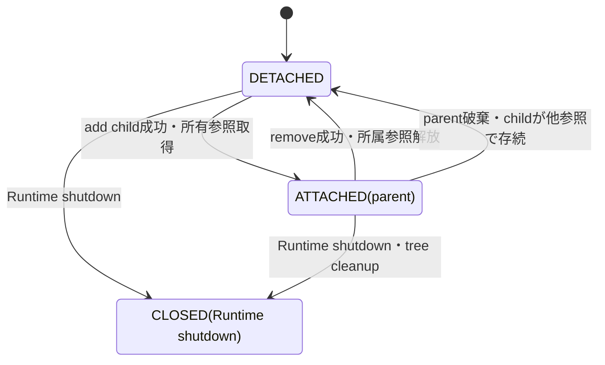

# 適用前記録 / 11-ui-tree-lifetime.md

- 記録日: 2026-10-17
- 区分: 2026-10-17改訂前の履歴。現行仕様として使用しない
- 元文書: [11-ui-tree-lifetime.md](../../13_detail_design/11-ui-tree-lifetime.md)

---

# DD-11 UI treeと要素寿命

- 状態: 内容承認済み（2026-10-11）
- 作成日: 2026-10-11
- 対象: Logical Treeの所属と所有、構造変更、detach、Detached subtreeの存続、Property/Binding/Subscriptionとの寿命境界
- 上位出典: .docs/12_design/BD-04_ui-tree-lifetime-upper-design.md、BD-05_logical-visual-tree-upper-design.md、BD-11_initial-control-contract-upper-design.md、Runtime R1/R2、ABI A29～A32
- 先行詳細設計: DD-01、DD-02、DD-07、DD-08、DD-09、DD-10
- 作業計画: .docs/20_todo/dd11-ui-tree-lifetime.md

本書のDD-TREE-01～08は2026-10-11に利用者承認済みである。第7節の後続設計事項は本承認の対象外として残す。Logical Treeの親子リンクをCoreの所有参照とし、Visual Tree上の対応は二重所有を作らない。公開APIの完全なC宣言や配布用headerを定義しない。

## 1. 範囲と前提

- BD-04: 親は所属中の子をCore内部強参照で保持し、子を親から外した後も公開handle等があれば子Core objectはDetachedとして存続する。複数親と循環は禁止される。
- BD-05: Logical Treeはアプリが組み立てるControlの意味上の包含関係、Visual Treeは配置・描画・hit-test対象であり、Visual TreeはLogical Treeの子を二重所有しない。
- BD-11: 初期ControlはWidget/Container分類を使い、Windowは一つのcontent rootを持ち、StackPanelは順序付きLogical childを持つ。
- DD-02: 公開handle参照と内部所有参照は別であり、UI objectの最終破棄とUI-affine cleanupはUI threadで行う。Binding/Subscriptionはtreeとは別の所有関係を持つ。
- DD-07/08/09/10のProperty通知、Binding、Validation、Command契約を変更しない。

## 2. 承認された判断

| ID | 判断 | 根拠・境界 | 状態 |
|---|---|---|---|
| DD-TREE-01 | Coreが所有寿命を管理する親子所属はLogical Treeに限る。親Containerは各Logical childへの内部強参照を一つ持ち、childはparentを弱い所属情報として持つ。Visual Treeのnode/対応情報はLogical childの寿命を追加で保持せず、その所有者はControlまたはtemplate側の明示的な内部ownerとする。 | BD-04/05、DD-LIFE-03。template由来Visual要素の具体ownerはtemplate設計に残す。 | 承認済み（2026-10-11） |
| DD-TREE-02 | 一つのWidgetは同時に最大一つのLogical parentに所属する。親子は同一Runtimeで、parentはContainerでなければならず、self-parent・祖先を子にする操作・既所属childの追加を拒否する。Windowのcontent root一つ、StackPanelの順序付きchildrenを維持する。 | BD-04、BD-11。初期Control以外の子数/cardinalityはControl別設計へ送る。 | 承認済み（2026-10-11） |
| DD-TREE-03 | 親子構造の変更はUI thread専用とする。追加・削除時は引数、Runtime、parent/child状態、循環を先に検証し、全検証に成功してからLogical Tree、parent所属情報、所有参照を一つのcommitで更新する。失敗時はtree・参照・通知に部分変更を残さない。既所属childの直接移動APIは設けず、明示remove後に新parentへ追加する。 | R2、BD-04、A29～A32、DD-02。公開関数名・引数型とVisual/Platform更新失敗時の詳細statusはABI/Control設計へ送る。 | 承認済み（2026-10-11） |
| DD-TREE-04 | removeが成功するとparent-child所有参照を解放し、childをDetached rootにする。child以下のLogical subtree内部リンクは維持する。外した子に公開handleがあればsubtreeをCore上で利用可能に保ち、handleがなければ参照グラフに従い通常の最終解放を行う。 | BD-04のDetached objectとsubtree切離しを具体化する。解放はUI threadのDD-02 cleanup規則に従う。 | 承認済み（2026-10-11） |
| DD-TREE-05 | Detached WidgetとそのsubtreeはRuntimeがRunningの間、公開handleを通じてCore objectとして有効とする。Propertyの通常API、Binding、Subscriptionはそれぞれのhandle/所有契約に従い使用できる。Detachedであること自体はそれらを自動解除しない。Detached subtreeはWindow/Layout/描画/Input対象ではなく、Platform peerを参照しない。 | BD-04、DD-LIFE-04/05、DD-07/08。APIごとの「Detachedでは不可」となる操作はControl/API設計で列挙する。 | 承認済み（2026-10-11） |
| DD-TREE-06 | Detached subtreeの再所属は、追加検証を全て通過したときに新parentが所属参照を取得して行う。追加失敗時はDetached状態と既存のProperty値・Binding/Subscription状態を保つ。再所属時のPlatform資源再生成はVisual/Platform側の責務であり、その詳細と失敗復旧はDD-12/16へ送る。 | BD-04は再所属時のpeer再生成/再接続を要求するが、具体peer modelは未決。 | 承認済み（2026-10-11） |
| DD-TREE-07 | Parent破棄時は各childとの所属リンクを解除する。子に他の参照があればDetached rootとして残り、その配下のLogical subtreeを維持する。参照が残らない子はDD-02の最終破棄へ進む。treeからのdetachだけを理由にProperty binding/subscriptionを解除せず、対象Property/ownerの通常破棄または明示解除に任せる。 | BD-04、DD-LIFE-03～05。TextBox固有のA29～A32契約を一般化しない。 | 承認済み（2026-10-11） |
| DD-TREE-08 | Runtime shutdownではDD-02の順序に従い、UI thread上でtree所属、Visual/Platform接続、treeに関連するUI-affine stateを閉じてからRuntimeをClosedにする。残存handleは閉じたCore shellとなり、通常のUI APIはUI_CLOSED。shutdown後にDetached objectを再所属させない。 | DD-LIFE-07/08、BD-04。focus/IME/rendererの具体cleanup順はDD-13/14/16に委ねる。 | 承認済み（2026-10-11） |

## 3. 所属状態と遷移図

Logical parentへの所属状態を、Windowの開閉、Runtime状態、Visual peerの有無とは別に扱う案である。

- AttachedはLogical parentが一つあり、parentがchildを強く保持する状態。
- DetachedはLogical parentを持たない状態。subtree内部の親子関係は維持可能とする。
- ClosedはRuntime shutdown後のshellであり、通常のtree操作はできない。
- add/remove失敗、Runtime不一致、循環、二重親、wrong threadでは遷移しない。
- Visual peer状態はこの図の状態と一対一にしない。Detachedは描画・入力対象外であり、必要なresource cleanup/regenerationはPlatform設計に委ねる。

## 4. 操作ごとの失敗・副作用案

| 操作 | 成功時 | 失敗時 |
|---|---|---|
| child追加 | Logical順序、parent情報、所属強参照を一括commit。通知・Visual更新はcommit後の既定queueで処理 | 入力不正、wrong thread、Runtime不一致、既所属、循環、非Container parentなら状態不変 |
| child削除 | parentから外し、child rootをDetached化して所属強参照を解放 | 指定childが所属していない／別parentなら状態不変 |
| Detached child再所属 | 検証後に新parentが所属強参照を取得 | 失敗時はDetachedのまま。値やBinding/Subscriptionを変更しない |
| parent最終破棄 | child linksを解消し、存続childはDetached化。最後の参照となるchildはDD-02のUI-thread cleanupへ | cleanup中の部分的な外部観測は許さない案。破棄順の細則は要レビュー |
| Runtime shutdown | Attached/Detachedを問わずRuntime objectのUI状態・Platform接続を閉じる | DD-02のshutdown状態遷移を適用し、閉鎖後のUI操作はUI_CLOSED |

この案では、Logical Tree変更のcommitと、Property notification/Binding deliveryを同一のcallback再入処理として混在させない。外部通知の正確なタイミング・順序はDD-07/08の既承認規則に従う。Visual tree更新のatomicityはRenderer契約が未確定のため追加しない。

## 5. DD-02/07/08との所有境界

| 関係 | DD-11の扱い |
|---|---|
| Logical parent → child | 所属中だけ強い内部参照を一つ持つ |
| child → parent | parent identityへの弱い所属情報 |
| Visual node → Logical Widget | 非所有の対応関係を基本とし、template内部objectにはtemplate ownerを別途明記 |
| Binding → Property | DD-LIFE-05/DD-08どおり独立した強参照関係 |
| Subscription → Property/callback | DD-LIFE-04/DD-07どおり独立した所有・解除契約 |
| Widget → Property / Command | Widget固有の所有はA29～A32およびDD-15で定義。一般tree linkから推定しない |

detach時にBinding/Subscriptionを自動解除しない案は、tree membershipをそれらの明示的なlifetime ownerとみなす判断を避けるためである。利用者側がWidgetのPropertyやSubscriptionを保持している間にdetach後も継続利用する場合は、その各公開handle/内部ownerの寿命契約に従う。

## 6. 検証ケース案

1. 同一RuntimeのDetached WidgetをContainerへ追加し、parentから子を辿れるLogical順序と所属参照を確認する。
2. 既にparentを持つWidget、別Runtime Widget、self-parent、子孫をparentにする循環操作を拒否し、元のtreeと参照数を変えない。
3. Windowがcontent rootを一つだけ持つこと、StackPanelの追加位置と順序が保持されることを確認する。
4. remove後にchild handleからCore object/Propertyを利用でき、tree/描画/input対象から外れることを確認する。
5. detachされたsubtreeを別Containerへ追加し、内部の子順序とProperty状態を維持する。追加失敗ではDetachedのままである。
6. detachだけではBinding/Subscriptionが自動解除されず、明示解除・Property破棄・Runtime shutdownではDD-07/08に従うことを確認する。
7. parent破棄後、公開handle等が残るchildはDetachedとして有効、参照が残らないchildは一度だけUI thread cleanupされる。
8. tree変更をworker threadから呼んだ場合はwrong-threadで状態不変。shutdown後の変更はUI_CLOSEDで状態不変。
9. callback中にtree変更した際の再入・通知開始時点がDD-04/07と矛盾しないことを確認する。
10. Visual peer再生成失敗、focus/IME cleanup、template由来Visual ownerなど本書外境界を後続設計で検証する。

## 7. 未決事項と後続設計

- 公開C ABIの正確なchild add/remove/get/count symbol、child index型、iterator/snapshot API: DD-15およびABI設計。レビュー案の意味論承認だけでsymbolは確定しない。
- 親子の付け替えはatomic reparent APIを設けず、明示removeの後に追加する（DD-TREE-03承認済み）。追加に失敗した場合はDetached状態を維持する（DD-TREE-06承認済み）。
- Detached Widgetで許す各APIの一覧とProperty値保持範囲: DD-15およびwrapper設計。
- Property/Binding/SubscriptionがWidget/Control内部Propertyを所有する具体グラフと、Widgetの公開handle release後にそれらを保持するowner: DD-15。A29～A32を優先する。
- Logical変更からVisual tree更新へ反映する時点、描画resource再生成の失敗・rollback: DD-12/16、Renderer基本設計。
- detach/Window close時のfocus、capture、IME composition cleanupとevent routing: DD-13/14およびInput/Focus/IME基本設計。
- template-generated Visual elementのowner、replace/destroy順: Template/Control設計。
- shutdown時の全Logical/Visual object処理順: DD-02/12/16の整合レビュー。

## 8. 上位判断へ戻す境界

このレビュー案はBD-04の親子所属による強参照、Detached objectの存続、複数親/循環の禁止を変更しない。BD-05のLogical/Visual Tree分離も維持する。提案した再配置、Detached時のAPI利用可否、Binding/Subscription継続、subtree内部構造保持がこれらの上位契約またはA29～A32と衝突すると判明した場合、DD-11だけで上書きせず、該当する基本設計または既承認詳細設計へ戻してレビューする。

## 9. 承認記録

利用者は2026-10-11にDD-TREE-01～08を内容承認した。承認範囲は、Logical Treeの所有、親子制約と変更の失敗原子性、detach後のsubtree/Property/Binding/Subscription、再所属、親破棄、Runtime shutdown時のtree cleanupである。childの付け替えはatomic reparent APIを追加せず、remove後に別parentへ追加する。第7節に列挙したABI symbol、Detached時のAPI一覧、Control固有owner、Visual/Platform再生成、focus/IME、template owner、shutdown順の詳細は本承認の対象外であり後続設計に残す。
