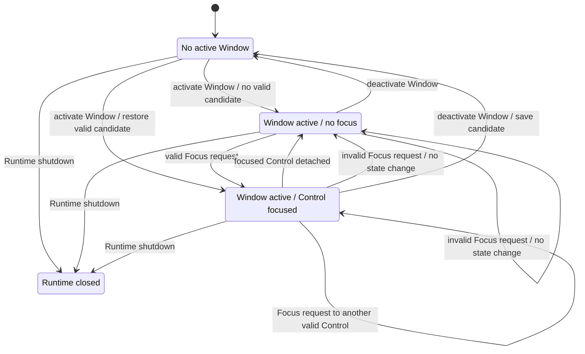

# 適用前記録 / 13-input-focus.md

- 記録日: 2026-10-17
- 区分: 2026-10-17改訂前の履歴。現行仕様として使用しない
- 元文書: [13-input-focus.md](../../13_detail_design/13-input-focus.md)

---

# DD-13 InputとFocus

- 状態: 承認済み（2026-10-12）
- 作成日: 2026-10-12
- 対象: 共通Input event、Runtime active Window/Focus、keyboard/text配送、Focus遷移
- 上位出典: .docs/12_design/BD-07_input-event-boundary-upper-design.md、BD-08_focus-upper-design.md、BD-09_ime-focus-transition-upper-design.md、BD-10_ime-platform-boundary-upper-design.md、Runtime R2～R4、ABI A25～A28
- 先行詳細設計: DD-03、DD-04、DD-09、DD-11、DD-12
- 作業計画: .docs/20_todo/dd13-input-focus.md

本書はBD-07～10と承認済みDD-11/12を具体化した詳細設計である。Platform Adapterはraw eventを共通形式へ正規化し、Core InputはUI thread上でRuntimeのactive Window/FocusとVisual boundsを参照して処理する。DD-INPUT-01～10は2026-10-12に利用者承認済み。Focus traversalやkey/action bindingは本書の範囲外であり、候補メモに分離した。C宣言・event structは配布用headerや実装済みAPIを意味しない。

## 1. 前提と責務境界

- Runtimeは同時にactive Windowを最大一つ、active keyboard focusを0または1つ管理する。Focus対象はLogical Tree上のControlとする（BD-08）。
- Platform Input AdapterはOS/device固有raw eventを共通eventへ変換し、Core Inputは共通eventの意味を処理する（BD-07）。
- Keyboardと確定textはactive focusへ送る。active Windowまたはactive focusがない場合はControlへ配送しない（BD-08）。
- native focus/activationはAdapterと同期するが、OSとCoreに独立したsource of truthを置かない。
- Core UI状態変更とcallback実行はRuntime UI threadに集約する。callback中の通知再帰やevent queue順はDD-03/04に従う。
- Focus離脱時の未commit IME preeditはCore TextBoxに保持し、commitやViewModel伝播を起こさない（BD-09/10）。内部sessionの実装はDD-14/16。

## 2. 判断案

| ID | 承認された判断 | 根拠・境界 |
|---|---|---|
| DD-INPUT-01 | Platform AdapterはOSのraw keyboard/text/pointer eventを共通Input eventへ正規化し、Runtime UI thread上へ投入する。keyboard key down/upとtext commitを区別し、CoreはAdapterが渡す安定したkey identity・modifier・source metadataを扱う。event field layoutとABI表現は決めない。 | BD-07、R2、DD-03。Platform固有のpointer hit-test target算出はDD-16。 |
| DD-INPUT-02 | RuntimeのFocus状態を「active Windowなし」「active Windowあり・active focusなし」「active Windowあり・active focusあり(Control)」に分ける。active Window外またはDetached Controlはactive focusになれない。Focus requestは同じControlならno-op、別Controlなら一つの状態遷移としてcommitする。 | BD-08、DD-11。WindowのcloseとRuntime shutdownはDD-11/02に従う。 |
| DD-INPUT-03 | 初期Focus取得条件は、要求元Controlがactive WindowのLogical TreeにAttachedであり、Controlがfocusableかつenabledであることとする。invalid/disabled/nonfocusable/nonactive-window/Detached targetへの要求は失敗し、現在のFocusを変えない。focusable/enabled Propertyの公開面はDD-15へ送る。 | BD-08は移動条件を後続へ送る。Visibility eligibilityやControl別例外の最終規則はDD-15で照合する。 |
| DD-INPUT-04 | Focus遷移ではRuntimeのactive focusを先に新状態へcommitする。その後、旧ControlのFocusLostを新ControlのFocusGainedより先に内部dispatchする。callback/eventは状態commit前のFocusを観測できない。Focus requestはUI thread専用で、callback中に発生する遷移は現在eventを中断せずDD-03/04の非再帰順序で後続処理する。 | BD-08、R2～R4、DD-03/04。public focus event APIは確定しない。 |
| DD-INPUT-05 | Active Windowがdeactivateされたらactive focusを解除して復帰候補として直前Controlを記録する。再activate時はcandidateが同WindowにAttachedでfocusable/enabledなら復帰し、そうでなければfocusなしとする。detachされたControlは復帰candidateにも残さない。 | BD-08はcandidate保持を許し復帰条件/時期を後続へ送る。Platform activation順はDD-16と整合させる。 |
| DD-INPUT-06 | Focus Controlまたはその祖先がactive WindowのLogical Treeからdetach/破棄された場合、active focusを解除し、detach ControlをFocus対象に残さない。detachだけを理由に別Controlへ自動Focusしない。FocusLostを一度dispatchし、TextBoxから離れる場合はBD-09/10のpreedit保持を適用する。 | BD-08、DD-TREE-04/07、DD-09。fallback targetの明示指定は後続Control設計に送る。 |
| DD-INPUT-07 | 入力eventはtarget Controlを定めた後、そのControlへ届ける。初期route候補として、targetで処理した後にLogical parent方向へbubbleする方式を推奨し、tunnel phaseは追加しない。keyboard targetはactive focus、pointer targetはDD-16のVisual hit-test結果に対応するLogical Controlとする。focusなし等でtargetを得られないkeyboard/text eventはbufferせず破棄する。 | BD-05/07/08、DD-11/12。routed-event subscription、handled/default action、公開ABIはDD-15/16へ送る。route方式自体は本レビューで確認する。 |
| DD-INPUT-08 | Focus対象はLogical Tree上のControlとする。Containerであること自体はFocus対象であることを意味せず、focusabilityの公開条件はControl設計で定める。 | BD-08。 |
| DD-INPUT-09 | 本詳細設計では、特定のkey/modifierをFocus移動やUI機能へ割り当てない。Tab/Shift+TabによるFocus traversal、Ctrl+Z等のshortcut/action binding、利用者が割当を変更する仕組みは本書の契約から除外し、将来検討メモに分離する。 | BD-08はkeyboard navigationを後続判断としている。候補メモ: `.docs/20_todo/keyboard-actions-value-memo.md`。 |
| DD-INPUT-10 | Coreはkey eventをtargetおよび選択されたrouteに沿ってUI thread上で順に処理する。Focus changeは現eventの処理中にstate commitできるが、新しいInput callbackを再帰開始しない。Adapter由来native focus同期が同じ遷移を再通知しても重複FocusLost/Gainedを発生させない。 | R2～R4、BD-07/08、DD-03/04。Platform feedback suppression/sequence IDの仕組みはDD-16へ送る。 |

## 3. Focus状態と遷移

Runtime内のactive Window/active focusを次の状態で表す案である。Windowごとの復帰candidateはactive focusとは別に保持する。

| 現状態 | 事象 | 次状態 | 副作用 |
|---|---|---|---|
| No active Window | Platform activate(Window) | Window active / no focusまたはvalid candidate | candidateが有効ならFocusGained |
| Window active / no focus | 有効ControlへFocus要求 | Window active / Control focused | FocusGained |
| Window active / Control A focused | 有効Control BへFocus要求 | Window active / Control B focused | A.FocusLost後にB.FocusGained |
| Window active / focused | Window deactivate | No active focus / candidate A | A.FocusLost、candidate保持 |
| No active Window | 以前のWindowが再activate | active Window / valid candidateまたはno focus | valid candidateならFocusGained |
| Window active / focused | Aまたは祖先をdetach/破棄 | Window active / no focus | A.FocusLost、candidateからも除外 |
| 任意 | invalid target/wrong thread | 状態不変 | 失敗を返す。Focus eventなし |
| 任意 | Runtime shutdown | Closed runtime | DD-02のcleanup。新しいInputを受けない |

状態フロー図:

Focus stateはControlのLayout bounds、Platform native focus flag、TextBox IME sessionとは別軸である。入力eventの配送はactive focusのみ参照し、Platform peer状態からCore focusを直接上書きしない。

## 4. Keyboard / text event配送

1. Platform Adapterはraw eventを共通keyboard key down/upまたはtext commitへ正規化する。
2. eventをRuntimeのUI thread queueへ渡す。worker threadやOS callback threadからControlを直接操作しない。
3. CoreはRuntimeがRunningでactive Window/focus Controlを持つことを検証する。
4. keyboard eventはactive focusをtargetとする。pointer eventはDD-16が得たVisual hit-test targetを対応するLogical Controlへ結び付ける。Coreはtarget eventから選択されたrouteを処理する。
5. key down/upはactive focus Controlをtargetとする。本書は特定key/modifierをFocus traversalやcommand/actionへ割り当てない。
6. Text commitはkey eventと別に扱う。TextBoxでは候補全文・selection・originをA25～A28の入力Validator規則へ渡す。
7. callbackでFocusが変わる場合、状態をcommit後にFocusLost/FocusGainedを順序付ける。event途中のshutdownはDD-03の優先control taskに従い現在event完了後にcleanupする。
8. keyboard/text eventにFocusがなければqueueに保留せず破棄し、後のFocus取得時に古い入力を再送しない。

Key repeat、shortcut/accelerator、TextBoxの文字編集・selection/caret、IME composition内のevent処理は本書で決めない。

## 5. FocusとTextBox/IME

- FocusLostはControl focus stateの遷移通知であり、TextBoxの入力候補を確定するAPIではない。
- FocusがTextBoxを離れる時点でIME preeditが未commitなら、Platform sessionを終了し、編集文字列と編集位置をCore TextBoxに保持する（BD-09/10）。
- Focus移動だけではView input validatorを確定候補として呼ばず、確定値Property/Bindingを更新しない。
- IME commitがFocusLostより先にCoreへ届いた場合は通常のA25～A28入力commitとして処理する。Platform eventの順序保証・session実装はDD-14/16に残す。
- TextBox内部のactive caret、selection、preedit range更新とFocus復帰後のIME再開はDD-14に委ねる。

## 6. callback・thread・失敗境界

- Focus request、active WindowのCore state更新、Core Input処理はUI thread専用。Platform raw eventはUI threadへ正規化dispatchされる。
- callbackから別ControlへFocus requestしても現在のcallbackを中断しない。同じfocusを再要求する操作は冪等。
- FocusLost/Gainedは状態変更後にdispatchするので、callbackがgetterを使う場合には新しいactive focus状態を観測する。eventの公開callback有無は決めない。
- invalid Handle、別Runtime、Detached Control、非active Window target、wrong threadでは状態変更・Focus event・IME操作を行わない。具体statusはABI共通規則とControl API設計に従う。
- Window deactivate、Focus detach、Runtime shutdown中のclosure cleanupはDD-02/03/04と対象ownerの規則を維持し、callback/destroyを重複させない。

## 7. 検証ケース案

1. 4言語でRuntime内active Window/active focusを一意に観測し、二つ目のactive Windowが先のwindow/focus stateを置き換える。
2. 有効focusable/enabled attached controlへの要求だけがFocusを移し、invalid、Detached、他Window、wrong-thread要求は状態を変えない。
3. Focus AからBへ移すと、commit済みstateをA.FocusLostが観測し、その後B.FocusGainedが呼ばれる。同じControlの再要求はduplicate eventを出さない。
4. Window deactivationでactive focusを解除し候補を保持、再activateで有効candidateを復元する。candidateがdetach/disable/release済みなら復元しない。
5. focused controlまたは祖先をdetach/破棄するとFocusLostを一度出し、旧Controlをactive focus/candidateに残さず、自動fallbackを行わない。
6. Keyboard inputはactive focusへ一度だけ配送する。focusなし/active Windowなしでは破棄し、後から再配送しない。
7. keyboard key eventはactive focusへ配送し、特定key/modifierに本書が暗黙のUI動作を割り当てていないことを確認する。
8. key down/upとtext commitを別eventとして扱い、TextBox commitのみA25～A28 Validator経路へ渡す。
9. BD-09/10どおり未commit preedit中のFocus離脱で編集内容を保ち、確定値・ViewModel値を変更しない。先着commitなら通常commitとなる。
10. callbackからのFocus request、Window deactivate、shutdownで現在callbackを打ち切らず、DD-03/04のqueue・destroy順を守る。

## 8. 未決事項と後続設計

- Focus traversal、shortcut/action binding（例: Tab/Shift+Tab、Ctrl+Z）、key mapの既定値・変更方法: 本詳細設計の対象外。付加価値候補として `.docs/20_todo/keyboard-actions-value-memo.md` に記録。
- visibility/enabled/focusableの完全なControl model: DD-15。
- FocusLost/Gainedの公開event/callback、正確なABI symbol、event handled/cancel/default-action契約: DD-15とABI設計。
- pointer hit-test結果をFocus requestへ結ぶ順序、capture、gesture、座標transform: DD-16。
- Platformごとのraw key identity、modifier/IME/text event順、activationとnative focus同期のsequence/suppression: DD-16。
- TextBox key editing、selection/caret、Undo/Redo、明示IME cancel、composition詳細: DD-14。
- Accessibility focus/state写像: DD-17。
- multi-seat/focus seatごとの状態: 上位要件追加後に判断。

## 9. 上位判断へ戻す境界

この案はBD-07のAdapter/Core責務分離、BD-08のRuntime一元active Window/focus、BD-09/10のIME preedit保持、DD-11/12のtree/layout境界を変更しない。Focus eligibility、イベント順、keyboard配送が上位契約またはA25～A28と衝突する場合はDD-13だけで上書きせず、該当する基本設計またはABI/Control/Platform設計へ戻す。Focus traversalとkey/action bindingは本詳細設計に含めない。

## 10. 承認記録

2026-10-12、利用者は本書のDD-INPUT-01～10を承認した。承認範囲はactive Window/Focus、Focus eligibilityと遷移、keyboard/text配送、Logical event routing、特定key/modifierとFocus traversal/UI機能を結び付けない境界を含む。Focus traversalおよびshortcut/action binding（Tab/Shift+Tab、Ctrl+Z等）は付加価値候補として `.docs/20_todo/keyboard-actions-value-memo.md` に分離し、本詳細設計には含めない。DD-14への着手承認は含まない。
