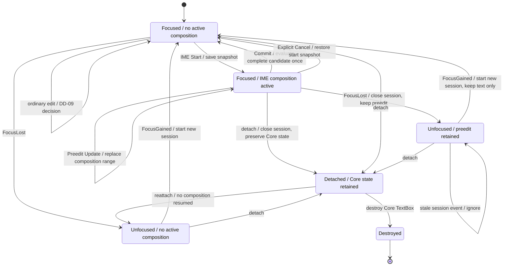

# 適用前記録 / 14-textbox-ime.md

- 記録日: 2026-10-17
- 区分: 2026-10-17改訂前の履歴。現行仕様として使用しない
- 元文書: [14-textbox-ime.md](../../13_detail_design/14-textbox-ime.md)

---

# DD-14 TextBoxとIME

- 状態: 承認済み（2026-10-12）
- 作成日: 2026-10-12
- 対象: TextBox編集状態、caret/selection、IME semantic session、DD-09入力Validator接続
- 上位出典: `.docs/12_design/BD-09_ime-focus-transition-upper-design.md`、`BD-10_ime-platform-boundary-upper-design.md`、`BD-23_text-shaping-upper-design.md`、`BD-24_ime-edit-session-upper-design.md`、V5～V8、A25～A28、A30～A32
- 先行詳細設計: 承認済みDD-09 Validation、DD-13 Input/Focus、DD-02～08
- 作業計画: `.docs/20_todo/dd14-textbox-ime.md`

本書は上位判断とDD-09/13をTextBox編集状態・IME sessionへ接続する詳細設計である。DD-TEXT-01～12は2026-10-12に利用者承認済み。承認済みのIME event意味論は変更しない。DD-TEXT-09/10/11/12に記すProperty Validator拒否時の入力状態、IME candidate退避失敗、Unicode内部位置単位、通知細部は未決のまま後続へ送る。Undo/Redoおよびkey/modifierと編集操作・UI機能を結ぶ規則は本書に含めず、`.docs/20_todo/keyboard-actions-value-memo.md` の候補範囲とする。

## 1. 前提と責務境界

- Core TextBoxは確定値Propertyと編集中の文字列・selection/caret・preedit編集状態を持つ。OS IME sessionと候補UIはPlatform Adapterが所有する（BD-10）。
- IME preeditは画面上の編集状態を変えるが、Validator、確定値Property、Binding/VMへ伝播しない。Commit時の完全候補だけをDD-09のView Input Validatorへ渡す（BD-24、A25～A28）。
- FocusLostはcommit/cancelではない。preeditと位置を保持してIME sessionを閉じ、明示cancelはpreedit開始直前の編集状態へ復元する（BD-09/24）。
- A25のcallback selection位置はUTF-8 byte offset。これだけではCore内部caret移動やselection操作のユーザー認識上の単位を決めない（BD-23）。
- TextBoxの編集候補はUI threadで更新する。Validatorおよびsubscriptionのclosure lifecycleはDD-04/09に従う。

## 2. 承認済み境界

| 出典 | 本書が維持する契約 |
|---|---|
| BD-09/10 | Focus離脱時にpreeditと編集位置をCoreに保持し、Platform session/candidate UIを終了する。編集文字列、selection/caret、入力状態はCore TextBoxがsource of truth。 |
| BD-24 | TextBox単位のIME session識別、Preedit中のValidator/Binding禁止、commit一回評価、明示cancel時の開始snapshot復元、FocusLostとの区別、Adapter受信順でのcommit/FocusLost競合解決、stale event破棄。 |
| DD-09 / V5～V8 / A25～A28 | 通常編集候補全文とpost-edit selectionをValidatorへ渡し、Accept/Incomplete/Rejectを適用する。IME preedit中はValidatorを呼ばず、commit Rejectも入力を保持する。 |
| A30～A32 | 確定値はBinding可能なUTF-8 Property。外部から異なる値が確定すると編集中の値・入力状態・理由を更新する。TextBox破棄時に入力callbackを解除する。 |

## 3. 判断案

| ID | 承認された判断 | 根拠・境界 |
|---|---|---|
| DD-TEXT-01 | Core状態を (a) 確定値Property、(b) 編集全文、(c) selection/caret、(d) optional active composition/session、(e) DD-09 input state/reasonに分ける。preeditは別の確定値ではなく編集全文中のcomposition rangeとして表す。 | A26/A27/A30、BD-10/24、DD-09。内部structと公開getter/APIは確定しない。 |
| DD-TEXT-02 | Text editは「編集前状態＋置換範囲＋挿入UTF-8＋編集後selection＋origin」から候補全文を作り、候補全体をDD-09 Validatorへ渡す方式を提案する。key/paste/drop/accessibilityで同じ編集判定経路を使う。 | V5/V7、A25、DD-VALID-07。どのgesture/keyがこの操作を発行するかは本判断に含めない。 |
| DD-TEXT-03 | 候補適用時はDD-09に従い、Acceptは候補を編集全文と確定値へ反映してBindingへ進み、Incompleteは編集全文とselectionだけ反映し、通常Rejectは編集状態を維持して状態/reasonだけ更新する。IME commit RejectはBD-24に従い候補を編集全文へ保持する。 | DD-VALID-08/09、BD-24。TextBox確定Property自身のProperty Validator拒否はDD-TEXT-09で別に確認する。 |
| DD-TEXT-04 | IME Startでsession identityと開始snapshotを保持し、Updateは対象rangeだけを最新preeditで置換する。各Updateは確定値、Validator、Bindingを変更しない。session IDとevent orderingはPlatform Adapterが供給し、Coreはcurrent session以外を適用しない。 | BD-24。IDの幅、ABI形状、OS event変換はDD-16へ送る。 |
| DD-TEXT-05 | Commitはactive sessionのpreedit rangeをcommit文字列で置換した完全候補を一度だけDD-09へ渡す。commit成功またはDD-09の判定後にcomposition/sessionを終了し、二重commit・終了済みsessionのcommitは無視する。 | BD-24、DD-VALID-07/09。Commit直後のcaret位置はselection post-state案を提示し、確認を求める。 |
| DD-TEXT-06 | Explicit CancelはBD-24に従い、session開始直前のediting text・caret・selectionを復元し、Validator・確定Property・Bindingを動かさない。開始時のinput state/reasonもsnapshotへ含めて戻す案と、編集位置のみ復元しcancel状態を別通知する案を比較する。 | BD-24では本文・caret・selection復元まで承認済み。入力state/reasonのcancel後状態は上位で明示されていない。 |
| DD-TEXT-07 | FocusLostはcurrent sessionを閉じるが、最後のpreedit編集全文・composition range・caret/selectionを保持し、commit・cancel・Validatorを実行しない。再Focusでは新sessionを作り、Core編集値から続ける。 | BD-09/24、DD-INPUT-05/06。OS候補windowと変換内部状態を復元しない。 |
| DD-TEXT-08 | 外部経路で確定値Propertyに異なる値が確定したらA31どおり編集全文を置換し、input state/reasonを初期化する。active compositionは無効化しsessionを終了した扱いとし、そのsession由来の遅延eventをstaleとして破棄する。 | A31、BD-24。Adapterへのsession close通知順はDD-16と整合させる。 |
| DD-TEXT-09 | ユーザー候補がDD-09 input ValidatorでAccept後、TextBox確定値Property自身のValidatorで拒否された場合の扱いは未決とする。選択肢は (A) 編集前へ戻し入力拒否を記録、(B)候補編集値を保持し確定値は旧値のままBinding error相当を記録、(C) Property Validator拒否を別の入力状態/errorとして可視化する。既存の未決境界を詳細化する。 | DD-VALID-07/08 §7、ABI §20.2、V2/V3。新しい意味論をDD-14だけで上書きしない。 |
| DD-TEXT-10 | Commit candidateの確保またはValidator実行前準備が失敗しても入力文字列を失わない。通常編集は編集前snapshotを保つ。IME commitでは候補をCore所有のpending recovery状態へ退避してからsessionを終了する案と、Adapterが再送可能な状態を保つ案を比較し、復旧可能な境界を定める。 | DD-VALID-08、BD-24、DD-09 §7。退避そのものが失敗した場合のstatus/diagnosticは要レビュー。 |
| DD-TEXT-11 | caret/selectionの内部位置単位を未確定として、UTF-8 byte offset、Unicode scalar boundary、extended grapheme boundaryと変換層の有無を比較する。全位置は少なくとも有効UTF-8境界を守り、A25 callbackには承認済みUTF-8 byte offsetで変換して渡す。 | A6/A25、BD-23はgrapheme単位移動・selection affinity・visual/logical policyを後続へ残す。内部単位は利用者確認を求める。 |
| DD-TEXT-12 | 編集状態の一つのlogical transaction内で本文、selection/caret、composition、input state/reason、確定値Propertyを原子的に確定する。通知はDD-09のProperty/Binding順を守る。TextBox input subscriptionと他callback群の相対順、composition update通知の統合は未決とする。 | DD-VALID-08、DD-VALID §6、DD-PROP-07、DD-BIND-05。 |

## 4. Core編集状態遷移案

図はsemantic stateのレビュー案である。TextBox object破棄後の永続保持はせず、IME OS session状態はAdapterが所有する。外部確定値更新によるactive compositionの無効化、候補退避失敗経路は判断レビューで確認する。

## 5. TextBox stateとediting transaction

通常のユーザー編集操作では、Coreはまず置換範囲と入力文字列から候補全文、post-edit selection、originを準備する。DD-09の判定前にTextBox stateを一部だけ書き換えない。Accept/Incomplete/Rejectの値反映はDD-VALID-08/09を維持し、input state/reasonと編集文字列の変化は一つの状態更新として読めるようにする。

初期モデル案:

| State | 内容 | Binding |
|---|---|---|
| Committed value | TextBoxの確定値Property。外部からも読書き・Binding可能 | Acceptと外部Property updateで更新 |
| Editing text | 表示・編集対象となるUTF-8全文。未確定入力を含みうる | Incomplete/Reject-preeditでは更新しても伝播しない |
| Selection/caret | 編集全文上のselection rangeとcaret | edit/cancel/focus operationと一緒に更新 |
| Composition | active session ID、range、preedit、開始snapshot | Platform sessionの意味をCore側で追跡 |
| Input feedback | DD-09のstate/reason snapshot | DD-09のnotification契約に従う |

External Property updateはA31に従う。同値setterが編集中の内容を上書きしないDD-VALID-10の規則も維持する。どの状態をgetterから公開するか、callback ABI、編集操作APIは本レビューの確定範囲にしない。

## 6. 検証ケース案

1. TextBox生成後、committed/editing textが初期値と一致し、selectionが有効な境界上にあり、初期通知を発生させない。
2. 通常編集で候補全文・post-edit selection・originを一度Validatorへ渡し、Accept/Incomplete/RejectでDD-09の規則どおり状態とBindingを更新する。
3. 日本語UTF-8、ASCIIとmultibyteの混在、結合文字列に対してselection/caret位置が不正なUTF-8 interiorを指さず、callback位置はbyte offsetで渡る。
4. IME Start/複数Update中はpreedit rangeだけが変わり、Validator・committed Property・ViewModelは変わらない。
5. Commitは完全候補を一度だけValidatorへ渡し、Accept/Incomplete/Rejectの各規則でcandidateとcomposition stateを一貫して終端する。duplicate/stale commitは二重適用しない。
6. Explicit Cancelは開始snapshotへ戻り、validator/Binding/committed Propertyの変更を起こさない。cancel後のinput state/reasonは選択した承認案に従う。
7. FocusLost前に受信したcommitとFocusLost後のstale commitをBD-24のAdapter順で区別し、後者がCore編集値を変更しない。
8. FocusLostはpreeditとselection/caretを保持し、再Focusで文字列を復帰しても旧session/candidate UIを再利用しない。
9. 外部から別値が確定するとA31どおりediting/input stateを更新し、古いIME sessionのeventは適用しない。同値setterは編集中の値を保つ。
10. TextBox detach/destroy/shutdownでsessionを閉じ、DD-04/09とA28に従ってcallbackを無効化・destroyする。遅延IME eventは破棄する。
11. candidate preparation/commit recoveryでallocation failureが起きても既存編集状態と候補を失わず、必要なdiagnosticを観測できる。

## 7. 未決事項と後続境界

- Unicode internal offset単位、grapheme navigation、selection affinity、logical/visual arrow policy（BD-23）。本書は候補比較まで。
- TextBox確定Property自身のValidator拒否時の入力状態、IME candidate退避失敗時の回復/status（DD-09 §7、ABI §20.2）。
- TextBox編集操作APIの全一覧、公開caret/selection API、ABI symbol、各言語wrapper signature（DD-15、DD-18～21）。
- キーとcaret movement/selection操作のbinding、Tab traversal、Ctrl+Z/Undo/Redo shortcut、その他action binding。本書では定めない。候補: `.docs/20_todo/keyboard-actions-value-memo.md`。
- Composition attributes/複数segmentの見た目、候補windowの選択・paging・caret座標配置、font shaping/rendering（DD-16、DD-15）。
- OS固有IME API、session ID生成器、IMEごとのevent ordering差とretry可能性（DD-16）。
- accessibility経由の編集操作の共通意味論（DD-17）。

## 8. 承認記録

2026-10-12、利用者はDD-TEXT-01～12を本書記載のとおり承認した。DD-TEXT-09のTextBox確定Property Validator拒否時の扱い、DD-TEXT-10のIME candidate退避失敗からの回復、DD-TEXT-11のUnicode内部位置単位、DD-TEXT-12の通知細部は、明示した選択肢・境界のまま未決とすることを含む承認である。Undo/Redo、key binding、公開API/ABI、OS固有IME実装は本承認に含まれない。DD-15への着手承認も含まれない。
