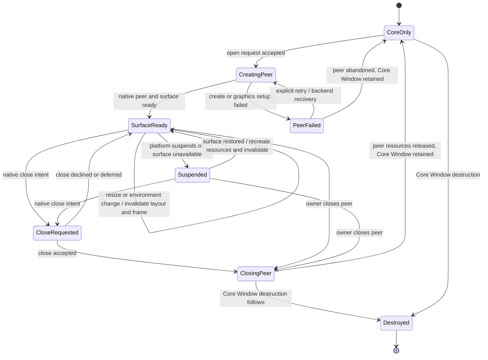
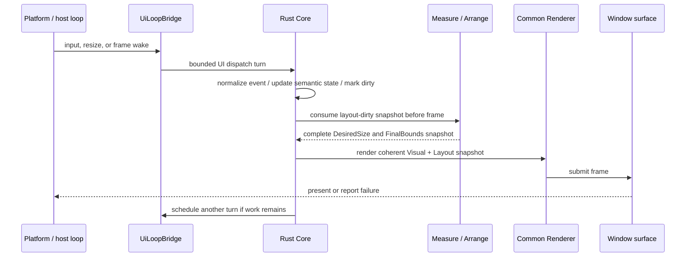

# 適用前記録 / 16-platform-rendering.md

- 記録日: 2026-10-17
- 区分: 2026-10-17改訂前の履歴。現行仕様として使用しない
- 元文書: [16-platform-rendering.md](../../13_detail_design/16-platform-rendering.md)

---

# DD-16 描画とPlatform Adapter

- 状態: 承認済み（2026-10-12、DD-PLAT-01～10）
- 作成日: 2026-10-12
- 対象: 共通Renderer/Platform Adapter境界、Window peerとsurface、frame scheduling、UI loop接続、raw input/IME接続
- 上位出典: Accepted ADR-0001・要求仕様 §6～8/12、BD-04～13/23/24/36、Runtime R1～R4
- 先行詳細設計: 承認済みDD-03、DD-11～15
- 作業計画: `.docs/20_todo/dd16-platform-rendering.md`

利用者は2026-10-12にDD-PLAT-01～10を記載どおり承認した。承認済みBD-12の共通RendererとPlatform Adapterの責務分離を維持し、DD-03/12/13/14/15の承認済み意味論を再定義しない。具体OS API/library、公開ABI signature、寸法単位/scale変換、Accessibility OS mapping、Window close policyの残る細部は後続設計に残す。擬似interface・状態図はレビュー時点の契約図であり、実装済みAPIではない。

## 1. 責務と境界

| 要素 | 責務案 | 所有しないもの |
|---|---|---|
| Rust Core | Logical/Visual Tree、Control状態、Focus/Input/IME semantic state、Measure/Arrange結果、render invalidation、frameに必要な一貫したCore snapshot | OS handle、native surface、graphics device/context、OS IME object、OS Accessibility peer |
| 共通Renderer | Visual snapshotと共通boundsからControlの描画内容を作る。Control意味論やLayoutを再計算しない | Platform window lifecycle、raw inputの意味解釈、OS native controlの状態 |
| Platform Adapter | OS event受信、Window/surfaceとgraphics接続、root領域・scale等の環境値通知、raw input/IMEの正規化、Rendererへの表示先提供 | Core Controlのsource-of-truth、Binding/Validation/Focus/IMEの意味論 |
| `UiLoopBridge` | DD-03に従いUI threadへ非同期wakeを依頼し、UI thread上のbounded dispatch turnを可能にする | host event loopの所有、nested loop、worker上でのCore UI操作 |

CoreとAdapterの間では、OS resourceをopaqueなAdapter内部resourceとして扱う。Backend固有callbackからCore/user callbackを直接呼ばず、DD-03のUI thread dispatch境界を通す。RendererはDD-12のFinalBoundsおよびDD-15のControl意味情報を使用し、Platform固有Control behaviorでそれらを上書きしない（BD-11/12）。

## 2. 判断案

| ID | 承認された判断 | 根拠・境界 |
|---|---|---|
| DD-PLAT-01 | Core、共通Renderer、Platform Adapterを分離する。Coreが意味情報とLayout結果を確定し、RendererはCoreから与えられるVisual snapshotを描画し、AdapterはOS surface/device/eventとの接続を担う。OS native controlをControl状態のsource-of-truthにしない。 | 承認済みBD-12、ADR-0001。個々のtrait/API/ABIは決めない。 |
| DD-PLAT-02 | ひとつのRuntimeは初期構成で一つのPlatform Adapter/backendに接続する。開かれたCore Windowごとに0または1つのAdapter-owned Window peerを対応させ、peerがnative window/surfaceとgraphics resourceを保持する。Core Windowとpeerは別object/寿命とし、WindowのDetached状態だけではpeerを暗黙破棄しない。 | BD-04/11/12、DD-11/15。複数backend同時表示、Windowのscreen owner、openの公開APIは未確定。 |
| DD-PLAT-03 | Visual/Property/Tree/Layout変更はCore dirty stateへ集約する。描画frameを作る直前に必要なMeasure/Arrangeを完了し、同じUI thread上の一貫したVisual/Layout/Control snapshotをRendererへ渡す。連続したdirty要求・resizeは未開始frameに集約し、部分更新に失敗した場合は前回のcomplete frame相当状態を保持する。 | DD-03/07、DD-11/12、DD-15。damage region、partial redraw、snapshot格納形式、厳密なframe clockは決めない。 |
| DD-PLAT-04 | Frame requestと通常post/input/notificationはDD-03のbounded UI dispatch内で処理する。shutdown control taskは実行中callback/eventが戻った次の処理機会でframe/通常workより優先し、開始済みrender/host eventを途中で再入終了させない。描画要求が続いても同じdispatch turnを無制限に占有しない。 | DD-DSP-03～08、BD-36。OS loopのpriority APIやrefresh synchronizationはbackend別後続。 |
| DD-PLAT-05 | Window peerはCore Windowへ関連付けた状態でsurfaceを作成し、Platformから来る利用可能領域・scale等のenvironment変更をCoreへ通知する。Core Windowは意味状態を維持し、surface resize/device recreation時にLayout dirtyとframe dirtyを立てて再描画する。OS peer喪失時もCore Tree/Property/Binding/Focus意味状態をOS resourceと一緒に破棄しない。 | BD-06/12、DD-11/12/15。peer作成を明示操作とするか、Runtime/window ownerが開始するかは未決。 |
| DD-PLAT-06 | OSのclose intentはPlatform AdapterからCoreへのclose requestとして通知する。OS eventを受けたことだけでRuntime shutdownやCommand/screen ownerのcloseを実行しない。Window close requestのaccept/veto/defer、Windowを再表示する意味、close後のCore Window状態は未決選択としてレビューに提示する。 | DD-15 §7、DD-02/03、BD-12。close policyをこの案だけで決めない。 |
| DD-PLAT-07 | Adapterはraw pointer/keyboard/window eventをBD-07/DD-13の共通Input eventへ正規化し、Core UI threadへ順序を保って渡す。AdapterはOS座標・device情報を保持し、Core Layout座標への変換点を一箇所に置く。Coreのroute/Focus/activationはDD-13に従い、backendごとに再実装しない。 | BD-07/08、DD-12/13、DD-15。event ABI、座標単位、原点、rounding、pointer hit-test詳細は未確定。 |
| DD-PLAT-08 | TextBoxにactive focusが移る時、Adapterは対応するOS IME sessionを開始し、preedit/commit/cancelをDD-14が定める共通IME eventへ変換する。Core focus離脱、TextBox detach/destroy、外部確定値update、Runtime shutdownではsessionを終了し、session外・stale eventをCore編集状態へ反映しない。Candidate UI位置はCore text/layout情報をAdapterへ渡す接点まで定める。 | BD-09/10/24、DD-13/14。OS API、内部caret単位、candidate window placement/render、OS event ordering差は確定しない。 |
| DD-PLAT-09 | Surface/device/render failureはCore UI状態のcommitと分離して診断する。失敗したframeをCoreの成功済みsnapshotとして扱わず、dirtyを保持してAdapterがrecoverまたは明示failure状態を通知する。surface喪失中もInput/IME eventは無効surfaceへ配送しない。 | DD-LAYOUT-08、DD-03、BD-12。status code、再試行回数、device fallback、software renderer切替は後続判断。 |
| DD-PLAT-10 | Runtime shutdown開始時はAdapterの新規OS event受信とframe schedulingを停止し、DD-03に従いUI thread上で未開始のworkをcancelする。AdapterはIME sessionを閉じ、native peers/graphics resourcesを破棄してからCoreがそれらの参照を解放する。既に実行中のUI callback/render turnは戻るまで完了させ、nested dispatchを始めない。 | R2～R4、BD-36、DD-02/03/04/11/14。shutdown worker待機時のloop停止・timeoutはDD-03/06の未決を維持。 |

## 3. Window peerとsurface状態案

この案はCore Windowとnative peerの寿命を分ける。`CoreOnly`はCore objectが存在するがnative surfaceを持たない状態、`SurfaceReady`はOS表示面が利用可能な状態を表す。`CloseRequested`以降のaccept/defer/decline semanticsはDD-PLAT-06の未決事項であり、この図だけでWindow close contractは確定しない。Runtime shutdownは個々のclose requestとは別の全peer teardown経路とする。

## 4. Frame生成・表示の処理案

Frame境界ではCore snapshotの読取りとUI意味状態の更新を混ぜない。frame作成より後に到着した入力/Property変更は次のsnapshotへ反映する。Surface presentが非同期backend operationなら、その完了callbackはAdapter内で受けてからDD-03 bridge経由でCoreに必要な状態だけ通知する。具体的なthread、fence、GPU resource synchronizationはbackend設計へ送る。

## 5. Eventとlifecycleの順序

### 5.1 起動・表示

1. Platform profileとAdapterをRuntime起動時に準備し、DD-03の`UiLoopBridge`接続を登録する。
2. Core WindowとControl Treeを構成する。Core object作成はnative OS windowを必ず生成するとは限らない。
3. open requestをAdapterへ渡し、UI thread上でpeer/surface/graphics接続を準備する。成功時にroot available region等をCoreへ通知する。
4. CoreはDD-12 Measure/Arrangeを行い、complete snapshotをRendererへ渡す。RendererはDD-15 Control意味情報に基づくframeをsurfaceへ提出する。

### 5.2 Input / Focus / IME

1. AdapterがOS eventを取得し、timestamp/modifier/device/surface座標等の元情報を保つ。
2. Adapterがthread-safeなqueue/bridgeでUI threadへ届け、ひとつの共通Core Input eventへ正規化する。
3. CoreはDD-13のactive Window/Focus、route、Control activation規則を適用する。Platform peerのnative focus変化はCore focus request/resultと同期し、二重focus eventを抑止する必要がある。
4. TextBox active focusに連動してAdapterがIME sessionを管理する。preedit等はDD-14の共通eventとしてCoreへ送り、OS candidate UIはAdapterが所有する。
5. Core state/Layout/render dirtyが生じたら既存event turn内のbounded処理を経て次のframeへ合流する。OS eventはCore callbackを直接呼び出さない。

Native focus changeとCore Focus changeの同期、event timestamp/order、座標・scaleの数値定義はレビュー案では境界まで示し、具体決定を保留する。

### 5.3 CloseとRuntime shutdown

- OS close intentはCore Windowへrequestとして通知する。Runtime/Command ownerのshutdownは暗黙に始めない。
- closeが受理された場合のpeer teardownとCore Window保持/破棄の関係はDD-PLAT-06で利用者確認が必要。
- Runtime shutdownではBD-36/DD-03優先度に従う。実行中のcallback/eventを終えた次処理機会で、未開始post/frameをcancelし、IME session、peer、surface、graphics resourceをUI thread上で停止・破棄する。
- worker同期shutdownがUI loop停止中に待つ場合のtimeout/cancel/statusはDD-03 §7とDD-06の未決事項に残す。

## 6. 検証ケース案

1. WindowsでCore Window/peer/surface生成から初回frame表示まで進み、Control stateとboundsがDD-11/12/15どおりRendererへ渡る。
2. Linux x64で同じControl snapshotをPlatform backendへ渡し、OS native controlへ意味状態を委譲せずframeを表示する。各OSの具体API選択自体は本書の検証合格条件にしない。
3. Property/Tree/Layout変更が複数回起きても未開始frameでdirtyを集約し、Layout完了前の古いboundsを新frameへ混在させない。
4. resize、minimize/suspend、surface restoreでCore Tree/Propertyを保持し、必要なLayout/frameを再生成する。
5. Surface作成失敗、graphics resource failure、present failureで部分snapshotを成功扱いせず、診断可能なdirty/failure状態を保つ。
6. OS pointer/keyboard eventがUI thread上で一度だけ正規化され、DD-13 route/Focus semanticsへ接続される。Keyboard shortcutを暗黙に追加しない。
7. TextBox focus、preedit/update/commit/cancel、FocusLost、detach、外部Value更新の各境界でOS sessionを適切に開始/終了し、stale session eventを適用しない。
8. Frame連続要求、通常post、Property通知の負荷中もDD-03 bounded turnを保ち、host loopへ制御を返す。
9. Runtime shutdownとsurface wake/present/IME eventを競合させ、現在のcallback/event終了後に優先shutdownし、未開始通常workをcancelし、destroy順を一度にする。
10. Window close intentでRuntime shutdownを暗黙発生させず、accept/decline/deferの選択後にnative peerとCore Windowが定義どおりの寿命を持つ。

## 7. 未決事項と後続設計

- **利用者判断が必要**: Window close intentをclose event/requestとしてCoreへ渡した後、Core側にaccept/decline/deferを持たせるか、OS closeを即時受理するか。Windowを閉じた後にCore Windowを保持して再openできるか。DD-PLAT-06に案を提示した。
- Window open/closeを誰が要求・所有するか、Runtime/Command screen ownerとの接続、複数Window/複数backend support（DD-15 §7、BD-12）。
- DD-03 `UiLoopBridge`の登録API、wakeup failure before/after queue acceptance、host loop停止時の同期worker shutdown timeout/cancel、status/完了観測（DD-03 §7、DD-06/18～21）。
- 座標の数値単位、原点、DPI/scale変換、transform、pixel rounding、unbounded layout size encoding（BD-06、DD-12）。
- Renderer API/scene representation、damage region/partial redraw、frame clock/vsync、GPU thread/context/fence、device lost時のfallbackとresource recreation（BD-12、backend follow-up）。
- Window title/native decoration、具体Windows/Linux windowing・graphics/IME API/library・driver/versionと対応機能差（BD-12、Platform profile）。
- Pointer hit-test/clip/transformとnative/Core focus event ordering、OS-specific event timestamp/capture semantics（DD-13）。
- IME candidate window anchor、font/text shaping/Unicode位置変換、composition rendering detail/session ID width/API（BD-23/24、DD-14）。
- OS Accessibility peer/event/action mappingとAT実機検証（DD-17、BD-13）。
- backend capability queryと失敗status catalog・retry policy、formal target/CI/release gate（DD-06/22/23、BD-12）。

## 8. 上位判断へ戻す境界

BD-12は共通Rendererによる独自描画、Core Visual Tree/Layout情報の供給、Platform AdapterによるWindow/surface/input/IME/Accessibility接続、およびPlatform検証順を承認済みである。DD-16はこれらの接続順・状態・寿命を具体化する。BD-06の座標単位/scale、BD-12が後続へ残した具体API/描画command/GPU資源、BD-13 Accessibility mapping、正式support/CI gateは本書だけで変更しない。既承認DDのUI thread、tree、layout、focus、IME、Control規則と衝突する場合はこの案を止め、上位判断または当該DDへ戻す。

## 9. 承認記録

- 2026-10-12、利用者はDD-PLAT-01～10を記載どおり承認した。
- 承認範囲はCore/Renderer/Adapter境界、Window peer/surfaceの状態・寿命案、frame生成順とbounded scheduling、DD-03 loop/Input/IME接続、失敗保持、shutdown時のteardownを含む。
- DD-PLAT-06ではOS close intentをCoreへのrequestとして渡し、Runtime shutdownを暗黙に起こさない境界を承認した。accept/decline/deferの意味、close後のCore Window保持と再open、screen ownerとの関係は§7の未決事項として残す。
- 寸法/scale表現、具体OS API/library、公開ABI、GPU同期、Accessibility OS mapping、loop停止時の同期worker待機等は本承認に含まれず、§7に記す後続判断へ残す。
- DD-17への着手は本承認とは別に利用者から指示され、2026-10-12に作業を開始した。
