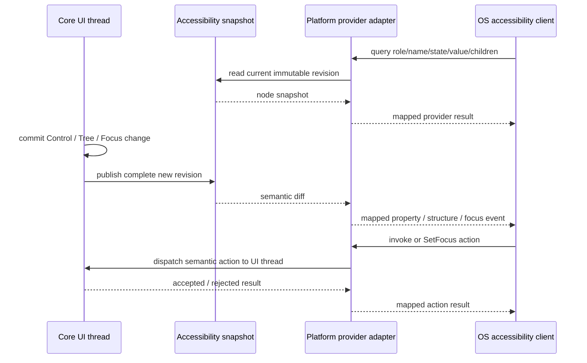

# 適用前記録 / 17-accessibility.md

- 記録日: 2026-10-17
- 区分: 2026-10-17改訂前の履歴。現行仕様として使用しない
- 元文書: [17-accessibility.md](../../13_detail_design/17-accessibility.md)

---

# DD-17 Accessibility

- 状態: DD-ACC-01～10承認済み（2026-10-12）
- 作成日: 2026-10-12
- 対象: Core Accessibility tree/snapshot、初期Control意味情報のOS provider mapping、変更通知、AT action接続
- 上位出典: Accepted要件 §7、BD-05/08/11/12/13、承認済みDD-13～16
- 先行詳細設計: 承認済みDD-13 Input/Focus、DD-14 TextBox/IME、DD-15 Controls、DD-16 Platform Adapter
- 作業計画: `.docs/20_todo/dd17-accessibility.md`

本書のDD-ACC-01～10は利用者承認済み（2026-10-12）。承認範囲は本書の判断表に記載した契約に限り、§8の未決事項を確定しない。BD-13のPlatform中立なAccessibility意味情報とLogical TreeをCoreのsource-of-truthとする境界を維持し、OS providerはその意味を各APIへ写像する。DD-15 §7の未決事項を本書で暗黙に確定しない。Windows UI AutomationとLinux AT-SPI 2は初期mapping profile候補として承認されたが、未決欄に残したAPI version・依存条件・OS固有詳細まで確定しない。擬似protocolは設計案であり、ABI宣言や実装済みAPIではない。

## 1. 責務境界

| 要素 | 責務案 | 境界 |
|---|---|---|
| Core | WidgetのAccessibility role/name/state/value/focus/supported action、Logical Treeに基づく意味上の階層を保持する。UI state commit後に読み取り用snapshotを更新する。 | OS role名、provider interface、OS event/property IDを保持しない。 |
| Platform Accessibility Adapter | Core snapshot/treeをOS provider treeへ写像し、OS query/event/actionを対応づける。Windows/Linux等の差をこの層に閉じる。 | Core Control状態を独自に推測・変更しない。native control/pixelから意味を作らない。 |
| OS provider | OS accessibility clientからのqueryとsupported actionを受け、Platform Adapterへ渡す。Core state変更通知をOS event/property notificationへ変換する。 | Binding/Command/Input/Validationの意味論を実装しない。 |

Provider queryはCore objectを任意threadから直接読み書きしない。query用snapshotの公開方式とactionのUI thread dispatchはDD-ACC-07で提案する。既存のCore Input/Focus/Command/TextBox経路がOS providerからも再利用される。

## 2. 承認済み意味論と本案の境界

| 項目 | 引き継ぐ契約 | DD-17で扱う範囲 |
|---|---|---|
| 階層 | Accessibility treeの意味上の基礎はLogical Tree。Visual template内部要素を既定で独立Widget/nodeとして公開しない（BD-13）。 | OS provider treeへのprojection、node順序、reparent/remove通知。 |
| Role/name | 初期ControlはWindow/StackPanel/Text/TextBox/Button。roleとnameを意味情報として公開し、`AccessibleName`は表示値と独立、初期縦断では明示設定/取得する（BD-13、DD-CONTROL-02）。 | OS role/name propertyへのcandidate mapping。空nameを表示文字列・Window titleから補完しない。 |
| Value/state | Control別に該当するvalue/stateを公開する。TextBox編集値、Focus、Enabled、ValidationはCore意味情報から取得する（BD-13、DD-09/13/14/15）。 | OS properties/statesへのcandidate mapping。意味値の選択が未決の項目は保留する。 |
| Action | Button invokeは通常のsemantic Button activation/Command経路。Focus/TextBox操作はCore Inputの既存意味へ接続する（BD-13、DD-CONTROL-12、DD-13/14）。 | OS provider pattern/interfaceの選択と要求dispatch。新しいkeyboard shortcutを導入しない。 |
| Platform | Coreは中立なsource-of-truth、AdapterがOS APIへ写像する（BD-12/13）。WindowsからLinux x64、組み込みLinuxへ検証する（BD-12/13）。 | 最初のOS profile候補とmapping差。特定AT製品の適合保証は決めない。 |

## 3. 判断案

| ID | 承認済み判断 | 根拠・境界 |
|---|---|---|
| DD-ACC-01 | CoreはPlatform中立なAccessibility snapshotを提供し、OS providerはそのsnapshotから値を返す。snapshotはUI thread上のCore state commit後に整合した単位で更新し、複数property/tree変更の途中状態を公開しない。 | BD-13、DD-03/07～16。snapshot ABI・保存形式は定めない。 |
| DD-ACC-02 | Accessibility hierarchyはLogical Treeの初期Controlを一nodeずつ対応づけ、子順はLogical child順に従う。Window peerに対応するWindowがtree root配下のOS nodeとなる。CoreはOS共通root（例: desktop/application root）を新しいWidgetとして作らない。Visual Tree/template部品は独立nodeにしない。 | BD-05/11/13、DD-11/15/16。OSが必要とするroot/fragmentはAdapter側に置く。 |
| DD-ACC-03 | node identityはCore Widgetの生存中に安定し、Property更新や同一Logical parent内の並べ替えだけでは再生成しない。detach/破棄済みnodeへのquery/actionはstaleとして無効化し、新しいWidgetにidentityを再利用しない。reparent時のOS peer保持/再生成と通知順はAdapter profileで一貫させる。 | DD-HND-01/02、DD-TREE-04～08、BD-13。公開handleとの同一性は要求しない。 |
| DD-ACC-04 | Role/name/state/valueはCore snapshotを唯一の意味sourceとする。`AccessibleName`はOS nameへ直接写し、未設定/空欄をlabel、表示文字列、Text.Content、Button label、Window titleから合成しない。roleと共通Control stateは下表のOS mapping候補を使い、表に「要判断」とする点は決定済み扱いにしない。 | BD-13、承認済みDD-CONTROL-02/08/10。DD-15 §7に残るproperty名・詳細意味論は変更しない。 |
| DD-ACC-05 | OS APIの`Focused` stateはCoreのactive Window/keyboard focused Controlから得る。ATの探索・読み上げ位置（accessibility/browse focus）はOS/AT側状態とし、単なるtree queryでCore keyboard focusを変更しない。OSから明示SetFocus actionを受けた場合だけDD-13 Focus requestへ接続する。 | BD-08/13、DD-INPUT-01～08。OS固有focus eventとCore keyboard focusの同一性を仮定しない。 |
| DD-ACC-06 | OSのsupported actionはCoreがそのControlで実際に扱えるsemantic actionのみ公開する。Button invokeはDD-CONTROL-12の同じactivation eligibility/Command経路へ接続し、Focus actionはDD-13 requestへ接続する。TextBox edit/value/selection actionはDD-14のediting transactionを通す。OS key eventを合成してshortcutとして実装しない。 | BD-13、DD-10/13/14/15。public TextBox selection/caret API未決のため、個別Text action setはレビュー対象・必要に応じ保留。 |
| DD-ACC-07 | OS query threadからはimmutable/current Accessibility snapshotだけを読み、Core UI objectを直接参照しない。AT actionはPlatform Adapterのthread-safe request経路でUI threadへ渡し、Core actionを一度だけ実行する。同期応答が必要なOS operationのthreading・timeout・再入制約はOS profileごとに定め、nested event loopやCore callbackからの再帰queryを避ける。 | R2～R4、DD-03/16。query/actionのOS-specific apartment/event-loop要件は公式provider契約で確認する。 |
| DD-ACC-08 | Core state commit後にname/value/focus/enabled/validation/tree changeをAdapterへ通知する。AdapterはOS API固有のproperty/structure/focus/action eventへ写像する。読取りproperty通知は同一node/propertyの未送信更新を最新値へ集約してよいが、focus遷移・invoke等のeventを状態通知と混同・破棄しない。 | BD-13、DD-03/07/08/09/13/15。OS event ID・細かな同一turn順序はOS profileで定義する。 |
| DD-ACC-09 | OS provider tree nodeはWindow peer/Accessibility adapterの寿命内で有効とする。Logical detachでtreeから削除し、peer close/Runtime shutdownではproviderを切断し、残存OS proxy query/actionへstale/unavailableを返す。Core WidgetをOS clientのremote referenceが所有延長しない。 | DD-02/03/11/16、BD-13。具体OS ref counting/weak reference処理はAPI仕様に従う。 |
| DD-ACC-10 | 初期mapping profile候補はWindows UI Automation server-side provider、Linux desktop profileはAT-SPI 2 Accessible/Action等のD-Bus providerとする。初期mappingは標準role/property/pattern/interfaceで表現し、独自role/event/patternは既存標準で意味を表せない場合に限り追加レビューする。 | BD-12/13と公式API資料。API version、Linux AT-SPI busの必須/任意条件、C++/Rust binding/library選択、embedded profile適用は未決。 |

## 4. 初期Control mapping候補

| Core Control / meaning | Windows UI Automation候補 | Linux AT-SPI 2候補 | 保留・注意 |
|---|---|---|---|
| Window | Window control type、provider fragment root | Frame role、application accessible root配下 | Window titleはDD-15のAccessibleNameから独立。Window peerを閉じた後のCore Window寿命はDD-16 §7。 |
| StackPanel | PaneまたはGroup control type | Panel role | どのOS roleが本Controlのgrouping意味に最も合うか、子順とcontrol/content view inclusionを確認する。 |
| Text | Text control type、read-only text information | Static role / Text interface candidate | `Content` valueと`AccessibleName`は別property。読み上げ単位・wrappingは決めない。 |
| TextBox | Edit control type、Text/Value patternの必要機能 | Entry role、Text/EditableText等の必要interface | DD-14のediting text/preedit/committed ValueのどれをOS valueとして表示するか、caret/selection APIが未決。 |
| Button | Button control type + Invoke pattern | Push Button role + Action interface | `Invoke`をDD-CONTROL-12 semantic activationへ送り、disabled/no-Command/can-executeを迂回しない。 |

上表の役割候補はOS APIの正式要件・supported pattern/interface一覧を照合するためのレビュー案である。MicrosoftはUI Automation providerにtree、properties、control patterns、eventsを公開する契約を持つ。GNOME AT-SPI 2はAccessibleを基礎objectとし、用途に応じAction、Component、Text等のinterfaceを公開する。role名を直接共通ABIへ漏らさない。

## 5. State・value・actionの共通対応案

### 5.1 Nameとrole

- Coreのabstract roleはOS profileで標準role/typeへ写像する。OS標準の該当roleがない時は、任意の汎用roleへ黙って変換せず、profileのunsupported mappingと検証結果を明記する。
- `AccessibleName`はUTF-8 semantic nameとして取得し、各OSの文字列型へ変換する。空欄をvisible label等で補わない。UTF-8からOS文字列型への不正入力・変換不能規則は共通値契約/DD-05と整合させる。
- localization、description/help text、label-for relation、name composition/fallbackは本案で追加しない。

### 5.2 Stateとvalue

- `focused`はDD-13 Core focus stateを写す。AT browse focusはCore focusに反映しない。SetFocus actionの成功時のみCore Focus request結果をOSへ反映する。
- `enabled/focusable`はControlのCore Accessibility stateを参照する。AdapterはLogical ancestor、native peer、OS defaultから独自に再計算しない。DD-15 §7のeffective enabled/focusable未決が解決するまでは、その細則に依存するmappingを承認済みと扱わない。
- `validation state`はDD-09のValidation/Input result由来とする。OSのinvalid/error indicationへの具体map、message公開は後続判断へ送る。
- TextのvalueはDD-CONTROL-08 `Content`から読む。TextBoxはDD-14のcommitted `Value`とediting textを区別する。Accessibility value/text interfaceにどちらを出すかは利用者判断が必要で、OS/ATごとの推奨を§8へ提示する。
- Visibility/hidden/offscreen semanticsはDD-15 §7の判断後に写す。OS providerが視覚boundsから独自にCore `IsVisible` stateを作らない。

### 5.3 Supported action

- Window: Core active/focus情報の取得。Window activation/close actionはDD-16未決境界を越えて追加しない。
- StackPanel: child tree navigationのみ。Focusability/keyboard operationsはDD-15の未決範囲に従う。
- Text: 読取可能なvalue/text情報。独立invoke actionなし。
- TextBox: Coreが確定したtext/value/edit操作のみ。selection/caret公開詳細が未決の機能はsupported actionとして出さない。ATによる入力候補はDD-09/14 Validator transactionへ通す。
- Button: Invoke action。Pointer activationと同じsemantic経路・CanExecute/IsEnabledの条件を使う。
- どのactionもアクセシビリティ層からViewModel/Commandを直接呼ばず、Core Control/Input/Commandへ戻す。Tab/Shift+Tab、Ctrl+Z等のkey bindingは登録しない。

## 6. Tree更新と通知

1. UI thread上でCoreがTree/Property/Focus/Validation stateをcommitする。
2. commit後に新しいcomplete Accessibility snapshotを作り、revisionを一つ進める。
3. Platform Adapterが旧・新snapshotを比較し、node追加/削除/reparentとproperty差分をOS provider通知へ変換する。
4. Adapterは通知をOS APIの必要thread/順序へdispatchする。通知処理でCore stateを書き換えない。
5. AT actionはsnapshot revisionとnode identityを検証し、staleならactionを実行せずOS profileのelement-unavailable相当結果にする。

Snapshot publicationとOS event送信の競合時、provider queryは一つのrevision内で回答する。eventが遅れてもATが新しい値をqueryできるため、重複property updateは集約可能。ただし構造削除、focus transition、invoke-completedの順序は各OS profileで必要条件を満たす。

## 7. Node状態と失敗

| 状況 | Provider動作案 |
|---|---|
| Core WidgetがAttached/active | 安定node identityと最新snapshotのpropertyを返す。 |
| Logical detach | nodeをaccessible childrenから外しstructure changeを通知。古いnode handle/actionを無効化。Core Widget自体はDD-11寿命規則に従う。 |
| Window peer suspend/lost | Core snapshotは保持。OS profileが表示されていないnodeをどう扱うかはprofile rulesに従い、stale visual boundsを有効な画面位置として返さない。 |
| node破棄 / peer close / Runtime shutdown | provider nodeを切断し、後続query/actionはelement unavailable/stale相当を返す。OS client参照でRuntime/Widgetを延命しない。 |
| OS queryが未知property/pattern/interfaceを要求 | profileの標準unsupported/not-implemented responseを返す。空文字や成功扱いへ偽装しない。 |
| actionの前提変化 | UI thread上で最新Core stateを再検証し、disabled/unfocused/detached/Command不可なら実行拒否。 |
| snapshot allocation / event delivery failure | Core UI stateはrollbackしない。最後のcomplete snapshotを保ち、Adapter diagnosticsにfailureを記録してretry可能なdiffを残す。 |

## 8. 未決事項と後続判断

- **利用者判断が必要**: DD-15で承認対象外のまま残した effective `IsEnabled` / `Focusable` defaults / Container focus、TextBox accessibility valueのcommitted/editing/preedit境界をDD-17でどこまで決めるか。推奨はFocus/EnabledはDD-15のCore state decisionを待ち、TextBox providerは現在画面上で編集されているediting textを読み取りvalueに使い、committed `Value`はViewModel/Binding valueとして混同せず別情報に出す案。preeditの読み上げはOS profile実測後に決める。
- **利用者判断が必要**: LinuxでAT-SPI 2 D-Bus providerを必須にする範囲。Linux x64 desktopでは候補として採用し、headless/組み込みKMS profileでAccessibility busがない場合のunsupported/optional behaviorは上位Platform profileで定める案。
- StackPanelのWindows UIA Pane vs Group、Linux roleとcontrol/content view inclusion、Window root mappingを確定する適合profile。
- OS provider query/action callbackのthread/apartment、UI threadとの同期返答、timeout、shutdown時error mapping。Windows providerとAT-SPI D-Bus actionの各仕様に沿ってDD-06/16/wrapperと整合させる。
- Windows UIA provider interface/host fragment、COM identity/refcount/thread options、event registration lifecycleと具体C++/Rust binding strategy。
- Linux AT-SPI registry/bus availability detection、DBus object path stability, Accessible/Action/Component/Text interfaces、event signal/lifetime implementationと必要依存。GTK/ATK経由か直接D-Bus providerかの選択。
- TextBox selection/caret/text edit operation public surface、Validation state/error message露出、hidden/offscreen/visibility state、label association/help/localization/name fallback（DD-15/17）。
- screen reader/switch access実機、具体AT product/OS version、formal conformance/accessibility certification範囲とrelease gate（BD-13は未決）。
- macOS provider profileとLinux embedded imageでのAT-SPI bus packaging/version support。

### 公式資料で確認したOS providerの契約

- Microsoft UI Automation providerはclientが要素情報をqueryし操作するためにprovider tree、properties、control patterns、eventsを実装する。standard control patternはbutton invoke等の機能単位で提供される。[UI Automation Specification](https://learn.microsoft.com/en-us/windows/win32/winauto/ui-automation-specification)、[Providers Overview](https://learn.microsoft.com/en-us/windows/win32/winauto/uiauto-providersoverview)、[Control Patterns Overview](https://learn.microsoft.com/en-us/windows/win32/winauto/uiauto-controlpatternsoverview)。
- Windows UI Automationのprovider treeはparent/sibling/child navigationとproperty/structure eventを公開し、provider disconnectionも扱う。[Implement a Server-Side Provider](https://learn.microsoft.com/en-us/windows/win32/winauto/uiauto-serversideprovider)。
- Linux候補AT-SPI 2ではAccessibleがaccessible hierarchyのbase interfaceであり、Action/Component/Text等をrole・機能に応じて実装する。D-Bus Accessible contractはroot object、Name、Parent、children navigationを持つ。[AT-SPI Accessible interface](https://gnome.pages.gitlab.gnome.org/at-spi2-core/devel-docs/doc-org.a11y.atspi.Accessible.html)、[AT-SPI roles](https://gnome.pages.gitlab.gnome.org/at-spi2-core/libatspi/enum.Role.html)。
- Windows provider callbackのthreading/apartment制約はprovider実装方式とCOM optionに依存する。client-side threading guideをserver providerへそのまま転用しない。Windows profile作成時にprovider guide/API contractを直接確認する。[UI Automation provider options](https://learn.microsoft.com/en-us/dotnet/api/system.windows.automation.provider.provideroptions)、[Server-side provider guide](https://learn.microsoft.com/en-us/windows/win32/winauto/uiauto-serversideprovider)。

## 9. 上位判断へ戻す境界

BD-13が承認したのはCoreに意味情報を保持し、Logical Treeを基礎としてAdapterがOS APIへ写像する責務と、初期Controlで公開する共通概念である。OS API名・role/state全列挙・name fallback・AT製品検証・ABI/provider APIは承認していない。DD-15の未決意味論やDD-16のpeer寿命と衝突した場合、DD-17内で既定値を作らず上位またはControl/Platform判断へ戻す。

## 10. 承認記録

利用者は2026-10-12にDD-ACC-01～10を記載どおり承認した。承認範囲は§3のsnapshot/tree/provider mapping/action/通知/node寿命の境界と、初期mapping profile候補である。§8の未決事項（DD-15由来の意味、各OSの詳細profile、bus依存、実機適合・サポート範囲等）は未決のまま維持し、具体的なprovider ABI、C ABI、wrapper API、event symbolも確定していない。DD-17は完了とし、DD-18は別途着手指示を受けて開始する。
