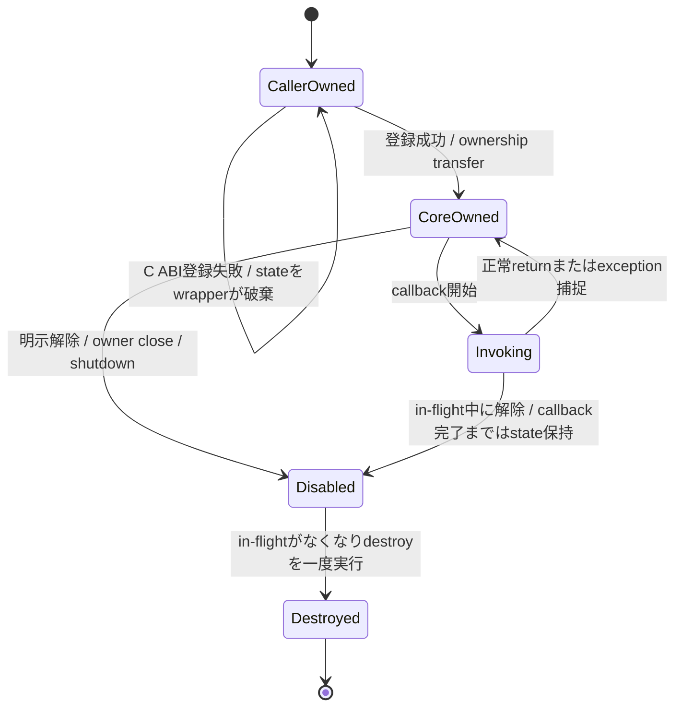

# 適用前記録 / 18-wrapper-cpp.md

- 記録日: 2026-10-17
- 区分: 2026-10-17改訂前の履歴。現行仕様として使用しない
- 元文書: [18-wrapper-cpp.md](../../13_detail_design/18-wrapper-cpp.md)

---

# DD-18 C++ wrapper

- 状態: DD-CPP-01～15承認済み（2026-10-12）
- 作成日: 2026-10-12
- 対象: C++ wrapperのhandle所有、RAII、callback、error変換、thread affinity、Runtime終了
- 上位出典: Accepted ADR-0001、Accepted要件、承認済みL1～L4、A1～A32、BD-01/27/28/36
- 先行詳細設計: 承認済みDD-01～17
- 作業計画: [DD-18 作業計画](../dd18-wrapper-cpp.md)

本書のDD-CPP-01～15は利用者承認済み（2026-10-12）。承認済みC ABI契約をC++から安全に使うwrapper境界を定める。C ABIの宣言は仕様案であり、本書の例示型・擬似コードも公開済みC++ APIではない。例外無効buildでの戻り値経路、利用者が差し替えられるcallback exception handler、C++内の確保済みcleanup管理を追加する。追加API具体化は、計画済み詳細設計DD-00～22を終えて全項目を整理するまで保留する。

## 1. 範囲と責務

| 領域 | C++ wrapperの責務 | 本書で確定しないこと |
|---|---|---|
| handle | owned tokenとborrowed argumentを区別し、tokenのretain/releaseを包む | C ABIのsymbol追加、内部token表現 |
| callback | 言語側captureをuserdata内に保持し、例外をABI境界で止める | callback診断API、個別機能の戻り値意味論 |
| error | `ui_status`とimmutable Error snapshotをC++ error surfaceへ移す | 全domain/code catalog、message localization |
| thread | UI thread限定を維持し、worker更新をDispatcherへ導く | UI executor実装、Platform loop詳細 |
| lifecycle | 明示closeとRAII token解放を提供する | finalizer queue failure時のnative契約変更 |
| values | 5つのProperty kindを明示変換する | DECIMALのABI符号化、値型間の暗黙変換 |

本案は既存のC ABIを覆う薄いbindingとする。独立したC++側Property正本、C++ object pointerのABI受渡し、C++例外のABI越境を導入しない。

## 2. 判断案

| ID | 判断案 | 根拠・境界 |
|---|---|---|
| DD-CPP-01 | すべての公開handle wrapperは内部にopaque `ui_handle` tokenを持ち、token整数・native pointerへの暗黙変換を提供しない。wrapperは期待kindとRuntime関連を型/内部検証で守り、最終的な検証statusはCoreの結果を保持する。 | A1～A3、DD-HND-01～05。ABI tokenをC++ object pointerとして再解釈しない。 |
| DD-CPP-02 | 所有tokenを持つ低層wrapperはmove-onlyとし、destructorで一token分の`handle_release`を試みる。所有tokenの複製は`handle_retain`を呼ぶ明示操作（例示名 `clone()`）だけで行う。借用handleは呼出し中のみ有効な非所有viewとして渡し、破棄時にreleaseしない。 | A1、DD-HND-04、DD-LIFE-01、DD-VAL-01。C++ copyがABI retainを隠れて起こすと失敗可能性と参照数が不透明になる。 |
| DD-CPP-03 | `close()` / `reset()`等の明示終了操作はstatus/errorを呼出し側へ返せる形にし、成功時だけ所有tokenを空にする。RAII destructorは例外を投げず、release成功時にtokenを空にし、失敗時はDD-CPP-15の言語内cleanup管理へ所有tokenを移す。 | A8、DD-VAL-04/06、DD-LIFE-06、DD-CPP-15。 |
| DD-CPP-04 | C++ callback captureは安定したheap stateに置き、C trampolineがそれを取り出して呼ぶ。C APIの登録/postが失敗した場合、所有権をCoreへ渡さずwrapperがstateを解放する。成功時はCoreのdestroy thunkがstateを一度だけ解放する。 | R3、A10～A12、L4、DD-CB-01/02/07。登録中のcallback開始可否はowner API契約が明示する。 |
| DD-CPP-05 | callback trampolineとdestroy thunkは`noexcept`とし、ユーザーcallableからのC++ exceptionをC ABIへ出さない。例外有効buildではcallback例外を利用者設定のhandlerへ渡せる。handler自体もthrowしてはならず、callback種別の失敗意味論を置き換えない。 | R3/R4、DD-CB-05～07、DD-CPP-14。handler未設定時の既定記録方法と診断payloadは後続で具体化する。 |
| DD-CPP-06 | C++ wrapper操作は、例外を使わずstatus/resultで失敗を返す基底経路を持つ。例外有効buildではその結果を`UiError`系例外へ変換する便宜APIを提供できる。Error snapshot取得時はowned error handleとraw status/domain/codeを保持し、詳細生成不能でも元statusを失わない。 | A2/A15/A18、DD-ABI-05～07、DD-VAL-04/05、DD-CPP-13。型名と具体 overloadはAPI設計章まで確定しない。 |
| DD-CPP-07 | unknown status/domain/codeは捨てず、raw数値としてgeneric failureに保持する。messageは表示用情報とし、分岐や再現可能なcode識別に使わない。UTF-8 messageはlength付きbyte列として読み、NUL終端やlossy conversionを前提にしない。 | DD-ABI-05/07、DD-VAL-02～06。C++標準string encodingとの変換規則は後続wrapper共通設計で確認する。 |
| DD-CPP-08 | Property kindごとに明示したC++型変換を行い、範囲外整数の切り詰め、型間の暗黙変換、`std::string`のNUL終端依存を避ける。UTF-8はdata pointer+byte lengthで渡す。 | DD-VAL-01～03、DD-PROP-01～03、BD-01。F64/DECIMALの具体ABIが未確定な部分は型trait等の拡張点に留める。 |
| DD-CPP-09 | UI-affine objectのUI操作はUI thread上に限定する。workerからUI操作を直接呼ばず、承認済みDispatcher/post経路へ値またはtaskを渡す。`runtime_is_ui_thread`は明示的な確認用とし、誤thread操作をwrapper内で黙って同期dispatchしない。 | R2、L3、DD-DSP-01～07。各操作のAPI固有thread契約は所有するDDに従う。 |
| DD-CPP-10 | Runtime shutdownは`shutdown()`等の明示操作とし、完了済みか要求受付済みかを戻り値で区別する。callback/event内の呼出しは`UI_PENDING`受付後に戻り、worker同期呼出しはUI-thread cleanup完了後に戻る。Runtime destructorがshutdownを暗黙実行する設計にはしない。 | BD-36、DD-ABI-06/09、DD-DSP-08、L4。host UI loop停止時のworker解除とRuntime破棄時の扱いは未決。 |
| DD-CPP-11 | Runtimeを使うUI-affine wrapper、活性Subscription/Binding、callback stateの寿命関係をC++ object graphで見えるようにする。Runtime shutdownは最初に明示完了させ、その後に従属wrapperをclose/releaseし、Runtime handleを最後に解放する使用順を提示する。 | R2、L4、DD-LIFE-02～08、DD-07/08/10/11。各objectがRuntimeをC++ shared ownershipで延命するかは別途所有型の詳細判断が必要。 |
| DD-CPP-12 | DD-LIFE-06の「worker finalizer enqueue失敗時は公開tokenを消費しない」契約を維持し、C++ wrapper内でtokenの所有を保つ。destructorはrelease失敗を隠さずcleanup管理へ移管し、UI threadで再試行する。 | DD-LIFE-06、DD-HND-04、A8、DD-CPP-02/03/15。Core側release契約は変更しない。 |
| DD-CPP-13 | 例外無効buildでも全てのwrapper操作とcallback adapterを利用できるよう、status/resultによる非throw経路を基底とする。例外有効buildのthrowing APIは同じ基底結果から構成する薄い便宜層とする。 | A2、DD-VAL-04/05。例外無効buildでC++例外を要求せず、callbackは明示結果または種別固有failureを返す。 |
| DD-CPP-14 | 例外有効buildで、callback内の捕捉した`std::exception_ptr`を利用者設定のexception handlerへ渡せるようにする。handlerは`noexcept`で、対象Runtime/callback種別に関連付ける。handler内の再throw・UI API呼出し可否は別途制約を定めるまで禁止候補とし、C ABIへ例外を漏らさない。 | R3、DD-CB-05～07。公開登録API名・handler交換時の同期・既定handlerは後続API設計で具体化する。 |
| DD-CPP-15 | 各OwnedHandleはnative owned tokenを受け取る前にcleanup nodeを確保する。node確保に失敗する場合はcreate/retain等のnative callを開始せず、optional error outputも要求しない。destructorでnative releaseが失敗した場合はtokenとnodeをC++内のintrusive pending-cleanup registryへ移管する。registryはUI thread safe pointで再試行し、Runtime shutdown完了後にも残ったtokenをClosed shellのreleaseとしてdrainする。shutdown APIはcleanup drainの完了までRuntime ownerを保持する。 | DD-LIFE-02/06/08、DD-DSP-08、DD-CPP-03/12。registryの同期・Runtime pinning・OOM・library unload境界は実装前のAPI設計で具体化し、silent leakを成功扱いしない。 |

## 3. 所有wrapperとborrowed view

### 3.1 handle wrapper案

```cpp
// 擬似コード: 公開名・template構造・例外有無の確定宣言ではない。
class OwnedHandle {
public:
  OwnedHandle(const OwnedHandle&) = delete;
  OwnedHandle& operator=(const OwnedHandle&) = delete;
  OwnedHandle(OwnedHandle&&) noexcept;
  OwnedHandle& operator=(OwnedHandle&&) noexcept;
  ~OwnedHandle() noexcept;

  Result<void> close();       // 明示release。成功時にemptyとなる。
  Result<OwnedHandle> clone() const; // retainで別tokenを得る。
};

class BorrowedHandleView {
  // 呼出し中のみ有効。コピー可能でも所有tokenを増やさず、releaseしない。
};
```

`Result`は例外無効buildにも使える非throw基底経路を示す説明用の抽象名であり、`std::expected`採用やC++標準versionは決めない。例外有効buildの便宜APIは同じ失敗情報を例外へ変換する。明示closeはどちらのbuildでも失敗を観測できる。

| 対象 | owned wrapperの破棄 | 明示終了 | Runtimeとの関係 |
|---|---|---|---|
| Runtime | token releaseのみ。shutdownを暗黙開始しない | shutdown完了後にhandleをrelease | Runningのまま破棄された場合のdiagnostic/防止策は未決 |
| Property/Widget/Command | owned tokenを一つrelease | UI意味論上のcloseが定義される型だけ提供 | Runtime state anchorはCore側で管理（DD-LIFE-02） |
| Binding/Subscription | token releaseとCoreの承認済み解除規則に従う | 必要な型は明示deactivate/closeを持つ | closure破棄時にC++ captureを一度だけ解放 |
| Error | immutable snapshot tokenをrelease | 通常の明示closeは不要 | UI Runtime操作とは独立したread-only snapshot |

型別APIがreleaseとdeactivateを分離している場合、C++ destructorはそのAPI固有の契約に合わせる。DD-02/07/08等にない一律のclose副作用は付けない。

### 3.2 Scopeと寿命順

- Wrapperが内部にborrowed Runtime viewを保持する場合、そのviewが指すRuntime tokenの寿命を型やscopeで制約する。danglingなC++ referenceだけで安全性を主張しない。
- moveは一つのowned tokenの所在を移すだけで、Core retainを呼ばない。cloneは別tokenを発行し、元wrapperと独立してcloseできる。
- create/retain/out-errorなどowned tokenを受ける操作では、wrapperがcleanup nodeを先に確保してからnative callを行う。ticket確保失敗ならnative token生成を開始しない。native APIが複数owned outputを返す場合は必要数のnodeを先に確保する。
- wrapperが親Runtimeのshared pointerを保持する案は、Runtime object寿命を延ばす意味がDD-LIFE-02のCore anchorと一致しない可能性がある。採用は未決とし、Runtime C++ ownerの寿命モデルと併せて決める。
- 正常終了の基本順は、UI上の使用停止、Runtime shutdown完了、子wrapperのtoken release、最後にRuntime token releaseとする。実際のshutdownでCoreがcleanupする参照を、利用者が先に全て手動解除する必要はない。

## 4. Callback captureとexception境界



- wrapperはcallableと必要な参照を一つのcallback stateに格納する。Coreへ渡す`userdata`はこのstateへのstable pointerとし、C function pointerは静的なtrampolineとdestroy thunkを用いる。
- API呼出しが失敗した場合はstateをwrapperが解放し、Core側destroyを期待しない。成功時にはDD-CB-01に従いCoreが一度だけdestroyする。
- trampolineはcallback種別の契約を適用してからcallableを呼び、C++ exceptionを必ずcatchする。通知例外、Validator拒否、Command failure、TextBox input resultを同じgeneric statusへ潰さない。
- callback内の自己解除はDD-CB-03とowner API固有制約に従う。in-flight stateはcallback returnまで保持し、destroy中はUI APIを呼ばない。
- 登録APIの戻り前に初回callbackを同期実行するかは各owner ABI契約で確認する。同期実行があり得る場合、成功statusが返るまでuserdata所有権を決められない単純なunique ownership transferを避ける必要がある。

### 利用者handlerと既定診断の境界

利用者設定handlerはcallback例外を受け取る拡張点として承認された。DD-CB-06のnotification例外後も他の購読者への配信を続ける。既定handler、診断payload/API、handler自体のfailure reportingは未定義なので、後続API設計で具体化する。handlerはC ABIを越える例外伝播を行わず、callback種別の戻り値・failure意味論を変更しない。

## 5. Errorと値変換

### 5.1 API error

通常のwrapper操作はstatus/resultによる非throw経路を必ず提供する。例外有効buildでは、同じ失敗を`UiError`相当へ変換する便宜APIを選べる。例外は少なくともraw `ui_status`を保持する。C APIが`out_error`を返した場合はC++ error objectがそのowned error handleをmove ownershipで保持し、必要な場合にstatus/domain/code/messageを取得する。Error取得中のallocation failureでも元statusを失わない。

```cpp
// 説明用概念。メンバーと名称はレビュー対象。
class UiError /* : public std::exception */ {
  ui_status status();
  std::optional<std::pair<uint32_t, uint32_t>> domain_code();
  std::string_view? message_utf8();
  // underlying immutable Error handleは所有し、破棄時releaseする。
};
```

例外無効buildでは非throw経路だけで完結する。例外有効buildではthrowing convenience層を提供できる。検証拒否・Command failure等、機能APIで通常の状態結果と定義済みのものはAPI固有設計に従い、全てを例外へ変換しない。

### 5.2 値型

| ABI kind | C++対応案 | 変換境界 |
|---|---|---|
| BOOL | 明示bool変換 | 0/1以外を生成しない |
| I64 | 符号付き64-bit型 | より狭い整数への暗黙切り詰めなし |
| UTF8 | byte lengthを保つUTF-8 value | 入力はcall中借用、保持時Core copy。getterは容量照会/retry規則に従う |
| F64 | binary64対応型 | NaN/±0等価などBD-01意味論をwrapperで変更しない |
| DECIMAL | 後続ABI表現に結びつく専用型trait候補 | `double`/stringへの暗黙変換やparse規則は追加しない |

C++の`std::string`は便宜上UTF-8 byte列を保持できるが、型だけでvalid UTF-8を保証しない。入力検証はCore contractに従い、wrapperが事前検査するかCoreへ委ねるかは失敗statusを保持する範囲で選ぶ。Embedded NULは長さで扱い、終端NULをABIへ含めない。

## 6. ThreadとshutdownのC++ surface

| 呼出し状況 | C ABI契約 | C++ wrapper案 |
|---|---|---|
| UI-affine getter/setterをworkerから呼ぶ | `UI_WRONG_THREAD` | 直接操作は例外/statusにし、暗黙dispatchしない |
| workerから非同期post | 成功後Coreがclosureを所有 | task/captureを安定化してからpost。失敗時はwrapperが保持・破棄 |
| callback/event中にshutdown | 優先control taskを受付後`UI_PENDING` | 「要求受付済み」を同期完了と区別する結果にする |
| workerからshutdown、loop稼働 | UI threadのcleanup完了まで同期waitし`UI_OK` | 呼出し元が待つことをAPI名/戻り型で見えるようにする |
| worker同期wait中にUI loop停止 | 挙動未決 | timeout/cancelを独自に作らず、未決状態として露出・検証する |

非同期shutdownで完了待ちfutureを付加する根拠はないため、本案では追加しない。callback/event中の`UI_PENDING`後にcompletion APIが必要かはDD-ABI-09で未決のため別判断を要する。

## 7. 失敗・競合ケース

| ケース | C++ wrapperの期待動作案 |
|---|---|
| `handle_retain`失敗 | cloneは失敗を返し、元owned tokenを変更しない |
| 明示closeでrelease失敗 | wrapper内のtokenを保持し、callerが再試行できる |
| destructorでrelease失敗 | 事前確保済みcleanup nodeにtokenを移し、C++内pending-cleanup registryがUI thread safe pointまたはshutdown後に再試行 |
| callback登録失敗 | callback stateはwrapperが解放し、destroyを二重実行しない |
| callback中のC++例外 | trampolineで捕捉し、ABIへ伝えない。owner固有のfailure/diagnosticへ変換 |
| callback自己解除 | in-flight callbackを終えた後にdestroyし、同一callbackを再度開始しない |
| unknown status | raw valueを保持しgeneric errorとして扱う |
| error snapshot生成不能 | 元のstatusを報告し、架空のdetail/error handleを作らない |
| UTF-8 getterでbuffer不足 | caller bufferを一部更新せず、必要長を使い再試行する |
| worker release時queue満杯/OOM | C ABIはtokenを消費しない。明示closeは失敗を返し、destructorは事前確保cleanup nodeへ所有権を移す |
| callback/event中shutdown | 現eventを中断せず、要求受付済みで戻る。完了済みと表示しない |

## 8. 検証観点

- move後に元wrapperがreleaseしないこと、cloneが別tokenを一つretainして独立にreleaseできることを確認する。
- Borrowed viewの破棄がCore参照数を変えず、呼出しscopeを越えて保存する型がないことを確認する。
- UI thread上の最終release、worker上のrelease、finalizer queue enqueue失敗、明示close再試行、destructorからcleanup registryへの移管とdrainを分けて検証する。
- Runtimeをshutdownせず破棄した場合、shutdown後に子wrapperを解放した場合、残存Error handleを読む場合の状態を検証する。
- callback登録成功/失敗、初回callback時点、callback自己解除、owner close、shutdown、C++ exception、destroy一回性を確認する。
- Property notification exception後に利用者handlerを呼んでから他subscriberへ通知を続ける。handler未設定時の既定診断記録はAPI設計章で定める。
- status、known/unknown domain/code、error snapshotの保持、error allocation failure、UTF-8 multibyte/embedded NUL/buffer不足を検証する。
- UI-thread APIをworkerから呼ぶ場合に自動dispatchせず、post worker更新はUI threadで実行することを確認する。
- UI callbackからshutdownするとpendingを区別し、worker同期shutdownはcleanup完了まで待つ。停止loop条件は未決に追跡する。
- 例外有効/無効の両方を検証対象とする。最低C++標準、具体compiler matrix、target calling conventionはDD-22で確定するまで、配布可能header適合テストを完了扱いにしない。

## 9. 未決事項と後続担当

| 未決事項 | 担当・次の判断 |
|---|---|
| C++ pending-cleanup registryのnode確保、同期、Runtime pinning、UI safe point wake、shutdown後drain、共有library unload時の寿命 | DD-CPP-15のAPI/implementation design。DD-02のtoken未消費契約は変更しない |
| Runtime wrapperをshutdown前に破棄した場合のdiagnostic、debug assertion、owner state | DD-02/06との整合を確認し、必要ならC++公開API判断 |
| `Result`/status型、throwing convenience層の具体型と最低C++標準 | 後続API設計章。Buildの対象標準はDD-22とも整合 |
| Error messageのUTF-8からC++ string/wide stringへの表示変換 | DD-06/22、application localization boundary |
| 利用者exception handlerの設定scope、default handler、handler自身の例外/再入、callback failure visibility | 後続API設計章。DD-06/07/10/14、追加候補DD-24と整合 |
| Native APIが登録関数から戻る前にcallbackを呼ぶか | owner APIごとの契約。userdata transfer順を確定する前に検証 |
| DECIMAL専用C++ valueとABI encoding、F64/DECIMAL property API | DD-07およびABI上位判断後 |
| Window/UI peer closeとAccessibility providerを含むplatform object寿命 | DD-16/17未決事項。C++ wrapperから補完しない |
| package、DLL/SOロード、ABI symbol解決、static/dynamic配布 | DD-22 |
| C++/C#/Rust/Pythonで揃えるcallback/error/lifetime verification suite | DD-19～23 |

## 10. 承認記録

利用者は2026-10-12にDD-CPP-01～15を承認した。追加条件として、例外無効buildの非throw result経路、例外有効buildで利用者がcallback exception handlerを差し込めること、release failure時のC++内pending-cleanup管理を反映した。DD-LIFE-06のnative契約は変更せず、具体的なregistry機構と公開handler APIは未決として後続のAPI具体化へ送る。追加API具体化は計画済み詳細設計DD-00～22完了後に全項目を整理するまで保留とした。DD-18を完了し、次の計画済みphase DD-19へ進む。
