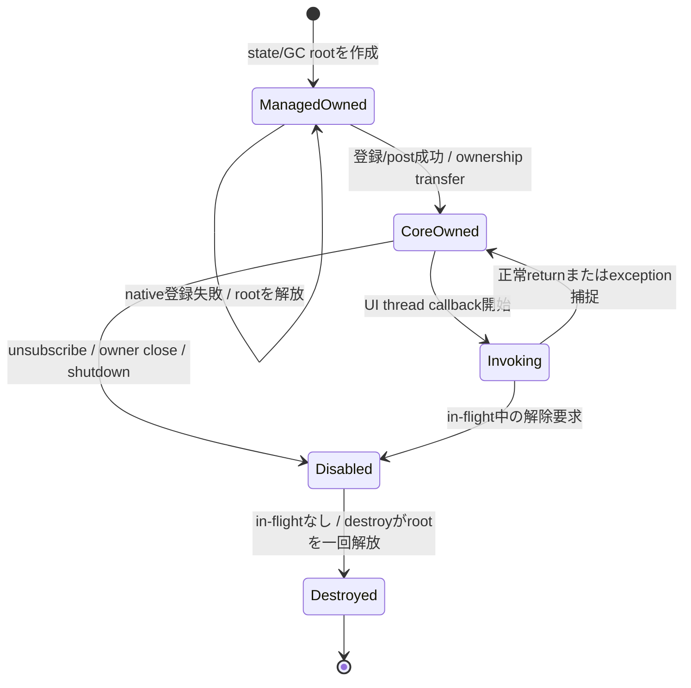

# 適用前記録 / 19-wrapper-csharp.md

- 記録日: 2026-10-17
- 区分: 2026-10-17改訂前の履歴。現行仕様として使用しない
- 元文書: [19-wrapper-csharp.md](../../13_detail_design/19-wrapper-csharp.md)

---

# DD-19 C# wrapper

- 状態: DD-CS-01～14承認済み（2026-10-12）
- 作成日: 2026-10-12
- 対象: C# P/Invoke、handle寿命、Dispose、callback delegate/userdata保持、thread affinity、status/error変換
- 上位出典: Accepted ADR-0001、Accepted要件、承認済みL1～L4、A1～A32、BD-01/18/27/28/36
- 先行詳細設計: 承認済みDD-01～18
- 作業計画: [DD-19 作業計画](../dd19-wrapper-csharp.md)

本書のDD-CS-01～14は利用者承認済み（2026-10-12）。managed wrapperはversioned C ABIを呼び出し、managed object/delegateをABIへ直接公開しない。C ABI declarationと本書のmanaged signature例はレビュー用であり、配布headerや実装済みAPIを意味しない。NuGet package、TFM、RID matrix、native loadingの最終選択は承認済みBD-18とDD-22に従う。表に記したSafeHandle/cleanup managerやdelegate-root方式は責務・寿命契約の承認であり、最終interop generator、TFM、公開API名まで確定するものではない。

## 1. 前提と責務境界

| 領域 | C# wrapperの責務 | 別設計へ残す事項 |
|---|---|---|
| P/Invoke | C ABIの固定幅型・calling convention・statusをmanaged型へ正確に写す | generator/style、最終TFM、API symbol一覧 |
| Handle | owned/borrowedを識別し、retain/releaseと同時Disposeを安全にする | Core token表現、release failure意味論の変更 |
| Callback | managed stateをGCからrootし、C ABIのdestroyまで保持する | 機能別callback結果、共通exception diagnostics API |
| Error | status/error snapshotをC#の明示失敗へ変換する | 全code catalog、message localization |
| Package | BD-18のRID native asset同梱を前提として参照する | NuGet ID/feed、TFM、load resolver、ARM profile（DD-22）|

## 2. 判断案

| ID | 承認済み判断 | 根拠・境界 |
|---|---|---|
| DD-CS-01 | Native interop declarationはC ABIと同じfixed-width typesを使う。`ui_handle`は`ulong`として値を保ち、`IntPtr`をC ABI handle表現やnative object pointerとして扱わない。C callback/userdataのpointer引数だけを`IntPtr`等のpointer-sized表現にする。 | A1～A3、DD-VAL-01。initial C# RIDはBD-18の64-bit `win-x64`/`linux-x64`。将来32-bit targetも必要なら`ulong`とP/Invoke declarationのmarshal互換を個別検証する。 |
| DD-CS-02 | 公開managed wrapperは`IDisposable`を実装し、明示`Dispose`/`Close`でtoken releaseまたはAPI固有deactivateを行う。Disposeは冪等とし、成功したrelease後だけtokenをemptyにする。finalizerは明示cleanupの代用にしない。 | L4、DD-LIFE-04～08、DD-CPP-02/03。 |
| DD-CS-03 | P/Invoke中のowner Dispose/release競合を避けるため、各native callはhandle lifetime leaseを取得し、call return後に解放する。leaseを持つcallが終了するまで最後のtoken releaseを開始しない。callbackからの再入Disposeもdeadlockさせない実装にする。 | DD-LIFE-01、DD-HND-04、DD-CPP-02。`SafeHandle`をそのまま`uint64_t`引数へmarshalするか、明示lease付き`ulong`を渡すかは最終interop styleで検証する。 |
| DD-CS-04 | `SafeHandle`は候補として調べるが、`ReleaseHandle`をCore releaseの単純な一回呼出しにしない。release失敗可能性に対して、事前確保済みcleanup ticketをC#側registryへ移管できる場合に限り利用する。代替ownerでも同じno-loss・retry契約を満たす。 | DD-LIFE-06、DD-CPP-15。Microsoft契約は`ReleaseHandle`実装が失敗してはならないとしている。今回のC ABI release failureと無条件に一致するとは限らない。 |
| DD-CS-05 | Persistent callbackは、長期native callback pointerにmanaged delegateの個別instanceを渡してGC任せにしない。固定rootされたstatic trampoline delegate（または将来検証済みのstatic function pointer）を用い、各subscription userdataはmanaged callback stateを指す`GCHandle`相当のstrong rootとする。 | R3、A10～A12、L4、DD-CB-01/02/07。Microsoft docsはcall return後もcallbackされるdelegateをcallback終了までrootするよう要求する。 |
| DD-CS-06 | callback stateのrootを作成後、C API登録/postが成功すればCoreへ所有権を移し、失敗すればC#側でrootを一度だけ解放する。成功closureのCore destroy callbackがin-flight invocation終了後にstateを解放する。 | DD-CB-01～03/07、DD-DSP-02/08。API登録中に同期callbackが始まる可能性はowner ABI契約を確認する。 |
| DD-CS-07 | managed callback trampolineはmanaged exceptionをcatchしてABI境界へ伝播させない。C# wrapperでは利用者が設定したRuntime/callback別handlerへ情報を渡せるようにする。handler自身のthrowも境界外へ出さず、callback種別のfailure意味論を変更しない。 | R3、DD-CB-05～07、DD-CPP-05/14。既定handler、再入制限、diagnosticsは後続API設計へ送る。 |
| DD-CS-08 | Statusによる非throw result/try経路を持ち、詳細失敗にはimmutable Error snapshotを保持するtyped C# exceptionを併設できる。unknown `ui_status`/domain/codeはraw数値を保ったgeneric failureとし、message文面で分岐しない。 | A2/A15/A18、DD-ABI-05～07、DD-VAL-04/05、DD-CPP-06/07。検証reject等の通常結果は機能API契約に従う。 |
| DD-CS-09 | Error messageとUTF-8 Property値はlength付きbyte列として扱う。末尾NUL、埋め込みNULの切捨て、変換不能byte列の暗黙replacementを前提にしない。 | DD-VAL-02/03、DD-ABI-07。C# `string`との厳密変換/invalid sequence policyは後続API designで決める。 |
| DD-CS-10 | UI-affine object APIはUI thread専用とし、workerから直接呼ばない。非同期worker更新は`runtime_post`/dispatcherへ値copyとclosure ownershipを渡し、UI threadでsetterを行う。C# wrapperは誤threadを自動dispatchしない。 | R2、L3、DD-DSP-01～07。 |
| DD-CS-11 | Runtime shutdownは明示APIとし、`UI_PENDING`による受付と`UI_OK`によるUI-thread完了を別の結果として表す。callback/event内のshutdownで同期待ちしない。worker同期shutdownはloop稼働時のみnative契約どおり完了を待つ。 | BD-36、DD-ABI-06/09、DD-DSP-08、DD-CPP-10。loop停止時wait解除は未決。 |
| DD-CS-12 | C# cleanup managerは各owned tokenに対応するpreallocated cleanup ticketを持つ。Ticket確保後にだけcreate/retain/out-handle ownershipを取得する。明示DisposeまたはGC cleanupでnative releaseが失敗したとき、token所有をticketへ移し、UI thread safe pointでretryする。Runtime shutdownはUI-affine cleanup後に残存ticketをClosed shell releaseとしてdrainする。 | DD-LIFE-06/08、DD-CPP-15。Registryの同期、Runtime pinning、process shutdown順、assembly unload時の処理は未決。 |
| DD-CS-13 | C# API surfaceはCore Propertyを値の正本とし、既存C# ViewModelは明示adapter経由で接続する。任意property/fieldのreflection discoveryと自動通知同期を初期契約に含めない。 | L1/L2、DD-CPP-08。 |
| DD-CS-14 | BD-18どおりmanaged assemblyとtarget native runtimeは一つのNuGet packageに含め、initial RIDは`win-x64`と`linux-x64`とする。C# wrapper内にRID catalogやARM board support promiseを重複定義しない。 | BD-18、要求仕様§9、DD-22。package name/TFM/loading detailsは本判断に含まない。 |

## 3. P/Invokeとhandle lifetime

### 3.1 ABI type mapping案

| C ABI | C# interop表現案 | wrapper上の注意 |
|---|---|---|
| `uint64_t ui_handle` | `ulong` | 0はinvalid、native pointer castなし |
| `uint32_t ui_status` | `uint`またはraw enum裏付け値 | unknown値を保持 |
| `uint8_t ui_bool` | `byte` | managed `bool`へのmarshal契約を明示し、0/1以外を成功扱いしない |
| UTF-8 pointer + `uint64_t length` | `IntPtr` + `ulong`（入力） | call中だけborrow。Coreが保持する場合native sideがreturn前にcopy |
| callback + userdata + destroy | static callback entry points + `IntPtr userdata` | capture/objectはmanaged state rootへ保持 |
| optional `out_error` | `ulong` out tokenまたは0 | Error wrapperへownership transfer |

P/Invoke signatureはC headerをsource-of-truthにしてABI testsで照合する。C# `bool`, `nint`, struct layoutをfixed-width C typesの代替とするかは個別のmarshal testなしに決めない。

### 3.2 P/Invoke中のDispose

各ownerはnative callへ入る前にleaseを取得する。leaseはtokenのreleaseを一時禁止し、呼出しが戻った後にreleaseを許す。C# lockをnative callの間保持する単純案は、native callbackからDisposeが再入するとdeadlockし得るため避ける。`SafeHandle.DangerousAddRef`相当かowner-local in-flight counterかは最終interop/TMF/API設計時に選ぶ。

SafeHandleはP/Invokeのresource ownerとして有用だが、UI Runtime tokenのcleanupを単純な`ReleaseHandle`へ直接書くとDD-LIFE-06の再試行契約に合わない可能性がある。Microsoft guidanceは`ReleaseHandle`が失敗しない実装を求める。利用する場合、ReleaseHandleがtokenを事前確保済みreaper ticketへ移し、移管完了を解放成功として扱う設計を検証する必要がある。[SafeHandle.ReleaseHandle](https://learn.microsoft.com/dotnet/api/system.runtime.interopservices.safehandle.releasehandle)、[SafeHandle class](https://learn.microsoft.com/dotnet/api/system.runtime.interopservices.safehandle)

## 4. Callback rootと所有状態



- C ABI callback pointerは、subscriptionごとに一時delegateを作って渡す方式としない。固定static trampolineを使う案とする。delegate/function pointerの形式・calling conventionはABI targetと.NET versionを合わせて検証する。
- userdataはcallback state objectをrootした`GCHandle`等で表現する。pinningはmanaged objectのアドレスをC ABIへ直接渡す用途でない限り不要とする。
- Registration失敗時にはC# wrapperがGC rootを解放し、Core destroyを期待しない。成功時はC ABI closure destroyがcallback stateを一度だけunrootする。
- UI thread上のdestroy callbackはmanaged callback/delegate参照の解放だけを行い、UI APIを呼ばない。finalizerやdelegate target finalizationから追加UI操作を起こさない。
- 長期native callbackのためdelegateを保持しなければならないこと、およびcall return後もcallbackが続くときの管理が必要なことはMicrosoft P/Invoke callback guidanceと整合する。[Implement callback functions](https://learn.microsoft.com/en-us/dotnet/standard/native-interop/how-to-implement-callback-functions)、[P/Invoke callbacks](https://learn.microsoft.com/en-us/dotnet/standard/native-interop/pinvoke)

## 5. C# exception/error surface

```csharp
// 擬似コード。公開型名・signature・TFMの確定宣言ではない。
Result<T> TryGetValue<T>(Property<T> property); // exception-free result path
T GetValue<T>(Property<T> property);            // convenience path may throw UiException
```

- Result surfaceはstatusとoptional Error snapshotを保持する。例外convenience surfaceは同じraw status/domain/code/native Error snapshotを持つ`UiException`へ変換する。
- error detail handleがない場合も、C ABI statusを維持する。unknown statusやfuture domain/codeをgeneric managed exceptionへ正規化してraw numeric dataを消さない。
- Validation rejectionやCommand state/failure snapshot等、機能APIが通常の結果として定義する値をすべてexceptionへ変換しない。
- callback内exceptionはP/Invoke境界へ伝播しない。利用者handlerへcallback種別、Runtime context、例外情報を渡す案とする。handler自身の例外、report先、default handlerは後続API designで決める。
- delegate callback stateのdestroy中やfinalizer中にユーザーhandlerを呼ばない。

## 6. Runtime・Dispose・thread規則

| 操作 | C# wrapper案 |
|---|---|
| Runtime作成 | returned owned tokenからRuntime ownerを作成 |
| UI API | UI threadでのみ呼ぶ。workerからの直接呼出しはstatus/resultまたはexceptionで誤threadを示す |
| worker更新 | value snapshotを渡すpost APIへ送る。成功時にcallback state所有権移転、失敗時C#側でcleanup |
| Subscription/Binding Dispose | CoreのDD-07/08解除・release意味論に従い明示解放 |
| Runtime Shutdown | 明示呼出し。callback中はaccepted/pending、worker同期はloop稼働時に完了待ち |
| Runtime Dispose | shutdownを暗黙に開始しない。未shutdown時の診断/拒否方法は未決 |
| finalization | fallback cleanup managerへのownership transferだけを行い、UI-affine Core処理を直接実行しない |
| shutdown後の残存token | Closed shell releaseをcleanup managerがdrainし、最後にRuntime native ownerを解放 |

C# wrapperが各child managed wrapperからRuntime managed ownerを参照保持するかは、C ABI Runtime anchor（DD-LIFE-02）と矛盾しないよう決める。managed referenceでRuntimeを延命しても、native `runtime_shutdown`を省略できることにはならない。

## 7. Native library loading境界

BD-18はRID別native assetを`runtimes/{rid}/native/`へ格納し、最初は`win-x64`と`linux-x64`を採用する。NuGet/.NET SDKのpublish asset配置を利用する方針である。P/Invokeはruntimeがplatform別library name/extensionを探索し、より複雑な選択ではassemblyごとの`NativeLibrary.SetDllImportResolver`等を使える。一つのassemblyへ設定できるresolverは一つなので、wrapper package同士の連携やconsumer側resolverとの競合を確認する必要がある。[Native library loading](https://learn.microsoft.com/en-us/dotnet/standard/native-interop/native-library-loading)、[SetDllImportResolver](https://learn.microsoft.com/en-us/dotnet/api/system.runtime.interopservices.nativelibrary.setdllimportresolver)

DD-19ではloader implementation、resolver導入、NuGet package filenameを決定しない。開発時build/run、RID publish、self-contained/single-file、ARM/Yocto profileはDD-22とBD-18未決条件に残す。

## 8. 失敗・競合ケース

| ケース | C# wrapperの期待動作案 |
|---|---|
| P/Invoke call中にDispose | in-flight leaseが終わるまでnative tokenをreleaseしない |
| callback登録失敗 | `GCHandle` rootをC#側が解放。Core destroyを呼ばない |
| callback登録成功 | state/delegate targetをCore destroyまでroot |
| callback内exception | catchし、利用者設定handlerへ通知。P/Invokeへ越境しない |
| handlerがthrow | さらに境界で捕捉し、callback種別のCore stateを破壊しない |
| Dispose/native releaseがUI finalizer queue OOMで失敗 | Dispose結果で失敗を返しtoken ownerを保つ。finalizer経路では事前確保ticketへ移管 |
| cleanup ticketをUI threadで処理 | release再試行。成功時だけticket/tokenを解放 |
| Runtime shutdown後にpending ticketあり | DD-LIFE-08 Closed shell releaseでdrain後、Runtime ownerを終了 |
| workerからUI-only API | 自動dispatchせずwrong-thread結果 |
| callback中shutdown | `UI_PENDING`をshutdown完了と誤認しない |
| unknown status/domain/code | raw数値とError snapshotを保持したgeneric failure |
| RID assetが存在しない/ロード失敗 | wrapper初期化時にnative load/version/feature failureを識別。詳細loader messageはpackage/runtime診断へ保持 |

## 9. 検証観点

- `ulong`/`uint`/`byte`のP/Invoke width、calling convention、out初期化、ABI major/feature queryをC headerとの相互コンパイル・interop testで確認する。
- callback registration/post後に強制GCを複数回行い、delegate、closure target、userdata stateがCore destroyまで生存する。
- registration failure、self-unsubscribe、in-flight disposal、owner shutdown、post cancelの各経路でGC root/`GCHandle`が一度だけ解放される。
- native callとmanaged Disposeをworker/UIから競合させ、leaseの競合とcallback再入でdeadlock/use-after-freeが起きない。
- finalizer threadからのrelease failure、cleanup ticket移管、UI safe-point retry、Runtime shutdown後drain、ticket allocation失敗を確認する。
- Exception handlerあり/なし、handler自身の例外、callback種別ごとのfailure、unknown native status/errorを確認する。
- UTF-8空/null pointer/embedded NUL/multibyte/buffer-too-small、Error snapshot保持、detail allocation failureをDD-05に照らして確認する。
- `win-x64`/`linux-x64`のNuGet publishでRID別native assetが選択されることはDD-22のpackage testで確認し、DD-19単独の完了条件にdistribution matrixを重複させない。

## 10. 未決事項と後続担当

| 未決事項 | 後続 |
|---|---|
| `SafeHandle` marshallingと`ui_handle` uint64固定幅の互換、in-flight lease方法 | API設計章・DD-22のTFM/interop matrix |
| cleanup managerの同期・preallocated ticket・Runtime pinning・AppDomain/AssemblyLoadContext unload・process exit drain | DD-CPP-15共通論点/API設計章、DD-22 |
| C#最低language version、TFM、`LibraryImport`/`DllImport`、source generationの採用 | BD-18/要求の未決、DD-22 |
| public exception/result type名、Error message encoding policy、unknown code extension | API設計章。DD-06/07/09/10/18との整合 |
| callback exception handler registration scope、default handler、handler failure reporting | API設計章とDD-24候補 |
| `NativeLibrary.SetDllImportResolver`かdefault RID probingか、consumer assembly resolverとの統合 | DD-22。BD-18 package/RID decisionは維持 |
| ARM/Yocto RID・libc・native dependency compatibility | BD-18/BD-16/27、DD-22 |
| UI loop停止中worker shutdown wait解除 | DD-03/06/16とwrapper共通判断 |
| Platform Accessibility UIA/AT-SPI provider wrapper | DD-17未決事項。ここでC# bindingを追加しない |

## 11. 承認記録

利用者は2026-10-12にDD-CS-01～14を記載どおり承認した。固定幅P/Invoke、owned/borrowed lifetime、callback root/destroy、Disposeとcleanup manager、error/thread/shutdown、BD-18のpackage/RID境界を反映する。SafeHandleの具体採用、TFM、interop generator、native loader、cleanup registry実装、公開型/API名は未決のまま維持し、DD-22または後続API設計へ送る。DD-19を完了し、利用者の指示によりDD-20へ進む。
