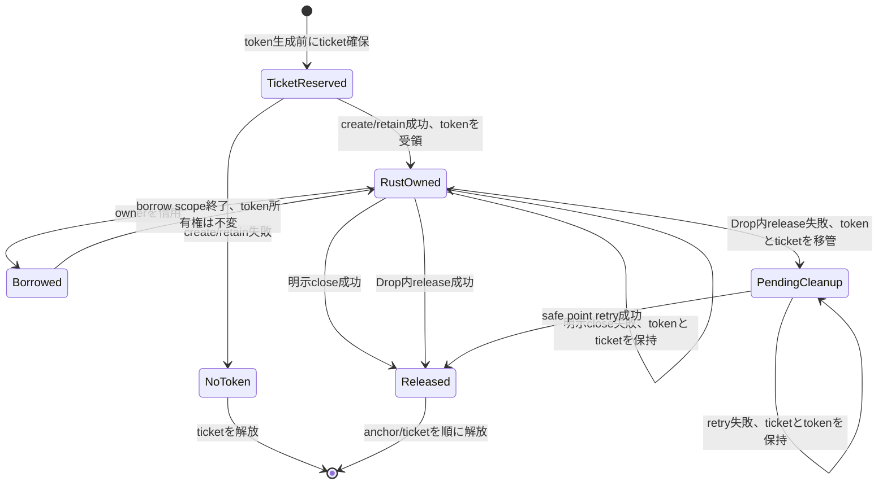
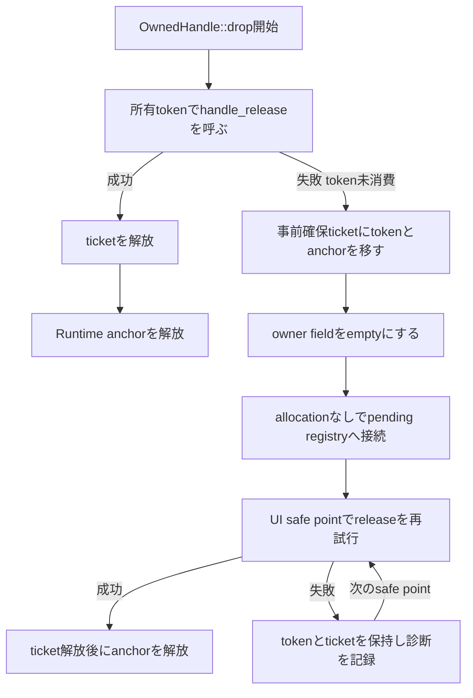
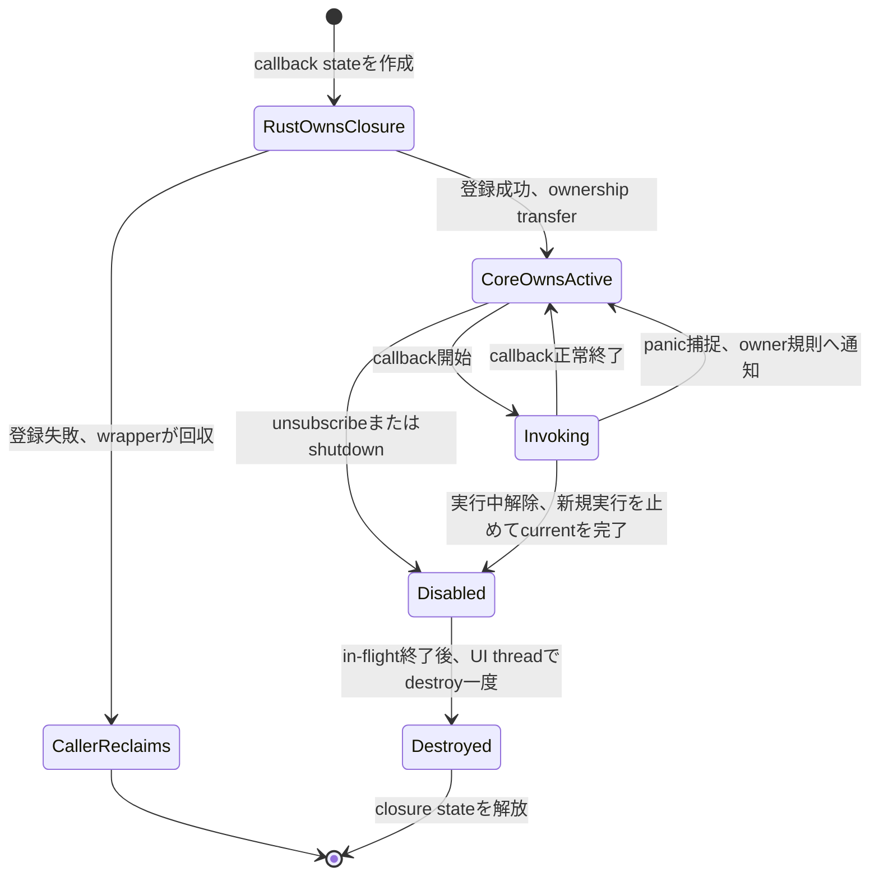

# 適用前記録 / 20-wrapper-rust.md

- 記録日: 2026-10-17
- 区分: 2026-10-17改訂前の履歴。現行仕様として使用しない
- 元文書: [20-wrapper-rust.md](../../13_detail_design/20-wrapper-rust.md)

---

# DD-20 Rust safe API

- 状態: DD-RS-01～15承認済み（2026-10-12）
- 作成日: 2026-10-12
- 対象: Rust safe wrapperの所有型・借用型、thread-safety、dispatcher、callback、panic境界、error・shutdown表現
- 上位出典: Accepted ADR-0001、Accepted要件、承認済みL1～L4、A1～A32、BD-01/16/20/27/28/36
- 先行詳細設計: 承認済みDD-01～19
- 作業計画: [DD-20 作業計画](../dd20-wrapper-rust.md)

本書のDD-RS-01～15は利用者承認済み（2026-10-12）である。例示する型や擬似コードは説明用であり、公開API宣言または実装済みAPIではない。BD-20の二crate構成とtarget別native runtimeの境界を保ち、Rust Coreをwrapper crateへ重複同梱しない。公開型・関数名、crate名、最低Rust version/edition、bindgen、link/loadの最終選択はここでは決めない。

## 1. 責務と境界

| 層 | Rust側の責務案 | この文書で決めないこと |
|---|---|---|
| raw `-sys` crate | C ABIのfixed-width型、symbol、callback ABIをunsafeな低層宣言として提供 | 宣言生成方法、header配布、crate名、link方式 |
| safe wrapper crate | opaque handleの所有権・Runtime関連・thread制約を型で包み、raw pointerを通常の利用者APIから隠す | 最終公開型/関数名、crate名、MSRV/edition |
| native runtime | 他言語と同じtarget別C ABI artifactを利用 | artifact取得、Cargo feature名、library loading/package構成（BD-20/DD-22） |

Safe wrapper crateからRust Coreを再リンクして重複させない。unsafe codeはsafe境界の内側に局所化し、公開safe methodはその不変条件を保つ。`-sys`宣言自体はunsafeな操作面として扱い、Rust利用者がraw handleやuserdata pointerを通常APIへ持ち込む必要をなくす。

## 2. 判断案

| ID | 承認済み判断 | 根拠・境界 | 状態 |
|---|---|---|---|
| DD-RS-01 | Rust wrapperをraw FFI `-sys` crateとsafe wrapper crateに分ける。Safe crateは通常利用時にraw pointer、userdata、C ABI関数呼出しを露出しない。 | BD-20、ADR-0001。unsafe区間をsafe層の内部に限定する。 | 承認済み（2026-10-12） |
| DD-RS-02 | safe wrapperが所有するC ABI tokenはmove-only相当のowner型で包む。ownerの暗黙`Copy`/`Clone`を認めず、明示的なretain操作が成功したときだけ独立した新tokenを持つownerを返す。 | DD-HND-01～05、DD-LIFE-01。`retain`は別tokenを発行し、元tokenを消費しない。 | 承認済み（2026-10-12） |
| DD-RS-03 | 借用handleはownerからの借用として表し、呼出しスコープを越えて保存・releaseできない。異なるRuntimeに属するhandleの組合せはsafe wrapper内でも検証し、最終的なkind/Runtime検証はCoreのstatusを保持する。 | DD-HND-02/03、DD-LIFE-01/02。内部token整数を利用者へ直接公開しない。 | 承認済み（2026-10-12） |
| DD-RS-04 | owned wrapperの明示終了操作は失敗を`Result`相当で返し、release成功時のみownerをemptyにする。失敗時はtoken ownershipをowner側へ残し再試行可能とする。 | DD-LIFE-06、DD-VAL-04～07。最終method名やreceiver形はAPI設計章へ送る。 | 承認済み（2026-10-12） |
| DD-RS-05 | `Drop`はpanicせず、native releaseの失敗を無視してtokenを失わない。token受領前にcleanup ticketを確保し、Dropでreleaseできない場合はtokenとticketをRust内pending-cleanup registryへ移管する。registryはUI safe pointで再試行し、shutdown完了後はClosed shell releaseとしてdrainする。 | DD-LIFE-06/08、DD-CPP-15、DD-CS-12。UI enqueue failureでnative tokenが消費されない契約を維持する。 | 承認済み（2026-10-12） |
| DD-RS-06 | cleanup ticket確保に失敗する可能性がある場合、Runtime create、retain、またはowned out-tokenを受領するnative呼出しを開始しない。Drop中のregistry移管は新規heap allocationに依存しない。 | DD-HND-06、DD-LIFE-06、DD-CPP-15、DD-CS-12のcleanup前提をRustへ対応付ける。registry同期・poison recovery・wake詳細は後続設計へ送る。 | 承認済み（2026-10-12） |
| DD-RS-07 | UI-affine Runtime objectとその子handleを通常は`Send`/`Sync`にしない。wrapper内の型marker等で別threadへの移動・共有をコンパイル時に抑止し、Coreのwrong-thread checkも最終防御として維持する。raw crateで根拠のないunsafe `Send`/`Sync`実装をしない。 | L3、DD-DSP-01、DD-CPP-09/ DD-CS-10。Rust `Send`はthread間move、`Sync`は共有参照を複数threadから使う安全性のtrait。 | 承認済み（2026-10-12） |
| DD-RS-08 | UI dispatcher/post handleはRuntimeのUI-affine object handleと分ける。複数threadから使う型を`Send`/`Sync`にできるのは、内部同期とnative契約が安全性を満たす場合に限る。post closureはworkerからUIへownership移送するため`Send + 'static`相当を要求し、成功後UI threadで一度だけ実行またはcancel/destroyする。 | DD-DSP-01～08、DD-CB-01。trait boundと実型は例示に留める。 | 承認済み（2026-10-12） |
| DD-RS-09 | UI thread上だけで登録・実行されるcallback closureへ一律に`Send`を要求しない。callback owner APIがworkerからclosureを移送する契約を持つ場合に限り、そのAPI固有で`Send`要件を課す。callbackの並列・再帰実行は禁止済み契約に従い、closureの可変状態はその直列実行条件の範囲で扱う。 | L3/L4、DD-DSP-03、DD-CB-02～05。機能ごとのcallback制約はDD-07/09/10/14に従う。 | 承認済み（2026-10-12） |
| DD-RS-10 | callback登録/post成功時だけclosure stateの所有権をCoreへ移す。失敗時はRust側がstateを保持して破棄する。safe closureからC trampolineへ渡すuserdata pointerの生成・復元はunsafe内部に閉じ、成功後はDD-CB-02のin-flight条件を守り、destroy thunkで一度だけ回収する。 | DD-CB-01～03/07、DD-DSP-02。userdataを`Box`等で表すコードは方式の確定ではなく説明例に限る。 | 承認済み（2026-10-12） |
| DD-RS-11 | C ABI callback trampolineおよびdestroy thunkからRust unwindを外へ出さない。`panic=unwind`時はユーザーcallbackのpanicをABI境界内で捕捉して閉じ込め、callback固有のfailure/診断規則に渡す。panic handler自身も境界を越えてpanicしないようにする。 | R4、DD-CB-05～09、DD-CPP-05/14、DD-CS-07。callbackごとの状態遷移・通知継続等はowner設計に従う。 | 承認済み（2026-10-12） |
| DD-RS-12 | `panic=abort`ではpanicを捕捉して継続できないことを前提として明示する。safe wrapperはpanic=abort buildでもunwindがC ABIを越える設計を作らないが、abort panic後の継続・cleanup完遂は保証しない。 | Rust Referenceのpanic strategyとFFI unwind規則。`catch_unwind`はabort strategyを回復可能に変えるものではない。 | 承認済み（2026-10-12） |
| DD-RS-13 | callback userdata内のRust値をdropするdestroy thunkもABIを越えるpanicを出さない。panic=unwind時のdrop panicは境界内で捕捉して診断側へ送る案とする。二重panicやpanic=abortによるprocess abortを、Rust wrapperが回復する契約にはしない。 | DD-CB-07/09、DD-LIFE-04/05、Rust Drop/panic contract。destructorがUI APIを呼ばない既承認規則を維持する。 | 承認済み（2026-10-12） |
| DD-RS-14 | native status/error snapshotをRustの`Result<T, E>`相当へ変換する。unknown status/domain/codeのraw数値を保持し、message文字列で分岐しない。Error handleがある場合はimmutable snapshotの所有権をRust側で保持する。 | DD-VAL-04～07、DD-ABI-05～07、BD-27、DD-06。型名、文字列decode policy、公開Error surfaceはAPI設計章へ送る。 | 承認済み（2026-10-12） |
| DD-RS-15 | UI-affine操作はUI threadでのみ呼ぶ。workerからの変更は値snapshotとpost closureをdispatcherへ渡す。非同期shutdownは完了を待たず受付結果で戻り、callback中要求もevent終了後に実行する。worker同期shutdownはUI loop稼働時にUI cleanup完了を待つ。 | L3/L4、BD-36、DD-DSP-08、DD-ABI-06/09、DD-CPP-10/ DD-CS-11。loop停止中wait解除と完了観測APIは未決を維持する。 | 承認済み（2026-10-12） |

## 3. 所有型・借用型の概念

以下は責務を説明する擬似例であり、公開宣言ではない。

```rust
// 説明用。実際の名前、generic構造、公開範囲は未決。
struct OwnedHandle<T> { /* opaque token + Runtime anchor + cleanup ticket */ }
struct BorrowedHandle<'a, T> { /* 呼出し中だけ有効な借用 */ }

impl<T> OwnedHandle<T> {
    fn try_retain(&self) -> Result<OwnedHandle<T>, UiError>;
    fn try_close(&mut self) -> Result<(), UiError>;
}
```

OwnerのDropは暗黙retain/release回数を増やさず、一つの公開tokenを一度だけreleaseする。`try_close`相当でreleaseに失敗したときはownerを有効なまま保つ。Drop経路でreleaseが失敗したときはDD-RS-05/06のticketへtoken所有権を移す。Borrowed viewはownerより長く存続できず、独立したretainが必要な場合は明示操作を使う。

### 3.1 owned tokenの所有権移動

safe wrapper内では、各owned tokenに対し、`(token, cleanup ticket, Runtime anchor)`の組を一つだけ所有者が持つ案とする。cleanup ticketはnative APIが新しいowned tokenを返す前に予約する。予約の割当てに失敗したらnative callを始めない。native callが失敗してtokenを返さなければticketを戻す。成功したときはtokenとticketを一つのRust ownerへ同時に渡す。



状態の意味は次のとおり。

- **TicketReserved**: wrapperだけがticketを持つ。native tokenはまだ存在せず、create/retainが失敗してもtokenの後始末は発生しない。
- **RustOwned**: Rust ownerだけが公開tokenを所有する。`BorrowedHandle<'a, T>`はこのownerから借りた参照であり、ABI tokenの追加retainやreleaseを行わない。
- **明示close失敗**: native契約がtokenを消費していない失敗なので、ownerはtoken/ticket/anchorを保持する。呼出し側が原因に応じて再試行またはownerを生存させられる。
- **PendingCleanup**: `Drop`が失敗した後の唯一の所有場所。Drop対象のfieldを空にしてから事前確保ticketをregistryへ移すので、Rustの自動dropによる二重releaseを防ぐ。registry移管自体は割当失敗しない操作として設計する。
- **Released**: native tokenの消費成功後にticketを解放し、Runtime anchorを最後に解放する。anchorを先に落とさない。

### 3.2 create・retain・borrow・closeの所有権表

| 操作 | 呼出し前の所有者 | 成功時 | 失敗時 |
|---|---|---|---|
| Runtime/object create | Rust側がticket予約済み、tokenなし | C ABIから返るtokenとticketを新ownerが受領 | token出力はDD-VAL-04に従い無効値。ticketを解放 |
| `retain` | 元ownerがtoken/ticketを所有、新token用ticketを別途予約 | C ABIが別tokenを返す。元ownerは変化せず、新ownerが新token/ticketを受領 | 元ownerは有効のまま。予約ticketだけを解放 |
| method call | ownerがtoken/ticket/anchorを所有 | scoped borrow/call leaseで呼出し中のnative object寿命を保護。所有権はownerに残る | borrowとcall leaseを終了。ownerのtokenは変化しない |
| borrowed child/view | 親ownerがtokenを所有 | Rust lifetimeで親ownerの借用期間内だけ利用可能 | 追加tokenを作らず、releaseもしない |
| explicit close | mutable owner borrowがtoken/ticket/anchorを保持 | release成功後にownerをemptyにし、ticket、anchorの順に解放 | token/ticket/anchorをownerに残して失敗結果を返す |
| Drop | ownerが最後のtoken/ticket/anchorを保持 | release成功後、ticketを解放しanchorを解放 | ticketを付けたtokenをpending registryへ移す |

RustのmoveはRust owner値の場所を移し、C ABI tokenのretainや数値変更を伴わない。所有ownerがmoveされた後、元の場所から同じtokenを使えない。逆に、`BorrowedHandle`の生成はnative retainを伴わず、borrow終了時にもreleaseしない。独立して保存できる所有者が必要なときだけ明示retainを行う。これらは図示用であり、実際のfield順・generic設計・メソッドsignatureを確定するものではない。

`PhantomData<Rc<()>>`等を使った`!Send`/`!Sync` markerは実現候補の説明であり、MSRV/edition・公開型レイアウトを確定しない。markerで静的に防げないnative runtime identity、UI thread判定、shutdown後の状態は、C ABIのstatus検証を保つ。

## 4. `Send`/`Sync`とdispatcher境界

| 対象 | Rust側の提案 | 実行・検証境界 |
|---|---|---|
| Runtime、Window、Property等のUI-affine owner | `Send`/`Sync`を実装しない | UI thread外のnative呼出しはCoreも拒否する |
| scope付きborrow | ownerのthread制約を継承 | lifetimeでowner/借用の順序を表すが、thread検証を置換しない |
| worker-safe post入口 | 内部状態が同期化される場合に限り`Send`/`Sync`候補 | enqueue成功後だけclosure ownershipが移る |
| workerからpostするclosure | `Send + 'static`相当 | UI threadで一度実行、またはcancel後にdestroy |
| UI thread登録callback | `Send`を一律に課さない | callbackは直列・非再帰でUI thread実行 |

marker traitを満たすためにunsafe実装を足す場合、その根拠はC ABIだけでは足りず、wrapper内の全参照・同期・destroy threadを含めて示す必要がある。本案はUI-affine wrapperを非Send/nonSyncにする方向を提案し、dispatcherを無条件にSend/Syncとすることは提案しない。

## 5. Dropと失敗可能release

Rustの`Drop::drop`は通常の`Result`を返せず、そこでnative release失敗を無視するとDD-LIFE-06のtoken未消費契約をwrapper側で失う。そのため、所有tokenの取得前にcleanup ticketを用意し、通常drop時に失敗したtokenを追加割当なしでwrapper内registryへ移す案を提案する。

| 経路 | 提案する扱い |
|---|---|
| 明示closeでrelease成功 | tokenを消費しownerをemptyにする |
| 明示closeでrelease失敗 | ownerはtokenを保持し、呼出し側へstatus/errorを返す |
| Dropのrelease成功 | tokenを消費しticketを解放する |
| Dropのrelease失敗 | tokenとticketをRust内cleanup registryへ移し、UI safe pointで再試行する |
| Runtime shutdown完了後の残存token | Closed shell releaseとしてdrainしてからRuntime anchorを解放する |
| cleanup ticket確保失敗 | owned tokenを作るnative callを始めず、callerへfailureを返す |

このregistryのlock/poison処理、Runtime pin、wake-up、library unloadまでの寿命は未決である。解放失敗tokenを捨てるfallback、Drop中にpanicするfallback、確保不能なnodeへ後から登録する実装は本案に含めない。

### 5.1 Drop失敗後のticket移管と再試行

`Drop`は通常の失敗値を返せないため、失敗を黙殺しない経路を型の生成時点から確保する。Drop内ではtokenをregistryへ移した後にowner fieldから除き、registryがticket/anchorを保持する。registryの再試行が失敗した場合もtokenを消さず、後続safe pointまで保持して失敗statusを診断へ記録する案とする。恒久的なnative corruptionなど再試行で解消しないfailureを無限に高速再試行するか、終了時にどう報告するかはAPI/実装設計へ残す。



## 6. Callbackとpanic境界

```text
Rust closure state
      │ successful registration/post only
      ▼
opaque userdata owned by Core ── callback trampoline ── Rust closure
      │ callback解除/shutdown、in-flight完了後
      ▼
destroy thunk ── exactly once ── state dropped in UI thread
```

登録/post失敗時は所有権がRust側に残り、wrapperがstateを破棄する。成功後はCoreのdestroy thunkが所有権を回収する。raw userdata pointerのcast/reconstructionと`unsafe extern "C"` trampolineはprivate moduleに閉じ、成功・失敗双方の所有権経路を一致させる。

### 6.1 callback closureの移転

callback closureはnative handleとは別のowned resourceとして追跡する。登録関数の呼出し中はRust側がstateを保ち、成功statusを確認した一点でのみCoreへ所有権が移る。登録失敗ならCoreはcallbackもdestroyも呼ばないため、Rust側が自分のstateを回収する。登録成功なら解除/shutdownで新規invocationを止め、実行中callbackが戻った後にUI thread上のdestroy thunkがstateを一度だけ回収する。



登録中からreturnまでcallback stateのallocation addressを安定させ、所有権はRust側に保持する。native登録APIがreturn前にcallbackを開始できるか、その最中のunsubscribe/shutdownでdestroyを呼べるかは各owner APIの契約が必要である。pre-return invocationを許すAPIでは、呼出し中の一時参照と成功後の所有権移転を明確に分け、失敗return後にCore側destroyが走らないことを保証しなければならない。契約が明確になるまでは、safe wrapperの実装条件として「登録結果が確定する前にCoreがuserdataをdestroyしない」ことを要求する案とする。

dispatcher post closureも同じ成功時移転を使うが、所有者はcallback登録APIではなくqueueであり、実行またはcancel後にdestroyする。post失敗時はclosure stateをRust callerへ戻し、成功後のdropをcaller側で重ねて行わない。

Rustの`extern "C"`はunwindを許可するABIではないため、Rust panicをそのままcallback trampolineから返さない。`panic=unwind` buildではユーザーclosure呼出しとRust値の破棄を適切なABI内境界で捕捉する案とする。捕捉したpanicの後に通知を継続するか、操作を失敗扱いにするかはcallback ownerが持つ既存/後続意味論に従い、共通動作をこのDDで追加しない。`panic=abort`時はprocess abortとなり得るため、回復やpending cleanup完遂を保証しない。

参考: [Rust Reference: Panic](https://doc.rust-lang.org/stable/reference/panic.html)、[Rustonomicon: FFI and unwinding](https://doc.rust-lang.org/stable/nomicon/ffi.html)、[Rustonomicon: Send and Sync](https://doc.rust-lang.org/nomicon/send-and-sync.html)、[Rust Reference: Destructors](https://doc.rust-lang.org/reference/destructors.html)。Rustonomiconは、non-unwind ABIからのpanicはprocess abortになること、`panic=abort`ではABI種類にかかわらずpanic時にabortすること、FFI callback contextは対象Rust objectが破棄された後に再利用されない寿命管理が必要なことを説明している。`Send`/`Sync`の誤ったunsafe実装はsafe Rust利用者に未定義動作を許し得るため、thread markerは契約と内部同期を証明した型に限る。

## 7. Error・thread・shutdown表現

| C ABI/Runtime結果 | Rust wrapper案 |
|---|---|
| `ui_status`成功 | 成功値を返す |
| 既知/未知statusとoptional Error handle | statusを一次情報として保持するerror valueへ変換。unknown raw値も保持する |
| UI-affine APIのworker呼出し | 型制約で多くを防ぎ、native wrong-thread statusも保存する |
| workerからの非同期post | enqueue受付後に戻り、完了futureを独自追加しない |
| callback内shutdown | shutdown受付済みと完了済みを区別し、現callbackの完了後に優先実行する |
| worker同期shutdown | UI loop稼働時はUI cleanup完了まで待つ。loop停止時の解除は未決として露出する |

例示の`UiError`等は型名を確定するものではない。APIの通常結果として定義されるvalidation reject/Command stateを例外相当のerrorへ機械的に変換しない。

## 8. 失敗・競合ケース

| ケース | 提案する観測結果 |
|---|---|
| retain失敗 | 新ownerを作らず、元ownerは有効 |
| ownerをmove | 移動元にtokenが残らず、releaseは一token分だけ |
| 明示close失敗 | ownerにtokenを保持し、再試行可能 |
| Drop release失敗 | cleanup ticketへ移管し、native tokenを失わない |
| workerからUI ownerをmove/share | Rust型検査で拒否。raw/sys経路の誤用はunsafe caller責務とCore statusで防御 |
| post登録失敗 | closure ownershipはRust側に残る |
| post成功 | Coreがclosure stateを所有し、実行/cancel後のdestroyはUI threadで一度 |
| callback panic (`panic=unwind`) | C ABIへunwindせず捕捉。callback個別のfailure規則へ渡す |
| callback panic (`panic=abort`) | process abortからの継続を保証しない |
| unknown native status/code | raw値を保持し、message parseで意味を推定しない |
| worker同期shutdown中にUI loop停止 | 待機解除条件は未決。ここでtimeoutや独自cancel意味論を発明しない |

## 9. 検証観点

- move、明示retain、borrowed lifetimeで、tokenの複製/消費がDD-HND-04と一致する。
- create/retain成功・失敗ごとにticketとtokenが一対一で移り、borrow scopeが終わっても元ownerのtokenが変化しない。
- explicit close failureではtoken/ticket/anchorをownerに保持し、Drop failureでは同じ組が一度だけregistryへ移る。ticketとRuntime anchorの解放順が逆転しない。
- UI-affine ownerが`Send`/`Sync`にならず、post入口・closureだけが要求条件の範囲でthread間移送できる。
- callback登録/postの失敗・成功でuserdata ownerがそれぞれ一度だけ破棄され、destroyはUI threadで一度だけ起きる。
- 明示close failureでownerが存続し、Drop failureで事前確保ticketへtokenが損失なく移る。ticket確保failure時にnative owned tokenを先に発行しない。
- Runtime shutdown、UI queue failure、Closed shell release、最後のRuntime anchorまでcleanup managerが寿命を保つ。
- `panic=unwind`でcallback panicとcallback state destructor panicがC ABI外へ出ないことを確認し、callback owner規則に沿う。`panic=abort`は別buildとしてprocess abortを許容する前提を明示する。
- unknown status/domain/code、Error snapshot有無、Error生成failure、UTF-8 byte列境界をDD-05/06と照合する。
- Windows x64/Linux x64のnative ABI連携はDD-22のtarget/package testで扱い、Rust crate単体の型確認と配布適合を混同しない。

## 10. 未決事項と後続担当

| 未決事項 | 後続 |
|---|---|
| crate名、最低Rust version/edition、公開型・関数名、trait boundの細部 | 後続API設計章、BD-20の未決事項 |
| cleanup registryの同期、lock poisoning、Runtime pin、wake-up、process exit/library unloadでのdrain | API/実装設計。DD-LIFE-06とDD-CPP-15/DD-CS-12を共通契約にする |
| `panic=unwind` callback panicの機能別failure、診断payload、利用者handler | callback owner設計・後続API設計章。DD-07/09/10/14およびDD-18/19と整合 |
| error型・文字列decode/invalid UTF-8 policy・Error clone/ownership API | API設計章、DD-05/06、BD-27 |
| UI thread identityをRust markerとnative checkでどう組み合わせるか、async facade | API設計章。完了待ち機構は承認前に追加しない |
| Cargo feature、artifact acquire、build.rs metadata、link/load、crate publishing | BD-20/DD-22 |
| Rust target matrix、ARM Linux/sysroot/libc/board profile | BD-16/DD-22、hardware verification gate |
| loop停止中のworker同期shutdown解除とshutdown完了観測 | DD-03/06/16およびwrapper共通判断 |

## 11. 承認記録

利用者は2026-10-12にDD-RS-01～15を記載どおり承認した。Rust wrapperをraw FFI `-sys` crateとsafe wrapper crateに分け、owned/borrowed token、thread marker、dispatcher closure ownership、Drop cleanup ticket、callback panic containment、status/error、shutdown境界を反映する。crate/API名、MSRV/edition、cleanup registry同期・poison recovery・exit drain、callback固有panic結果、Cargo/link/load方式は未決のまま維持する。DD-20を完了し、利用者の指示を受けてDD-21 Python 3 wrapperへ進む。
