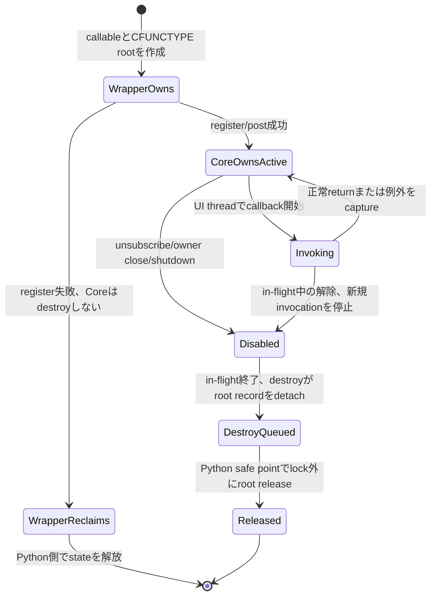
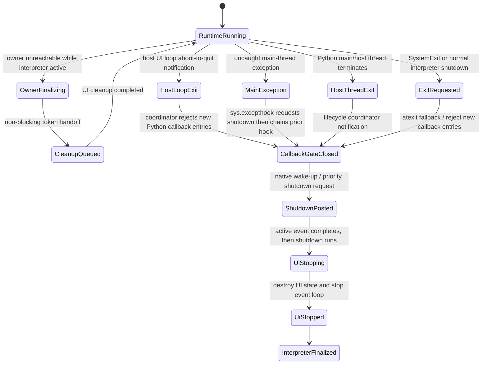

# 適用前記録 / 21-wrapper-python.md

- 記録日: 2026-10-17
- 区分: 2026-10-17改訂前の履歴。現行仕様として使用しない
- 元文書: [21-wrapper-python.md](../../13_detail_design/21-wrapper-python.md)

---

# DD-21 Python 3 wrapper

- 状態: 承認済み（2026-10-12）
- 作成日: 2026-10-12
- 対象: Python 3 `ctypes` wrapperのhandle ownership、callback保持、明示close/context manager、finalizer/cleanup、GIL/UI thread、exception/error変換
- 上位出典: Accepted ADR-0001、Accepted要件、承認済みL1～L4、A1～A32、BD-01/14/15/17/27/28/36
- 先行詳細設計: 承認済みDD-01～20
- 作業計画: [DD-21 作業計画](../dd21-wrapper-python.md)

本書のDD-PY-01～21は利用者承認済みの詳細設計判断である。BD-14で承認された標準`ctypes`とversioned C ABIの境界を具体化する。Python公開APIはPython object/methodとして提供し、`ctypes` function、pointer、callbackを通常の利用者へ露出しない。擬似コードや例示名は公開済みAPIではない。BD-17のpure-Python wrapperとtarget別native runtimeの分離を維持し、package名、最低Python version、wheel matrix、loaderはDD-22へ送る。

## 1. 責務と境界

| 層 | Python wrapperの責務案 | この文書で決めないこと |
|---|---|---|
| ctypes ABI adapter | versioned C ABI functionを固定幅prototypeで宣言し、status/outputを検査する | 全symbol生成方式、prototype generator、header parity tool |
| Python object wrapper | opaque tokenの所有・Runtime関連・close・callback rootingを管理する | 最終公開型/API名、package名、Python version |
| Runtime/Core | handle、UI thread、callback、dispatcher、shutdownの意味論を所有する | Core契約やC ABIの変更 |
| distribution | BD-17のpure-Python wrapperとnative runtime別配布を前提にする | index、wheel tag、loader、target matrix（DD-22） |

ctypes declarationをアプリへ露出しないことは、Python wrapperがC ABIを別の意味へ変換してよいことを意味しない。A1～A32とDD-01～06の固定幅、handle、status/error、byte lengthを正確に写す。

## 2. 判断案

| ID | 判断案 | 根拠・境界 | 状態 |
|---|---|---|---|
| DD-PY-01 | 初期Python wrapperはBD-14どおり標準`ctypes`からversioned C ABIを動的ロードし、compiled Python extension/cffiへ置き換えない。raw ctypes objectをアプリ公開APIにしない。 | BD-14、ADR-0001。loader・package配置はBD-17/DD-22。 | 利用者承認済み |
| DD-PY-02 | ctypes functionごとに`argtypes`と`restype`を明示し、ABI fixed-width scalarに一致する`ctypes`型を使う。`c_long`、暗黙のC `int` return、`c_size_t`をABI固定幅型の代わりに使わない。 | A1～A8、DD-ABI-01～04、DD-VAL-01/06。具体宣言はABI headerのsource of truthに照合する。 | 利用者承認済み |
| DD-PY-03 | Python owner objectはopaque token整数を内部に保持し、`int`/native pointerへの暗黙変換を提供しない。Python objectはCore Propertyの値の正本やC ABI userdata pointerそのものにしない。 | L1/L2、DD-HND-01～05、DD-CPP-01、DD-CS-01、DD-RS-01～03。 | 利用者承認済み |
| DD-PY-04 | owned handle objectは一tokenだけを所有し、複製は明示retain操作に限る。borrowed handle/引数は一回のwrapper呼出し中だけ利用し、retainしない。wrapper objectのPython reference増加とC ABI token retainを混同しない。 | DD-HND-04、DD-LIFE-01、DD-CPP-02、DD-RS-02/03。 | 利用者承認済み |
| DD-PY-05 | UI-affine ownerには明示`close()`相当と`with` context-manager利用を用意し、close成功後にだけtokenをemptyにする。失敗時はownerがtoken/ticket/Runtime anchorを保持し、再試行できる。closeは冪等にできるが、二度目のcloseで新たなreleaseを発行しない。 | L4、DD-LIFE-06/08、DD-CPP-03、DD-CS-02/12、DD-RS-04/05。名前・例外型はAPI設計章へ送る。 | 利用者承認済み |
| DD-PY-06 | Python ownerが回収されるときは、`__del__`または同等のfinalizerから所有tokenのcleanup要求を必ず引き渡す設計を候補とする。finalizerは事前確保ticket/token/Runtime anchorを非同期・非blockでcleanup managerへ移すだけとし、GC/finalizer threadからUI-affine native releaseを直接呼ばない。明示`close()`とcontext managerは早く確実な解放経路として併用する。 | L4、DD-LIFE-06/08、DD-CPP-15、DD-CS-12、DD-RS-05/06。Pythonは回収時期やinterpreter終了時の全object finalizationを保証しないため、Runtime全体の終了経路はDD-PY-20で別に扱う。 | 利用者承認済み |
| DD-PY-07 | cleanup ticket確保ができないときはRuntime/object create、retain、owned out-tokenを返すnative callを始めない。release failure時はtokenを捨てず、事前確保ticketでpending registryへ移してUI safe pointでretryする。成功後はticket、Runtime anchorの順で解放する。 | DD-LIFE-06/08、DD-VAL-06、DD-CPP-15、DD-CS-12、DD-RS-05/06。registry同期・wake・永続failureの扱いは未決。 | 利用者承認済み |
| DD-PY-08 | Coreがclosureを所有する期間、wrapperはPython callable、callback state、`ctypes` callback objectを強参照する。callback registration/post成功時にだけCoreへ所有権を移し、失敗時はwrapperが回収する。CFUNCTYPE callback objectへの参照を落としてGCに任せない。 | BD-14、R3/L4、DD-CB-01～03/07、DD-CPP-04、DD-CS-05/06、DD-RS-10。 | 利用者承認済み |
| DD-PY-09 | callback trampolineはsignature/calling conventionごとにABIと一致させる。userdataはprivate root registryへ結び、Python objectの生アドレスをCoreがdereferenceする前提を置かない。destroyでは新規callbackを無効化し、root recordを一度だけ切り離す。 | A10～12、DD-CB-01/02/07、BD-14。userdata key/cellの具体表現は実装検証と後続API設計へ送る。 | 利用者承認済み |
| DD-PY-10 | destroy thunk内でPython callable/stateの最後のreferenceをregistry lock中にdropしない。root recordはC destroy stackからsafe-point release queueへ移し、任意のPython finalizerがlock内・Core destroy呼出し中に起動する可能性を避ける。destroy thunk自体はUI APIを呼ばない。 | R3、DD-CB-07、DD-CPP-04、DD-CS-06。Python `__del__`等の任意コードは参照数減少時に動き得る。safe point接続はDD-16/22との整合が必要。 | 利用者承認済み |
| DD-PY-11 | `ctypes` callback trampoline内でPython callback由来の例外をC ABI境界へ伝播させない。`Exception`/`BaseException`の捕捉範囲を明示し、callback種別に沿って診断/失敗処理へ渡す。`KeyboardInterrupt`/`SystemExit`もC callbackからPython callerへそのままunwindできない。 | R4、DD-CB-05～09、BD-14。default handling・診断payload・各callback固有の結果は未決。 | 利用者承認済み |
| DD-PY-12 | callback例外情報を受ける利用者差し替えhandlerを設けられる設計とする。handler自身のPython例外もABI外へ出さず、callback ownerのfailure意味論や通知順を変更しない。handler登録scope・既定動作・handler失敗の報告先は後続API設計へ送る。 | DD-CPP-14、DD-CS-07、DD-CB-05～09。全言語共通APIをこのDDで定義しない。 | 利用者承認済み |
| DD-PY-13 | worker threadから変更を許すPython wrapper state（owner状態、token/ticket所有移転、callback/Runtime registry等）は、GILの有無にかかわらず明示lockで保護する。workerから変更させないstateはread-only viewまたは値snapshotとして渡し、UI-affine stateの変更はUI threadへdispatchする。 | Python free-threading official docs、R2/R3、DD-DSP-01～03。GILはPython code実行の実装/性能特性であり、本判断は全objectを自由なthreadから変更可能にする意図ではない。 | 利用者承認済み |
| DD-PY-14 | wrapperはRuntime作成時のPython UI thread identityを記録し、UI-only operationを呼ぶ前にPython thread identityを検査する。Coreの`runtime_is_ui_thread`/wrong-thread statusも最終防御として残し、GIL取得だけで正しいthreadとみなさない。 | R2、L3、DD-DSP-01、DD-CPP-09、DD-CS-10、DD-RS-07。foreign-created callback threadでは`threading.local`がcallback間で保たれると仮定しない。 | 利用者承認済み |
| DD-PY-15 | workerからCore UI stateを直接変更せず、コピー済み値とPython callableをdispatcherへpostする。post成功後はCoreがcallback stateを所有し、失敗時はPython callerがstrong referencesを保持/解放する。非同期shutdownは完了を待たず、worker同期shutdownはUI loop稼働時にnative契約どおり完了を待つ。 | L3/L4、DD-DSP-01～08、DD-CB-01、BD-36、DD-CPP-10、DD-CS-11、DD-RS-15。 | 利用者承認済み |
| DD-PY-16 | `ui_status`を一次判定にし、Error snapshotを保持するPython exception/resultへ写す。unknown status/domain/codeのraw値を失わず、message文面で分岐しない。BD-15のtype stubはPython wrapper surfaceを解析可能にするが、checker/MCP実装判断を本書に含めない。 | DD-VAL-04/05、DD-ABI-05～07、BD-15/27。Python用公開error型名、`str` decode、stub生成はAPI設計章へ送る。 | 利用者承認済み |
| DD-PY-17 | Python special method overrideを一律のoperator overloading規則として扱わず、framework/base契約がbase implementationへのchain-upを必須とするmethodだけをmethod別metadataで識別する。wrapper制御下で検出可能なoverrideは実行時guard、静的に解決できるoverrideはBD-15 analyzerで検査する案とする。`__del__`をbase-call enforcementの仕組みに流用しない。resource cleanupのための`__del__`はDD-PY-06/19の最小cleanup handoff候補として扱う。 | Python Data Model、BD-14/15、L4。GObject系virtual method等では個別methodの親実装呼出しが要求される場合がある。一律`super()` text searchは採用しない。 | 利用者承認済み |
| DD-PY-18 | Python wrapperの正しさをGILによる暗黙直列性に依存させない。FFI呼出し、callback、finalizer、複数threadからの明示closeを同じ明示同期規則で扱い、wrapper lockをnative call/user callback中に保持しない。このthread access policyはfree-threaded Python対応そのものを要求せず、正式support/version matrixは別途判断する。free-threaded buildをsupport対象に選ぶ場合は同じpolicyで検証する。 | Python free-threading official docs、DD-PY-13/14、DD-CPP-15/DD-CS-12/DD-RS-05/06のcleanup ownership。 | 利用者承認済み |
| DD-PY-19 | `__del__`等のobject finalizerはownerのopaque tokenを失わずcleanup managerへ移す最小handoffに利用できる。finalizerはblocking lock、UI call、完了待ち、利用者callbackを実行せず、例外を外へ伝える経路ともみなさない。managerはPython owner本体を強参照せず、token/ticket単位の記録を保持する。 | Python Data Model、`weakref.finalize`、DD-PY-06/07/10、DD-LIFE-06/08。循環参照、遅延GC、回収されないままのinterpreter終了にはfinalizerだけで対処できない。 | 利用者承認済み |
| DD-PY-20 | RuntimeはPython main/host threadの終了を検知してRuntime単位のlifecycle coordinatorへ通知し、全Runtimeへshutdown要求を送り、Python側callbackへの新規entryを止めたうえでnative UI loopを起床・終了させる経路を持つ案とする。`atexit`は通常interpreter終了時の補助signalとし、残存non-daemon UI threadがinterpreter shutdown開始を妨げる場合にも対応できるよう、それだけに依存しない。coordinator/finalizerはUI completionを同期待ちせず、shutdown taskはBD-36どおりactive event終了後に優先処理する。 | BD-36、DD-DSP-01～08、DD-CB-01～07、DD-LIFE-07/08、Python `atexit`/threading lifecycle。main/host thread終了通知の移植可能な提供元、in-flight callback barrier、Python rootをinterpreter finalization前に外す手順、異常終了時の保証限界は未決。 | 利用者承認済み |
| DD-PY-21 | Runtime lifecycle coordinatorは通常の終了経路を複数の通知点から受け付ける。host UI loopが終了する直前の通知（Qtの`aboutToQuit()`相当）、Python main threadの未捕捉例外（`SystemExit`を除き`sys.excepthook`から終了要求を出して既存hookの例外報告を維持）、wrapper所有workerの未捕捉例外、通常interpreter shutdownの`atexit`補助通知、明示shutdownを対象にする。host loop終了直前hookはUI thread上でloop停止前にcleanupを完了できる形で接続し、実行されない通常queueへのpostだけに依存しない。例外hookからのshutdown dispatchはBD-36/DD-03に従い、UI threadの通常contextなら同期cleanup、callback/event中なら現処理後の優先処理、worker等からならUI threadへのsignalとする。コールバック例外はtrampoline内で捕捉し、handler/機能別方針に渡す。捕捉済みの任意例外は自動終了理由にしない。`SystemExit`/`sys.exit()`はエラーではなく通常終了経路として扱う。`os._exit()`、fatal error、未処理の致命的signal/killではin-process cleanup完遂を保証しない。 | Qt `QCoreApplication.aboutToQuit()`、Python `sys.excepthook`/`threading.excepthook`/`atexit`、DD-PY-11/12/20、BD-36。hookの導入・既存hookとの合成、host loop adapter接続、worker例外のRuntime関連付け、callback例外から終了へ進む条件は後続API/implementation設計へ送る。 | 利用者承認済み |

## 3. owned tokenとPython objectの寿命

例示名のみの概念である。Python object reference countとC ABI owned tokenは独立し、同じwrapper objectを複数変数から参照してもnative retainは増えない。

```text
create/retain前: Python owner factory --reserve--> CleanupTicket
        │ native create/retain success
        ▼
Python owner [token + CleanupTicket + Runtime anchor]
        ├── borrowed call argument: 呼出し中だけ一時利用、追加tokenなし
        ├── explicit close success: token消費 → ticket release → anchor release
        ├── explicit close failure: tupleをownerに保持 → 失敗を呼出し側へ返す
        ├── owner回収時: token/ticket/anchorをcleanup managerへ非block移管 → UI safe pointでrelease
        └── release failure: tupleをpending managerへ移管 → UI safe point retry
```

| 経路 | Python ownerの動作案 | token/ticketの最終所有者 |
|---|---|---|
| create成功 | native out tokenを一つだけ受け取る | 新owner |
| create失敗 | tokenは無効値のまま、ticketを戻す | tokenなし、ticket解放 |
| retain成功 | 元tokenを残し、別tokenを受領する | 元ownerと新ownerに一組ずつ |
| retain失敗 | 元ownerを変更しない | 元ownerのみ |
| borrowed call | private token値をC callへ一時的に渡す | 元owner。borrowed wrapperはreleaseしない |
| close成功 | ownerをclosedへ移行する | native token消費後にticket/anchorを順に解放 |
| close失敗 | ownerをopenのまま保つ | 同ownerがtoken/ticket/anchorを保持 |
| owner回収 | finalizerはownerをcaptureせずtoken/ticket/anchorをcleanup managerへ非block移管 | cleanup manager |
| fallback cleanup failure | managerは再tryできるticketを保持し、UI safe pointへpost | pending manager |

PythonではborrowのscopeをRust lifetimeほど静的に制約できない。そのためprivate helper/call leaseを使い、temporary borrowed handle objectを返す場合も外へ保持できない形を検討する。APIの具体signatureは後続API設計章に残す。

## 4. Explicit close、context manager、owner finalization

明示closeはUI threadで決定的に実行し、正常な利用例では`with`終了時にresourceをreleaseする。`close()`が失敗した場合はownerをclosed扱いにせず、tokenの再試行/診断が可能な状態を保つ。bodyのPython exceptionとclose失敗が同時に起きた場合のprimary/secondary exception保持はPython API designで定義する。

明示`close()`/`with`は呼出し側がcleanup時点と失敗を扱える経路である。同時に、管理owner objectが回収されるときにnative tokenを取り残さないため、`__del__`または`weakref.finalize`等からcleanup要求を自動で引き渡す経路も設ける案とする。`__del__`自体を避ける方針ではなく、その責務を最小のhandoffに限定する。

- finalizerはowner object自身をcaptureして回収を妨げない。token/ticket/anchorはownerから独立したcleanup recordとして移管する。
- finalizerは短い非blockのhandoffだけを行う。Runtime/UI operation、native UI-affine release、完了待ち、利用者callback、blocking lock取得は行わない。
- ticketはowner/token発行前に確保する。handoff queueが満杯・停止中でもtokenを捨てないよう、事前確保recordをmanager registryへ移すno-allocation経路を設ける候補とする。
- PythonのGCは回収時期を保証せず、循環参照等で回収が遅れる場合がある。また`__del__`は任意threadで実行され、例外は呼出し側へ伝播せず、interpreter終了時には依存globalが利用不能になり得る。したがってobject finalizerだけをRuntime全体shutdownの唯一経路にはしない。
- finalizerを`__del__`、`weakref.finalize`、または両者を包むmanagerのどれで実装するかは未決。callback失敗をstderr出力だけで報告しない。

finalizerはcleanup要求を出したこととnative cleanupが完了したことを同一視しない。成功確認可能な経路は明示closeまたはRuntime shutdown completionとし、finalizer経由の失敗はpending cleanup registryと診断状態で追跡する案である。

公式資料は、Pythonがobjectの回収時期を保証せず、`__del__`が任意threadで実行され、例外が無視され、interpreter shutdown中にも呼ばれ得ることを示す。[Python Data Model: object finalization](https://docs.python.org/3/reference/datamodel.html#object.__del__)。`weakref.finalize`のcallback例外も呼出し元へ伝播しない。[Python `threading`](https://docs.python.org/3/library/threading.html)ではaliveなnon-daemon threadがなくなるまでprogramが終了せず、[`atexit`](https://docs.python.org/3/library/atexit.html)はnormal interpreter termination時のhandlerである。これらのため、object finalizerはowner tokenのhandoff、main/host thread終了通知はRuntime全体停止として別経路にする案である。

### 4.1 Python終了時のRuntime shutdown経路

owner finalizerは個々のopaque tokenを回収する経路、lifecycle coordinatorはRuntime全体を閉じる経路として分ける。後者はRuntime一覧とnative shutdown signalを管理し、Python main threadの終了後もUI loopへ到達する独立したwake-up経路を持つ。host UI loop adapterはloop終了直前に通知する。Qtでは`QCoreApplication.aboutToQuit()`がこの用途の例であり、`exec()`の後だけにcleanupを置くと、OSのログオフ時などに`exec()`が戻らずcleanupが実行されない場合がある。adapterはUI thread上でloop停止前にshutdown cleanupを実行できるよう接続し、about-to-quit hookから通常queueへ積むだけで処理済みとみなさない。これはloop終了通知であって、任意のprocess terminationを検知するものではない。

参照: [Qt `QCoreApplication`](https://doc.qt.io/qt-6/qcoreapplication.html)、Python [`sys.excepthook`](https://docs.python.org/3/library/sys.html#sys.excepthook)、[`threading.excepthook`](https://docs.python.org/3/library/threading.html#threading.excepthook)、[`atexit`](https://docs.python.org/3/library/atexit.html)、[`os._exit`](https://docs.python.org/3/library/os.html#os._exit)。

Python main threadで`SystemExit`以外の例外が未捕捉になる場合は、`sys.excepthook`からcoordinatorへshutdown要求を送り、その後に既存hookへ委譲してtraceback報告を維持する。`sys.excepthook`は通常Python programが終了する直前に呼ばれるため、終了処理はBD-36/DD-03のthread/context dispatchに従う。UI threadの通常contextでは同期cleanup、callback/event中では現処理後の優先処理、worker等の別threadからはUI threadへのsignalとし、callback deadlockを作らない。`SystemExit`/`sys.exit()`はこのhookの対象外なので、main/host thread終了通知と`atexit`補助通知で扱う。wrapperが所有するworker threadの未捕捉例外はworker entry境界で観測・記録し、通常のthread exception報告も維持する。host所有thread全体の`threading.excepthook`差し替えを必須にせず、導入する場合は既存hookを保存・呼び出す方式を後続設計で定める。

いずれかの終了通知を受けた時点でcoordinatorはcallback受付を閉じ、新規Python callback entryを禁止してから各Runtimeへ優先shutdownを要求する。UI threadはactive event完了後にshutdownを処理し、UI stateとcallback registrationを無効化し、UI loopを停止する。finalizerや別threadからのcoordinator通知はUI threadの応答を同期waitしない。UI threadの通常contextではBD-36に従いcleanupを同期実行し、callback/event中は現処理後に優先実行する。明示shutdown、host loop終了通知、main thread終了/例外、通常`atexit`から同じ要求を冪等に送れるようにする。

Python callback rootをいつ安全に解放し、in-flight callbackが残る間にinterpreter teardownをどう遅らせるかは重要な未決事項である。Python側rootを解放するsafe pointとnative側callback gate/barrierを協調させる必要がある。user callbackがmain thread上の処理を同期待ちする場合など、終了hookからの単純なjoin/waitはdeadlockし得るため、完了待ち方式を本案では決めない。`atexit`は通常終了時の補助signal候補であり、fatal error、未処理signalによるkill、`os._exit()`等までのcleanup保証を意味しない。

## 5. Callback callableのrootと所有移転

`CFUNCTYPE` object、Python callable、callback state/registry entryを一つのroot recordとして扱う。Coreが保持するABI callback pointerが有効な間、recordへのstrong referenceを維持する。



destroy thunkはuserdata keyをregistryからatomicにdetachし、新しいcallback invocationを拒む。その後、Python callable/CFUNCTYPEへの最終参照をC destroy stackやregistry lockの中で落とさず、wrapper safe-point queueへ渡す。任意Python objectの`__del__`やweakref callbackがreference dropに伴って実行され得るため、Core destroy thunk内のPython object destructionを避ける。queueをdrainするsafe pointのhost event-loop接続とinterpreter終了前drainは未決である。

登録関数のreturn前にcallback invocationを許すowner APIでは、登録呼出し中はwrapperがrootを維持したまま一時invocationを処理し、成功statusを確認した一点でCore ownershipへ移す。登録結果確定前にCore destroyが呼ばれないこと、失敗return時はCoreがcallback/destroyを呼ばないことをowner API contractに要求する。

## 6. ctypes、GIL、UI thread

| 境界 | 提案 |
|---|---|
| Native call | C ABI functionを呼ぶ前にprototypeとUI thread条件を確認する。FFI call中にregistry lockを保持しない |
| GIL | GIL-enabled buildでも`ctypes.CDLL` call中にGILが解放され、他threadがwrapper stateを変更し得るため、許可した共有mutable stateは専用lockで同期する。GILはデータ保護の代用にしない |
| Callback | CFUNCTYPE callbackは保持済みroot recordからcallableを取得し、Coreが要求するUI thread上で動作することを検証する |
| foreign-created thread | ctypesのcallbackでPython dummy thread stateが使われ得る。`threading.local`を異なるinvocation間のcallback state保存先にしない |
| workerが変更可能なwrapper state | ownerのopen/closed/token/ticket状態、cleanup registry、callback root registry等はlockで保護し、状態遷移全体をatomicに扱う。builtin container個々の操作保証に依存しない |
| workerが変更してはならないstate | UI-affine Runtime/UI stateはUI threadだけが変更する。workerへはimmutable/read-only snapshotまたは値copyを渡し、更新要求はdispatcherへpostする |
| UI-only wrapper call | native Runtime thread checkを正とし、Python thread identity checkを早期診断に使う。誤threadを暗黙dispatchしない |
| worker update | 値copyとclosureをpost queueへ渡す。workerからUI-affine Property getter/setterを直接呼ばない |

DD-21はGILを共有状態保護の仕組みとして前提にしない。これは任意threadから全状態を変更可能にする設計ではない。変更を許すwrapper-owned mutable stateはlockで保護し、変更を許さないUI-affine stateはread-only/snapshot/value copyで他threadへ渡す。明示lockは状態確認・更新の短い区間に限り、FFI中やuser callback中には保持せず、finalizerではblocking lockを取らない。free-threaded Python supportは別途選ぶversion/support policyであり、この同期契約の意味と混同しない。

公式資料: [Python ctypes — callback functions](https://docs.python.org/3/library/ctypes.html#callback-functions)は、C利用中の`CFUNCTYPE` object参照をPython側で保持する必要、foreign-created thread callbackでdummy threadが使われ得ることを説明する。同じ資料は`CDLL` callがGILを解放することも記す。[Python weakref.finalize](https://docs.python.org/3/library/weakref.html#weakref.finalize)はGC finalizerからの例外が呼出し元へ伝播しないことを記す。[Python free-threading guide](https://docs.python.org/3/howto/free-threading-python.html)は、containerに内部lockがあっても、その実装上の挙動へ依存せず`threading.Lock`等を使うことを勧める。

### 6.1 Special method overrideとbase chain-up

Pythonのspecial methodは算術operatorだけではない。暗黙演算子dispatch、属性設定、初期化、context manager、iterator、比較、finalizationなどがtype上のmethod overrideで振る舞いを置き換える。暗黙special-method lookupはinstance attribute経由の通常lookupと異なるため、instanceへの監視method追加だけではoverrideを安定して捕捉できない。

GObject系virtual methodやGUI frameworkのlifecycle hookのように、親実装を呼んで基底のnative動作を維持する必要があるmethodは、methodごとの契約として記録する。検査対象は文字列`super()`の存在ではなく、要求されたparent implementationへ実際にchain-upしたかとする。MRO上の適切な`super().method()`、明示的なancestor callなど、契約上有効な呼出し形を識別する。`super()`をすべてのoperatorやspecial methodへ要求しない。

| method契約 | 検出方針案 |
|---|---|
| parent implementation必須、wrapperがoverrideをdispatchする | base methodが呼ばれたことを記録するruntime guardを置き、dispatch終了時に未呼出しなら分かりやすい例外にする |
| parent implementation必須、ユーザー定義overrideを静的解析できる | BD-15 Python analyzerが対象methodと解決可能なMROを使ってerror/warningを出す |
| chain-up任意または独自実装が置換する | metadataで不要と明示し、警告しない |
| dynamic dispatch/MRO/monkey patchで検査不能 | 診断を`unknown`として扱い、安全と断定しない。Runtime保護は維持 |
| `__del__`等のfinalizer | resource cleanup用の最小token handoffに利用できる（DD-PY-06/19）。base-class chain-up検査とは分け、外部base classのchain-up不足は実行時例外では検査せず、静的検出できる場合のdiagnostic候補とする |

実行時guardは、method metadataで指定されたoverrideだけをclass creation時のhook/metaclass/decorator候補で包み、guard状態を呼出しごとに持つ構成が考えられる。要求された親実装側がそのguardへchain-up到達を記録し、override終了時に未到達なら分かりやすい例外を出す。検査対象は`super()`という構文文字列ではなく、契約上の親実装呼出しである。Python演算子構文が直接special methodを呼ぶ場合も、class creation時に対象methodをwrapperで包めれば実行時に検査できる。dynamic class変更や検査外の継承ではruntime検査を保証せず、BD-15 analyzerのdiagnosticまたはunknownへ送る。missing chain-up exceptionのmethod一覧、severity、継承先の抑制方法、対象operatorは未決である。

guard状態をGILだけで保護せず、同じPython objectに複数threadからoperator methodが同時呼出しされてもcall間で誤って混ざらないper-invocation stateにする。user overrideが例外で終了した場合は元の例外を保ち、chain-up不足の例外で上書きしない。

参考: [Python Data Model: special method lookup](https://docs.python.org/3/reference/datamodel.html#special-method-lookup)、[Python Data Model: `__del__`](https://docs.python.org/3/reference/datamodel.html#object.__del__)。GObject base virtual callのmethod-specificな例は[PyGObject subclassing](https://pygobject.gnome.org/tutorials/gobject/subclassing.html)、wxPythonでoverride methodの基底呼出しを指示する例は[`wx.App.OnPreInit`](https://docs.wxpython.org/wx.App.html)を参照した。

## 7. Callback例外とerror surface

callback trampolineはPython callbackの例外がctypes callback boundaryからC/Rustへ伝播する経路を作らない。Python runtimeはPython function実行中に生成される`BaseException`全体を扱うため、trampoline catch対象を`Exception`に限るか`BaseException`とするか、`KeyboardInterrupt`/`SystemExit`をどう利用者へ再通知するかを明示する必要がある。いずれの選択でも、その例外をC stack越しにthrowしない。

利用者設定exception handlerをcallback exceptionの報告先候補にする。handler自身が例外を送出した場合もtrampoline内で封じ、callback種別の成功/拒否/通知継続意味論を変更しない。handler未設定時のdefault record/report、診断queue、exception object/tracebackの保持期間は後続API設計へ送る。

通常のC ABI失敗は`ui_status`を一次情報としてPython error surfaceへ変換し、任意Error handleがある場合はimmutable snapshotを所有する。unknown status/domain/codeもraw数値を保持する。`str(error)`等のmessageは表示に使えても、分岐や再試行判定に使わない。検証rejectやCommand stateなどAPI固有の通常結果は、個別設計に従い全てをPython exceptionにしない。

## 8. Shutdownとcleanup順

| 状況 | Python wrapper案 |
|---|---|
| async shutdown | 要求受付後に戻り、完了待ちをwrapper独自に追加しない |
| callback/event内shutdown | 現在のcallback/event完了後に優先処理される受付結果を返す |
| workerからsync shutdown | UI loop稼働時にUI cleanup完了まで待つ。loop停止時解除は未決 |
| UI Runtime owner close | shutdownは明示実行済みであることを要求/診断し、closeが暗黙shutdownを始めない案 |
| owner finalization中のowned child | `__del__`または同等finalizerがtoken/ticketをcleanup managerへ非block移管し、UI thread上でcleanupする |
| Runtime Closed後 | Closed shell releaseをdrainし、最後のRuntime anchorを解放 |
| host UI loop終了直前 | Qt `aboutToQuit()`相当のUI-thread adapter通知からloop停止前にshutdown cleanupを実行する。通常queueにpostするだけの接続は完了保証にならない |
| Python main threadの未捕捉例外 | `sys.excepthook`からBD-36/DD-03のthread/context dispatchでshutdownを要求し、既存hookへ委譲してtraceback報告を維持する。`SystemExit`は通常終了経路へ送る |
| wrapper所有workerの未捕捉例外 | worker entry境界で例外を捕捉・記録し、通常のthread exception報告を維持した上でRuntime lifecycle policyに従ってshutdownを要求する |
| callback/event内の例外 | trampoline内で捕捉して設定handlerとcallback固有failureへ渡す。自動shutdownはcallback/API固有方針で明示された場合だけ要求する |
| 通常interpreter shutdown開始 | `atexit`から同じlifecycle要求を補助的・冪等に送る |
| abrupt process termination | `os._exit()`、fatal error、致命的signal/kill等でPython hookが動かない場合を含み、process終了を越えたcleanup完遂は保証対象外 |



図の`CallbackGateClosed`から`InterpreterFinalized`までにin-flight callback/rootを安全にdrainする具体handshakeは未決である。終了中の同期待ちがmain threadとUI/callback間の依存を作らない条件もレビュー対象とする。

## 9. 失敗・競合ケース

| ケース | 提案する観測結果 |
|---|---|
| ctypes prototypeの欠落/wrong width | header parity/interoperability checkで検出。実行時の暗黙C `int`に依存しない |
| callback登録失敗 | Coreはcallback/destroyを呼ばず、wrapperがroot recordを回収 |
| callback登録成功 | Core destroyまでcallableとCFUNCTYPE objectを強参照 |
| callback例外 | C ABIへ出さず、callback固有failureと設定handlerへ送る |
| destroy中のPython finalizer | lock/C destroy stackから切り離し、safe-point release queueで参照を落とす |
| ownerがGC対象になった | finalizerがtoken/ticketを非block移管し、UI safe pointでrelease。finalizerを実行できない異常状態はRuntime lifecycle shutdown経路で回収 |
| UI ownerのwrong-thread call | wrapper checkまたはCore `UI_WRONG_THREAD`として明示する |
| CDLL call中に別Python threadが動く | GIL解放を前提に短い同期区間で状態を保護する |
| explicit close失敗 | wrapper ownerがtoken/ticket/anchorを保持し、失敗をcallerに返す |
| finalizer fallbackのrelease失敗 | tokenをmanagerに保ちretry。stderr例外だけで失敗を捨てない |
| worker同期shutdown中にUI loop停止 | 未決条件として残す。独自timeout/cancelを作らない |
| Python main/host thread終了時にUI threadが生存 | lifecycle coordinatorがcallback gateを閉じてnative priority shutdownをsignalし、UI loopを停止する。検知方式とcallback/root drain handshakeは未決 |
| Qt `aboutToQuit()`相当通知後の通常queue停止 | adapterがUI thread上でloop停止前にcleanupを行い、配送されないままのqueued shutdownを完了扱いにしない |
| host UI loopの通常終了 | loop終了直前のadapter通知（Qt `aboutToQuit()`相当）からloop停止前にRuntime shutdown cleanupを実行し、通常queueに依存せず、`exec()`後だけのcleanupにもしない |
| Python main threadの未捕捉例外 | `sys.excepthook`からBD-36/DD-03のthread/context dispatchでshutdownを要求し、保存した既存hookでtracebackを報告する。hook差し替え競合・既存hookとの合成は未決 |
| wrapper所有workerの未捕捉例外 | worker境界で捕捉して診断し、Runtimeとの関連付けとshutdown policyを適用する。host全体の`threading.excepthook`差し替えは必須にしない |
| callback内の一般例外 | trampoline内で捕捉して設定handlerへ渡す。callback固有policyでfatal shutdownと定められた場合だけRuntimeを終了する |
| `SystemExit`/`sys.exit()` | error hook対象外の通常終了としてmain/host thread終了と`atexit`経路へ流す |
| アプリケーションが捕捉した例外 | 明示的にshutdownを要求しない限りRuntimeを自動終了しない |
| `os._exit()`/fatal error/致命的signal | Python cleanup hookが呼ばれない経路はprocess内保証外 |
| unknown status/domain/code | raw numeric valuesとError snapshotを保持 |

## 10. 検証観点

- 各C ABI functionの`argtypes`/`restype`/calling convention/widthをheaderと機械的に照合し、32-bit/64-bit C type差を誤って混入させない。
- create/retain failure時にticketだけ戻り、成功時はtoken・ticket・Runtime anchorが一つのownerへ対応する。Python reference copyはnative retainしない。
- explicit close、context manager、close failure、繰返しcloseでtoken releaseが高々一回となり、失敗時にownerがopen状態を保つ。
- callable、`CFUNCTYPE` object、userdata rootがforced GC中もCore destroyまで生存する。register失敗とsuccessで強参照releaseが一回だけである。
- callback self-unsubscribe、in-flight destroy、shutdown、post cancel時にCoreとPython root registryの所有者が重複しない。
- object finalizerからtoken/ticketが非blockでmanagerへ移り、UI-affine native cleanupがUI threadで完了する。`__del__`が任意threadで走る条件、finalizerの遅延/失敗、ticket確保失敗を確認する。
- Python main/host thread終了で、`atexit`開始前にもUI threadが残留しないようRuntime lifecycle signalが届き、UI loopがshutdown後に停止する。callback gate、in-flight invocation、root解放とinterpreter teardownの順序を検証し、main/UI相互待ちがないことを確認する。non-daemon Python UI threadがある場合にもprocess終了を妨げないことを確認する。
- Qt `aboutToQuit()`相当通知では、UI threadのloop停止前にcleanupが完了し、後続の通常queue dispatchを待って停止したままにならない。
- main threadの未捕捉例外ではshutdown要求後も既存`sys.excepthook`のtraceback出力が維持され、BD-36/DD-03のthread/context dispatchを使う。workerからUI完了を待つ場合もcallback deadlockを作らず、wrapper所有worker例外もthread例外の報告を保つ。
- host UI loopの終了直前hook、Python main threadの未捕捉一般例外、`SystemExit`、wrapper所有workerの未捕捉例外、callback handler自身の例外を別経路で検証する。main例外hookは既存hookのtraceback報告を保ち、BD-36/DD-03に従ってthread/contextに適したdispatchを選ぶ。捕捉済み例外は自動終了を起こさない。
- abrupt termination (`os._exit()`、Python fatal error、未処理signalによるkill)を通常終了hookの保証範囲と混同しない。
- `ctypes.CDLL`のGIL release中に他worker callを行い、wrapper state race/deadlockがない。foreign thread callbackでthread-localを状態保存に使わない。
- worker変更を許すowner/registry stateを複数threadで競合更新し、lockによりtoken/ticket/callback ownershipと状態遷移が壊れないことを確認する。UI-affine stateはworkerから変更不能で、read-only/snapshot/value copyまたはdispatcher経由になることを確認する。
- free-threaded CPythonをsupport対象に含める場合に限り、同じthread access policyをfree-threaded buildでも検証する。GIL有無でRuntime UI affinityが変わらない。
- methodごとのbase chain-up policyについて、required/optional/not-required/dynamic-unknownを分け、wrapper-controlled overrideのmissing chain-up例外とBD-15 static diagnosticを確認する。`super()`以外の有効ancestor callを誤検出せず、全operatorへ一律のsuper requirementを付けない。
- `__del__`/`weakref.finalize`候補がresource tokenを一度だけmanagerへhandoffし、chain-up不足検知と混同しない。例外を呼出し側へ返せると誤認せず、owner復活やfinalizer遅延を含む条件を確認する。
- Python normal interpreter shutdownで、main threadからの終了要求後にnative UI loopが停止し、Python callbackへ新規entryしない。callback root/in-flight drainがinterpreter teardownより先に完了する規則と、終了時waitによるdeadlock不在を確認する。
- callback内の例外、handler自身の例外、`KeyboardInterrupt`/`SystemExit`候補をABI越境なしに処理する。
- UI-only APIをworkerから直接呼ぶとCore statusとwrapper挙動が一致し、worker updateはUI threadで反映する。
- Errorなし/あり/生成失敗、unknown status/code、UTF-8空/embedded NUL/buffer-too-smallをDD-05/06と照合する。
- BD-17どおりpure-Python wrapperとnative runtimeを別distributionに保つ。wheel、native loader、ARM board profileはDD-22で検証する。

## 11. 未決事項と後続担当

| 未決事項 | 後続 |
|---|---|
| Python minimum version、CPython/PyPy/free-threaded support、GIL matrix | BD-14/DD-22 |
| public owner/callback/error type、method名、`close`のexception chaining/context semantics | API設計章 |
| `__del__`/weakref.finalize/managerの選択、ticket registry同期、worker finalize、permanent release failure | API/implementation design。DD-LIFE-06、DD-CPP-15、DD-CS-12、DD-RS-05/06と整合 |
| interpreter/runtimeごとのlifecycle coordinator登録、main/host thread終了通知の移植可能な提供元、normal-exit補助hook、UI wake-up経路、in-flight callback/root drain handshake、main/UI相互待ちがない証明 | DD-22/API・implementation設計およびCore lifecycle連携。DD-PY-20の要求を満たす具体方式 |
| Qt `aboutToQuit()`相当のhost loop adapter、`sys.excepthook`/`threading.excepthook`の導入・合成・解除と複数Runtimeの所有規則、main未捕捉例外とwrapper所有worker例外の終了policy | API/implementation設計およびDD-22。既存host hookを保存・委譲し、thread/contextに適したdispatchでdeadlockを作らないこと |
| userdata registry key/cellとcallback registration中の同期invocation可否 | ABI owner API契約、DD-06～10/14、callback共通設計 |
| destroy後のPython root release safe pointとplatform UI loop integration | DD-16/22。C destroy内でPython finalizerを起動しない制約を維持 |
| `BaseException`捕捉、`KeyboardInterrupt`/`SystemExit`の再通知、handler default/diagnostics | 後続API設計章。callback固有failureはowner設計に従う |
| special method overrideごとのrequired/optional/no-chain-up一覧、base-call guard実装、operator dispatchの実行時検出範囲 | BD-15 analyzerと後続API設計。event callback/event method規則はDD-24候補と重ならないよう範囲確認 |
| free-threaded Python version/support matrix、`ctypes`/native-library/thread-stateの適合 | BD-14/DD-22。安全性設計はGIL有無に依存させない |
| `ctypes` symbol/prototype generation/header parity tooling | BD-14/DD-22、BD-15 type stub/analyzer境界 |
| Python package/index、pure wheel metadata、native binary wheel tags、library search/loading | BD-17/DD-22 |
| ARM/Yocto wheel compatibilityとnative artifact acquisition | BD-16/17/DD-22 |
| UI loop停止時の同期worker shutdown待機解除/completion observation | DD-03/06/16とwrapper共通設計 |
| dynamic Python codeのevent method静的解析とmarker/decorator仕様 | BD-15および追加候補DD-24。DD-21では決めない |

## 12. 承認記録

利用者は2026-10-12にDD-PY-01～21を承認した。通常終了は明示shutdown、host UI loop終了直前通知、main/host thread終了、通常interpreter shutdownで網羅し、未捕捉main例外・wrapper所有worker例外・callback例外の境界も記録した。`os._exit()`、fatal error、致命的signal/killはin-process cleanup保証外とする。承認はPython API名、hook導入方法、adapter実装、distribution仕様を確定しない。これらは§11の後続設計に残す。
