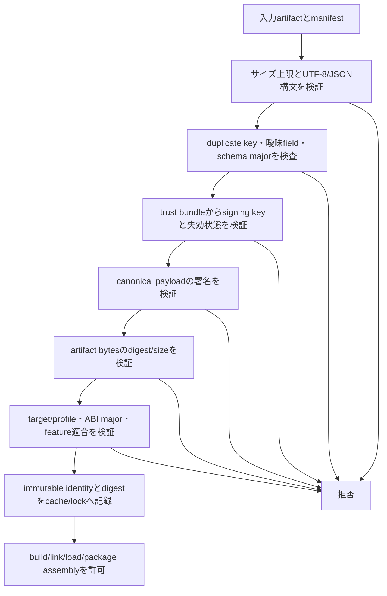
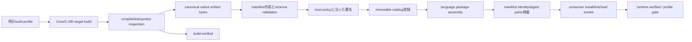

# 適用前記録 / 22-build-distribution.md

- 記録日: 2026-10-17
- 区分: 2026-10-17改訂前の履歴。現行仕様として使用しない
- 元文書: [22-build-distribution.md](../../13_detail_design/22-build-distribution.md)

---

# DD-22 Buildと配布

- 状態: 利用者承認済み（DD-BUILD-01～11、2026-10-12）
- 作成日: 2026-10-12
- 対象: target別native runtime build/profile、4言語package接続、artifact catalog/identity、manifest・署名・trust
- 上位出典: Accepted ADR-0001、Accepted要件、承認済みA1～A32、BD-16～22、BD-28～32
- 先行詳細設計: 承認済みDD-01～21
- 作業計画: [DD-22 作業計画](../dd22-build-distribution.md)

本書のDD-BUILD-01～11は利用者承認済みの詳細設計判断である。Buildと配布の関係を定めるが、実装済みpipeline、公開package名、registry、toolchain版、OS・boardの正式support宣言を示すものではない。承認済みBD-16～22/28～32の意味を保ち、安定版artifactの公開・取得より前に確定が必要な詳細を分ける。

## 1. 責務と配布単位

| 層 | 責務 | source of truth |
|---|---|---|
| Build profile | host/target、sysroot/toolchain、target profile、ABI major、feature setを指定する | Build設定とprofile記録。exact値は未決 |
| Native runtime artifact | Rust Core、versioned C ABI、target固有backendを一つのtarget向けbinaryとして生成する | artifact bytesと不変manifest |
| Language package | 各言語の既定package境界でwrapperとnative artifactを利用者へ接続する | package metadata。native assetを含む場合もcanonical digestを保つ |
| Canonical catalog | 公式manifestとimmutable identityの権威ある保管・取得点になる | service/URL/APIは未決 |
| Verification state | build/runtime/hardware verificationの達成範囲を表す | release support matrix |

同一target/profileのnative C ABI runtimeは各language package向けに独自再build・再labelせず、同じcanonical artifact identity/digestを参照する。package archive自体のdigestと、中に含まれるnative runtime fileのdigestは別の対象として記録する。

## 2. 判断案

| ID | 判断案 | 根拠・境界 | 状態 |
|---|---|---|---|
| DD-BUILD-01 | native runtimeは`runtime version + ABI major + target profile + feature set`をbuild identity入力として一つのartifactにする。4言語用にCoreを再compileしない。packageへの収録・圧縮・配置変更は許せるが、native binary bytesを変更した再build・再labelは別artifact identityとして扱う。 | ADR-0001、BD-16～20、BD-29/30。bit-for-bit reproducible buildの達成は本判断から保証せず、attestation/SBOM詳細は後続へ送る。 | 利用者承認済み |
| DD-BUILD-02 | build profileはbuild hostとtargetを独立して明示し、少なくともtarget OS/architecture/triple、board/toolchain profile ID、sysroot identity、ABI major、要求featureを持つ。ABI・linkに影響するcompiler/linker/sysroot/CPU featureの値はprofileに束縛し、host machineからtargetを推測しない。 | BD-16、BD-20、BD-29/30。compiler/Rust/CMake/SDK/sysrootのexact version、CPU/FPU/float ABI、libc baseline、board名は未決。 | 利用者承認済み |
| DD-BUILD-03 | target状態は`build-verified`、`runtime-verified`、`hardware-profile-verified`の三段階で記録する。compile/link/ABI inspection通過だけでruntime supportと宣言しない。実機検証の結果は試験済みのboard・OS image・sysroot・driver profileの範囲に限定する。 | BD-16、BD-22、release/version test方針。各状態の合格suiteと性能閾値はtest planningで具体化する。 | 利用者承認済み |
| DD-BUILD-04 | 初期target順はWindows x64 native build/smoke、Linux x64 native build/test、Linux x64 hostからARMv7/AArch64 cross-build、選定した一つのARM実機profile gate、その後にWindows ARM64/macOS等とする。未検証targetへのfallbackやsupport表示拡張をしない。 | BD-12/16/22。実機board、exact compiler/sysroot、CI provider/runner、正式release matrixは未決。 | 利用者承認済み |
| DD-BUILD-05 | package境界は上位設計の言語別方式に合わせる。Pythonはpure-Python wrapperとOS/architecture別native runtime packageを分離し、初期binary wheelはWindows x64/Linux x64。C#はmanaged wrapperとnative fileをNuGet同梱し、初期RIDは`win-x64`/`linux-x64`。C++はpublic header/source、native library、CMake Config/export targetを持つrelocatable install tree。Rustは低レベル`-sys`とsafe crateを分け、native runtimeを別artifactとして使い、別environment importは明示feature/targetで選ぶ。 | BD-17～20、DD-18～21。package ID、Python/.NET/C++/Rust最低version、crate registry、CMake target・構成、native loader実装は後続へ送る。 | 利用者承認済み |
| DD-BUILD-06 | 組み込みLinux ARMv7/AArch64 native artifactはcross-build対象にするが、libc・sysroot・GPU/input依存とprofile compatibilityを確かめるまでdesktop Linux向けmanylinux/musllinux wheelまたは一般NuGet RIDとして扱わない。互換性がないprofileはYocto/system packageまたはtarget-specific archiveなどの別導入経路とし、形式選定は後続判断とする。 | BD-16/17/18/19。正式なARM package形式、board-specific recipe、wheel/RID適合判定は未決。 | 利用者承認済み |
| DD-BUILD-07 | native artifactのcanonical identityは一つの公式catalogをsource of truthにする。language packageへ同梱・参照するbinaryは同じmanifest identity/digestを保つ。selectorはbuild/runtime targetと明示profileから決め、host/target混同や推測fallbackを拒否する。 | BD-29/30。catalog service/URL/API、package managerごとの取得pluginは未決。 | 利用者承認済み |
| DD-BUILD-08 | manifestはruntime versionとは独立したschema versionを持つ。payloadにはruntime version、ABI major、OS/architecture/target triple、profile/compatibility、feature、filename、byte size、artifact SHA-256 digest、immutable release identity、schema version、signing key identityを含める。 | BD-28～32。完全なfield名・型・critical/optional表現は未決。 | 利用者承認済み |
| DD-BUILD-09 | manifest payloadはUTF-8 JSONのRFC 8785 JCS canonical formを候補とし、manifest payload内すべての意味情報（signature containerを除く）をEd25519 signatureで束縛する候補とする。artifact file digestにはSHA-256を候補とする。duplicate keys、不正Unicode、範囲外数値、曖昧なparseは拒否し、large integer-like valuesは文字列表現にする。algorithm/canonicalization/schema test vectorsは利用者承認前に確定しない。 | BD-29/31/32、RFC 8785、RFC 8032、NIST FIPS 180-4。RFC 8785はInformational RFC。algorithm approval、key encoding、signature envelope、field wire schemaは未決。 | 利用者承認済み |
| DD-BUILD-10 | manifest readerは署名を検証した上でmanifest全体を一意にparseする。unknown schema major、duplicate/ambiguous field、unknown critical/required field/feature、署名対象の不一致はfail closed。same-majorのunknown optional fieldは署名検証後に限り無視可能とし、target/ABI/trust/security判定に影響する情報をoptionalにしない。 | BD-29/31/32。readerの対応schema major数、resource size/depth limitは未決。 | 利用者承認済み |
| DD-BUILD-11 | artifact取得・import・package assemblyでは、runtime versionとdigestをlock可能な値として記録し、cache keyにもimmutable identityとdigestを含める。catalog fetchは明示操作とし、signature/trust/expiry/revocation、digest、target/profile、ABI major、required featureを検証してからlink/loadに渡す。署名・信頼がunknown/revoked/invalid、target mismatch、metadata解析不能ならfail closed。offline時は運用者が別経路から信頼したpublic trust bundleと失効情報を使う。 | BD-29～32。trust rootはcatalogと独立してprovisionする。key custody、rotation時期、revocation propagation SLA、stale offline metadataの期限と詳細responseは未決。 | 利用者承認済み |

## 3. Targetとverification gate

| Build host | Target/profile | Gate | 表示できる状態 |
|---|---|---|---|
| Windows x64 | Windows x64 | native compile/link、Core/ABI test、4言語smokeの初期gate | build-verified。smoke結果のtarget範囲を別記 |
| Linux x64 | Linux x64 | native compile/link、Core/ABI test、renderer/backend smoke、wrapper parity | build-verified。Linux runtime suite通過分はruntime-verified |
| Linux x64 | ARMv7 target profile | cross-compile/link/import・artifact inspection | build-verifiedのみ |
| Linux x64 | AArch64 target profile | cross-compile/link/import・artifact inspection | build-verifiedのみ |
| 代表Linux ARM board | 選定済み一つのboard/sysroot/driver profile | Window/surface、描画、input/IME/accessibilityの指定smokeを実機実行 | 当該profileのみhardware-profile-verified |
| 後続target | Windows ARM64/macOS等 | 別途matrix追加とruntime試験 | 試験完了までsupport宣言なし |

CIはbuild hostとtargetの両方を各job結果に記録する。Cross-build resultにはtarget binaryのimport/symbol/metadata検査を付けるが、hardware-dependent動作の証拠とは扱わない。具体的なsuiteとgate実行頻度はtest implementation planningで定める。

## 4. Language package接続

| 言語 | 上位で承認済みのpackage境界 | DD-22で守るartifact契約 |
|---|---|---|
| Python | pure-Python ctypes wrapper wheelとnative runtime binary wheel/artifactを別packageにする。初期native wheelはWindows/Linux x64。 | wrapper packageにPython ABI拡張を要求しない。native wheelのplatform tagは実binaryのOS/architecture/libc互換条件に適合する時だけ付ける。ARM profileは互換性確認前に標準wheelとしない。 |
| C# | managed wrapperとtarget native runtimeを一つのNuGet packageへ収録。native assetは`runtimes/{rid}/native/`。初期RIDは`win-x64`/`linux-x64`。 | NuGet assetは正しいRIDの同一canonical native artifactを運び、publish結果でABI/profile identityを照合する。 |
| C++ | C ABIを呼ぶthin wrapperをCMake install/exportでrelocatable package化し、config/exported targetsから利用。 | install tree内native runtimeは同じtarget artifactを参照し、relocation後も依存を解決する条件を持つ。vcpkg/Conanを必須にしない。 |
| Rust | raw FFI `-sys` crateとsafe wrapper crateを分け、Core native artifactを別配布。`--target`でtargetを明示し、named profile/artifact import featureを利用可能にする。 | featureは取得方式の指定でありtarget tripleの代用でない。build scriptはhost/targetを区別し、artifact metadata不一致を拒否する。 |

Python wheel compatibility tagsはinterpreter/ABI/platform条件を表し、NuGetはRID native assets、CMakeはConfig/exported targets、Cargoはtarget/feature機構を提供する。ここでのpackage shapeはBD-17～20が決定しており、exact versions・paths・resolver APIsを本書で追加確定しない。

## 5. Manifest・署名・信頼

### 5.1 Manifest identityと内容

- `runtime_version`は安定版native runtimeのMAJOR.MINOR.PATCHとし、MAJORはC ABI symbol majorと一致する（BD-28）。wrapper package versionとmanifest schema versionは独立させる。
- target tripleだけでは不足するprofile情報（libc/sysroot/board/CPU/backend差など）はprofile IDまたは明示互換条件で記録する。具体property setは正式target matrixに合わせて後続schema設計で定義する。
- content digestはnative file bytesを対象にする。wrapper `.whl`/`.nupkg`/CMake archive/SDK archiveのpackage digestは別層のpackage metadataで扱い、native runtime identityをpackage container identityで置き換えない。
- SHA-256、Ed25519、JCS/UTF-8 JSONはDD-BUILD-09のreview candidateであり、利用者承認までは確定algorithmにしない。

### 5.2 Parse・signature・policy validation順

順序の要点は、未検証catalog内のkeyを信頼根にせず、検証に失敗したartifactをwarning-onlyで使わないことである。取得しただけでは実行・link/loadせず、別targetへ自動fallbackしない。offline importでは検証済みartifact cacheに加え、運用者が明示provisionしたtrust bundleと失効情報を用いる。stale metadataを許す期間は決めていない。

### 5.3 Schema evolution

同一schema majorのminor追加では旧readerが読める後方互換形式を保つ。readerは署名対象全fieldをcanonicalizeしてからunknown optional fieldの扱いを決める。unknown critical/required fieldまたは必須feature、unknown major、同じ意味に複数解釈がある表現は拒否する。署名対象field範囲・canonical encodingの変更を旧schema内で暗黙に行わない。

## 6. Build/release artifact flow

catalog登録は不変identity単位で行い、同一identity/digestをlanguage packageへ接続する。署名、digest、target/profile、ABI、featureのいずれかを検証できないpackageをbuild/importに使わない。公開承認、credentials、catalog API、atomic upload procedureはrelease implementation designへ送る。

## 7. Release・version testとの接続

| 確認 | 本書の境界 | 詳細 |
|---|---|---|
| 毎回releaseごとの利用目的に対するsystem全体の動作 | package assemble、native artifact identity、各宣言targetのverification stateをrelease recordへ渡す | [release test](../../30_release_test/release-test.md)のgateに入力する |
| version updateでの変更要求・影響範囲・回帰 | runtime ABI major/minor/patch、wrapper package version、manifest schema version、target profileの変更差分を独立に表示 | [version test](../../31_version_test/version-test.md)の影響分析に入力する |
| artifact verification | signature/digest/profile mismatchはfail closedし、成功時は検証済みidentityを記録 | 対応するpackage verification caseと実装testで検査する |

## 8. 失敗・競合ケース

| ケース | 提案する結果 |
|---|---|
| build hostをtargetと誤認 | profile mismatchとして拒否。artifact metadataへhost/targetを個別記録 |
| cross-compileは成功、board runtimeは未試験 | `build-verified`まで。runtime/hardware supportと表示しない |
| ARM sysrootと一般 Linux wheel/RIDの互換性が証明されない | 標準tag/package収録を拒否し、profile別導入形態を後続判断へ送る |
| 同じruntime version表記のbinary bytes差し替え | digest不一致の新identityとして扱い、既存immutable entryを上書きしない |
| target/profile/ABI/feature mismatch | package assembly/link/load前に拒否し、異なるartifactへ自動fallbackしない |
| manifest signature不正、key unknown/revoked、trust chain不成立 | fail closed。unsigned/unknown keyでのwarning-only利用を認めない |
| unknown major、duplicate key、署名対象を一意化できないmanifest | parse/validation failureとして拒否 |
| unknown optional field | schema policyでoptionalと識別でき、署名検証後に限り無視候補。security-relevant fieldをoptional扱いしない |
| offlineでtrust/revocation metadataがない、またはstale | 未決の有効期限policyに従う。未知keyや署名検証不能を自動受入れしない |
| package container hashだけ一致しnative file digestが異なる | native artifact identity mismatchとして拒否 |

## 9. 検証観点

- 各profileでbuild hostとtargetの値が区別され、Windows/Linux nativeとARM cross-buildがBD-16の順序で判定される。
- ARM link/build成功がruntime/hardware verified状態へ自動昇格しない。
- 4言語packageで同一target native bytes、manifest identity、digest、ABI major、feature条件が一致し、言語ごとの再build/relabelがない。
- 1-byte binary change、version/digest/profile/feature差、同version別digestを検出し、immutable catalog/cache identityの上書きがない。
- JSON parserのduplicate key、invalid UTF-8/Unicode、unknown schema major/critical field、ambiguous signature scope、oversized inputを拒否する。
- known/trusted/current keyでは正規manifest signatureが検証され、unknown/revoked key、署名改変、artifact digest改変、stale trust条件はpolicyに応じfail closedとなる。
- wrapper package assembly後もnative artifact digestが保たれ、各上位 package boundary (wheel/RID/CMake/Cargo) の consumer smokeで正しいtargetを選ぶ。
- release/version testの変更影響としてruntime, wrapper, manifest schema, target profileが別々に追跡できる。
- 承認済みのRFC 8785 JCS・Ed25519・SHA-256について、RFC test vectorとpositive/negative vectorsをpackage verification testへ引き継ぐ。

## 10. 未決事項と後続担当

| 未決事項 | 後続 |
|---|---|
| Rust/Cargo/C/C++/platform SDK/compiler/linker exact version、Linux libc baseline、Yocto/sysroot lock、board/CPU/FPU/GPU/input profile、CI provider/jobs/cache | Build/test implementation plan。正式support matrixは利用者の上位判断が必要 |
| package IDs、wrapper version scheme、Python support/tag、.NET TFM/RID additions、CMake version/targets、Cargo registry/crate names | 後続API/distribution/release design |
| canonical catalog URL/API/auth/proxy、resolver command/plugin、explicit fetch workflow、cache placement/GC/offline bundle format | Artifact distribution implementation design |
| exact manifest field names/types/schema version/critical flags/size limits and multiple-major reader policy | Manifest schema implementation/verification design |
| signature envelope/key-id bytes、trusted root provisioning, key custody, rotation/revocation/stale metadata intervals | 利用者承認済みのJCS/Ed25519/SHA-256を維持し、crypto/trust implementation designで確定。安定版公開・fetch実装前に確定 |
| release approval workflow、CI provenance attestation、SBOM format/aggregation/signing、reproducible-build requirement | Release/security design |
| toolchain profileをsupport matrix/EOLへ登録する手順と最低12か月deprecation通知の公開channel | BD-22 support policy実装、release process |
| full 4-language vertical scenario、system release gate、version-impact regression suite、ABI compatibility tests | Requirements test case catalog、Release/Version test規約、test implementation plan |

## 11. 承認記録

2026-10-12: 利用者はDD-BUILD-01～11を承認。判断案の内容を承認済みとして確定した。RFC 8785 JCS、Ed25519、SHA-256も本書の提案範囲で承認された。ただし、exact algorithm parameters、key encoding/envelope、manifest wire schema、test vectors等、本文で明示的に後続へ送った実装詳細は未決のまま維持する。

## 文書改訂記録

| 日付 | 変更 | 承認状態 |
|---|---|---|
| 2026-10-14 | DD-23再分類に伴い、test case・gate具体化の担当先をRequirements Test Manifest、要求test対応表、Release/Version test規約、test実装計画へ更新 | 編集案・未承認。DD-BUILD-01～11の製品設計判断は変更しない |

## 参考資料

- [BD-16 Build/CI target matrix](BD-16_build-ci-target-matrix-upper-design.md)～[BD-22 support lifecycle](BD-22_support-lifecycle-upper-design.md)
- [BD-28 ABI/runtime version](BD-28_abi-release-version-upper-design.md)～[BD-32 manifest schema evolution](BD-32_artifact-manifest-schema-upper-design.md)
- [PyPA wheel binary distribution](https://packaging.python.org/en/latest/specifications/binary-distribution-format/) / [platform compatibility tags](https://packaging.python.org/en/latest/specifications/platform-compatibility-tags/)
- [NuGet native files](https://learn.microsoft.com/en-us/nuget/create-packages/native-files-in-net-packages) / [.NET RID catalog](https://learn.microsoft.com/en-us/dotnet/core/rid-catalog)
- [CMake importing/exporting packages](https://cmake.org/cmake/help/latest/guide/importing-exporting.html)
- [Cargo build scripts and cross-target environment](https://doc.rust-lang.org/cargo/reference/build-scripts.html) / [Cargo features](https://doc.rust-lang.org/cargo/reference/features.html)
- [RFC 8785 JSON Canonicalization Scheme](https://www.rfc-editor.org/rfc/rfc8785) / [RFC 8032 EdDSA](https://www.rfc-editor.org/rfc/rfc8032) / [NIST FIPS 180-4 Secure Hash Standard](https://csrc.nist.gov/pubs/fips/180-4/upd1/final)
- [Release test policy](../../30_release_test/release-test.md) / [Version test policy](../../31_version_test/version-test.md)
