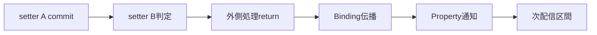

# SEP-B02 / MVVM UIライブラリ UI transactionの上位判断の責務分離レビュー案

- 文書版: 0.2
- 状態: 全案反映承認済み・正本適用済み（2026-10-17）。具体化未了は適用結果を参照
- 作成日: 2026-10-17
- 対象: [元文書](../../12_design/BD-02_ui-transaction-upper-design.md)
- 対象箇所: BD-02 判断・規則表
- 索引: [一括レビュー](index.md)
- 台帳項目: B02

- 現行要求根拠: [RQ-02-002](../../11_requirements/RQ-02_core-features.md#rq-02-002)、[RQ-07-005](../../11_requirements/RQ-07_binding.md#rq-07-005)、[RQ-07-006](../../11_requirements/RQ-07_binding.md#rq-07-006)、[RQ-07-009](../../11_requirements/RQ-07_binding.md#rq-07-009)、[RQ-15-010](../../11_requirements/RQ-15_requirement-decisions.md#rq-15-010)

## 対象本文と既存承認

- 状態: BD-02承認済み（2026-09-26）

作成時点の原文SHA-256: `02ac08aa079aadfa240a43020090831ae90c386c3fe9b15bc7c71e5267abe6c6`。対象は台帳の箇所と、以下の原文・判断ID。正本の本文は今回編集していない。

原文 本文判断 / L10:

> 初期公開版では、利用者が明示的に開始・commit・rollbackするUI transactionを設けない。 代わりに既存の「外側のUI処理区間」を、Bindingと通知をまとめる単位として採用する。これはP2・P3・B2・D3を維持する判断であり、新しい一括更新APIや同期flush APIの提案ではない。

原文 配信とBinding / L15:

> 外側のUIイベント・投稿callback・UI API処理が戻った後にBindingを伝播し、同一Propertyの通知をまとめる。通知callbackが生んだ変更は次の配信回。有限作業枠に達した場合はBD-03に従って配信回の境界でUIへ譲り、保留通知を後続区間で再開する

## 改訂判断案

| レビューID | 変更対象 | 提案 |
|---|---|---|
| SEP-B02-01 | 外部契約と要求の根拠 | [SEP-RQ-021 同値設定時の検証](rq-candidates.md#candidate-021)へ対応付ける。既存RQで定まる結果は上流参照にし、補足/選択要は要求承認後に設計前提へ反映する |
| SEP-B02-02 | 実現手段の本文 | 下記の責務・data/ownership flow・stateを本文案として収録する。個別の公開名・signatureを新たに確定する判断とは分ける |
| SEP-B02-03 | 未決・承認粒度 | 一般transactionと同期flushの初期非提供は要求の対象範囲で扱う。Collection一batchの原子性をこの処理区間へ拡張しない。 |

## 設計本文の改訂案

Core setterは一つの候補に対して検証・必要copyを行い、そのPropertyへ直ちにcommitする。Runtimeは外側のUI処理区間にdirty Propertyを集約し、その区間が戻った後にBinding伝播と外部通知を処理する。配信callback起因の変更は次の配信区間へ入れる。複数setterをまとめるrollback状態は持たず、通知の集約区間を値のtransactionと分ける。

## 移管・ID・検証への影響

- 既存ID: BD-02。方式として残る意味は旧IDを維持し、要求へ分ける文だけを仮候補IDに対応付ける。正式RQ IDの発番は[移行案](id-migration.md)による。
- 移管先: 利用者可視条件は上記RQ候補、C/言語APIの具体形はDD内、脅威と防御はSD、試験操作と判定手順はrequirements-test/unit-test、着手順と下流割当はto-do。
- 設計を説明する所有・state・call図と計算例は保持する。対象本文の試験節は、[検証改訂案](test-impact.md)へ対応付けてから移す。失敗時の状態表・cleanup順まで検証扱いで削除しない。
- 上流RQ/ADR/BDへの参照は該当記述に直接置く。後続の着手割当は計画へ移し、DD間のinterface依存参照は実際の定義側へ向けて循環を解く。文書番号の大小だけで依存を判定しない。

## 承認履歴

| 日付 | 対象 | 承認者 | 結果 |
|---|---|---|---|
| 2026-10-17 | SEP-B02 | — | 一括作成指示に基づくレビュー案。採用・正本適用は未承認 |

## 改訂履歴

| 版 | 日付 | 内容 | 状態 |
|---|---|---|---|
| 0.1 | 2026-10-17 | 現行文書から責務分離・改訂文案・影響を作成 | レビュー待ち |

## 2026-10-17 適用結果

[適用先](../../12_design/BD-02_ui-transaction-upper-design.md) の版0.1へ反映した。補足要求は正式IDへ対応付け、未設計事項は [後続課題](../requirements-design-separation-follow-up.md) に移した。

### 承認履歴

| 日付 | 範囲 | 承認者 | 結果 |
| --- | --- | --- | --- |
| 2026-10-17 | 全レビュー案の反映 | 利用者 | 「すべて反映して下さい。」により採用・正本適用を承認 |

### 改訂履歴

| 版 | 日付 | 内容 |
| --- | --- | --- |
| 0.2 | 2026-10-17 | 承認と正本適用結果を追記。作成時点の比較・引用を保持 |
