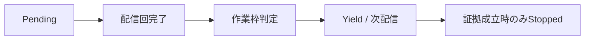

# SEP-B03 / MVVM UIライブラリ Runtime通知上限・診断の上位判断案の責務分離レビュー案

- 文書版: 0.2
- 状態: 全案反映承認済み・正本適用済み（2026-10-17）。具体化未了は適用結果を参照
- 作成日: 2026-10-17
- 対象: [元文書](../../12_design/BD-03_runtime-notification-upper-design.md)
- 対象箇所: BD-03 契約表・限界・停止後
- 索引: [一括レビュー](index.md)
- 台帳項目: B03

- 現行要求根拠: [RQ-07-008](../../11_requirements/RQ-07_binding.md#rq-07-008)、[RQ-15-007](../../11_requirements/RQ-15_requirement-decisions.md#rq-15-007)、[RQ-15-013](../../11_requirements/RQ-15_requirement-decisions.md#rq-15-013)

## 対象本文と既存承認

- 状態: BD-03承認済み（2026-09-26）

作成時点の原文SHA-256: `f93902e5d9a0b517804bbbed40c52156ec26a3a8f6c97fd9c70c6335ba0240be`。対象は台帳の箇所と、以下の原文・判断ID。正本の本文は今回編集していない。

原文 本文判断 / L9:

> Runtimeが行う通知配信に、UIを占有し続けないための有限の作業枠を設ける。枠を使い切っても未配信の通知を捨てず、完了済みの配信回の境界でUIイベントループへ制御を返し、後続のUI処理区間で配信を再開する。 単に枠を超えたことだけでは循環とみなさない。反復が収束しないことをRuntimeが判定した場合は、原因となった通知連鎖の再配信を停止し、診断可能な状態を残す。無関係な通知は継続する。

原文 非収束する反復 / L16:

> 作業枠到達を繰り返すだけでは確定診断とせず、循環状態など非収束と判断する根拠を要する。判定した通知連鎖の自動再配信を止め、原因・影響範囲・停止状態を診断として公開する。別の連鎖を巻き添えにしない。

## 改訂判断案

| レビューID | 変更対象 | 提案 |
|---|---|---|
| SEP-B03-01 | 外部契約と要求の根拠 | [SEP-RQ-022 長期保留の診断設定](rq-candidates.md#candidate-022)、[SEP-RQ-023 非収束診断と回復](rq-candidates.md#candidate-023)、[SEP-RQ-048 診断・解析の能力と限界](rq-candidates.md#candidate-048)へ対応付ける。既存RQで定まる結果は上流参照にし、補足/選択要は要求承認後に設計前提へ反映する |
| SEP-B03-02 | 実現手段の本文 | 下記の責務・data/ownership flow・stateを本文案として収録する。個別の公開名・signatureを新たに確定する判断とは分ける |
| SEP-B03-03 | 未決・承認粒度 | Python静的警告任意という旧例外は、BD-15/RQ-15-007/013による解決可能範囲の診断へ更新した経緯として残す。WatchDog5秒の公開既定と内部128-item枠を分離する。 |

## 設計本文の改訂案

Runtimeは因果連鎖を識別して未配信作業を保持する。有限作業枠の終点では完了した配信回までを確定し、残件を保持してhost loopへ制御を返す。次の処理機会に同じ順序から再開する。長期保留の観測と循環証拠の判定を別に行い、証拠が成立した連鎖だけを停止状態へ移す。診断経路は通常通知連鎖を再発生させず、停止状態の不変snapshotを公開する。

## 移管・ID・検証への影響

- 既存ID: BD-03。方式として残る意味は旧IDを維持し、要求へ分ける文だけを仮候補IDに対応付ける。正式RQ IDの発番は[移行案](id-migration.md)による。
- 移管先: 利用者可視条件は上記RQ候補、C/言語APIの具体形はDD内、脅威と防御はSD、試験操作と判定手順はrequirements-test/unit-test、着手順と下流割当はto-do。
- 設計を説明する所有・state・call図と計算例は保持する。対象本文の試験節は、[検証改訂案](test-impact.md)へ対応付けてから移す。失敗時の状態表・cleanup順まで検証扱いで削除しない。
- 上流RQ/ADR/BDへの参照は該当記述に直接置く。後続の着手割当は計画へ移し、DD間のinterface依存参照は実際の定義側へ向けて循環を解く。文書番号の大小だけで依存を判定しない。

## 承認履歴

| 日付 | 対象 | 承認者 | 結果 |
|---|---|---|---|
| 2026-10-17 | SEP-B03 | — | 一括作成指示に基づくレビュー案。採用・正本適用は未承認 |

## 改訂履歴

| 版 | 日付 | 内容 | 状態 |
|---|---|---|---|
| 0.1 | 2026-10-17 | 現行文書から責務分離・改訂文案・影響を作成 | レビュー待ち |

## 2026-10-17 適用結果

[適用先](../../12_design/BD-03_runtime-notification-upper-design.md) の版0.1へ反映した。補足要求は正式IDへ対応付け、未設計事項は [後続課題](../requirements-design-separation-follow-up.md) に移した。

### 承認履歴

| 日付 | 範囲 | 承認者 | 結果 |
| --- | --- | --- | --- |
| 2026-10-17 | 全レビュー案の反映 | 利用者 | 「すべて反映して下さい。」により採用・正本適用を承認 |

### 改訂履歴

| 版 | 日付 | 内容 |
| --- | --- | --- |
| 0.2 | 2026-10-17 | 承認と正本適用結果を追記。作成時点の比較・引用を保持 |
