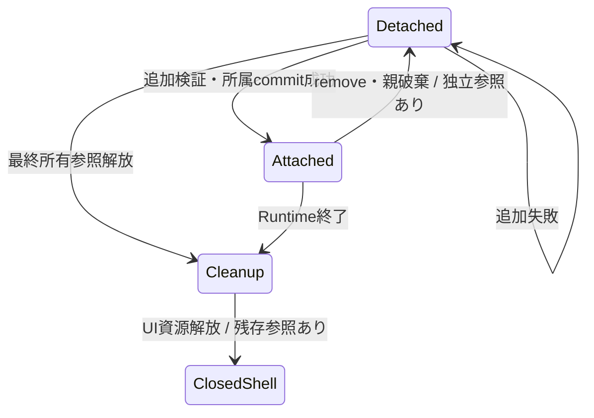

# SEP-B04 / MVVM UIライブラリ UI treeの所有・寿命に関する上位判断案の責務分離レビュー案

- 文書版: 0.2
- 状態: 全案反映承認済み・正本適用済み（2026-10-17）。具体化未了は適用結果を参照
- 作成日: 2026-10-17
- 対象: [元文書](../../12_design/BD-04_ui-tree-lifetime-upper-design.md)
- 対象箇所: BD-04 所属/寿命表・レビュー項目
- 索引: [一括レビュー](index.md)
- 台帳項目: B04

- 現行要求根拠: [RQ-02-007](../../11_requirements/RQ-02_core-features.md#rq-02-007)、[RQ-02-013](../../11_requirements/RQ-02_core-features.md#rq-02-013)、[RQ-05-002](../../11_requirements/RQ-05_ownership-callbacks.md#rq-05-002)、[RQ-05-003](../../11_requirements/RQ-05_ownership-callbacks.md#rq-05-003)、[RQ-09-003](../../11_requirements/RQ-09_ui-scope.md#rq-09-003)

## 対象本文と既存承認

- 状態: BD-04承認済み（2026-09-26）

作成時点の原文SHA-256: `8bc5c2b12cda932ab0e77270ce6d9ef263dce1d570217fec1001c306e3dd879b`。対象は台帳の箇所と、以下の原文・判断ID。正本の本文は今回編集していない。

原文 本文判断 / L9:

> Core管理のUI treeで親子所属が成立している間、親は子をCore内部の強参照で保持する。子を親から外すとその所属参照を解放するが、呼び出し側が持つ公開handleや別の明示所有者があれば子objectは存続する。 親子所属そのものを言語wrapperのGCや参照カウントに依存させない。

原文 付け外し / L14:

> 子は同じtreeの親を最大一つ持つ。親子リンクの追加は既存の親がない場合に限り、削除時はそのリンクの参照を解放する。親子の付け替えを一操作で行うか、失敗時の原子性は後続設計で定める。

原文 Detached中のhandle / L17:

> Detachedでも有効な公開handleはCore objectを指し、release可能とする。所属していないobjectが描画・入力対象にならないことを上位契約とする。Propertyの読み書き・再所属等をどこまで許すかは詳細設計でAPI別に定める。

## 改訂判断案

| レビューID | 変更対象 | 提案 |
|---|---|---|
| SEP-B04-01 | 外部契約と要求の根拠 | [SEP-RQ-033 Detached subtreeの利用](rq-candidates.md#candidate-033)、[SEP-RQ-034 Tree変更の拒否結果](rq-candidates.md#candidate-034)へ対応付ける。既存RQで定まる結果は上流参照にし、補足/選択要は要求承認後に設計前提へ反映する |
| SEP-B04-02 | 実現手段の本文 | 下記の責務・data/ownership flow・stateを本文案として収録する。個別の公開名・signatureを新たに確定する判断とは分ける |
| SEP-B04-03 | 未決・承認粒度 | 再生成に失敗した場合の利用者結果と再試行可否はRQの未決境界。複数親/循環拒否・独立参照存続はRQへ明記する候補。 |

## 設計本文の改訂案

Logical parentは所属childへの内部所有参照を持ち、childからparentへの所属参照は非所有とする。detachはparentの所属参照だけを解放し、独立所有参照のあるchild以下をDetached subtreeとして保持する。Platform接続はCore object寿命と別管理し、detach/親破棄では古いpeerを切り離す。再所属では親子検証の後に所属参照を取得し、新たなPlatform接続を構築する。

## 移管・ID・検証への影響

- 既存ID: BD-04。方式として残る意味は旧IDを維持し、要求へ分ける文だけを仮候補IDに対応付ける。正式RQ IDの発番は[移行案](id-migration.md)による。
- 移管先: 利用者可視条件は上記RQ候補、C/言語APIの具体形はDD内、脅威と防御はSD、試験操作と判定手順はrequirements-test/unit-test、着手順と下流割当はto-do。
- 設計を説明する所有・state・call図と計算例は保持する。対象本文の試験節は、[検証改訂案](test-impact.md)へ対応付けてから移す。失敗時の状態表・cleanup順まで検証扱いで削除しない。
- 上流RQ/ADR/BDへの参照は該当記述に直接置く。後続の着手割当は計画へ移し、DD間のinterface依存参照は実際の定義側へ向けて循環を解く。文書番号の大小だけで依存を判定しない。

## 承認履歴

| 日付 | 対象 | 承認者 | 結果 |
|---|---|---|---|
| 2026-10-17 | SEP-B04 | — | 一括作成指示に基づくレビュー案。採用・正本適用は未承認 |

## 改訂履歴

| 版 | 日付 | 内容 | 状態 |
|---|---|---|---|
| 0.1 | 2026-10-17 | 現行文書から責務分離・改訂文案・影響を作成 | レビュー待ち |

## 2026-10-17 適用結果

[適用先](../../12_design/BD-04_ui-tree-lifetime-upper-design.md) の版0.1へ反映した。補足要求は正式IDへ対応付け、未設計事項は [後続課題](../requirements-design-separation-follow-up.md) に移した。

### 承認履歴

| 日付 | 範囲 | 承認者 | 結果 |
| --- | --- | --- | --- |
| 2026-10-17 | 全レビュー案の反映 | 利用者 | 「すべて反映して下さい。」により採用・正本適用を承認 |

### 改訂履歴

| 版 | 日付 | 内容 |
| --- | --- | --- |
| 0.2 | 2026-10-17 | 承認と正本適用結果を追記。作成時点の比較・引用を保持 |
