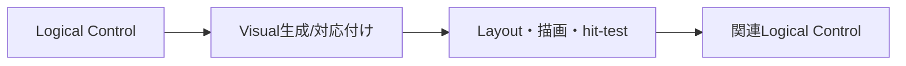

# SEP-B05 / MVVM UIライブラリ Logical Tree／Visual Treeの役割に関する上位判断案の責務分離レビュー案

- 文書版: 0.2
- 状態: 全案反映承認済み・正本適用済み（2026-10-17）。具体化未了は適用結果を参照
- 作成日: 2026-10-17
- 対象: [元文書](../../12_design/BD-05_logical-visual-tree-upper-design.md)
- 対象箇所: BD-05 判断表・BD-04整合・決めないこと
- 索引: [一括レビュー](index.md)
- 台帳項目: B05

- 現行要求根拠: [RQ-02-007](../../11_requirements/RQ-02_core-features.md#rq-02-007)、[RQ-05-003](../../11_requirements/RQ-05_ownership-callbacks.md#rq-05-003)、[RQ-09-003](../../11_requirements/RQ-09_ui-scope.md#rq-09-003)、[RQ-09-026](../../11_requirements/RQ-09_ui-scope.md#rq-09-026)

## 対象本文と既存承認

- 状態: BD-05承認済み（2026-09-26）

作成時点の原文SHA-256: `c6b7286080d3224d3086f9f69ddfb20fb48e7013220c8bb57156f62e50380983`。対象は台帳の箇所と、以下の原文・判断ID。正本の本文は今回編集していない。

原文 本文判断 / L9:

> 初期版からLogical TreeとVisual Treeを別の概念として扱う。Logical Treeはアプリが組み立てるControlの意味上の包含関係、Visual Treeは実際に配置・描画・hit-testする表示構造とする。Control template等が導入された後も、アプリの論理的な構成をtemplate内部の表示部品で変えないためである。 初期Controlでは両者が一対一に見える構成を許す。

原文 Logical Tree / L13:

> アプリが構築するControlの包含関係を表す。初期縦断シナリオのWindow、StackPanel、TextBox、Text、Buttonはこの関係で組み立てる。BD-04の親子所有・寿命規則はLogical Treeに適用する。

原文 Visual Tree / L14:

> Layoutと描画の対象となる実表示構造を表す。Hit-testもVisual Tree上の位置・形状を使って候補を得る。LayoutのMeasure/Arrange規則と各入力種別のdispatchは別判断にする。

## 改訂判断案

| レビューID | 変更対象 | 提案 |
|---|---|---|
| SEP-B05-01 | 外部契約と要求の根拠 | [SEP-RQ-033 Detached subtreeの利用](rq-candidates.md#candidate-033)へ対応付ける。既存RQで定まる結果は上流参照にし、補足/選択要は要求承認後に設計前提へ反映する |
| SEP-B05-02 | 実現手段の本文 | 下記の責務・data/ownership flow・stateを本文案として収録する。個別の公開名・signatureを新たに確定する判断とは分ける |
| SEP-B05-03 | 未決・承認粒度 | DataContext/resource/name scopeの機能採否は別要求。Logical/Visual二概念の維持は承認済みで、template初期採用を意味しない。 |

## 設計本文の改訂案

Logical Treeをアプリ構成と所有の正本にし、Visual TreeをMeasure/Arrange・描画・hit-testの入力にする。各Visual要素に関連Logical Controlを引ける対応を持たせ、入力候補はこの対応を経て共通Controlへ渡す。template由来VisualのownerはControl/template内部へ置き、Logical childとしての所有を追加しない。初期Controlでは同じ順序の単純なVisualを生成する。

## 移管・ID・検証への影響

- 既存ID: BD-05。方式として残る意味は旧IDを維持し、要求へ分ける文だけを仮候補IDに対応付ける。正式RQ IDの発番は[移行案](id-migration.md)による。
- 移管先: 利用者可視条件は上記RQ候補、C/言語APIの具体形はDD内、脅威と防御はSD、試験操作と判定手順はrequirements-test/unit-test、着手順と下流割当はto-do。
- 設計を説明する所有・state・call図と計算例は保持する。対象本文の試験節は、[検証改訂案](test-impact.md)へ対応付けてから移す。失敗時の状態表・cleanup順まで検証扱いで削除しない。
- 上流RQ/ADR/BDへの参照は該当記述に直接置く。後続の着手割当は計画へ移し、DD間のinterface依存参照は実際の定義側へ向けて循環を解く。文書番号の大小だけで依存を判定しない。

## 承認履歴

| 日付 | 対象 | 承認者 | 結果 |
|---|---|---|---|
| 2026-10-17 | SEP-B05 | — | 一括作成指示に基づくレビュー案。採用・正本適用は未承認 |

## 改訂履歴

| 版 | 日付 | 内容 | 状態 |
|---|---|---|---|
| 0.1 | 2026-10-17 | 現行文書から責務分離・改訂文案・影響を作成 | レビュー待ち |

## 2026-10-17 適用結果

[適用先](../../12_design/BD-05_logical-visual-tree-upper-design.md) の版0.1へ反映した。補足要求は正式IDへ対応付け、未設計事項は [後続課題](../requirements-design-separation-follow-up.md) に移した。

### 承認履歴

| 日付 | 範囲 | 承認者 | 結果 |
| --- | --- | --- | --- |
| 2026-10-17 | 全レビュー案の反映 | 利用者 | 「すべて反映して下さい。」により採用・正本適用を承認 |

### 改訂履歴

| 版 | 日付 | 内容 |
| --- | --- | --- |
| 0.2 | 2026-10-17 | 承認と正本適用結果を追記。作成時点の比較・引用を保持 |
