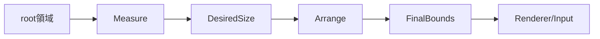

# SEP-B06 / MVVM UIライブラリ Layoutの責務境界に関する上位判断案の責務分離レビュー案

- 文書版: 0.2
- 状態: 全案反映承認済み・正本適用済み（2026-10-17）。具体化未了は適用結果を参照
- 作成日: 2026-10-17
- 対象: [元文書](../../12_design/BD-06_layout-upper-design.md)
- 対象箇所: BD-06 判断表・Sizer/Locationerカスタマイズ
- 索引: [一括レビュー](index.md)
- 台帳項目: B06

- 現行要求根拠: [RQ-02-008](../../11_requirements/RQ-02_core-features.md#rq-02-008)、[RQ-09-007](../../11_requirements/RQ-09_ui-scope.md#rq-09-007)、[RQ-09-008](../../11_requirements/RQ-09_ui-scope.md#rq-09-008)

## 対象本文と既存承認

- 状態: BD-06承認済み（2026-09-26）

作成時点の原文SHA-256: `7059e208bea60e571e40c126a59720a08e08a11fa377f42dd9139cdf29d02cb6`。対象は台帳の箇所と、以下の原文・判断ID。正本の本文は今回編集していない。

原文 本文判断 / L9:

> Measure/ArrangeによるControlの配置計算はRust CoreがVisual Tree上で行い、Platform Adapterはrootの表示可能領域など環境入力を提供し、Coreが確定したboundsを描画・入力系へ渡す。Controlごとのレイアウト意味論を各Platform Adapterで別々に実装しない。 これにより、同じControl treeの配置結果を対象OS間で共通化する。

原文 Core / L13:

> Visual Treeを使ってmeasureとarrangeを行い、Control／Visual要素の最終配置boundsを確定する。Controlのlayout意味論を一か所に置く。

## 改訂判断案

| レビューID | 変更対象 | 提案 |
|---|---|---|
| SEP-B06-01 | 外部契約と要求の根拠 | [SEP-RQ-035 StackPanel公開設定と既定](rq-candidates.md#candidate-035)へ対応付ける。既存RQで定まる結果は上流参照にし、補足/選択要は要求承認後に設計前提へ反映する |
| SEP-B06-02 | 実現手段の本文 | 下記の責務・data/ownership flow・stateを本文案として収録する。個別の公開名・signatureを新たに確定する判断とは分ける |
| SEP-B06-03 | 未決・承認粒度 | 単位・DPI・roundingは設計未決。方向/Alignの公開機能と、Vertical等の省略時の外部保証を別々にレビューする。 |

## 設計本文の改訂案

Platformはrootの利用可能領域と環境scaleをCoreへ渡す。Core Sizerが子からDesiredSizeを集約し、Locationerがrootから子へ矩形を配分してboundsを確定する。RendererとInputは同じboundsを読み、backend側で配置規則を再計算しない。設定値は組み込みSizer/Locationerへの入力として扱い、利用者callbackの独自配置アルゴリズムとは別にする。

## 移管・ID・検証への影響

- 既存ID: BD-06。方式として残る意味は旧IDを維持し、要求へ分ける文だけを仮候補IDに対応付ける。正式RQ IDの発番は[移行案](id-migration.md)による。
- 移管先: 利用者可視条件は上記RQ候補、C/言語APIの具体形はDD内、脅威と防御はSD、試験操作と判定手順はrequirements-test/unit-test、着手順と下流割当はto-do。
- 設計を説明する所有・state・call図と計算例は保持する。対象本文の試験節は、[検証改訂案](test-impact.md)へ対応付けてから移す。失敗時の状態表・cleanup順まで検証扱いで削除しない。
- 上流RQ/ADR/BDへの参照は該当記述に直接置く。後続の着手割当は計画へ移し、DD間のinterface依存参照は実際の定義側へ向けて循環を解く。文書番号の大小だけで依存を判定しない。

## 承認履歴

| 日付 | 対象 | 承認者 | 結果 |
|---|---|---|---|
| 2026-10-17 | SEP-B06 | — | 一括作成指示に基づくレビュー案。採用・正本適用は未承認 |

## 改訂履歴

| 版 | 日付 | 内容 | 状態 |
|---|---|---|---|
| 0.1 | 2026-10-17 | 現行文書から責務分離・改訂文案・影響を作成 | レビュー待ち |

## 2026-10-17 適用結果

[適用先](../../12_design/BD-06_layout-upper-design.md) の版0.1へ反映した。補足要求は正式IDへ対応付け、未設計事項は [後続課題](../requirements-design-separation-follow-up.md) に移した。

### 承認履歴

| 日付 | 範囲 | 承認者 | 結果 |
| --- | --- | --- | --- |
| 2026-10-17 | 全レビュー案の反映 | 利用者 | 「すべて反映して下さい。」により採用・正本適用を承認 |

### 改訂履歴

| 版 | 日付 | 内容 |
| --- | --- | --- |
| 0.2 | 2026-10-17 | 承認と正本適用結果を追記。作成時点の比較・引用を保持 |
