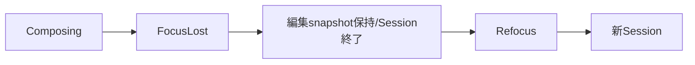

# SEP-B09 / MVVM UIライブラリ Focus移動時のIME compositionに関する上位判断案の責務分離レビュー案

- 文書版: 0.2
- 状態: 全案反映承認済み・正本適用済み（2026-10-17）。具体化未了は適用結果を参照
- 作成日: 2026-10-17
- 対象: [元文書](../../12_design/BD-09_ime-focus-transition-upper-design.md)
- 対象箇所: BD-09 状況表・保証しない範囲
- 索引: [一括レビュー](index.md)
- 台帳項目: B09

- 現行要求根拠: [RQ-02-011](../../11_requirements/RQ-02_core-features.md#rq-02-011)、[RQ-09-005](../../11_requirements/RQ-09_ui-scope.md#rq-09-005)、[RQ-15-006](../../11_requirements/RQ-15_requirement-decisions.md#rq-15-006)

## 対象本文と既存承認

- 状態: BD-09承認済み（2026-09-26）

作成時点の原文SHA-256: `e6bd07b03624b4877c9bcc8666de684b39662e284719c22c4b2a260bba877c19`。対象は台帳の箇所と、以下の原文・判断ID。正本の本文は今回編集していない。

原文 本文判断 / L9:

> FocusがTextBoxから離れる時点でIMEがまだcommitしていない文字列（preedit）がある場合、Platform IME sessionは終了するが、Coreはpreedit文字列と編集位置をTextBoxの未確定編集値として保持する。Focus移動だけを理由にcommitやViewModelへのBinding伝播を行わない。 後でFocusが戻った場合は文字列をTextBoxへ戻して編集を続けられるようにするが、Platform固有の変換候補やcomposition sessionそのものの復元は保証しない。

原文 Focus離脱前にIME commit済み / L13:

> A25～A28に従い確定候補を検証する。`Accept`は通常の値確定とBindingへ進み、`Incomplete`／`Reject`は既承認規則に従って編集値に保持する。

原文 未commitのpreeditがあるままFocus離脱 / L14:

> Coreはpreedit文字列と対応するcaret／selection位置を保持し、IME sessionを終了する。commit扱いせず、候補Validatorを確定候補として実行せず、ViewModelへ流さない。

原文 同じTextBoxへFocusが戻る / L15:

> 保持文字列を編集値として再表示し、IME sessionは新しく開始する。OS候補一覧、変換学習状態、候補segmentなどsession固有状態の復元は保証しない。

## 改訂判断案

| レビューID | 変更対象 | 提案 |
|---|---|---|
| SEP-B09-01 | 外部契約と要求の根拠 | [SEP-RQ-026 TextBox入力三値の結果](rq-candidates.md#candidate-026)、[SEP-RQ-028 IME cancel後の入力理由](rq-candidates.md#candidate-028)、[SEP-RQ-030 外部更新と編集中の値](rq-candidates.md#candidate-030)へ対応付ける。既存RQで定まる結果は上流参照にし、補足/選択要は要求承認後に設計前提へ反映する |
| SEP-B09-02 | 実現手段の本文 | 下記の責務・data/ownership flow・stateを本文案として収録する。個別の公開名・signatureを新たに確定する判断とは分ける |
| SEP-B09-03 | 未決・承認粒度 | OS候補一覧・学習・segmentの復元保証はRQ側の除外として扱う。Escape/Undo等のキー割当は将来候補を維持。 |

## 設計本文の改訂案

FocusLostではCore編集値・caret・selectionを保持したままAdapterのIME sessionを閉じる。preeditをcommit候補に昇格させず、Validator/Bindingを実行しない。再Focusでは保持編集値を表示し、新しいsessionを開始する。明示cancelは別イベントとして開始snapshotを復元する。detach時もCore objectが存続する範囲で編集値を保持する。

## 移管・ID・検証への影響

- 既存ID: BD-09。方式として残る意味は旧IDを維持し、要求へ分ける文だけを仮候補IDに対応付ける。正式RQ IDの発番は[移行案](id-migration.md)による。
- 移管先: 利用者可視条件は上記RQ候補、C/言語APIの具体形はDD内、脅威と防御はSD、試験操作と判定手順はrequirements-test/unit-test、着手順と下流割当はto-do。
- 設計を説明する所有・state・call図と計算例は保持する。対象本文の試験節は、[検証改訂案](test-impact.md)へ対応付けてから移す。失敗時の状態表・cleanup順まで検証扱いで削除しない。
- 上流RQ/ADR/BDへの参照は該当記述に直接置く。後続の着手割当は計画へ移し、DD間のinterface依存参照は実際の定義側へ向けて循環を解く。文書番号の大小だけで依存を判定しない。

## 承認履歴

| 日付 | 対象 | 承認者 | 結果 |
|---|---|---|---|
| 2026-10-17 | SEP-B09 | — | 一括作成指示に基づくレビュー案。採用・正本適用は未承認 |

## 改訂履歴

| 版 | 日付 | 内容 | 状態 |
|---|---|---|---|
| 0.1 | 2026-10-17 | 現行文書から責務分離・改訂文案・影響を作成 | レビュー待ち |

## 2026-10-17 適用結果

[適用先](../../12_design/BD-09_ime-focus-transition-upper-design.md) の版0.1へ反映した。補足要求は正式IDへ対応付け、未設計事項は [後続課題](../requirements-design-separation-follow-up.md) に移した。

### 承認履歴

| 日付 | 範囲 | 承認者 | 結果 |
| --- | --- | --- | --- |
| 2026-10-17 | 全レビュー案の反映 | 利用者 | 「すべて反映して下さい。」により採用・正本適用を承認 |

### 改訂履歴

| 版 | 日付 | 内容 |
| --- | --- | --- |
| 0.2 | 2026-10-17 | 承認と正本適用結果を追記。作成時点の比較・引用を保持 |
