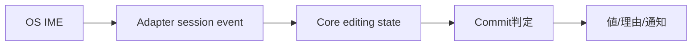

# SEP-B10 / MVVM UIライブラリ IME Platform境界に関する上位判断案の責務分離レビュー案

- 文書版: 0.2
- 状態: 全案反映承認済み・正本適用済み（2026-10-17）。具体化未了は適用結果を参照
- 作成日: 2026-10-17
- 対象: [元文書](../../12_design/BD-10_ime-platform-boundary-upper-design.md)
- 対象箇所: BD-10 責務表・範囲
- 索引: [一括レビュー](index.md)
- 台帳項目: B10

- 現行要求根拠: [RQ-02-011](../../11_requirements/RQ-02_core-features.md#rq-02-011)、[RQ-09-005](../../11_requirements/RQ-09_ui-scope.md#rq-09-005)、[RQ-15-006](../../11_requirements/RQ-15_requirement-decisions.md#rq-15-006)

## 対象本文と既存承認

- 状態: BD-10承認済み（2026-09-26）

作成時点の原文SHA-256: `7fcc773fd12bbb19bafeef3c2acc58ffa0f2667963014634312a6d9a50a148f8`。対象は台帳の箇所と、以下の原文・判断ID。正本の本文は今回編集していない。

原文 本文判断 / L9:

> Platform AdapterはOSのIME session、変換候補UI、native IME APIとの接続を所有する。Core TextBoxはアプリから観測できる編集文字列・selection/caret・入力状態を所有し、Platform AdapterはIMEからのpreedit／commit／cancelを共通eventへ変換して渡す。 OS固有のIME objectや候補windowをCore handleやABIへ露出させない。

原文 Platform Adapter / L13:

> OS IME sessionの開始・終了、native candidate UI、OS固有eventの受信を担う。TextBoxのcaretや入力位置に候補UIを配置するため、必要な座標・selection情報をCoreから受け取る。

原文 Core TextBox / L14:

> 編集値、selection/caret、preedit状態、入力状態と理由を保持し、4言語から共通APIで観測できるようにする。Platform固有候補windowを状態のsource-of-truthにしない。

原文 Preedit更新 / L15:

> Adapterは変換途中の文字列と編集範囲をCoreへ渡す。CoreはTextBox表示用の編集状態を更新するが、候補Validatorで確定判定せず、確定Property／ViewModelへ伝播しない（V7、A26）。

## 改訂判断案

| レビューID | 変更対象 | 提案 |
|---|---|---|
| SEP-B10-01 | 外部契約と要求の根拠 | [SEP-RQ-026 TextBox入力三値の結果](rq-candidates.md#candidate-026)、[SEP-RQ-030 外部更新と編集中の値](rq-candidates.md#candidate-030)へ対応付ける。既存RQで定まる結果は上流参照にし、補足/選択要は要求承認後に設計前提へ反映する |
| SEP-B10-02 | 実現手段の本文 | 下記の責務・data/ownership flow・stateを本文案として収録する。個別の公開名・signatureを新たに確定する判断とは分ける |
| SEP-B10-03 | 未決・承認粒度 | surrounding text、OS API、candidate UI座標の公開形は未決。4言語での編集結果観測は要求、event structはDD。 |

## 設計本文の改訂案

Core TextBoxが編集全文・selection/caret・preeditと入力状態を保持し、AdapterはOS IME sessionとcandidate UIを所有する。UpdateはCore編集状態だけを書き換え、Commitは完全候補を入力Validatorへ一度渡す。candidate UIの配置にはCoreのcaret/layout座標を渡し、native候補windowを編集値の正本にしない。

## 移管・ID・検証への影響

- 既存ID: BD-10。方式として残る意味は旧IDを維持し、要求へ分ける文だけを仮候補IDに対応付ける。正式RQ IDの発番は[移行案](id-migration.md)による。
- 移管先: 利用者可視条件は上記RQ候補、C/言語APIの具体形はDD内、脅威と防御はSD、試験操作と判定手順はrequirements-test/unit-test、着手順と下流割当はto-do。
- 設計を説明する所有・state・call図と計算例は保持する。対象本文の試験節は、[検証改訂案](test-impact.md)へ対応付けてから移す。失敗時の状態表・cleanup順まで検証扱いで削除しない。
- 上流RQ/ADR/BDへの参照は該当記述に直接置く。後続の着手割当は計画へ移し、DD間のinterface依存参照は実際の定義側へ向けて循環を解く。文書番号の大小だけで依存を判定しない。

## 承認履歴

| 日付 | 対象 | 承認者 | 結果 |
|---|---|---|---|
| 2026-10-17 | SEP-B10 | — | 一括作成指示に基づくレビュー案。採用・正本適用は未承認 |

## 改訂履歴

| 版 | 日付 | 内容 | 状態 |
|---|---|---|---|
| 0.1 | 2026-10-17 | 現行文書から責務分離・改訂文案・影響を作成 | レビュー待ち |

## 2026-10-17 適用結果

[適用先](../../12_design/BD-10_ime-platform-boundary-upper-design.md) の版0.1へ反映した。補足要求は正式IDへ対応付け、未設計事項は [後続課題](../requirements-design-separation-follow-up.md) に移した。

### 承認履歴

| 日付 | 範囲 | 承認者 | 結果 |
| --- | --- | --- | --- |
| 2026-10-17 | 全レビュー案の反映 | 利用者 | 「すべて反映して下さい。」により採用・正本適用を承認 |

### 改訂履歴

| 版 | 日付 | 内容 |
| --- | --- | --- |
| 0.2 | 2026-10-17 | 承認と正本適用結果を追記。作成時点の比較・引用を保持 |
