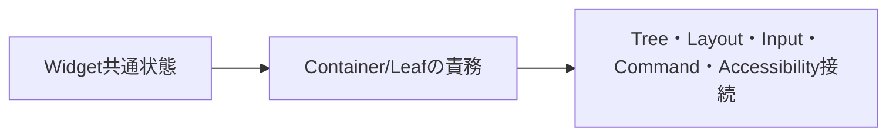

# SEP-B11 / MVVM UIライブラリ 初期Control契約に関する上位判断案の責務分離レビュー案

- 文書版: 0.2
- 状態: 全案反映承認済み・正本適用済み（2026-10-17）。具体化未了は適用結果を参照
- 作成日: 2026-10-17
- 対象: [元文書](../../12_design/BD-11_initial-control-contract-upper-design.md)
- 対象箇所: BD-11 Control責務表・決めないこと
- 索引: [一括レビュー](index.md)
- 台帳項目: B11

- 現行要求根拠: [RQ-09-001](../../11_requirements/RQ-09_ui-scope.md#rq-09-001)、[RQ-09-002](../../11_requirements/RQ-09_ui-scope.md#rq-09-002)、[RQ-09-003](../../11_requirements/RQ-09_ui-scope.md#rq-09-003)、[RQ-09-004](../../11_requirements/RQ-09_ui-scope.md#rq-09-004)、[RQ-09-005](../../11_requirements/RQ-09_ui-scope.md#rq-09-005)、[RQ-09-006](../../11_requirements/RQ-09_ui-scope.md#rq-09-006)、[RQ-09-007](../../11_requirements/RQ-09_ui-scope.md#rq-09-007)、[RQ-09-009](../../11_requirements/RQ-09_ui-scope.md#rq-09-009)、[RQ-09-010](../../11_requirements/RQ-09_ui-scope.md#rq-09-010)、[RQ-09-011](../../11_requirements/RQ-09_ui-scope.md#rq-09-011)、[RQ-10-003](../../11_requirements/RQ-10_accessibility.md#rq-10-003)、[RQ-10-008](../../11_requirements/RQ-10_accessibility.md#rq-10-008)、[RQ-15-004](../../11_requirements/RQ-15_requirement-decisions.md#rq-15-004)

## 対象本文と既存承認

- 状態: BD-11承認済み（2026-09-26）

作成時点の原文SHA-256: `2019fc3209b05287747901ef565c290696f45329dca4c44514673253d0af14b4`。対象は台帳の箇所と、以下の原文・判断ID。正本の本文は今回編集していない。

原文 本文判断 / L9:

> 共通抽象を`Widget`とし、その下に子Widgetを持ちうる分類として抽象`Container`を設ける。WindowとStackPanelはContainer、TextBox・Text・Buttonは初期版の葉Widgetとする。アプリが組み立てる所有・包含関係はLogical Treeで表し、配置・描画・hit-testは対応するVisual TreeとCore Layoutに委ねる。各型の共通役割だけをこの判断で定め、個別Property一覧、子数、見た目の既定値、イベントroutingや描画方式は後続に残す。

原文 Widget / L13:

> UI要素の共通抽象。tree所属と共通のCore object寿命を持つ。直接生成できるか、共通Propertyを何にするかはここでは決めない。

原文 TextBox / L18:

> 葉Widget。編集文字列とselection/caret、入力状態をCore側で持つ編集Control。commit候補をA25～A28で検証し、IME session連携はBD-09／BD-10に従う。

## 改訂判断案

| レビューID | 変更対象 | 提案 |
|---|---|---|
| SEP-B11-01 | 外部契約と要求の根拠 | [SEP-RQ-035 StackPanel公開設定と既定](rq-candidates.md#candidate-035)、[SEP-RQ-036 有効性とFocusの共通結果](rq-candidates.md#candidate-036)、[SEP-RQ-037 初期機能の除外とButton未接続](rq-candidates.md#candidate-037)、[SEP-RQ-041 Accessibility nameの空欄](rq-candidates.md#candidate-041)へ対応付ける。既存RQで定まる結果は上流参照にし、補足/選択要は要求承認後に設計前提へ反映する |
| SEP-B11-02 | 実現手段の本文 | 下記の責務・data/ownership flow・stateを本文案として収録する。個別の公開名・signatureを新たに確定する判断とは分ける |
| SEP-B11-03 | 未決・承認粒度 | Window子数を古い未決として残さずRQ-09-001の一content rootへ整合。公開class/Property名はDD内で具体化する。 |

## 設計本文の改訂案

Widgetに共通Core寿命と意味情報を持たせ、ContainerにLogical child所有を持たせる。Windowはcontent rootを介して表示領域へ接続し、StackPanelは順序付きchildrenをLayoutへ渡す。Textは表示値、TextBoxは確定値と編集状態、Buttonはsemantic activationからCommandへ接続する。初期Controlの列挙はRQを参照し、この責務表から製品範囲を追加しない。

## 移管・ID・検証への影響

- 既存ID: BD-11。方式として残る意味は旧IDを維持し、要求へ分ける文だけを仮候補IDに対応付ける。正式RQ IDの発番は[移行案](id-migration.md)による。
- 移管先: 利用者可視条件は上記RQ候補、C/言語APIの具体形はDD内、脅威と防御はSD、試験操作と判定手順はrequirements-test/unit-test、着手順と下流割当はto-do。
- 設計を説明する所有・state・call図と計算例は保持する。対象本文の試験節は、[検証改訂案](test-impact.md)へ対応付けてから移す。失敗時の状態表・cleanup順まで検証扱いで削除しない。
- 上流RQ/ADR/BDへの参照は該当記述に直接置く。後続の着手割当は計画へ移し、DD間のinterface依存参照は実際の定義側へ向けて循環を解く。文書番号の大小だけで依存を判定しない。

## 承認履歴

| 日付 | 対象 | 承認者 | 結果 |
|---|---|---|---|
| 2026-10-17 | SEP-B11 | — | 一括作成指示に基づくレビュー案。採用・正本適用は未承認 |

## 改訂履歴

| 版 | 日付 | 内容 | 状態 |
|---|---|---|---|
| 0.1 | 2026-10-17 | 現行文書から責務分離・改訂文案・影響を作成 | レビュー待ち |

## 2026-10-17 適用結果

[適用先](../../12_design/BD-11_initial-control-contract-upper-design.md) の版0.1へ反映した。補足要求は正式IDへ対応付け、未設計事項は [後続課題](../requirements-design-separation-follow-up.md) に移した。

### 承認履歴

| 日付 | 範囲 | 承認者 | 結果 |
| --- | --- | --- | --- |
| 2026-10-17 | 全レビュー案の反映 | 利用者 | 「すべて反映して下さい。」により採用・正本適用を承認 |

### 改訂履歴

| 版 | 日付 | 内容 |
| --- | --- | --- |
| 0.2 | 2026-10-17 | 承認と正本適用結果を追記。作成時点の比較・引用を保持 |
