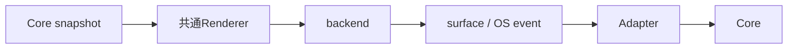

# SEP-B12 / MVVM UIライブラリ 初期描画方式と検証順序に関する上位判断案の責務分離レビュー案

- 文書版: 0.2
- 状態: 全案反映承認済み・正本適用済み（2026-10-17）。具体化未了は適用結果を参照
- 作成日: 2026-10-17
- 対象: [元文書](../../12_design/BD-12_rendering-platform-upper-design.md)
- 対象箇所: BD-12 描画/対応順/実機表
- 索引: [一括レビュー](index.md)
- 台帳項目: B12

- 現行要求根拠: [RQ-09-005](../../11_requirements/RQ-09_ui-scope.md#rq-09-005)、[RQ-11-001](../../11_requirements/RQ-11_platform.md#rq-11-001)、[RQ-11-002](../../11_requirements/RQ-11_platform.md#rq-11-002)、[RQ-11-009](../../11_requirements/RQ-11_platform.md#rq-11-009)、[RQ-12-010](../../11_requirements/RQ-12_build-distribution.md#rq-12-010)、[RQ-13-001](../../11_requirements/RQ-13_nonfunctional-measurement.md#rq-13-001)、[RQ-13-011](../../11_requirements/RQ-13_nonfunctional-measurement.md#rq-13-011)、[RQ-15-001](../../11_requirements/RQ-15_requirement-decisions.md#rq-15-001)、[RQ-15-002](../../11_requirements/RQ-15_requirement-decisions.md#rq-15-002)、[RQ-15-003](../../11_requirements/RQ-15_requirement-decisions.md#rq-15-003)、[RQ-15-005](../../11_requirements/RQ-15_requirement-decisions.md#rq-15-005)、[RQ-15-017](../../11_requirements/RQ-15_requirement-decisions.md#rq-15-017)

## 対象本文と既存承認

- 状態: BD-12承認済み（2026-09-26）

作成時点の原文SHA-256: `237abc294d6c0bf491d6d04536ddc3f71bc3926159eb7b69f7892bd6e8388640`。対象は台帳の箇所と、以下の原文・判断ID。正本の本文は今回編集していない。

原文 本文判断 / L9:

> 初期Controlの見た目は共通Rendererによる独自描画とし、OSのnative controlを各Controlの意味・状態のsource-of-truthにしない。

原文 Control描画 / L13:

> Window、StackPanel、TextBox、Text、Buttonは共通Rendererで描く。Platform native controlは見た目やControl stateのsource-of-truthにしない。

原文 組み込みLinux実機検証 / L18:

> Linux x64での動作・cross-build確認後、正式対象であるLinux ARMv7/AArch64の代表boardで実機検証する。ADR-0001記載の候補順でDRM/KMS + EGL/OpenGL ES、Wayland、X11、framebuffer/software rendererを確認し、要求仕様の性能項目を計測する。

原文 その他のOS / L19:

> 上記の後にWindows以外のarchitecture、macOS等へ展開する。対象候補は維持し、正確なtarget matrix・各OS backend・リリースgateは配布／CI判断に残す。

## 改訂判断案

| レビューID | 変更対象 | 提案 |
|---|---|---|
| SEP-B12-01 | 外部契約と要求の根拠 | [SEP-RQ-039 Platform資源喪失と終了](rq-candidates.md#candidate-039)、[SEP-RQ-049 検証状態と正式support](rq-candidates.md#candidate-049)、[SEP-RQ-058 text coverageと編集位置](rq-candidates.md#candidate-058)、[SEP-RQ-059 性能測定と閾値](rq-candidates.md#candidate-059)へ対応付ける。既存RQで定まる結果は上流参照にし、補足/選択要は要求承認後に設計前提へ反映する |
| SEP-B12-02 | 実現手段の本文 | 下記の責務・data/ownership flow・stateを本文案として収録する。個別の公開名・signatureを新たに確定する判断とは分ける |
| SEP-B12-03 | 未決・承認粒度 | backend候補順・正式support・実機測定の合否を混同しない。具体描画API・scene/damage形式は未決。 |

## 設計本文の改訂案

Core Visual/Layout snapshotを共通Rendererへ渡し、RendererがPlatform backendのsurfaceへ描画する。AdapterはWindow/surface、input、IME、AccessibilityとOSとの接点を所有する。Linux x64とARMで共通source/build logicを共有し、target別linker/sysroot/dependencyから別native artifactを作る。開発順は計画へ、公開support範囲はRQへ分ける。

## 移管・ID・検証への影響

- 既存ID: BD-12。方式として残る意味は旧IDを維持し、要求へ分ける文だけを仮候補IDに対応付ける。正式RQ IDの発番は[移行案](id-migration.md)による。
- 移管先: 利用者可視条件は上記RQ候補、C/言語APIの具体形はDD内、脅威と防御はSD、試験操作と判定手順はrequirements-test/unit-test、着手順と下流割当はto-do。
- 設計を説明する所有・state・call図と計算例は保持する。対象本文の試験節は、[検証改訂案](test-impact.md)へ対応付けてから移す。失敗時の状態表・cleanup順まで検証扱いで削除しない。
- 上流RQ/ADR/BDへの参照は該当記述に直接置く。後続の着手割当は計画へ移し、DD間のinterface依存参照は実際の定義側へ向けて循環を解く。文書番号の大小だけで依存を判定しない。

## 承認履歴

| 日付 | 対象 | 承認者 | 結果 |
|---|---|---|---|
| 2026-10-17 | SEP-B12 | — | 一括作成指示に基づくレビュー案。採用・正本適用は未承認 |

## 改訂履歴

| 版 | 日付 | 内容 | 状態 |
|---|---|---|---|
| 0.1 | 2026-10-17 | 現行文書から責務分離・改訂文案・影響を作成 | レビュー待ち |

## 2026-10-17 適用結果

[適用先](../../12_design/BD-12_rendering-platform-upper-design.md) の版0.1へ反映した。補足要求は正式IDへ対応付け、未設計事項は [後続課題](../requirements-design-separation-follow-up.md) に移した。

### 承認履歴

| 日付 | 範囲 | 承認者 | 結果 |
| --- | --- | --- | --- |
| 2026-10-17 | 全レビュー案の反映 | 利用者 | 「すべて反映して下さい。」により採用・正本適用を承認 |

### 改訂履歴

| 版 | 日付 | 内容 |
| --- | --- | --- |
| 0.2 | 2026-10-17 | 承認と正本適用結果を追記。作成時点の比較・引用を保持 |
