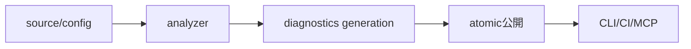

# SEP-B15 / MVVM UIライブラリ Python lint/type check とMCP連携に関する上位判断案の責務分離レビュー案

- 文書版: 0.2
- 状態: 全案反映承認済み・正本適用済み（2026-10-17）。具体化未了は適用結果を参照
- 作成日: 2026-10-17
- 対象: [元文書](../../12_design/BD-15_python-lint-mcp-upper-design.md)
- 対象箇所: BD-15 境界表・増分解析・静的範囲
- 索引: [一括レビュー](index.md)
- 台帳項目: B15

- 現行要求根拠: [RQ-15-007](../../11_requirements/RQ-15_requirement-decisions.md#rq-15-007)、[RQ-15-013](../../11_requirements/RQ-15_requirement-decisions.md#rq-15-013)

## 対象本文と既存承認

- 状態: BD-15承認済み（2026-09-26）

作成時点の原文SHA-256: `b47ff75f7eac438dc55436f773ccbfb00ff2fdd8e4fd1431ff43d243e5bd4594`。対象は台帳の箇所と、以下の原文・判断ID。正本の本文は今回編集していない。

原文 本文判断 / L9:

> Python向けlint/type checkをlibrary compilerの開発ツール群へ組み込み、同じ解析基盤をMCP server経由で利用できるようにする。

原文 Library compiler / diagnostics core / L15:

> Language analyzerから診断を集約し、rule ID、severity、message、source span、related locationを共通形式で返す。同じ入力と設定からCLI/CIとMCPで同じ結果を生成する。

## 改訂判断案

| レビューID | 変更対象 | 提案 |
|---|---|---|
| SEP-B15-01 | 外部契約と要求の根拠 | [SEP-RQ-048 診断・解析の能力と限界](rq-candidates.md#candidate-048)へ対応付ける。既存RQで定まる結果は上流参照にし、補足/選択要は要求承認後に設計前提へ反映する |
| SEP-B15-02 | 実現手段の本文 | 下記の責務・data/ownership flow・stateを本文案として収録する。個別の公開名・signatureを新たに確定する判断とは分ける |
| SEP-B15-03 | 未決・承認粒度 | workspace/file/cacheの隔離はSDへ。parser/checker製品、MCP schema、marker拡張、base-call必須methodの一覧は別具体化待ち。 |

## 設計本文の改訂案

language analyzerとView analyzerの結果を共通diagnostics coreへ集め、CLI/CI/MCPは同じ入力・設定と解析結果を扱う。増分cacheは入力内容と設定の世代に関連付け、解析完了した一世代を公開する。入力が変わった世代の古い結果は最新応答に使わない。MCPはworkspace/file要求の受付層とし、解析本体やbuildの再現性をdaemon寿命へ依存させない。

## 移管・ID・検証への影響

- 既存ID: BD-15。方式として残る意味は旧IDを維持し、要求へ分ける文だけを仮候補IDに対応付ける。正式RQ IDの発番は[移行案](id-migration.md)による。
- 移管先: 利用者可視条件は上記RQ候補、C/言語APIの具体形はDD内、脅威と防御はSD、試験操作と判定手順はrequirements-test/unit-test、着手順と下流割当はto-do。
- 設計を説明する所有・state・call図と計算例は保持する。対象本文の試験節は、[検証改訂案](test-impact.md)へ対応付けてから移す。失敗時の状態表・cleanup順まで検証扱いで削除しない。
- 上流RQ/ADR/BDへの参照は該当記述に直接置く。後続の着手割当は計画へ移し、DD間のinterface依存参照は実際の定義側へ向けて循環を解く。文書番号の大小だけで依存を判定しない。

## 承認履歴

| 日付 | 対象 | 承認者 | 結果 |
|---|---|---|---|
| 2026-10-17 | SEP-B15 | — | 一括作成指示に基づくレビュー案。採用・正本適用は未承認 |

## 改訂履歴

| 版 | 日付 | 内容 | 状態 |
|---|---|---|---|
| 0.1 | 2026-10-17 | 現行文書から責務分離・改訂文案・影響を作成 | レビュー待ち |

## 2026-10-17 適用結果

[適用先](../../12_design/BD-15_python-lint-mcp-upper-design.md) の版0.1へ反映した。補足要求は正式IDへ対応付け、未設計事項は [後続課題](../requirements-design-separation-follow-up.md) に移した。

### 承認履歴

| 日付 | 範囲 | 承認者 | 結果 |
| --- | --- | --- | --- |
| 2026-10-17 | 全レビュー案の反映 | 利用者 | 「すべて反映して下さい。」により採用・正本適用を承認 |

### 改訂履歴

| 版 | 日付 | 内容 |
| --- | --- | --- |
| 0.2 | 2026-10-17 | 承認と正本適用結果を追記。作成時点の比較・引用を保持 |
