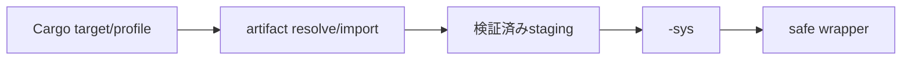

# SEP-B20 / MVVM UIライブラリ Rust Cargo packageに関する上位判断の責務分離レビュー案

- 文書版: 0.2
- 状態: 全案反映承認済み・正本適用済み（2026-10-17）。具体化未了は適用結果を参照
- 作成日: 2026-10-17
- 対象: [元文書](../../12_design/BD-20_rust-cargo-package-upper-design.md)
- 対象箇所: BD-20 判断・配布表・import契約
- 索引: [一括レビュー](index.md)
- 台帳項目: B20

- 現行要求根拠: [RQ-03-003](../../11_requirements/RQ-03_language-support.md#rq-03-003)、[RQ-12-001](../../11_requirements/RQ-12_build-distribution.md#rq-12-001)、[RQ-12-003](../../11_requirements/RQ-12_build-distribution.md#rq-12-003)、[RQ-12-005](../../11_requirements/RQ-12_build-distribution.md#rq-12-005)、[RQ-15-016](../../11_requirements/RQ-15_requirement-decisions.md#rq-15-016)

## 対象本文と既存承認

- 状態: BD-20承認済み（2026-09-27）

作成時点の原文SHA-256: `d1f920d4c7dc05b7695d6fdfaf502b912f6db8f19f0d2a71dcb802ba4b84e48a`。対象は台帳の箇所と、以下の原文・判断ID。正本の本文は今回編集していない。

原文 本文判断 / L9:

> Rust向けwrapperはCargo library crateとして配布し、raw `unsafe extern` C ABI宣言を担う低レベル`-sys` crateと、それを安全なRust APIで包む高レベルcrateを分ける。

原文 Low-level crate / L15:

> versioned C ABIの型・関数をraw FFIで公開する`-sys` crate

## 改訂判断案

| レビューID | 変更対象 | 提案 |
|---|---|---|
| SEP-B20-01 | 外部契約と要求の根拠 | [SEP-RQ-044 Rust safe APIとpanic限界](rq-candidates.md#candidate-044)、[SEP-RQ-050 artifact選択・identity・取得](rq-candidates.md#candidate-050)、[SEP-RQ-051 artifactの信頼と検証失敗](rq-candidates.md#candidate-051)へ対応付ける。既存RQで定まる結果は上流参照にし、補足/選択要は要求承認後に設計前提へ反映する |
| SEP-B20-02 | 実現手段の本文 | 下記の責務・data/ownership flow・stateを本文案として収録する。個別の公開名・signatureを新たに確定する判断とは分ける |
| SEP-B20-03 | 未決・承認粒度 | crate名、features、bindgen、registry/cache/credentialsは未決。featureをtarget指定として使わない。trust境界はSDへ。 |

## 設計本文の改訂案

Cargo配布はraw FFIの-sysとsafe wrapperを分け、target native runtimeを独立artifactとしてlink/loadする。Cargo targetとnamed profileをartifact解決へ渡し、明示importは検証済みstagingへ取り込んでからlink search情報を返す。safe crateの通常利用からraw handle/userdataを隠し、unsafe実装でCore契約を満たす。

## 移管・ID・検証への影響

- 既存ID: BD-20。方式として残る意味は旧IDを維持し、要求へ分ける文だけを仮候補IDに対応付ける。正式RQ IDの発番は[移行案](id-migration.md)による。
- 移管先: 利用者可視条件は上記RQ候補、C/言語APIの具体形はDD内、脅威と防御はSD、試験操作と判定手順はrequirements-test/unit-test、着手順と下流割当はto-do。
- 設計を説明する所有・state・call図と計算例は保持する。対象本文の試験節は、[検証改訂案](test-impact.md)へ対応付けてから移す。失敗時の状態表・cleanup順まで検証扱いで削除しない。
- 上流RQ/ADR/BDへの参照は該当記述に直接置く。後続の着手割当は計画へ移し、DD間のinterface依存参照は実際の定義側へ向けて循環を解く。文書番号の大小だけで依存を判定しない。

## 承認履歴

| 日付 | 対象 | 承認者 | 結果 |
|---|---|---|---|
| 2026-10-17 | SEP-B20 | — | 一括作成指示に基づくレビュー案。採用・正本適用は未承認 |

## 改訂履歴

| 版 | 日付 | 内容 | 状態 |
|---|---|---|---|
| 0.1 | 2026-10-17 | 現行文書から責務分離・改訂文案・影響を作成 | レビュー待ち |

## 2026-10-17 適用結果

[適用先](../../12_design/BD-20_rust-cargo-package-upper-design.md) の版0.1へ反映した。補足要求は正式IDへ対応付け、未設計事項は [後続課題](../requirements-design-separation-follow-up.md) に移した。

### 承認履歴

| 日付 | 範囲 | 承認者 | 結果 |
| --- | --- | --- | --- |
| 2026-10-17 | 全レビュー案の反映 | 利用者 | 「すべて反映して下さい。」により採用・正本適用を承認 |

### 改訂履歴

| 版 | 日付 | 内容 |
| --- | --- | --- |
| 0.2 | 2026-10-17 | 承認と正本適用結果を追記。作成時点の比較・引用を保持 |
