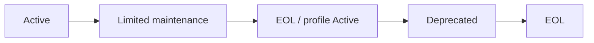

# SEP-B22 / MVVM UIライブラリ サポート期間に関する上位判断案の責務分離レビュー案

- 文書版: 0.2
- 状態: 全案反映承認済み・正本適用済み（2026-10-17）。具体化未了は適用結果を参照
- 作成日: 2026-10-17
- 対象: [元文書](../../12_design/BD-22_support-lifecycle-upper-design.md)
- 対象箇所: BD-22 判断・EOL条件
- 索引: [一括レビュー](index.md)
- 台帳項目: B22

- 現行要求根拠: [RQ-11-001](../../11_requirements/RQ-11_platform.md#rq-11-001)、[RQ-11-002](../../11_requirements/RQ-11_platform.md#rq-11-002)、[RQ-12-010](../../11_requirements/RQ-12_build-distribution.md#rq-12-010)、[RQ-15-015](../../11_requirements/RQ-15_requirement-decisions.md#rq-15-015)

## 対象本文と既存承認

- 状態: BD-22承認済み（2026-09-27）

作成時点の原文SHA-256: `fa1d33a01865a95bf98cd52b78afa70b191278c9287a8623e37c5be91bd63f0f`。対象は台帳の箇所と、以下の原文・判断ID。正本の本文は今回編集していない。

原文 本文項目1 / L15:

> サポート対象はABI majorとtarget profileの組で明示する。 各releaseのsupport matrixにOS、architecture、hardware profileまたはtoolchain profile、ABI major、検証状態を記す。単にcross-compileできるtargetを「実機サポート済み」と表示しない。

原文 本文項目2 / L16:

> 最新安定ABI majorを通常保守する。 通常保守には互換性を保つbug fixとsecurity fixを含める。機能追加・互換変更はA3のminor、破壊変更は新majorの規則に従う。

原文 本文項目4 / L18:

> target profileの追加・非推奨・EOLはABI majorとは別に管理する。 profileを非推奨にする場合は、公式release noteで最低12か月前に通知する。重大なsecurity上の事情がある場合は短縮理由と影響を同じ告知に記録する。

## 改訂判断案

| レビューID | 変更対象 | 提案 |
|---|---|---|
| SEP-B22-01 | 外部契約と要求の根拠 | [SEP-RQ-049 検証状態と正式support](rq-candidates.md#candidate-049)、[SEP-RQ-054 support lifecycleとEOL記録](rq-candidates.md#candidate-054)へ対応付ける。既存RQで定まる結果は上流参照にし、補足/選択要は要求承認後に設計前提へ反映する |
| SEP-B22-02 | 実現手段の本文 | 下記の責務・data/ownership flow・stateを本文案として収録する。個別の公開名・signatureを新たに確定する判断とは分ける |
| SEP-B22-03 | 未決・承認粒度 | SLA/LTS/保存期限を追加しない。support matrixの正式target採否は別要求承認。 |

## 設計本文の改訂案

ABI major×profileをsupport記録のkeyとし、通常保守・限定保守・非推奨・EOLの状態と開始/終了根拠を管理する。新major公開を旧majorの限定保守期間へ対応付け、profile変更告知と公開物への参照をrelease metadataに結ぶ。保守期間・例外・EOL後の利用者可視結果はRQを正本にする。

## 移管・ID・検証への影響

- 既存ID: BD-22。方式として残る意味は旧IDを維持し、要求へ分ける文だけを仮候補IDに対応付ける。正式RQ IDの発番は[移行案](id-migration.md)による。
- 移管先: 期限と保証はRQ、告知・保守実行は運用計画、検査記録はrelease/version-testへ。
- 設計を説明する所有・state・call図と計算例は保持する。対象本文の試験節は、[検証改訂案](test-impact.md)へ対応付けてから移す。失敗時の状態表・cleanup順まで検証扱いで削除しない。
- 上流RQ/ADR/BDへの参照は該当記述に直接置く。後続の着手割当は計画へ移し、DD間のinterface依存参照は実際の定義側へ向けて循環を解く。文書番号の大小だけで依存を判定しない。

## 承認履歴

| 日付 | 対象 | 承認者 | 結果 |
|---|---|---|---|
| 2026-10-17 | SEP-B22 | — | 一括作成指示に基づくレビュー案。採用・正本適用は未承認 |

## 改訂履歴

| 版 | 日付 | 内容 | 状態 |
|---|---|---|---|
| 0.1 | 2026-10-17 | 現行文書から責務分離・改訂文案・影響を作成 | レビュー待ち |

## 2026-10-17 適用結果

[適用先](../../12_design/BD-22_support-lifecycle-upper-design.md) の版0.1へ反映した。補足要求は正式IDへ対応付け、未設計事項は [後続課題](../requirements-design-separation-follow-up.md) に移した。

### 承認履歴

| 日付 | 範囲 | 承認者 | 結果 |
| --- | --- | --- | --- |
| 2026-10-17 | 全レビュー案の反映 | 利用者 | 「すべて反映して下さい。」により採用・正本適用を承認 |

### 改訂履歴

| 版 | 日付 | 内容 |
| --- | --- | --- |
| 0.2 | 2026-10-17 | 承認と正本適用結果を追記。作成時点の比較・引用を保持 |
