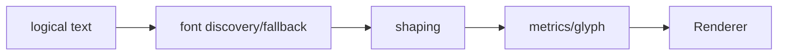

# SEP-B23 / MVVM UIライブラリ text shaping／Unicode対応の上位判断案の責務分離レビュー案

- 文書版: 0.2
- 状態: 全案反映承認済み・正本適用済み（2026-10-17）。具体化未了は適用結果を参照
- 作成日: 2026-10-17
- 対象: [元文書](../../12_design/BD-23_text-shaping-upper-design.md)
- 対象箇所: BD-23 判断・capability matrix・未決
- 索引: [一括レビュー](index.md)
- 台帳項目: B23

- 現行要求根拠: [RQ-04-003](../../11_requirements/RQ-04_abi-boundary.md#rq-04-003)、[RQ-09-005](../../11_requirements/RQ-09_ui-scope.md#rq-09-005)、[RQ-15-005](../../11_requirements/RQ-15_requirement-decisions.md#rq-15-005)

## 対象本文と既存承認

- 状態: BD-23承認済み（2026-09-27）

作成時点の原文SHA-256: `f04f1336be6624f7562dc934000f40c0e0a7f45a54616bc80a11798b89d7ab34`。対象は台帳の箇所と、以下の原文・判断ID。正本の本文は今回編集していない。

原文 本文項目1 / L22:

> 初期版ではUTF-8を唯一のtext encodingとし、Latinと日本語UI文字列の表示・編集を最低保証候補にする。 文字列の正本はlogical textとし、描画のためのUnicode normalizationは自動適用しない。対象漢字corpusとunsupported codepointの挙動を各targetのmatrixで確定する。

原文 本文項目2 / L23:

> Windows x64、Linux x64、embedded Linux ARMのすべてで上記最低保証を実機検証する。 font coverageをOS側の偶然のfont installだけに依存させない。OS fontsで満たせるprofileは依存条件を明記し、embedded profileは選定した日本語font assetをimageまたは別packageに含めることを推奨する。

原文 本文項目4 / L25:

> Noto Sans CJK JP等の再配布可能な日本語fontをembedded用候補として評価する。 Font payload size、subsetによるcoverage、OFL notice/Reserved Font Name条件、font更新方法を確認して選定する。採用を決定したものではない。

原文 本文項目5 / L26:

> releaseごとにplatform capability matrixを持つ。 UTF-8 validation、Japanese glyph coverage、font source/fallback、shaping/rasterization stack、font assets/dependencies、IME入力経路、resource footprint、build/runtime verification、test corpusをtargetごとに記録する。

## 改訂判断案

| レビューID | 変更対象 | 提案 |
|---|---|---|
| SEP-B23-01 | 外部契約と要求の根拠 | [SEP-RQ-058 text coverageと編集位置](rq-candidates.md#candidate-058)、[SEP-RQ-015 UTF-8文字列の受渡し結果](rq-candidates.md#candidate-015)へ対応付ける。既存RQで定まる結果は上流参照にし、補足/選択要は要求承認後に設計前提へ反映する |
| SEP-B23-02 | 実現手段の本文 | 下記の責務・data/ownership flow・stateを本文案として収録する。個別の公開名・signatureを新たに確定する判断とは分ける |
| SEP-B23-03 | 未決・承認粒度 | DirectWrite/Fontconfig/HarfBuzz/FreeType/Notoは既存候補として保持。具体version/corpus、RTL/grapheme/caretの製品保証は未決。 |

## 設計本文の改訂案

Coreはlogical UTF-8 textを保持し、text serviceへfont条件・文字列・layout条件を渡す。text serviceはfont discovery/fallback、shaping、glyph rasterizationを分担し、Rendererへmetricsとglyph情報を返す。target profileにfont assetと依存条件を結び、対応文字corpusの測定はtest側で管理する。

## 移管・ID・検証への影響

- 既存ID: BD-23。方式として残る意味は旧IDを維持し、要求へ分ける文だけを仮候補IDに対応付ける。正式RQ IDの発番は[移行案](id-migration.md)による。
- 移管先: 利用者可視条件は上記RQ候補、C/言語APIの具体形はDD内、脅威と防御はSD、試験操作と判定手順はrequirements-test/unit-test、着手順と下流割当はto-do。
- 設計を説明する所有・state・call図と計算例は保持する。対象本文の試験節は、[検証改訂案](test-impact.md)へ対応付けてから移す。失敗時の状態表・cleanup順まで検証扱いで削除しない。
- 上流RQ/ADR/BDへの参照は該当記述に直接置く。後続の着手割当は計画へ移し、DD間のinterface依存参照は実際の定義側へ向けて循環を解く。文書番号の大小だけで依存を判定しない。

## 承認履歴

| 日付 | 対象 | 承認者 | 結果 |
|---|---|---|---|
| 2026-10-17 | SEP-B23 | — | 一括作成指示に基づくレビュー案。採用・正本適用は未承認 |

## 改訂履歴

| 版 | 日付 | 内容 | 状態 |
|---|---|---|---|
| 0.1 | 2026-10-17 | 現行文書から責務分離・改訂文案・影響を作成 | レビュー待ち |

## 2026-10-17 適用結果

[適用先](../../12_design/BD-23_text-shaping-upper-design.md) の版0.1へ反映した。補足要求は正式IDへ対応付け、未設計事項は [後続課題](../requirements-design-separation-follow-up.md) に移した。

### 承認履歴

| 日付 | 範囲 | 承認者 | 結果 |
| --- | --- | --- | --- |
| 2026-10-17 | 全レビュー案の反映 | 利用者 | 「すべて反映して下さい。」により採用・正本適用を承認 |

### 改訂履歴

| 版 | 日付 | 内容 |
| --- | --- | --- |
| 0.2 | 2026-10-17 | 承認と正本適用結果を追記。作成時点の比較・引用を保持 |
