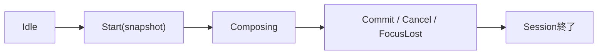

# SEP-B24 / MVVM UIライブラリ IME edit sessionに関する上位判断案の責務分離レビュー案

- 文書版: 0.2
- 状態: 全案反映承認済み・正本適用済み（2026-10-17）。具体化未了は適用結果を参照
- 作成日: 2026-10-17
- 対象: [元文書](../../12_design/BD-24_ime-edit-session-upper-design.md)
- 対象箇所: BD-24 判断1～5・event表
- 索引: [一括レビュー](index.md)
- 台帳項目: B24

- 現行要求根拠: [RQ-02-011](../../11_requirements/RQ-02_core-features.md#rq-02-011)、[RQ-09-005](../../11_requirements/RQ-09_ui-scope.md#rq-09-005)、[RQ-15-006](../../11_requirements/RQ-15_requirement-decisions.md#rq-15-006)

## 対象本文と既存承認

- 状態: BD-24承認済み（2026-09-27）

作成時点の原文SHA-256: `42d2a7f48952a7ecd0917833b8bf5b58311804441de843075ac9acb51e8d9a5b`。対象は台帳の箇所と、以下の原文・判断ID。正本の本文は今回編集していない。

原文 本文項目1 / L17:

> IME sessionはTextBoxごとに識別し、session内のevent順を保つ。 Platform Adapterが開始時にsession identityを割り当て、preedit update、commit、明示cancelを同じsessionに結び付ける。終了済み／置き換え済みsessionの遅延eventはCore編集値へ適用しない。

原文 本文項目2 / L18:

> Preedit updateは表示用の未確定編集値だけを更新する。 preedit中はViewInputValidator、Property Validator、Binding伝播を実行せず、Core TextBoxだけが編集中の内容と位置を持つ。

原文 本文項目3 / L19:

> Commitは一度だけ確定候補として処理する。 Coreはactive preedit範囲をcommit文字列で置換した完全なTextBox候補を作り、A25～A28のViewInputValidatorへ渡す。Acceptは編集値を確定してBindingへ進める。IncompleteはTextBoxに保持してBindingを止める。Reject相当のcommitも破棄せず、理由付きの未受理編集値として保持する。ViewModel側の検証拒否は既承認V2に従ってBinding errorにする。

原文 本文項目4 / L20:

> 明示cancelはpreedit開始直前のTextBox編集値へ戻す。 cancel前に保存した本文、caret、selectionを復元し、commit、Validator、Bindingを発生させない。候補windowを閉じるだけのキー操作はcancelとみなさず、AdapterがOS入力意味に基づいてsemantic cancel eventを送る。

## 改訂判断案

| レビューID | 変更対象 | 提案 |
|---|---|---|
| SEP-B24-01 | 外部契約と要求の根拠 | [SEP-RQ-026 TextBox入力三値の結果](rq-candidates.md#candidate-026)、[SEP-RQ-028 IME cancel後の入力理由](rq-candidates.md#candidate-028)、[SEP-RQ-029 IME commit準備失敗](rq-candidates.md#candidate-029)、[SEP-RQ-030 外部更新と編集中の値](rq-candidates.md#candidate-030)へ対応付ける。既存RQで定まる結果は上流参照にし、補足/選択要は要求承認後に設計前提へ反映する |
| SEP-B24-02 | 実現手段の本文 | 下記の責務・data/ownership flow・stateを本文案として収録する。個別の公開名・signatureを新たに確定する判断とは分ける |
| SEP-B24-03 | 未決・承認粒度 | cancel後の入力state/reasonとOOM時退避は要求候補を先にレビューする。終了済みsession eventの破棄はID照合の設計に残す。 |

## 設計本文の改訂案

Adapterがsession identityと順序を付けてIME eventを渡し、Coreはactive sessionに一致するeventだけを編集状態へ適用する。Startで編集snapshotを保存し、Updateではpreedit範囲だけを更新する。Commitは完全候補を作り一度判定し、Cancelは開始snapshotへ戻す。FocusLostはsnapshot復元と区別し最新preeditを保持する。

## 移管・ID・検証への影響

- 既存ID: BD-24。方式として残る意味は旧IDを維持し、要求へ分ける文だけを仮候補IDに対応付ける。正式RQ IDの発番は[移行案](id-migration.md)による。
- 移管先: 利用者可視条件は上記RQ候補、C/言語APIの具体形はDD内、脅威と防御はSD、試験操作と判定手順はrequirements-test/unit-test、着手順と下流割当はto-do。
- 設計を説明する所有・state・call図と計算例は保持する。対象本文の試験節は、[検証改訂案](test-impact.md)へ対応付けてから移す。失敗時の状態表・cleanup順まで検証扱いで削除しない。
- 上流RQ/ADR/BDへの参照は該当記述に直接置く。後続の着手割当は計画へ移し、DD間のinterface依存参照は実際の定義側へ向けて循環を解く。文書番号の大小だけで依存を判定しない。

## 承認履歴

| 日付 | 対象 | 承認者 | 結果 |
|---|---|---|---|
| 2026-10-17 | SEP-B24 | — | 一括作成指示に基づくレビュー案。採用・正本適用は未承認 |

## 改訂履歴

| 版 | 日付 | 内容 | 状態 |
|---|---|---|---|
| 0.1 | 2026-10-17 | 現行文書から責務分離・改訂文案・影響を作成 | レビュー待ち |

## 2026-10-17 適用結果

[適用先](../../12_design/BD-24_ime-edit-session-upper-design.md) の版0.1へ反映した。補足要求は正式IDへ対応付け、未設計事項は [後続課題](../requirements-design-separation-follow-up.md) に移した。

### 承認履歴

| 日付 | 範囲 | 承認者 | 結果 |
| --- | --- | --- | --- |
| 2026-10-17 | 全レビュー案の反映 | 利用者 | 「すべて反映して下さい。」により採用・正本適用を承認 |

### 改訂履歴

| 版 | 日付 | 内容 |
| --- | --- | --- |
| 0.2 | 2026-10-17 | 承認と正本適用結果を追記。作成時点の比較・引用を保持 |
