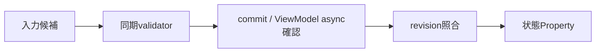

# SEP-B25 / MVVM UIライブラリ 非同期Validationの初版範囲に関する上位判断案の責務分離レビュー案

- 文書版: 0.2
- 状態: 全案反映承認済み・正本適用済み（2026-10-17）。具体化未了は適用結果を参照
- 作成日: 2026-10-17
- 対象: [元文書](../../12_design/BD-25_async-validation-upper-design.md)
- 対象箇所: BD-25 判断1～5・将来境界
- 索引: [一括レビュー](index.md)
- 台帳項目: B25

- 現行要求根拠: [RQ-02-002](../../11_requirements/RQ-02_core-features.md#rq-02-002)、[RQ-05-006](../../11_requirements/RQ-05_ownership-callbacks.md#rq-05-006)、[RQ-05-009](../../11_requirements/RQ-05_ownership-callbacks.md#rq-05-009)、[RQ-09-005](../../11_requirements/RQ-09_ui-scope.md#rq-09-005)、[RQ-15-008](../../11_requirements/RQ-15_requirement-decisions.md#rq-15-008)

## 対象本文と既存承認

- 状態: BD-25承認済み（2026-09-27）

作成時点の原文SHA-256: `1a00088a2b7b3af93868169ab78df321d61da43708bd6173a1c408081b59bee5`。対象は台帳の箇所と、以下の原文・判断ID。正本の本文は今回編集していない。

原文 本文項目1 / L16:

> 初版のCore Property ValidatorとView Input Validatorは、承認済みV1～V8どおり同期・短時間に限定する。 network、storage、長時間CPU処理を行うValidator callbackやCore-owned pending stateは初版に追加しない。

原文 本文項目2 / L17:

> remoteまたは長時間の判定は、アプリのViewModel側にAsyncCommandと明示的な状態Propertyを組み合わせて実装する。 例として`Checking / Available / Rejected / Failed`状態や理由をViewModelに持たせ、Text、indicator、Buttonの実行可否へBindingする。AsyncCommandをProperty setterやIME commit callbackの内部で同期待ちさせない。

原文 本文項目4 / L19:

> 非同期検証の`pending`はV5～V8の`Incomplete`と混同しない。 `Incomplete`は編集候補がまだ成立しない入力状態、pendingは非同期確認の完了待ちである。初版ではpending/errorの共通Property、複数validator結果の集約、validator callback ABIをCoreに設けない。

原文 本文項目5 / L20:

> 将来Core-managed async Validationを追加する場合は独立した上位判断を行う。 対象Property revision、同時要求の置換／併存、cancel、stale result suppression、複数エラー、shutdown中の結果破棄、diagnostic/transport errorの区別、wrapper ABIを先に決める。

## 改訂判断案

| レビューID | 変更対象 | 提案 |
|---|---|---|
| SEP-B25-01 | 外部契約と要求の根拠 | [SEP-RQ-024 Validator登録条件](rq-candidates.md#candidate-024)、[SEP-RQ-025 判定callback中の禁止操作](rq-candidates.md#candidate-025)、[SEP-RQ-026 TextBox入力三値の結果](rq-candidates.md#candidate-026)へ対応付ける。既存RQで定まる結果は上流参照にし、補足/選択要は要求承認後に設計前提へ反映する |
| SEP-B25-02 | 実現手段の本文 | 下記の責務・data/ownership flow・stateを本文案として収録する。個別の公開名・signatureを新たに確定する判断とは分ける |
| SEP-B25-03 | 未決・承認粒度 | Core-managed async validation、cross-field集約、pending共通Propertyは採用候補のまま。入力結果の全体待合せを追加しない。 |

## 設計本文の改訂案

Core validatorはsetterまたは編集候補処理から同期で呼ばれ、その戻り値を受けてcommit可否を決める。network等の非同期確認はViewModelのAsyncCommandへ分離し、結果と入力revisionをアプリ側で照合して状態Propertyへ書く。Core同期のIncompleteとViewModelの非同期確認中を別状態として接続する。

## 移管・ID・検証への影響

- 既存ID: BD-25。方式として残る意味は旧IDを維持し、要求へ分ける文だけを仮候補IDに対応付ける。正式RQ IDの発番は[移行案](id-migration.md)による。
- 移管先: 利用者可視条件は上記RQ候補、C/言語APIの具体形はDD内、脅威と防御はSD、試験操作と判定手順はrequirements-test/unit-test、着手順と下流割当はto-do。
- 設計を説明する所有・state・call図と計算例は保持する。対象本文の試験節は、[検証改訂案](test-impact.md)へ対応付けてから移す。失敗時の状態表・cleanup順まで検証扱いで削除しない。
- 上流RQ/ADR/BDへの参照は該当記述に直接置く。後続の着手割当は計画へ移し、DD間のinterface依存参照は実際の定義側へ向けて循環を解く。文書番号の大小だけで依存を判定しない。

## 承認履歴

| 日付 | 対象 | 承認者 | 結果 |
|---|---|---|---|
| 2026-10-17 | SEP-B25 | — | 一括作成指示に基づくレビュー案。採用・正本適用は未承認 |

## 改訂履歴

| 版 | 日付 | 内容 | 状態 |
|---|---|---|---|
| 0.1 | 2026-10-17 | 現行文書から責務分離・改訂文案・影響を作成 | レビュー待ち |

## 2026-10-17 適用結果

[適用先](../../12_design/BD-25_async-validation-upper-design.md) の版0.1へ反映した。補足要求は正式IDへ対応付け、未設計事項は [後続課題](../requirements-design-separation-follow-up.md) に移した。

### 承認履歴

| 日付 | 範囲 | 承認者 | 結果 |
| --- | --- | --- | --- |
| 2026-10-17 | 全レビュー案の反映 | 利用者 | 「すべて反映して下さい。」により採用・正本適用を承認 |

### 改訂履歴

| 版 | 日付 | 内容 |
| --- | --- | --- |
| 0.2 | 2026-10-17 | 承認と正本適用結果を追記。作成時点の比較・引用を保持 |
