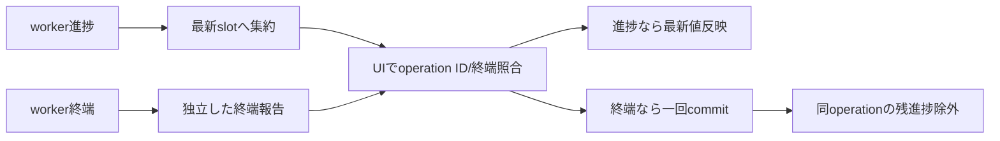

# SEP-B26 / MVVM UIライブラリ Async Command進捗配信に関する上位判断案の責務分離レビュー案

- 文書版: 0.2
- 状態: 全案反映承認済み・正本適用済み（2026-10-17）。具体化未了は適用結果を参照
- 作成日: 2026-10-17
- 対象: [元文書](../../12_design/BD-26_async-command-progress-upper-design.md)
- 対象箇所: BD-26 判断1～5・停止後保証
- 索引: [一括レビュー](index.md)
- 台帳項目: B26

- 現行要求根拠: [RQ-05-002](../../11_requirements/RQ-05_ownership-callbacks.md#rq-05-002)、[RQ-06-004](../../11_requirements/RQ-06_threading-dispatch.md#rq-06-004)、[RQ-15-009](../../11_requirements/RQ-15_requirement-decisions.md#rq-15-009)

## 対象本文と既存承認

- 状態: BD-26承認済み（2026-09-27）

作成時点の原文SHA-256: `a6d4faf8a4b11832a02f6fccc7c6eef66ceaf50bca03b4d4d6ca8b9a025af426`。対象は台帳の箇所と、以下の原文・判断ID。正本の本文は今回編集していない。

原文 本文項目1 / L17:

> 進捗は中間状態であり、全サンプルの配信を保証しない。 Runtimeまたはwrapperは、同一operationの未配信進捗を新しい値で置き換えて集約してよい。ProgressBar等の表示Propertyは最新の受理値へ追随する。

原文 本文項目2 / L18:

> 完了・失敗・キャンセルの終端結果は進捗値と別に扱う。 進捗集約で終端結果を置き換えず、現在operationに属する終端通知を一度だけ適用する。終端結果を適用した後に処理される同一operationの進捗は破棄する。

原文 本文項目5 / L21:

> 詳細設計で決めるものは集約の格納場所、dispatcher wake-upの抑制、頻度・時間閾値、進捗の型と値域、複数進捗チャネルの識別、shutdownとcancelの競合処理とする。上位判断では具体的な間隔や数値を固定しない。

## 改訂判断案

| レビューID | 変更対象 | 提案 |
|---|---|---|
| SEP-B26-01 | 外部契約と要求の根拠 | [SEP-RQ-031 Command実行受付と結果](rq-candidates.md#candidate-031)、[SEP-RQ-032 取消・close・handle破棄の差](rq-candidates.md#candidate-032)へ対応付ける。既存RQで定まる結果は上流参照にし、補足/選択要は要求承認後に設計前提へ反映する |
| SEP-B26-02 | 実現手段の本文 | 下記の責務・data/ownership flow・stateを本文案として収録する。個別の公開名・signatureを新たに確定する判断とは分ける |
| SEP-B26-03 | 未決・承認粒度 | progress型/範囲/複数channel/閾値は未決。全sampleログ保存をUI進捗機能へ追加しない。 |

## 設計本文の改訂案

進捗格納と終端報告を別経路にする。同一operationの未配信進捗は最新slotへ置換し、wakeはまとめる。UI threadはoperation IDを照合して進捗を適用し、終端状態へ遷移した後は同じoperationの保留進捗を落とす。終端報告は進捗slotの置換対象に含めない。

## 移管・ID・検証への影響

- 既存ID: BD-26。方式として残る意味は旧IDを維持し、要求へ分ける文だけを仮候補IDに対応付ける。正式RQ IDの発番は[移行案](id-migration.md)による。
- 移管先: 利用者可視条件は上記RQ候補、C/言語APIの具体形はDD内、脅威と防御はSD、試験操作と判定手順はrequirements-test/unit-test、着手順と下流割当はto-do。
- 設計を説明する所有・state・call図と計算例は保持する。対象本文の試験節は、[検証改訂案](test-impact.md)へ対応付けてから移す。失敗時の状態表・cleanup順まで検証扱いで削除しない。
- 上流RQ/ADR/BDへの参照は該当記述に直接置く。後続の着手割当は計画へ移し、DD間のinterface依存参照は実際の定義側へ向けて循環を解く。文書番号の大小だけで依存を判定しない。

## 承認履歴

| 日付 | 対象 | 承認者 | 結果 |
|---|---|---|---|
| 2026-10-17 | SEP-B26 | — | 一括作成指示に基づくレビュー案。採用・正本適用は未承認 |

## 改訂履歴

| 版 | 日付 | 内容 | 状態 |
|---|---|---|---|
| 0.1 | 2026-10-17 | 現行文書から責務分離・改訂文案・影響を作成 | レビュー待ち |

## 2026-10-17 適用結果

[適用先](../../12_design/BD-26_async-command-progress-upper-design.md) の版0.1へ反映した。補足要求は正式IDへ対応付け、未設計事項は [後続課題](../requirements-design-separation-follow-up.md) に移した。

### 承認履歴

| 日付 | 範囲 | 承認者 | 結果 |
| --- | --- | --- | --- |
| 2026-10-17 | 全レビュー案の反映 | 利用者 | 「すべて反映して下さい。」により採用・正本適用を承認 |

### 改訂履歴

| 版 | 日付 | 内容 |
| --- | --- | --- |
| 0.2 | 2026-10-17 | 承認と正本適用結果を追記。作成時点の比較・引用を保持 |
