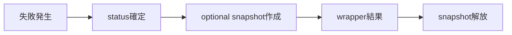

# SEP-B27 / MVVM UIライブラリ Error objectの安定性境界に関する上位判断案の責務分離レビュー案

- 文書版: 0.2
- 状態: 全案反映承認済み・正本適用済み（2026-10-17）。具体化未了は適用結果を参照
- 作成日: 2026-10-17
- 対象: [元文書](../../12_design/BD-27_error-object-upper-design.md)
- 対象箇所: BD-27 判断1～5
- 索引: [一括レビュー](index.md)
- 台帳項目: B27

- 現行要求根拠: [RQ-02-012](../../11_requirements/RQ-02_core-features.md#rq-02-012)、[RQ-04-006](../../11_requirements/RQ-04_abi-boundary.md#rq-04-006)、[RQ-04-007](../../11_requirements/RQ-04_abi-boundary.md#rq-04-007)、[RQ-15-011](../../11_requirements/RQ-15_requirement-decisions.md#rq-15-011)

## 対象本文と既存承認

- 状態: BD-27承認済み（2026-09-27）

作成時点の原文SHA-256: `6d398a781745c16ff3e8a99543b2a269b7641b74f9a23dd62ca347e7975478de`。対象は台帳の箇所と、以下の原文・判断ID。正本の本文は今回編集していない。

原文 本文項目1 / L16:

> 機械分岐にはdomain＋code＋statusを使い、message文字列を条件判定に使わない。 domainはエラーを出したライブラリ領域、codeはそのdomain内の安定した理由、statusはAPI呼び出しの成否・分類を表す。意味を維持する追加は可能にし、既存codeの意味の変更・再利用はしない。

原文 本文項目2 / L17:

> messageは説明用であり、ABI上の安定識別子ではない。 messageの文面、言語、詳細度はminor更新やlocalizationで変わり得る。アプリが利用者向けに表示してよいが、機械処理や保存済みデータの識別には使わない。

原文 本文項目3 / L18:

> 原因情報と診断情報を分ける。 公開causeは元の失敗を理解するための任意の連鎖で、各要素もdomain/code/statusを保つ。診断情報はstack/backtrace、native OS detail、Runtime連鎖情報などの補助情報であり、存在・完全性・機密性を前提にしない。公開ABIでは、診断を機械契約として扱わない。

原文 本文項目4 / L19:

> error objectは生成時点のsnapshotとして不変に扱う。 呼び出し後にmessageやcodeが別operationの結果で書き換わらない。保持期限、release方法、cause/diagnosticの取得方法はA15/A18の既定寿命契約を維持し、具体handle/APIは詳細設計で定める。

## 改訂判断案

| レビューID | 変更対象 | 提案 |
|---|---|---|
| SEP-B27-01 | 外部契約と要求の根拠 | [SEP-RQ-017 error詳細を生成できない失敗](rq-candidates.md#candidate-017)、[SEP-RQ-018 利用者定義エラーの自動採番](rq-candidates.md#candidate-018)へ対応付ける。既存RQで定まる結果は上流参照にし、補足/選択要は要求承認後に設計前提へ反映する |
| SEP-B27-02 | 実現手段の本文 | 下記の責務・data/ownership flow・stateを本文案として収録する。個別の公開名・signatureを新たに確定する判断とは分ける |
| SEP-B27-03 | 未決・承認粒度 | code/domain値・getter/handleはDD、diagnosticの秘匿/size/depthはSD、利用者定義auto採番の保証はRQ。 |

## 設計本文の改訂案

APIはstatusを一次結果として返し、必要なら失敗時点のerror snapshotを生成する。snapshotはdomain/code、説明message、任意causeとdiagnosticを分けて所有し、後のoperationで書き換えない。wrapperは機械識別値を言語結果へ保持し、messageは表示情報として渡す。詳細確保失敗時にも元statusを保持する。

## 移管・ID・検証への影響

- 既存ID: BD-27。方式として残る意味は旧IDを維持し、要求へ分ける文だけを仮候補IDに対応付ける。正式RQ IDの発番は[移行案](id-migration.md)による。
- 移管先: 利用者可視条件は上記RQ候補、C/言語APIの具体形はDD内、脅威と防御はSD、試験操作と判定手順はrequirements-test/unit-test、着手順と下流割当はto-do。
- 設計を説明する所有・state・call図と計算例は保持する。対象本文の試験節は、[検証改訂案](test-impact.md)へ対応付けてから移す。失敗時の状態表・cleanup順まで検証扱いで削除しない。
- 上流RQ/ADR/BDへの参照は該当記述に直接置く。後続の着手割当は計画へ移し、DD間のinterface依存参照は実際の定義側へ向けて循環を解く。文書番号の大小だけで依存を判定しない。

## 承認履歴

| 日付 | 対象 | 承認者 | 結果 |
|---|---|---|---|
| 2026-10-17 | SEP-B27 | — | 一括作成指示に基づくレビュー案。採用・正本適用は未承認 |

## 改訂履歴

| 版 | 日付 | 内容 | 状態 |
|---|---|---|---|
| 0.1 | 2026-10-17 | 現行文書から責務分離・改訂文案・影響を作成 | レビュー待ち |

## 2026-10-17 適用結果

[適用先](../../12_design/BD-27_error-object-upper-design.md) の版0.1へ反映した。補足要求は正式IDへ対応付け、未設計事項は [後続課題](../requirements-design-separation-follow-up.md) に移した。

### 承認履歴

| 日付 | 範囲 | 承認者 | 結果 |
| --- | --- | --- | --- |
| 2026-10-17 | 全レビュー案の反映 | 利用者 | 「すべて反映して下さい。」により採用・正本適用を承認 |

### 改訂履歴

| 版 | 日付 | 内容 |
| --- | --- | --- |
| 0.2 | 2026-10-17 | 承認と正本適用結果を追記。作成時点の比較・引用を保持 |
