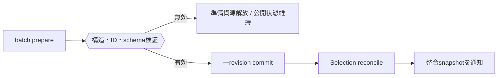

# SEP-B35 / MVVM UIライブラリ Collection change batch原子性に関する上位判断の責務分離レビュー案

- 文書版: 0.2
- 状態: 全案反映承認済み・正本適用済み（2026-10-17）。具体化未了は適用結果を参照
- 作成日: 2026-10-17
- 対象: [元文書](../../12_design/BD-35_collection-change-batch-upper-design.md)
- 対象箇所: BD-35 判断1～6・入力検証境界
- 索引: [一括レビュー](index.md)
- 台帳項目: B35

- 現行要求根拠: [RQ-02-005](../../11_requirements/RQ-02_core-features.md#rq-02-005)、[RQ-07-009](../../11_requirements/RQ-07_binding.md#rq-07-009)、[RQ-09-019](../../11_requirements/RQ-09_ui-scope.md#rq-09-019)

## 対象本文と既存承認

- 状態: BD-35承認済み（2026-09-27）

作成時点の原文SHA-256: `1fd2d5fdd4ecebee88e0ace1eb02bcaf6ffbabb2b3e89f3adb648b022e87c69d`。対象は台帳の箇所と、以下の原文・判断ID。正本の本文は今回編集していない。

原文 本文項目1 / L16:

> 一つのCollection change batchを一つの原子的Model mutationとして扱う。 事前検証はCollectionの構造・ID・index・宣言schemaなど、Modelへ適用できるかを判定する。View入力の値検証やアプリ固有の業務検証を、batch全体のcommit条件にはしない。batchをまたぐProperty更新や複数Collectionをまとめる一般transactionは提供しない。

原文 本文項目2 / L17:

> batchのいずれかのoperationが無効なら、batch全体を拒否する。 invalid index/ID、schema不一致、重複IDなどのModel整合性違反を返し、Collection値、順序、revision、Selection state、公開通知を変更しない。この原子性は同じbatchへ意図的にまとめたModel変更に限る。独立した入力欄・cellの編集commitは既定で別々に適用し、一つの入力が他の入力の検証完了を待たない。

原文 本文項目3 / L18:

> 有効batchは一つの新しいCollection revisionとしてcommitする。 batch内operationの順序は適用順として定義する。consumerには中間stateを通知せず、commit後のsnapshotと整合したCollection change notificationを一括で公開する。

## 改訂判断案

| レビューID | 変更対象 | 提案 |
|---|---|---|
| SEP-B35-01 | 外部契約と要求の根拠 | [SEP-RQ-057 Collection batchの観測結果](rq-candidates.md#candidate-057)へ対応付ける。既存RQで定まる結果は上流参照にし、補足/選択要は要求承認後に設計前提へ反映する |
| SEP-B35-02 | 実現手段の本文 | 下記の責務・data/ownership flow・stateを本文案として収録する。個別の公開名・signatureを新たに確定する判断とは分ける |
| SEP-B35-03 | 未決・承認粒度 | callback相対順・change set形・snapshot所有期間は次段階DDで具体化。業務validationや複数Model transactionをbatchへ含めない。 |

## 設計本文の改訂案

Collection batchの各operationを構造・ID・index・schemaについて事前検証し、必要資源を確保する。有効な候補だけを一revisionとしてcommitし、同じ論理更新区間でSelectionをreconcileしてから外部callbackへ一貫したsnapshotを公開する。失敗時は準備資源だけを解放し、公開revisionへ到達しない。

## 移管・ID・検証への影響

- 既存ID: BD-35。方式として残る意味は旧IDを維持し、要求へ分ける文だけを仮候補IDに対応付ける。正式RQ IDの発番は[移行案](id-migration.md)による。
- 移管先: 利用者可視条件は上記RQ候補、C/言語APIの具体形はDD内、脅威と防御はSD、試験操作と判定手順はrequirements-test/unit-test、着手順と下流割当はto-do。
- 設計を説明する所有・state・call図と計算例は保持する。対象本文の試験節は、[検証改訂案](test-impact.md)へ対応付けてから移す。失敗時の状態表・cleanup順まで検証扱いで削除しない。
- 上流RQ/ADR/BDへの参照は該当記述に直接置く。後続の着手割当は計画へ移し、DD間のinterface依存参照は実際の定義側へ向けて循環を解く。文書番号の大小だけで依存を判定しない。

## 承認履歴

| 日付 | 対象 | 承認者 | 結果 |
|---|---|---|---|
| 2026-10-17 | SEP-B35 | — | 一括作成指示に基づくレビュー案。採用・正本適用は未承認 |

## 改訂履歴

| 版 | 日付 | 内容 | 状態 |
|---|---|---|---|
| 0.1 | 2026-10-17 | 現行文書から責務分離・改訂文案・影響を作成 | レビュー待ち |

## 2026-10-17 適用結果

[適用先](../../12_design/BD-35_collection-change-batch-upper-design.md) の版0.1へ反映した。補足要求は正式IDへ対応付け、未設計事項は [後続課題](../requirements-design-separation-follow-up.md) に移した。

### 承認履歴

| 日付 | 範囲 | 承認者 | 結果 |
| --- | --- | --- | --- |
| 2026-10-17 | 全レビュー案の反映 | 利用者 | 「すべて反映して下さい。」により採用・正本適用を承認 |

### 改訂履歴

| 版 | 日付 | 内容 |
| --- | --- | --- |
| 0.2 | 2026-10-17 | 承認と正本適用結果を追記。作成時点の比較・引用を保持 |
