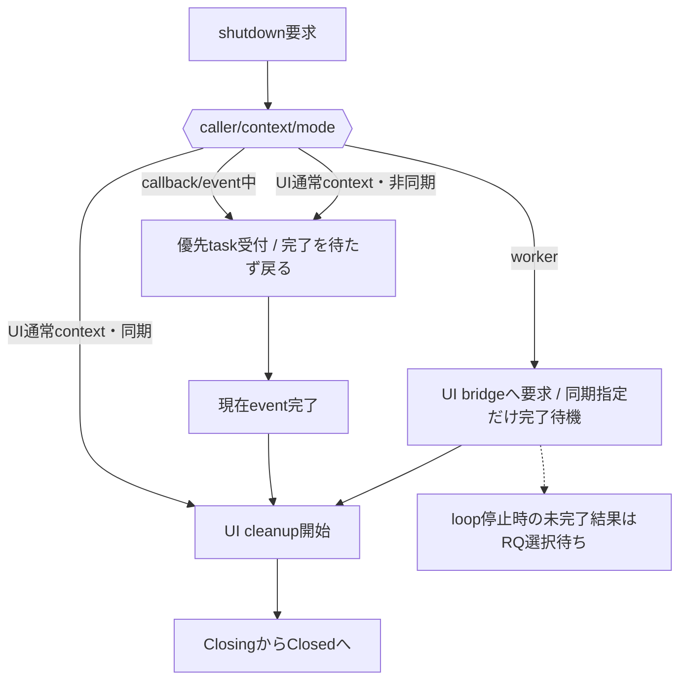

# SEP-B36 / Runtime shutdownのcallback中dispatchに関する上位判断の責務分離レビュー案

- 文書版: 0.2
- 状態: 全案反映承認済み・正本適用済み（2026-10-17）。具体化未了は適用結果を参照
- 作成日: 2026-10-17
- 対象: [元文書](../../12_design/BD-36_runtime-shutdown-dispatch-upper-design.md)
- 対象箇所: BD-36 BD-36-01～04・§3/5
- 索引: [一括レビュー](index.md)
- 台帳項目: B36

- 現行要求根拠: [RQ-02-013](../../11_requirements/RQ-02_core-features.md#rq-02-013)、[RQ-05-003](../../11_requirements/RQ-05_ownership-callbacks.md#rq-05-003)、[RQ-05-009](../../11_requirements/RQ-05_ownership-callbacks.md#rq-05-009)、[RQ-06-002](../../11_requirements/RQ-06_threading-dispatch.md#rq-06-002)

## 対象本文と既存承認

- 状態: 方針確定（利用者指示・API別の表現と完了観測は未決）

作成時点の原文SHA-256: `bed3403ec23ff65fbda952f627398b7dbde463c4fb5604f43c3804991d803be2`。対象は台帳の箇所と、以下の原文・判断ID。正本の本文は今回編集していない。

原文 BD-36-01 / L16:

> callback/event中のshutdown要求を許可する。呼出し中のevent/callbackは最後まで実行し、cleanupはその処理から再帰実行せず、現在のevent終了後、通常のqueued workより優先して次の処理機会に実行する。

原文 BD-36-02 / L17:

> shutdown cleanup本体はUI thread上で同期実行する。workerからの要求はUI loopへdispatchして実行する。thread切替とdispatchはlibrary内部で行う。

原文 BD-36-03 / L18:

> callback/event中かを判定するにはthread IDだけでなく、libraryが管理するdispatch/callback実行中のcontextも用いる。UI thread IDはworkerからの要求のmarshal判定に使い、現在のeventを完了させるべき状態はdispatch contextで判定する。

原文 BD-36-04 / L19:

> 呼出しモードにより戻り方を分ける。非同期呼出しはthread/contextによらず要求受付後に戻り、cleanup完了を待たない。同期呼出しはUI thread上の通常contextならその場で完了し、worker threadならUI threadへdispatchしたcleanupの完了まで待つ。ただしcallback/event実行中は現在の処理を完了させる必要があるため、同期指定であっても待たずに要求受付後に戻る。

## 改訂判断案

| レビューID | 変更対象 | 提案 |
|---|---|---|
| SEP-B36-01 | 外部契約と要求の根拠 | [SEP-RQ-006 Runtime停止後の利用境界](rq-candidates.md#candidate-006)、[SEP-RQ-007 Runtime終了の再要求](rq-candidates.md#candidate-007)、[SEP-RQ-008 callback/event中の終了要求](rq-candidates.md#candidate-008)、[SEP-RQ-009 終了要求の受付と完了](rq-candidates.md#candidate-009)、[SEP-RQ-010 停止したUI loopへの同期要求](rq-candidates.md#candidate-010)へ対応付ける。既存RQで定まる結果は上流参照にし、補足/選択要は要求承認後に設計前提へ反映する |
| SEP-B36-02 | 実現手段の本文 | 下記の責務・data/ownership flow・stateを本文案として収録する。個別の公開名・signatureを新たに確定する判断とは分ける |
| SEP-B36-03 | 未決・承認粒度 | BD-36-01/02/04確認済みと03実装提案未確認を維持する。host event context検知、停止loop時の待機解除と新規completion APIは個別未決。 |

## 設計本文の改訂案

shutdown受付層はcallerのthreadと実行contextを評価し、現在callback/event中なら優先control taskを登録して戻る。worker要求はbridgeへmarshalし、同期指定の場合のみ完了状態を待つ。UI thread上のcleanupはRunning→Closing→Closedへ遷移し、未開始workのcancel、in-flight終了、UI資源解放を一つの終了解決へ集約する。

## 移管・ID・検証への影響

- 既存ID: BD-36 / BD-36-01～04。方式として残る意味は旧IDを維持し、要求へ分ける文だけを仮候補IDに対応付ける。正式RQ IDの発番は[移行案](id-migration.md)による。
- 移管先: 利用者可視条件は上記RQ候補、C/言語APIの具体形はDD内、脅威と防御はSD、試験操作と判定手順はrequirements-test/unit-test、着手順と下流割当はto-do。
- 設計を説明する所有・state・call図と計算例は保持する。対象本文の試験節は、[検証改訂案](test-impact.md)へ対応付けてから移す。失敗時の状態表・cleanup順まで検証扱いで削除しない。
- 上流RQ/ADR/BDへの参照は該当記述に直接置く。後続の着手割当は計画へ移し、DD間のinterface依存参照は実際の定義側へ向けて循環を解く。文書番号の大小だけで依存を判定しない。

## 承認履歴

| 日付 | 対象 | 承認者 | 結果 |
|---|---|---|---|
| 2026-10-17 | SEP-B36 | — | 一括作成指示に基づくレビュー案。採用・正本適用は未承認 |

## 改訂履歴

| 版 | 日付 | 内容 | 状態 |
|---|---|---|---|
| 0.1 | 2026-10-17 | 現行文書から責務分離・改訂文案・影響を作成 | レビュー待ち |

## 2026-10-17 適用結果

[適用先](../../12_design/BD-36_runtime-shutdown-dispatch-upper-design.md) の版0.1へ反映した。補足要求は正式IDへ対応付け、未設計事項は [後続課題](../requirements-design-separation-follow-up.md) に移した。

### 承認履歴

| 日付 | 範囲 | 承認者 | 結果 |
| --- | --- | --- | --- |
| 2026-10-17 | 全レビュー案の反映 | 利用者 | 「すべて反映して下さい。」により採用・正本適用を承認 |

### 改訂履歴

| 版 | 日付 | 内容 |
| --- | --- | --- |
| 0.2 | 2026-10-17 | 承認と正本適用結果を追記。作成時点の比較・引用を保持 |
