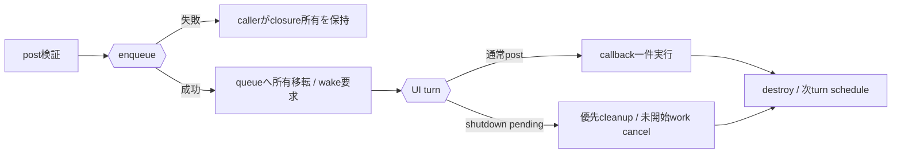

# SEP-D03 / DD-03 UI threadと投稿キューの責務分離レビュー案

- 文書版: 0.2
- 状態: 全案反映承認済み・正本適用済み（2026-10-17）。具体化未了は適用結果を参照
- 作成日: 2026-10-17
- 対象: [元文書](../../13_detail_design/03-dispatcher.md)
- 対象箇所: DD-03 DD-DSP-01～08、§4/5/7
- 索引: [一括レビュー](index.md)
- 台帳項目: D03

- 現行要求根拠: [RQ-02-013](../../11_requirements/RQ-02_core-features.md#rq-02-013)、[RQ-05-002](../../11_requirements/RQ-05_ownership-callbacks.md#rq-05-002)、[RQ-05-003](../../11_requirements/RQ-05_ownership-callbacks.md#rq-05-003)、[RQ-05-009](../../11_requirements/RQ-05_ownership-callbacks.md#rq-05-009)、[RQ-06-001](../../11_requirements/RQ-06_threading-dispatch.md#rq-06-001)、[RQ-06-002](../../11_requirements/RQ-06_threading-dispatch.md#rq-06-002)、[RQ-15-007](../../11_requirements/RQ-15_requirement-decisions.md#rq-15-007)
- 具体化する基本設計: [BD-03](../../12_design/BD-03_runtime-notification-upper-design.md)、[BD-36](../../12_design/BD-36_runtime-shutdown-dispatch-upper-design.md)
## 対象本文と既存承認

- 状態: 内容承認済み（2026-10-05）

作成時点の原文SHA-256: `c35c275cedb67044b8e304236129c9e0a8424bde654703f3784f20e2823d834d`。対象は台帳の箇所と、以下の原文・判断ID。正本の本文は今回編集していない。

原文 DD-DSP-01 / L24:

> Runtime作成threadのidentityをRuntimeに記録し、以後のUI thread判定に使う。`runtime_is_ui_thread`は有効なRuntime handleがあれば任意threadから呼べ、呼出し元が異なれば`false`を返す。UI専用APIはhandle/token/Runtime検証（DD-HND-03）の後、RuntimeがClosedなら`UI_CLOSED`、Running中にUI thread以外から呼ばれたら`UI_WRONG_THREAD`を返す。

原文 DD-DSP-02 / L25:

> 各RuntimeにFIFOのpost queueを1つ設ける。複数threadからの同時postはqueueへの追加が直列化された順を受付順とする。queue追加が成功した時点でcallback/userdata/destroyの所有権をCoreへ移し、それ以前の失敗では呼出し側に残す。

原文 DD-DSP-03 / L26:

> 同じRuntimeの投稿callbackはUI thread上で一度に一つだけ実行し、再帰実行しない。UI thread上のpostも通常queueの末尾へ追加する。host event loopの一回のdispatch turnでは投稿callbackを最大一件実行し、そのcallback終了後に次turnをscheduleする。shutdown要求がpendingの場合は通常callbackよりshutdown制御処理を先に実行する。

原文 DD-DSP-05 / L28:

> post queue、pending notification、finalizer、shutdown control taskのいずれかに処理対象があるときRuntime wake-upを一つだけpendingにできるようにする。

## 改訂判断案

| レビューID | 変更対象 | 提案 |
|---|---|---|
| SEP-D03-01 | 外部契約と要求の根拠 | [SEP-RQ-001 任意threadの参照取得・破棄](rq-candidates.md#candidate-001)、[SEP-RQ-006 Runtime停止後の利用境界](rq-candidates.md#candidate-006)、[SEP-RQ-008 callback/event中の終了要求](rq-candidates.md#candidate-008)、[SEP-RQ-009 終了要求の受付と完了](rq-candidates.md#candidate-009)、[SEP-RQ-010 停止したUI loopへの同期要求](rq-candidates.md#candidate-010)へ対応付ける。既存RQで定まる結果は上流参照にし、補足/選択要は要求承認後に設計前提へ反映する |
| SEP-D03-02 | 実現手段の本文 | 下記の責務・data/ownership flow・stateを本文案として収録する。個別の公開名・signatureを新たに確定する判断とは分ける |
| SEP-D03-03 | 未決・承認粒度 | 固定件数上限なしは内部方式で資源無制限保証ではない。UiLoopBridge未接続/host停止時の呼出し結果、完了待機解除はX03/RQ案の選択後に具体化。 |

## 設計本文の改訂案

Runtimeのpost queueはenqueue直列化点を受付順とする。enqueue成功でclosureをqueue ownerへ移し、UiLoopBridgeへwakeを要求する。dispatchは優先shutdown control task、通常work、通知の区別を持ち、一通常turnでpostを最大一つ実行する。queue確認とwake状態の更新をenqueueと同期してlost wakeを防ぐ。Closingでは通常workをcancel/destroyし、finalizerと終了cleanupをUI上でdrainする。

## 移管・ID・検証への影響

- 既存ID: DD-DSP-01、DD-DSP-02、DD-DSP-03、DD-DSP-04、DD-DSP-05、DD-DSP-06、DD-DSP-07、DD-DSP-08。方式として残る意味は旧IDを維持し、要求へ分ける文だけを仮候補IDに対応付ける。正式RQ IDの発番は[移行案](id-migration.md)による。
- 移管先: 利用者可視条件は上記RQ候補、C/言語APIの具体形はDD内、脅威と防御はSD、試験操作と判定手順はrequirements-test/unit-test、着手順と下流割当はto-do。
- 設計を説明する所有・state・call図と計算例は保持する。対象本文の試験節は、[検証改訂案](test-impact.md)へ対応付けてから移す。失敗時の状態表・cleanup順まで検証扱いで削除しない。
- 上流RQ/ADR/BDへの参照は該当記述に直接置く。後続の着手割当は計画へ移し、DD間のinterface依存参照は実際の定義側へ向けて循環を解く。文書番号の大小だけで依存を判定しない。

## 承認履歴

| 日付 | 対象 | 承認者 | 結果 |
|---|---|---|---|
| 2026-10-17 | SEP-D03 | — | 一括作成指示に基づくレビュー案。採用・正本適用は未承認 |

## 改訂履歴

| 版 | 日付 | 内容 | 状態 |
|---|---|---|---|
| 0.1 | 2026-10-17 | 現行文書から責務分離・改訂文案・影響を作成 | レビュー待ち |

## 2026-10-17 適用結果

[適用先](../../13_detail_design/03-dispatcher.md) の版0.1へ反映した。補足要求は正式IDへ対応付け、未設計事項は [後続課題](../requirements-design-separation-follow-up.md) に移した。

### 承認履歴

| 日付 | 範囲 | 承認者 | 結果 |
| --- | --- | --- | --- |
| 2026-10-17 | 全レビュー案の反映 | 利用者 | 「すべて反映して下さい。」により採用・正本適用を承認 |

### 改訂履歴

| 版 | 日付 | 内容 |
| --- | --- | --- |
| 0.2 | 2026-10-17 | 承認と正本適用結果を追記。作成時点の比較・引用を保持 |
