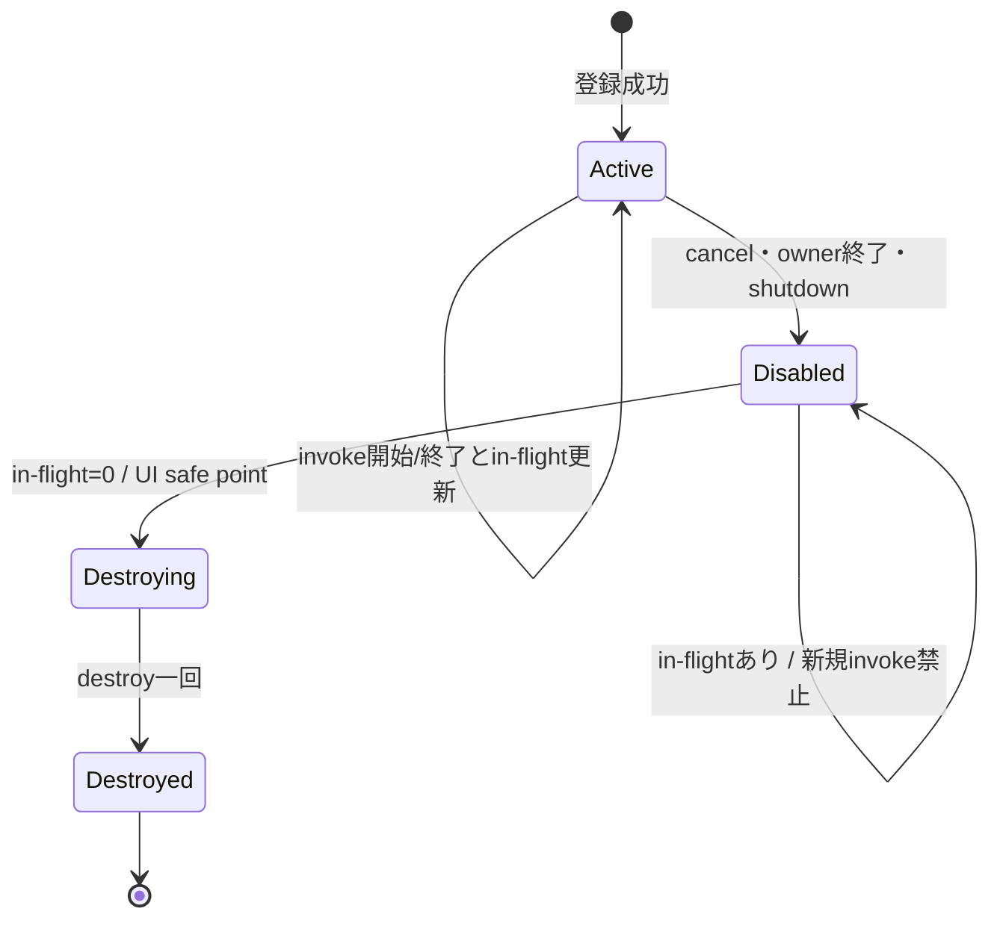

# SEP-D04 / DD-04 Callbackと再入の責務分離レビュー案

- 文書版: 0.2
- 状態: 全案反映承認済み・正本適用済み（2026-10-17）。具体化未了は適用結果を参照
- 作成日: 2026-10-17
- 対象: [元文書](../../13_detail_design/04-callback-lifecycle.md)
- 対象箇所: DD-04 DD-CB-01～09、§4～7/9
- 索引: [一括レビュー](index.md)
- 台帳項目: D04

- 現行要求根拠: [RQ-04-015](../../11_requirements/RQ-04_abi-boundary.md#rq-04-015)、[RQ-04-016](../../11_requirements/RQ-04_abi-boundary.md#rq-04-016)、[RQ-04-017](../../11_requirements/RQ-04_abi-boundary.md#rq-04-017)、[RQ-05-006](../../11_requirements/RQ-05_ownership-callbacks.md#rq-05-006)、[RQ-05-007](../../11_requirements/RQ-05_ownership-callbacks.md#rq-05-007)、[RQ-05-008](../../11_requirements/RQ-05_ownership-callbacks.md#rq-05-008)、[RQ-05-009](../../11_requirements/RQ-05_ownership-callbacks.md#rq-05-009)、[RQ-07-006](../../11_requirements/RQ-07_binding.md#rq-07-006)、[RQ-15-007](../../11_requirements/RQ-15_requirement-decisions.md#rq-15-007)、[RQ-15-013](../../11_requirements/RQ-15_requirement-decisions.md#rq-15-013)
- 具体化する基本設計: [BD-03](../../12_design/BD-03_runtime-notification-upper-design.md)
## 対象本文と既存承認

- 状態: 内容承認済み（2026-10-07）

作成時点の原文SHA-256: `494c132994b1b5fba5d109b3389bb12dc5dd02ff29b94cc1c1733f2d427820b6`。対象は台帳の箇所と、以下の原文・判断ID。正本の本文は今回編集していない。

原文 DD-CB-01 / L24:

> callback登録・postが成功した時点で、関数ポインタ・userdata・destroyを含むclosureの所有権をCoreへ移す。失敗時は所有権を移さず、Coreはcallbackもdestroyも呼ばない。

原文 DD-CB-02 / L25:

> Core所有closureは`Active → Disabled → Destroying → Destroyed`の一方向状態を持つ。所有者の解除・破棄・shutdownでDisabledにし、その後は新しいcallback invocationを開始しない。既に開始したcallbackは完了させる。

原文 DD-CB-06 / L29:

> 言語wrapperはcallbackからの言語例外をC ABIへ伝播させない。通知callbackの例外は診断経路へ記録して、そのcallbackの後始末を行い、他の通知対象の配信を続ける。戻り値を持つcallbackは各callback種別で定めた失敗値へ変換する。Rust panicも公開ABI境界を越えない。

原文 DD-CB-09 / L32:

> イベントメソッド内の検知候補を「仕様上禁止する違反」「誤動作リスクの警告」「追加調査が必要な候補」に分類し、ルール一覧と各言語での診断精度を後続設計で定める。

## 改訂判断案

| レビューID | 変更対象 | 提案 |
|---|---|---|
| SEP-D04-01 | 外部契約と要求の根拠 | [SEP-RQ-020 購読の初期通知・順序](rq-candidates.md#candidate-020)、[SEP-RQ-025 判定callback中の禁止操作](rq-candidates.md#candidate-025)、[SEP-RQ-048 診断・解析の能力と限界](rq-candidates.md#candidate-048)、[SEP-RQ-061 通知callbackの例外後の継続](rq-candidates.md#candidate-061)へ対応付ける。既存RQで定まる結果は上流参照にし、補足/選択要は要求承認後に設計前提へ反映する |
| SEP-D04-02 | 実現手段の本文 | 下記の責務・data/ownership flow・stateを本文案として収録する。個別の公開名・signatureを新たに確定する判断とは分ける |
| SEP-D04-03 | 未決・承認粒度 | 通知例外後の他購読継続は外部結果として要求候補に追加記録する。DD-CB-08/09のmarker/禁止違反検知は棚卸し承認と実装採用を区別し、DD-24未着手を維持する。 |

## 設計本文の改訂案

Core closureはActive→Disabled→Destroying→Destroyedへ進め、invoke開始時にActiveを確認してin-flightを加算する。解除はDisabledへ移し、実行中invokeが戻ったUI safe pointでdestroyを一度だけ行う。通常通知例外はtrampolineで捕捉し、種別固有の失敗を記録した後に残りの通知対象へ進む。戻り値callbackは定義済みfailureへ変換する。

## 移管・ID・検証への影響

- 既存ID: DD-CB-01、DD-CB-02、DD-CB-03、DD-CB-04、DD-CB-05、DD-CB-06、DD-CB-07、DD-CB-08、DD-CB-09。方式として残る意味は旧IDを維持し、要求へ分ける文だけを仮候補IDに対応付ける。正式RQ IDの発番は[移行案](id-migration.md)による。
- 移管先: 利用者可視条件は上記RQ候補、C/言語APIの具体形はDD内、脅威と防御はSD、試験操作と判定手順はrequirements-test/unit-test、着手順と下流割当はto-do。
- 設計を説明する所有・state・call図と計算例は保持する。対象本文の試験節は、[検証改訂案](test-impact.md)へ対応付けてから移す。失敗時の状態表・cleanup順まで検証扱いで削除しない。
- 上流RQ/ADR/BDへの参照は該当記述に直接置く。後続の着手割当は計画へ移し、DD間のinterface依存参照は実際の定義側へ向けて循環を解く。文書番号の大小だけで依存を判定しない。

## 承認履歴

| 日付 | 対象 | 承認者 | 結果 |
|---|---|---|---|
| 2026-10-17 | SEP-D04 | — | 一括作成指示に基づくレビュー案。採用・正本適用は未承認 |

## 改訂履歴

| 版 | 日付 | 内容 | 状態 |
|---|---|---|---|
| 0.1 | 2026-10-17 | 現行文書から責務分離・改訂文案・影響を作成 | レビュー待ち |

## 2026-10-17 適用結果

[適用先](../../13_detail_design/04-callback-lifecycle.md) の版0.1へ反映した。補足要求は正式IDへ対応付け、未設計事項は [後続課題](../requirements-design-separation-follow-up.md) に移した。

### 承認履歴

| 日付 | 範囲 | 承認者 | 結果 |
| --- | --- | --- | --- |
| 2026-10-17 | 全レビュー案の反映 | 利用者 | 「すべて反映して下さい。」により採用・正本適用を承認 |

### 改訂履歴

| 版 | 日付 | 内容 |
| --- | --- | --- |
| 0.2 | 2026-10-17 | 承認と正本適用結果を追記。作成時点の比較・引用を保持 |
