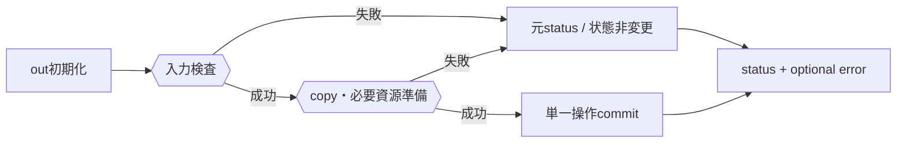

# SEP-D05 / DD-05 値の受渡しと失敗契約の責務分離レビュー案

- 文書版: 0.2
- 状態: 全案反映承認済み・正本適用済み（2026-10-17）。具体化未了は適用結果を参照
- 作成日: 2026-10-17
- 対象: [元文書](../../13_detail_design/05-boundary-values-errors.md)
- 対象箇所: DD-05 DD-VAL-01～07、§3～6
- 索引: [一括レビュー](index.md)
- 台帳項目: D05

- 現行要求根拠: [RQ-04-001](../../11_requirements/RQ-04_abi-boundary.md#rq-04-001)、[RQ-04-003](../../11_requirements/RQ-04_abi-boundary.md#rq-04-003)、[RQ-04-006](../../11_requirements/RQ-04_abi-boundary.md#rq-04-006)、[RQ-04-007](../../11_requirements/RQ-04_abi-boundary.md#rq-04-007)、[RQ-05-004](../../11_requirements/RQ-05_ownership-callbacks.md#rq-05-004)、[RQ-05-005](../../11_requirements/RQ-05_ownership-callbacks.md#rq-05-005)、[RQ-07-009](../../11_requirements/RQ-07_binding.md#rq-07-009)、[RQ-15-011](../../11_requirements/RQ-15_requirement-decisions.md#rq-15-011)
- 具体化する基本設計: [BD-01](../../12_design/BD-01_value-types-upper-design.md)、[BD-27](../../12_design/BD-27_error-object-upper-design.md)、[BD-35](../../12_design/BD-35_collection-change-batch-upper-design.md)
## 対象本文と既存承認

- 状態: 内容承認済み（2026-10-07）

作成時点の原文SHA-256: `4be013d85d35447b596ed5b9a848562667997ca66547c0367a8ca452a61d0f8c`。対象は台帳の箇所と、以下の原文・判断ID。正本の本文は今回編集していない。

原文 DD-VAL-01 / L29:

> 固定幅scalarはC ABIで定めた型に値として渡す。wrapperは明示的な型対応を行い、範囲外整数の切り詰め、異なるProperty kind間の暗黙変換、言語オブジェクトの直接受渡しを行わない。

原文 DD-VAL-02 / L30:

> UTF-8入力はpointerとbyte lengthで受け、呼出し中のみ借用する。長さが正でpointerがnullなら`UI_INVALID_ARGUMENT`、nullと長さ0は空byte列を表す。有効なUTF-8だけ受理し、保持する場合は呼出しが戻る前にcopyする。埋め込みNULはbyte列中の値として許す。

原文 DD-VAL-04 / L32:

> `ui_status`を呼出し結果の一次判定とする。`out_error`は任意で、非nullの場合は呼出し開始時に0へ初期化し、失敗詳細を生成できたときだけ新しい所有error handleを返す。成功時は0。

原文 DD-VAL-05 / L33:

> Error handleは失敗時点のimmutable snapshotとする。機械分岐はstatus/domain/codeを用い、message文面に依存しない。`out_error == NULL`、またはerror snapshotを作れない資源不足時も、元のAPI statusを返し、詳細なしで失敗を表す。

## 改訂判断案

| レビューID | 変更対象 | 提案 |
|---|---|---|
| SEP-D05-01 | 外部契約と要求の根拠 | [SEP-RQ-015 UTF-8文字列の受渡し結果](rq-candidates.md#candidate-015)、[SEP-RQ-016 buffer不足時の結果](rq-candidates.md#candidate-016)、[SEP-RQ-017 error詳細を生成できない失敗](rq-candidates.md#candidate-017)、[SEP-RQ-062 単一操作の準備失敗](rq-candidates.md#candidate-062)へ対応付ける。既存RQで定まる結果は上流参照にし、補足/選択要は要求承認後に設計前提へ反映する |
| SEP-D05-02 | 実現手段の本文 | 下記の責務・data/ownership flow・stateを本文案として収録する。個別の公開名・signatureを新たに確定する判断とは分ける |
| SEP-D05-03 | 未決・承認粒度 | 一般transactionやcallbackアプリ副作用のrollbackへ拡大しない。取得間snapshot非保証の利用者条件はRQ、null/capacity0と出力初期値はDD。 |

## 設計本文の改訂案

C ABI入口でrequired outputを規定値へ初期化し、pointer/length・kind・UTF-8を検証する。保持が必要な入力はcall中にcopyし、資源確保が成功してからCore状態をcommitする。buffer getterは必要byte数と容量を先に照合してからcopyする。statusを確定した後のoptional error確保失敗で一次失敗を置換しない。

## 移管・ID・検証への影響

- 既存ID: DD-VAL-01、DD-VAL-02、DD-VAL-03、DD-VAL-04、DD-VAL-05、DD-VAL-06、DD-VAL-07。方式として残る意味は旧IDを維持し、要求へ分ける文だけを仮候補IDに対応付ける。正式RQ IDの発番は[移行案](id-migration.md)による。
- 移管先: 利用者可視条件は上記RQ候補、C/言語APIの具体形はDD内、脅威と防御はSD、試験操作と判定手順はrequirements-test/unit-test、着手順と下流割当はto-do。
- 設計を説明する所有・state・call図と計算例は保持する。対象本文の試験節は、[検証改訂案](test-impact.md)へ対応付けてから移す。失敗時の状態表・cleanup順まで検証扱いで削除しない。
- 上流RQ/ADR/BDへの参照は該当記述に直接置く。後続の着手割当は計画へ移し、DD間のinterface依存参照は実際の定義側へ向けて循環を解く。文書番号の大小だけで依存を判定しない。

## 承認履歴

| 日付 | 対象 | 承認者 | 結果 |
|---|---|---|---|
| 2026-10-17 | SEP-D05 | — | 一括作成指示に基づくレビュー案。採用・正本適用は未承認 |

## 改訂履歴

| 版 | 日付 | 内容 | 状態 |
|---|---|---|---|
| 0.1 | 2026-10-17 | 現行文書から責務分離・改訂文案・影響を作成 | レビュー待ち |

## 2026-10-17 適用結果

[適用先](../../13_detail_design/05-boundary-values-errors.md) の版0.1へ反映した。補足要求は正式IDへ対応付け、未設計事項は [後続課題](../requirements-design-separation-follow-up.md) に移した。

### 承認履歴

| 日付 | 範囲 | 承認者 | 結果 |
| --- | --- | --- | --- |
| 2026-10-17 | 全レビュー案の反映 | 利用者 | 「すべて反映して下さい。」により採用・正本適用を承認 |

### 改訂履歴

| 版 | 日付 | 内容 |
| --- | --- | --- |
| 0.2 | 2026-10-17 | 承認と正本適用結果を追記。作成時点の比較・引用を保持 |
