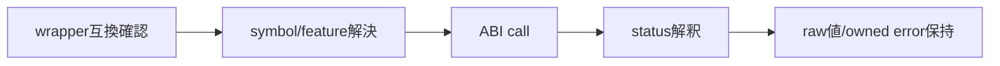

# SEP-D06 / DD-06 ABIシンボルと互換性の責務分離レビュー案

- 文書版: 0.2
- 状態: 全案反映承認済み・正本適用済み（2026-10-17）。具体化未了は適用結果を参照
- 作成日: 2026-10-17
- 対象: [元文書](../../13_detail_design/06-abi-surface.md)
- 対象箇所: DD-06 DD-ABI-01～10、§3～8
- 索引: [一括レビュー](index.md)
- 台帳項目: D06

- 現行要求根拠: [RQ-04-006](../../11_requirements/RQ-04_abi-boundary.md#rq-04-006)、[RQ-04-007](../../11_requirements/RQ-04_abi-boundary.md#rq-04-007)、[RQ-04-009](../../11_requirements/RQ-04_abi-boundary.md#rq-04-009)、[RQ-04-010](../../11_requirements/RQ-04_abi-boundary.md#rq-04-010)、[RQ-06-002](../../11_requirements/RQ-06_threading-dispatch.md#rq-06-002)、[RQ-15-011](../../11_requirements/RQ-15_requirement-decisions.md#rq-15-011)、[RQ-15-012](../../11_requirements/RQ-15_requirement-decisions.md#rq-15-012)
- 具体化する基本設計: [BD-27](../../12_design/BD-27_error-object-upper-design.md)、[BD-28](../../12_design/BD-28_abi-release-version-upper-design.md)、[BD-36](../../12_design/BD-36_runtime-shutdown-dispatch-upper-design.md)
## 対象本文と既存承認

- 状態: DD-ABI-01～10承認済み（2026-10-07）。Binding domain code catalog追記承認済み（2026-10-14）

作成時点の原文SHA-256: `a8b4a396622aabb6a9c63562ec3ffdd64612cd5ddb2e681f2d298e009af39441`。対象は台帳の箇所と、以下の原文・判断ID。正本の本文は今回編集していない。

原文 DD-ABI-01 / L30:

> 外部C symbolは`ui_abi_<major>_<group>_<operation>`形式とする。既存設計の`ui_abi_1_*`をABI major 1とし、ABI majorをsymbol prefixで識別する。C calling convention、固定幅整数、opaque handleの型・意味はADR-0001とA1～A3を維持する。

原文 DD-ABI-02 / L31:

> `get_version`はnative runtimeの安定版MAJOR.MINOR.PATCHを返し、`major`は当該symbol prefixのmajorと一致させる。既存major/minor出力に`out_patch`を追加する。ABI 1導入前に署名を確定し、初回stable番号やpre-releaseは本判断に含めない。

原文 DD-ABI-06 / L35:

> 初版のstatusを§3の表とする。`UI_COMMAND_EXECUTION_FAILED`と`UI_INPUT_FEEDBACK`はError snapshotが持つ結果分類であり、通常のAPI呼出し戻り値ではない。`UI_PENDING`はshutdown要求が受付済みだが未完了のとき返す非失敗statusとし、wrapperは通常のAPI failureとして扱わない。

原文 DD-ABI-09 / L38:

> `runtime_shutdown`はRuntimeがClosedになる同期操作とする。UI thread callback/event内の呼出しは実行中処理を中断せず、優先control taskとして受付後に`UI_PENDING`で戻る。workerからの呼出しはDD-03に従いUI threadの完了を待ち、完了後に`UI_OK`を返す。shutdown開始前のUI thread外の呼出しはbridgeへdispatchする。

## 改訂判断案

| レビューID | 変更対象 | 提案 |
|---|---|---|
| SEP-D06-01 | 外部契約と要求の根拠 | [SEP-RQ-004 参照の種類・所属の拒否結果](rq-candidates.md#candidate-004)、[SEP-RQ-009 終了要求の受付と完了](rq-candidates.md#candidate-009)、[SEP-RQ-017 error詳細を生成できない失敗](rq-candidates.md#candidate-017)、[SEP-RQ-018 利用者定義エラーの自動採番](rq-candidates.md#candidate-018)、[SEP-RQ-019 機能照会と互換性](rq-candidates.md#candidate-019)へ対応付ける。既存RQで定まる結果は上流参照にし、補足/選択要は要求承認後に設計前提へ反映する |
| SEP-D06-02 | 実現手段の本文 | 下記の責務・data/ownership flow・stateを本文案として収録する。個別の公開名・signatureを新たに確定する判断とは分ける |
| SEP-D06-03 | 未決・承認粒度 | DD-BIND-15のdomain3 code1～3と2026-10-14承認を維持。新しい完了待機APIや停止loop timeout値は追加しない。bridge hookは既存宣言を保持し相対的なAPI分冊移管だけを提案。 |

## 設計本文の改訂案

ABI major付きsymbol、version/feature query、status/domain/code catalogを宣言正本に集約する。wrapper loaderはminimum versionとsymbolの存在を確認して呼ぶ。利用者error auto採番は安定catalogの未使用領域へ割り当て、公開済みcodeを保持する。shutdownの受付未完了はUI_PENDINGとして言語結果へ渡し、cleanup完了のUI_OKと区別する。

## 移管・ID・検証への影響

- 既存ID: DD-ABI-01、DD-ABI-02、DD-ABI-03、DD-ABI-04、DD-ABI-05、DD-ABI-06、DD-ABI-07、DD-ABI-08、DD-ABI-09、DD-ABI-10。方式として残る意味は旧IDを維持し、要求へ分ける文だけを仮候補IDに対応付ける。正式RQ IDの発番は[移行案](id-migration.md)による。
- 移管先: 利用者可視条件は上記RQ候補、C/言語APIの具体形はDD内、脅威と防御はSD、試験操作と判定手順はrequirements-test/unit-test、着手順と下流割当はto-do。
- 設計を説明する所有・state・call図と計算例は保持する。対象本文の試験節は、[検証改訂案](test-impact.md)へ対応付けてから移す。失敗時の状態表・cleanup順まで検証扱いで削除しない。
- 上流RQ/ADR/BDへの参照は該当記述に直接置く。後続の着手割当は計画へ移し、DD間のinterface依存参照は実際の定義側へ向けて循環を解く。文書番号の大小だけで依存を判定しない。

## 承認履歴

| 日付 | 対象 | 承認者 | 結果 |
|---|---|---|---|
| 2026-10-17 | SEP-D06 | — | 一括作成指示に基づくレビュー案。採用・正本適用は未承認 |

## 改訂履歴

| 版 | 日付 | 内容 | 状態 |
|---|---|---|---|
| 0.1 | 2026-10-17 | 現行文書から責務分離・改訂文案・影響を作成 | レビュー待ち |

## 2026-10-17 適用結果

[適用先](../../13_detail_design/06-abi-surface.md) の版0.1へ反映した。補足要求は正式IDへ対応付け、未設計事項は [後続課題](../requirements-design-separation-follow-up.md) に移した。

### 承認履歴

| 日付 | 範囲 | 承認者 | 結果 |
| --- | --- | --- | --- |
| 2026-10-17 | 全レビュー案の反映 | 利用者 | 「すべて反映して下さい。」により採用・正本適用を承認 |

### 改訂履歴

| 版 | 日付 | 内容 |
| --- | --- | --- |
| 0.2 | 2026-10-17 | 承認と正本適用結果を追記。作成時点の比較・引用を保持 |
