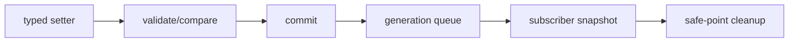

# SEP-D07 / DD-07 Propertyの保存と通知の責務分離レビュー案

- 文書版: 0.2
- 状態: 全案反映承認済み・正本適用済み（2026-10-17）。具体化未了は適用結果を参照
- 作成日: 2026-10-17
- 対象: [元文書](../../13_detail_design/07-property-notification.md)
- 対象箇所: DD-07 DD-PROP-01～10、§4～9/11
- 索引: [一括レビュー](index.md)
- 台帳項目: D07

- 現行要求根拠: [RQ-02-002](../../11_requirements/RQ-02_core-features.md#rq-02-002)、[RQ-04-002](../../11_requirements/RQ-04_abi-boundary.md#rq-04-002)、[RQ-05-006](../../11_requirements/RQ-05_ownership-callbacks.md#rq-05-006)、[RQ-07-005](../../11_requirements/RQ-07_binding.md#rq-07-005)、[RQ-07-006](../../11_requirements/RQ-07_binding.md#rq-07-006)、[RQ-07-008](../../11_requirements/RQ-07_binding.md#rq-07-008)、[RQ-15-007](../../11_requirements/RQ-15_requirement-decisions.md#rq-15-007)
- 具体化する基本設計: [BD-01](../../12_design/BD-01_value-types-upper-design.md)、[BD-02](../../12_design/BD-02_ui-transaction-upper-design.md)、[BD-03](../../12_design/BD-03_runtime-notification-upper-design.md)
## 対象本文と既存承認

- 状態: DD-PROP-01～10の基礎判断は承認済み（2026-10-08）。DD-PROP-08のX01 Runtime owner・cleanup改訂 v0.3はレビュー待ち（2026-10-13、DD-LIFE-03/04承認後の整合案）

作成時点の原文SHA-256: `d08ff7ef0f5e9905cafbcc9179541d27ffa03d9e3607b01380c75ba0a303717d`。対象は台帳の箇所と、以下の原文・判断ID。正本の本文は今回編集していない。

原文 DD-PROP-01 / L39:

> Property kind IDをBOOL=1、I64=2、UTF8=3、OBJECT=4（予約・生成不可）、F64=5、DECIMAL=6とする。追加kindは新IDを割当て、既存IDを再利用しない。

原文 DD-PROP-02 / L40:

> 既存A9の初期値付き型別create、A5の`property_kind`、型別getter/setterを維持し、F64/DECIMAL用の互換追加symbolを設ける。生成成功は所有Property handleを返し、失敗時は0。生成自体で通知を発生させない。

原文 DD-PROP-05 / L43:

> setterは入力検証・UTF8 copy・必要な値確保がすべて成功した後に値をcommitする。型不一致、wrong thread、invalid UTF8、validation rejection、allocation failureではProperty値・notification queueを変えない。required outputはDD-VAL-06どおり初期化し、`ui_status`を一次結果、optional `out_error`を失敗詳細とする。

原文 DD-PROP-07 / L45:

> notificationは最外側のUI処理終了後、通常UI event/postより先に処理を始める。Property単位のdelivery itemは、その時点のsubscriber順序snapshotへ登録順でcallbackする。処理中の変更は次のgenerationへenqueueし、同じPropertyをgeneration内で一件へcoalesceする。

## 改訂判断案

| レビューID | 変更対象 | 提案 |
|---|---|---|
| SEP-D07-01 | 外部契約と要求の根拠 | [SEP-RQ-011 ABI F32要求の未対応範囲](rq-candidates.md#candidate-011)、[SEP-RQ-012 初期Propertyの値型範囲](rq-candidates.md#candidate-012)、[SEP-RQ-013 F64の同値と保持結果](rq-candidates.md#candidate-013)、[SEP-RQ-014 十進値の範囲と同値](rq-candidates.md#candidate-014)、[SEP-RQ-020 購読の初期通知・順序](rq-candidates.md#candidate-020)、[SEP-RQ-021 同値設定時の検証](rq-candidates.md#candidate-021)、[SEP-RQ-022 長期保留の診断設定](rq-candidates.md#candidate-022)へ対応付ける。既存RQで定まる結果は上流参照にし、補足/選択要は要求承認後に設計前提へ反映する |
| SEP-D07-02 | 実現手段の本文 | 下記の責務・data/ownership flow・stateを本文案として収録する。個別の公開名・signatureを新たに確定する判断とは分ける |
| SEP-D07-03 | 未決・承認粒度 | DD-PROP-08のX01本文改訂は未承認範囲として別承認欄を維持。slice128は内部作業枠、内蔵parse/formatは将来意向、F32は未対応の要求差異を残す。 |

## 設計本文の改訂案

Property setterはtyped candidateを検証し、同値なら格納表現を保持して戻る。差分なら値をcommitし、generation内で一Propertyのdelivery itemへ集約する。delivery開始時のsubscriber順序snapshotに従ってActive登録だけをinvokeする。active SubscriptionはRuntime registryが所有し、Property indexはweak。cancelは新規invokeを止め、in-flight後にclosure/index/registryを解放する。

## 移管・ID・検証への影響

- 既存ID: DD-PROP-01、DD-PROP-02、DD-PROP-03、DD-PROP-04、DD-PROP-05、DD-PROP-06、DD-PROP-07、DD-PROP-08、DD-PROP-09、DD-PROP-10。方式として残る意味は旧IDを維持し、要求へ分ける文だけを仮候補IDに対応付ける。正式RQ IDの発番は[移行案](id-migration.md)による。
- 移管先: 利用者可視条件は上記RQ候補、C/言語APIの具体形はDD内、脅威と防御はSD、試験操作と判定手順はrequirements-test/unit-test、着手順と下流割当はto-do。
- 設計を説明する所有・state・call図と計算例は保持する。対象本文の試験節は、[検証改訂案](test-impact.md)へ対応付けてから移す。失敗時の状態表・cleanup順まで検証扱いで削除しない。
- 上流RQ/ADR/BDへの参照は該当記述に直接置く。後続の着手割当は計画へ移し、DD間のinterface依存参照は実際の定義側へ向けて循環を解く。文書番号の大小だけで依存を判定しない。

## 承認履歴

| 日付 | 対象 | 承認者 | 結果 |
|---|---|---|---|
| 2026-10-17 | SEP-D07 | — | 一括作成指示に基づくレビュー案。採用・正本適用は未承認 |

## 改訂履歴

| 版 | 日付 | 内容 | 状態 |
|---|---|---|---|
| 0.1 | 2026-10-17 | 現行文書から責務分離・改訂文案・影響を作成 | レビュー待ち |

## 2026-10-17 適用結果

[適用先](../../13_detail_design/07-property-notification.md) の版0.5へ反映した。補足要求は正式IDへ対応付け、未設計事項は [後続課題](../requirements-design-separation-follow-up.md) に移した。

### 承認履歴

| 日付 | 範囲 | 承認者 | 結果 |
| --- | --- | --- | --- |
| 2026-10-17 | 全レビュー案の反映 | 利用者 | 「すべて反映して下さい。」により採用・正本適用を承認 |

### 改訂履歴

| 版 | 日付 | 内容 |
| --- | --- | --- |
| 0.2 | 2026-10-17 | 承認と正本適用結果を追記。作成時点の比較・引用を保持 |
