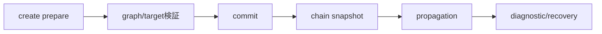

# SEP-D08 / DD-08 Bindingの伝播とグラフの責務分離レビュー案

- 文書版: 0.2
- 状態: 全案反映承認済み・正本適用済み（2026-10-17）。具体化未了は適用結果を参照
- 作成日: 2026-10-17
- 対象: [元文書](../../13_detail_design/08-binding-graph.md)
- 対象箇所: DD-08 DD-BIND-01～09、§4
- 索引: [一括レビュー](index.md)
- 台帳項目: D08

- 現行要求根拠: [RQ-07-001](../../11_requirements/RQ-07_binding.md#rq-07-001)、[RQ-07-002](../../11_requirements/RQ-07_binding.md#rq-07-002)、[RQ-07-003](../../11_requirements/RQ-07_binding.md#rq-07-003)、[RQ-07-004](../../11_requirements/RQ-07_binding.md#rq-07-004)、[RQ-07-005](../../11_requirements/RQ-07_binding.md#rq-07-005)、[RQ-07-006](../../11_requirements/RQ-07_binding.md#rq-07-006)、[RQ-07-007](../../11_requirements/RQ-07_binding.md#rq-07-007)、[RQ-07-008](../../11_requirements/RQ-07_binding.md#rq-07-008)、[RQ-07-009](../../11_requirements/RQ-07_binding.md#rq-07-009)、[RQ-07-010](../../11_requirements/RQ-07_binding.md#rq-07-010)、[RQ-07-011](../../11_requirements/RQ-07_binding.md#rq-07-011)、[RQ-15-007](../../11_requirements/RQ-15_requirement-decisions.md#rq-15-007)
- 具体化する基本設計: [BD-03](../../12_design/BD-03_runtime-notification-upper-design.md)
## 対象本文と既存承認

- 状態: DD-BIND-01～15は意味・動作の判断を承認済み（2026-10-14まで）。DD-BIND-04のX01 owner/lifecycle本文改訂とWatchDog公開設定のAPI形は別途具体化待ち

作成時点の原文SHA-256: `bb6efae853dbe17730958938b8ae6256889b1a973bb768d4e01edfcff5d4c577`。対象は台帳の箇所と、以下の原文・判断ID。正本の本文は今回編集していない。

原文 DD-BIND-04 / L28:

> Binding propagation itemは開始時にBindingの活性状態、グラフ世代、入力Propertyの最新確定値を確認してから実行する。解除またはshutdown済みなら何も伝播しない。Binding作成後の保留変更は、作成時にsourceの最新値を使った初期同期で吸収し、同じ値の重複通知を作らない。解除後は保留itemを破棄し、両端の確定値を保つ。

原文 DD-BIND-11 / L42:

> 長期保留のWatchDog

原文 DD-BIND-12 / L43:

> 診断観測と明示回復

原文 DD-BIND-13 / L44:

> sliceと128件計数単位

## 改訂判断案

| レビューID | 変更対象 | 提案 |
|---|---|---|
| SEP-D08-01 | 外部契約と要求の根拠 | [SEP-RQ-022 長期保留の診断設定](rq-candidates.md#candidate-022)、[SEP-RQ-023 非収束診断と回復](rq-candidates.md#candidate-023)、[SEP-RQ-063 同じBindingの重複接続](rq-candidates.md#candidate-063)へ対応付ける。既存RQで定まる結果は上流参照にし、補足/選択要は要求承認後に設計前提へ反映する |
| SEP-D08-02 | 実現手段の本文 | 下記の責務・data/ownership flow・stateを本文案として収録する。個別の公開名・signatureを新たに確定する判断とは分ける |
| SEP-D08-03 | 未決・承認粒度 | DD-BIND-10～15承認済み、X01 owner本文は別状態。5秒既定/無効化/回復の外部結果はRQ候補、128-item計数/hash/graph snapshotはDD。WatchDog設定APIの適用時点と公開形は残課題。 |

## 設計本文の改訂案

Binding createはkind/Runtime/modeと仮topologyを検査し、初期target検証・資源準備後に接続と値をcommitする。chainごとにgraph generationの不変topologyを用い、OneWay item/TwoWay group/item配信を完了境界まで進める。循環候補hash一致ではkind別値snapshotの意味的同値を確認する。cancelはactive generationを無効化し、該当queue itemだけを除外する。WatchDog診断と循環停止を分ける。

## 移管・ID・検証への影響

- 既存ID: DD-BIND-01、DD-BIND-02、DD-BIND-03、DD-BIND-04、DD-BIND-05、DD-BIND-06、DD-BIND-07、DD-BIND-08、DD-BIND-09、DD-BIND-10、DD-BIND-11、DD-BIND-12、DD-BIND-13、DD-BIND-14、DD-BIND-15。方式として残る意味は旧IDを維持し、要求へ分ける文だけを仮候補IDに対応付ける。正式RQ IDの発番は[移行案](id-migration.md)による。
- 移管先: 利用者可視条件は上記RQ候補、C/言語APIの具体形はDD内、脅威と防御はSD、試験操作と判定手順はrequirements-test/unit-test、着手順と下流割当はto-do。
- 設計を説明する所有・state・call図と計算例は保持する。対象本文の試験節は、[検証改訂案](test-impact.md)へ対応付けてから移す。失敗時の状態表・cleanup順まで検証扱いで削除しない。
- 上流RQ/ADR/BDへの参照は該当記述に直接置く。後続の着手割当は計画へ移し、DD間のinterface依存参照は実際の定義側へ向けて循環を解く。文書番号の大小だけで依存を判定しない。

## 承認履歴

| 日付 | 対象 | 承認者 | 結果 |
|---|---|---|---|
| 2026-10-17 | SEP-D08 | — | 一括作成指示に基づくレビュー案。採用・正本適用は未承認 |

## 改訂履歴

| 版 | 日付 | 内容 | 状態 |
|---|---|---|---|
| 0.1 | 2026-10-17 | 現行文書から責務分離・改訂文案・影響を作成 | レビュー待ち |

## 2026-10-17 適用結果

[適用先](../../13_detail_design/08-binding-graph.md) の版0.7へ反映した。補足要求は正式IDへ対応付け、未設計事項は [後続課題](../requirements-design-separation-follow-up.md) に移した。

### 承認履歴

| 日付 | 範囲 | 承認者 | 結果 |
| --- | --- | --- | --- |
| 2026-10-17 | 全レビュー案の反映 | 利用者 | 「すべて反映して下さい。」により採用・正本適用を承認 |

### 改訂履歴

| 版 | 日付 | 内容 |
| --- | --- | --- |
| 0.2 | 2026-10-17 | 承認と正本適用結果を追記。作成時点の比較・引用を保持 |
