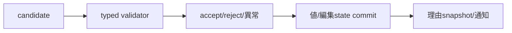

# SEP-D09 / DD-09 ValidationとView入力の責務分離レビュー案

- 文書版: 0.2
- 状態: 全案反映承認済み・正本適用済み（2026-10-17）。具体化未了は適用結果を参照
- 作成日: 2026-10-17
- 対象: [元文書](../../13_detail_design/09-validation-input.md)
- 対象箇所: DD-09 DD-VALID-01～10、§5～7
- 索引: [一括レビュー](index.md)
- 台帳項目: D09

- 現行要求根拠: [RQ-02-002](../../11_requirements/RQ-02_core-features.md#rq-02-002)、[RQ-02-009](../../11_requirements/RQ-02_core-features.md#rq-02-009)、[RQ-02-011](../../11_requirements/RQ-02_core-features.md#rq-02-011)、[RQ-05-006](../../11_requirements/RQ-05_ownership-callbacks.md#rq-05-006)、[RQ-05-009](../../11_requirements/RQ-05_ownership-callbacks.md#rq-05-009)、[RQ-07-010](../../11_requirements/RQ-07_binding.md#rq-07-010)、[RQ-09-005](../../11_requirements/RQ-09_ui-scope.md#rq-09-005)、[RQ-15-006](../../11_requirements/RQ-15_requirement-decisions.md#rq-15-006)、[RQ-15-008](../../11_requirements/RQ-15_requirement-decisions.md#rq-15-008)
- 具体化する基本設計: [BD-01](../../12_design/BD-01_value-types-upper-design.md)
## 対象本文と既存承認

- 状態: DD-VALID-01～10の基礎判断は承認済み（2026-10-11）。DD-VALID-06のX01 Runtime owner・cleanup改訂 v0.3はレビュー待ち（2026-10-13、DD-LIFE-03/04承認後の整合案）

作成時点の原文SHA-256: `5e83f6d4d2ed7f4afcc26b2b0f13100010ff56b223be5bfdcd21ea98aab0e243`。対象は台帳の箇所と、以下の原文・判断ID。正本の本文は今回編集していない。

原文 DD-VALID-01 / L32:

> Propertyごとに同期Validatorを最大一つ登録する。登録・cancelはUI thread専用。登録時には現在値を再検証しない。既存登録がある場合は新規登録を失敗させ、既存closureを維持する。BOOL/I64/UTF8/F64/DECIMALすべてを対象にする。

原文 DD-VALID-02 / L33:

> callbackには型に合うcandidateを同期で渡す。BOOL/I64/UTF8はA17の型別callbackを維持し、F64/DECIMALは`double`/`uint64_t` signatureを使う。UTF8 bytesはcallback中だけ借用可能とし、保持が必要ならcallback内でcopyする。callbackの入力はsetterがcommitする前のcandidateである。

原文 DD-VALID-03 / L34:

> Validator callbackは`UI_OK`なら受理、`UI_VALIDATION_FAILED`なら拒否、`UI_INTERNAL_ERROR`または不正status/outputなら検証処理の異常とする。拒否時はProperty値と値通知を変えず、statusを通常API引数失敗と区別する。直接setterでは拒否を呼出し側へ返す。

原文 DD-VALID-07 / L38:

> TextBox入力callbackには編集後候補全文、selection start/end、originをUTF8 byte offsetで渡し、callback判定は`ACCEPT / INCOMPLETE / REJECT`の三値とする。Keyboard・paste・drop・accessibilityの編集を同じ判定経路に通し、IME composition中は呼ばず、確定候補を`IME_COMMIT`として評価する。

## 改訂判断案

| レビューID | 変更対象 | 提案 |
|---|---|---|
| SEP-D09-01 | 外部契約と要求の根拠 | [SEP-RQ-024 Validator登録条件](rq-candidates.md#candidate-024)、[SEP-RQ-025 判定callback中の禁止操作](rq-candidates.md#candidate-025)、[SEP-RQ-026 TextBox入力三値の結果](rq-candidates.md#candidate-026)、[SEP-RQ-027 TextBox自身のProperty検証拒否](rq-candidates.md#candidate-027)へ対応付ける。既存RQで定まる結果は上流参照にし、補足/選択要は要求承認後に設計前提へ反映する |
| SEP-D09-02 | 実現手段の本文 | 下記の責務・data/ownership flow・stateを本文案として収録する。個別の公開名・signatureを新たに確定する判断とは分ける |
| SEP-D09-03 | 未決・承認粒度 | DD-VALID-06のX01本文はレビュー待ちを保持。TextBox自身のProperty拒否、入力通知相対順は未決を残し、要求案の採否を先行させる。 |

## 設計本文の改訂案

型別ValidatorはPropertyに対して最大一つのactive登録を管理し、setter commit前のcandidateを同期評価する。拒否とcallback異常を別statusへ変換し、owned理由handleは経路ごとに一度消費する。TextBox入力は候補全文・selection・originを判定callbackへ渡し、Accept/Incomplete/Rejectに応じて編集値と確定値のcommit対象を分ける。registration ownerとweak indexは承認済みDD-02の方式へ合わせる。

## 移管・ID・検証への影響

- 既存ID: DD-VALID-01、DD-VALID-02、DD-VALID-03、DD-VALID-04、DD-VALID-05、DD-VALID-06、DD-VALID-07、DD-VALID-08、DD-VALID-09、DD-VALID-10。方式として残る意味は旧IDを維持し、要求へ分ける文だけを仮候補IDに対応付ける。正式RQ IDの発番は[移行案](id-migration.md)による。
- 移管先: 利用者可視条件は上記RQ候補、C/言語APIの具体形はDD内、脅威と防御はSD、試験操作と判定手順はrequirements-test/unit-test、着手順と下流割当はto-do。
- 設計を説明する所有・state・call図と計算例は保持する。対象本文の試験節は、[検証改訂案](test-impact.md)へ対応付けてから移す。失敗時の状態表・cleanup順まで検証扱いで削除しない。
- 上流RQ/ADR/BDへの参照は該当記述に直接置く。後続の着手割当は計画へ移し、DD間のinterface依存参照は実際の定義側へ向けて循環を解く。文書番号の大小だけで依存を判定しない。

## 承認履歴

| 日付 | 対象 | 承認者 | 結果 |
|---|---|---|---|
| 2026-10-17 | SEP-D09 | — | 一括作成指示に基づくレビュー案。採用・正本適用は未承認 |

## 改訂履歴

| 版 | 日付 | 内容 | 状態 |
|---|---|---|---|
| 0.1 | 2026-10-17 | 現行文書から責務分離・改訂文案・影響を作成 | レビュー待ち |

## 2026-10-17 適用結果

[適用先](../../13_detail_design/09-validation-input.md) の版0.4へ反映した。補足要求は正式IDへ対応付け、未設計事項は [後続課題](../requirements-design-separation-follow-up.md) に移した。

### 承認履歴

| 日付 | 範囲 | 承認者 | 結果 |
| --- | --- | --- | --- |
| 2026-10-17 | 全レビュー案の反映 | 利用者 | 「すべて反映して下さい。」により採用・正本適用を承認 |

### 改訂履歴

| 版 | 日付 | 内容 |
| --- | --- | --- |
| 0.2 | 2026-10-17 | 承認と正本適用結果を追記。作成時点の比較・引用を保持 |
