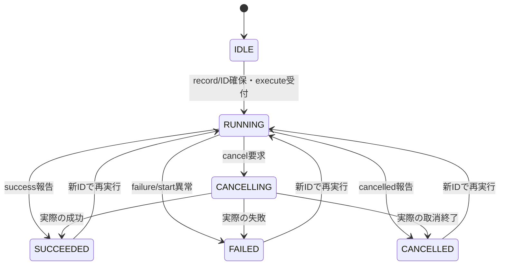

# SEP-D10 / DD-10 非同期Commandの責務分離レビュー案

- 文書版: 0.2
- 状態: 全案反映承認済み・正本適用済み（2026-10-17）。具体化未了は適用結果を参照
- 作成日: 2026-10-17
- 対象: [元文書](../../13_detail_design/10-async-command.md)
- 対象箇所: DD-10 DD-CMD-01～12、§3～9
- 索引: [一括レビュー](index.md)
- 台帳項目: D10

- 現行要求根拠: [RQ-02-004](../../11_requirements/RQ-02_core-features.md#rq-02-004)、[RQ-05-002](../../11_requirements/RQ-05_ownership-callbacks.md#rq-05-002)、[RQ-06-004](../../11_requirements/RQ-06_threading-dispatch.md#rq-06-004)、[RQ-09-006](../../11_requirements/RQ-09_ui-scope.md#rq-09-006)、[RQ-15-009](../../11_requirements/RQ-15_requirement-decisions.md#rq-15-009)
- 具体化する基本設計: [BD-25](../../12_design/BD-25_async-validation-upper-design.md)、[BD-26](../../12_design/BD-26_async-command-progress-upper-design.md)
## 対象本文と既存承認

- 状態: 内容承認済み（2026-10-11）

作成時点の原文SHA-256: `3f0ed358b740ed9937f18368e9807cee9f478e5075b25b1615bcba3cff70c922`。対象は台帳の箇所と、以下の原文・判断ID。正本の本文は今回編集していない。

原文 DD-CMD-01 / L26:

> `command_create_async`はUI thread専用とし、RuntimeがRunningであること、必須のstart/destroy closure、実行条件Propertyが0または同RuntimeのBOOLであることを検査する。成功時に所有Command handleを返し、Coreはstart closureを所有する。失敗時はhandleを0にしclosureを呼び出し側に残す。実行条件0は常時true。

原文 DD-CMD-02 / L27:

> `can_execute = command_open && eligibility_current && state not in {RUNNING, CANCELLING}`とする。条件引数0なら`eligibility_current=true`。実行可否Propertyは読取専用BOOL、state Propertyは読取専用I64とし、Command生成時に作成する。生成はProperty値変更通知を発生させない。

原文 DD-CMD-03 / L28:

> operation IDはRuntime内で単調に発行する非zero `uint64_t`とし、終端・過去operationを含め一度使ったIDを再利用しない。採番・operation record確保の失敗ではID出力を0、Command状態を変更せず、workerを起動しない。ID空間枯渇時は周回再利用せず新規実行を拒否する。

原文 DD-CMD-04 / L29:

> `execute`可能なら新IDを確保し、失敗snapshotを消し、stateを`RUNNING`・can-executeをfalseへ切り替えた後にstart callbackを同期で一度呼ぶ。callbackはworker/async taskを開始して速やかに戻る。operation生成成功後は、start callbackが失敗statusや例外を返しても`execute`は`UI_OK`と発行済みIDを返し、該当operationを`FAILED`にする。

## 改訂判断案

| レビューID | 変更対象 | 提案 |
|---|---|---|
| SEP-D10-01 | 外部契約と要求の根拠 | [SEP-RQ-031 Command実行受付と結果](rq-candidates.md#candidate-031)、[SEP-RQ-032 取消・close・handle破棄の差](rq-candidates.md#candidate-032)へ対応付ける。既存RQで定まる結果は上流参照にし、補足/選択要は要求承認後に設計前提へ反映する |
| SEP-D10-02 | 実現手段の本文 | 下記の責務・data/ownership flow・stateを本文案として収録する。個別の公開名・signatureを新たに確定する判断とは分ける |
| SEP-D10-03 | 未決・承認粒度 | startが一部worker起動後に失敗した場合のticket/取消責任、ID枯渇code、screen owner API、progress型は未決。既存の二つのMermaid状態図を維持する。 |

## 設計本文の改訂案

executeはcan-executeを確認してoperation IDとrecordを確保し、state=RUNNINGとcan-execute=falseを一つの内部遷移でcommitしてからstartを呼ぶ。cancelはthread-safe flagとCANCELLINGへ移し、completeは現在IDに対して一度だけ終端へcommitする。close/shutdownは受付を止め取消を要求し、worker所有参照とCore start closureを別々にcleanupする。

## 移管・ID・検証への影響

- 既存ID: DD-CMD-01、DD-CMD-02、DD-CMD-03、DD-CMD-04、DD-CMD-05、DD-CMD-06、DD-CMD-07、DD-CMD-08、DD-CMD-09、DD-CMD-10、DD-CMD-11、DD-CMD-12。方式として残る意味は旧IDを維持し、要求へ分ける文だけを仮候補IDに対応付ける。正式RQ IDの発番は[移行案](id-migration.md)による。
- 移管先: 利用者可視条件は上記RQ候補、C/言語APIの具体形はDD内、脅威と防御はSD、試験操作と判定手順はrequirements-test/unit-test、着手順と下流割当はto-do。
- 設計を説明する所有・state・call図と計算例は保持する。対象本文の試験節は、[検証改訂案](test-impact.md)へ対応付けてから移す。失敗時の状態表・cleanup順まで検証扱いで削除しない。
- 上流RQ/ADR/BDへの参照は該当記述に直接置く。後続の着手割当は計画へ移し、DD間のinterface依存参照は実際の定義側へ向けて循環を解く。文書番号の大小だけで依存を判定しない。

## 承認履歴

| 日付 | 対象 | 承認者 | 結果 |
|---|---|---|---|
| 2026-10-17 | SEP-D10 | — | 一括作成指示に基づくレビュー案。採用・正本適用は未承認 |

## 改訂履歴

| 版 | 日付 | 内容 | 状態 |
|---|---|---|---|
| 0.1 | 2026-10-17 | 現行文書から責務分離・改訂文案・影響を作成 | レビュー待ち |

## 2026-10-17 適用結果

[適用先](../../13_detail_design/10-async-command.md) の版0.1へ反映した。補足要求は正式IDへ対応付け、未設計事項は [後続課題](../requirements-design-separation-follow-up.md) に移した。

### 承認履歴

| 日付 | 範囲 | 承認者 | 結果 |
| --- | --- | --- | --- |
| 2026-10-17 | 全レビュー案の反映 | 利用者 | 「すべて反映して下さい。」により採用・正本適用を承認 |

### 改訂履歴

| 版 | 日付 | 内容 |
| --- | --- | --- |
| 0.2 | 2026-10-17 | 承認と正本適用結果を追記。作成時点の比較・引用を保持 |
