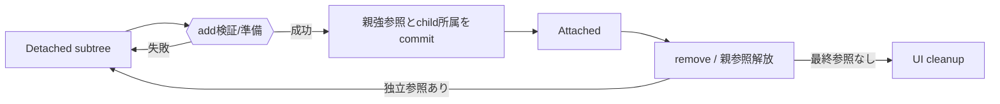

# SEP-D11 / DD-11 UI treeと要素寿命の責務分離レビュー案

- 文書版: 0.2
- 状態: 全案反映承認済み・正本適用済み（2026-10-17）。具体化未了は適用結果を参照
- 作成日: 2026-10-17
- 対象: [元文書](../../13_detail_design/11-ui-tree-lifetime.md)
- 対象箇所: DD-11 DD-TREE-01～08、§4/5/7
- 索引: [一括レビュー](index.md)
- 台帳項目: D11

- 現行要求根拠: [RQ-02-007](../../11_requirements/RQ-02_core-features.md#rq-02-007)、[RQ-02-013](../../11_requirements/RQ-02_core-features.md#rq-02-013)、[RQ-05-003](../../11_requirements/RQ-05_ownership-callbacks.md#rq-05-003)、[RQ-09-001](../../11_requirements/RQ-09_ui-scope.md#rq-09-001)、[RQ-09-003](../../11_requirements/RQ-09_ui-scope.md#rq-09-003)
- 具体化する基本設計: [BD-04](../../12_design/BD-04_ui-tree-lifetime-upper-design.md)、[BD-05](../../12_design/BD-05_logical-visual-tree-upper-design.md)、[BD-11](../../12_design/BD-11_initial-control-contract-upper-design.md)
## 対象本文と既存承認

- 状態: 内容承認済み（2026-10-11）

作成時点の原文SHA-256: `86be14af52bd57a5f08a35abb2673d5a6ee45b860cfd486bc1200e4078490db2`。対象は台帳の箇所と、以下の原文・判断ID。正本の本文は今回編集していない。

原文 DD-TREE-01 / L24:

> Coreが所有寿命を管理する親子所属はLogical Treeに限る。親Containerは各Logical childへの内部強参照を一つ持ち、childはparentを弱い所属情報として持つ。Visual Treeのnode/対応情報はLogical childの寿命を追加で保持せず、その所有者はControlまたはtemplate側の明示的な内部ownerとする。

原文 DD-TREE-02 / L25:

> 一つのWidgetは同時に最大一つのLogical parentに所属する。親子は同一Runtimeで、parentはContainerでなければならず、self-parent・祖先を子にする操作・既所属childの追加を拒否する。Windowのcontent root一つ、StackPanelの順序付きchildrenを維持する。

原文 DD-TREE-03 / L26:

> 親子構造の変更はUI thread専用とする。追加・削除時は引数、Runtime、parent/child状態、循環を先に検証し、全検証に成功してからLogical Tree、parent所属情報、所有参照を一つのcommitで更新する。失敗時はtree・参照・通知に部分変更を残さない。既所属childの直接移動APIは設けず、明示remove後に新parentへ追加する。

原文 DD-TREE-06 / L29:

> Detached subtreeの再所属は、追加検証を全て通過したときに新parentが所属参照を取得して行う。追加失敗時はDetached状態と既存のProperty値・Binding/Subscription状態を保つ。再所属時のPlatform資源再生成はVisual/Platform側の責務であり、その詳細と失敗復旧はDD-12/16へ送る。

## 改訂判断案

| レビューID | 変更対象 | 提案 |
|---|---|---|
| SEP-D11-01 | 外部契約と要求の根拠 | [SEP-RQ-033 Detached subtreeの利用](rq-candidates.md#candidate-033)、[SEP-RQ-034 Tree変更の拒否結果](rq-candidates.md#candidate-034)へ対応付ける。既存RQで定まる結果は上流参照にし、補足/選択要は要求承認後に設計前提へ反映する |
| SEP-D11-02 | 実現手段の本文 | 下記の責務・data/ownership flow・stateを本文案として収録する。個別の公開名・signatureを新たに確定する判断とは分ける |
| SEP-D11-03 | 未決・承認粒度 | D02からのDetached API別可否を引き継ぐ。再所属peer生成失敗時の外部結果と復旧、Visual template owner、Focus/IME cleanup順の未決を個別に記録する。 |

## 設計本文の改訂案

Logical parentのchild強参照とchildのweak parent情報を一commitで更新する。addは所属/Runtime/循環/必要資源を先に検査し、removeは所属参照を外してchildをDetached rootへする。subtree内部リンクは保持する。再addは検証後に新parent ownerを取得し、Platform接続更新へ渡す。shutdownでは所属・Visual/peer接続を閉じ、残存Core shellだけを残す。

## 移管・ID・検証への影響

- 既存ID: DD-TREE-01、DD-TREE-02、DD-TREE-03、DD-TREE-04、DD-TREE-05、DD-TREE-06、DD-TREE-07、DD-TREE-08。方式として残る意味は旧IDを維持し、要求へ分ける文だけを仮候補IDに対応付ける。正式RQ IDの発番は[移行案](id-migration.md)による。
- 移管先: 利用者可視条件は上記RQ候補、C/言語APIの具体形はDD内、脅威と防御はSD、試験操作と判定手順はrequirements-test/unit-test、着手順と下流割当はto-do。
- 設計を説明する所有・state・call図と計算例は保持する。対象本文の試験節は、[検証改訂案](test-impact.md)へ対応付けてから移す。失敗時の状態表・cleanup順まで検証扱いで削除しない。
- 上流RQ/ADR/BDへの参照は該当記述に直接置く。後続の着手割当は計画へ移し、DD間のinterface依存参照は実際の定義側へ向けて循環を解く。文書番号の大小だけで依存を判定しない。

## 承認履歴

| 日付 | 対象 | 承認者 | 結果 |
|---|---|---|---|
| 2026-10-17 | SEP-D11 | — | 一括作成指示に基づくレビュー案。採用・正本適用は未承認 |

## 改訂履歴

| 版 | 日付 | 内容 | 状態 |
|---|---|---|---|
| 0.1 | 2026-10-17 | 現行文書から責務分離・改訂文案・影響を作成 | レビュー待ち |

## 2026-10-17 適用結果

[適用先](../../13_detail_design/11-ui-tree-lifetime.md) の版0.1へ反映した。補足要求は正式IDへ対応付け、未設計事項は [後続課題](../requirements-design-separation-follow-up.md) に移した。

### 承認履歴

| 日付 | 範囲 | 承認者 | 結果 |
| --- | --- | --- | --- |
| 2026-10-17 | 全レビュー案の反映 | 利用者 | 「すべて反映して下さい。」により採用・正本適用を承認 |

### 改訂履歴

| 版 | 日付 | 内容 |
| --- | --- | --- |
| 0.2 | 2026-10-17 | 承認と正本適用結果を追記。作成時点の比較・引用を保持 |
