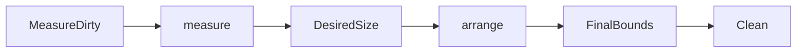

# SEP-D12 / DD-12 Layoutの責務分離レビュー案

- 文書版: 0.2
- 状態: 全案反映承認済み・正本適用済み（2026-10-17）。具体化未了は適用結果を参照
- 作成日: 2026-10-17
- 対象: [元文書](../../13_detail_design/12-layout.md)
- 対象箇所: DD-12 DD-LAYOUT-01～08、§4/7
- 索引: [一括レビュー](index.md)
- 台帳項目: D12

- 現行要求根拠: [RQ-02-008](../../11_requirements/RQ-02_core-features.md#rq-02-008)、[RQ-09-007](../../11_requirements/RQ-09_ui-scope.md#rq-09-007)、[RQ-09-008](../../11_requirements/RQ-09_ui-scope.md#rq-09-008)
- 具体化する基本設計: [BD-04](../../12_design/BD-04_ui-tree-lifetime-upper-design.md)、[BD-06](../../12_design/BD-06_layout-upper-design.md)
## 対象本文と既存承認

- 状態: 内容承認済み（2026-10-12）

作成時点の原文SHA-256: `84890e10248ac610ac60285f5f2bcbd3b70cd8e83a3abc0792006a2956eb54f3`。対象は台帳の箇所と、以下の原文・判断ID。正本の本文は今回編集していない。

原文 DD-LAYOUT-01 / L24:

> LayoutはVisual Treeの各要素に対し、SizerによるMeasureとLocationerによるArrangeの二段階で行う。Measureは親から利用可能サイズ制約を受けてDesiredSizeを返し、Arrangeは親が割り当てた最終矩形を子へ配分し、各要素のFinalBoundsを確定する。DesiredSizeとFinalBoundsを別値として保持する。

原文 DD-LAYOUT-02 / L25:

> Layout関連操作と測定結果のcommitはUI thread専用とする。各要素のサイズ制約は横・縦それぞれ最小値と最大値を持つ。寸法は非負でNaNを許さず、最大値には「上限なし」を表す意味値を許す。上下限が逆転する制約は無効入力として拒否し、既存制約・DesiredSize・FinalBoundsを変更しない。ABI上の符号化は未決のままにする。

原文 DD-LAYOUT-05 / L28:

> StackPanelのArrangeではmain axis上にchildrenをDesiredSize順で連続配置し、cross axisは各childのAlignに従う。初期Align候補はStart、Center、End、Stretchとする。明示child AlignはContainer既定Alignに優先し、未指定時はcross-axis Stretch、main-axis Start相当とする。Stretchは割り当てたcross-axis領域へ広げるが、childのmaximum制約を超えない。

原文 DD-LAYOUT-08 / L31:

> Measure/Arrangeは決定的かつ冪等とし、入力制約、Visual構造、配置Propertyが同一なら同じDesiredSize/FinalBoundsを返す。制約の不正、破棄済みVisual、Runtime shutdownでは既存の公開結果を部分更新せず失敗する。独自callbackを呼ばないためlayout pass中の利用者コード再入は発生させない。

## 改訂判断案

| レビューID | 変更対象 | 提案 |
|---|---|---|
| SEP-D12-01 | 外部契約と要求の根拠 | [SEP-RQ-035 StackPanel公開設定と既定](rq-candidates.md#candidate-035)へ対応付ける。既存RQで定まる結果は上流参照にし、補足/選択要は要求承認後に設計前提へ反映する |
| SEP-D12-02 | 実現手段の本文 | 下記の責務・data/ownership flow・stateを本文案として収録する。個別の公開名・signatureを新たに確定する判断とは分ける |
| SEP-D12-03 | 未決・承認粒度 | Vertical/HorizontalとAlign提供、公開既定値の要求境界をX06へ。数値単位/rounding/overflow/clippingは未決。配置計算例は設計を説明するため残し、検証caseと同一視しない。 |

## 設計本文の改訂案

Sizer.measureは利用可能制約から子のDesiredSizeを集約し、Locationer.arrangeは親の割当矩形からFinalBoundsを確定する。StackPanelはaxisを選び、main軸合計/cross軸最大のmeasureとAlignによるarrangeを行う。dirty状態は祖先/必要部分へ伝播し、結果を消費する前に再計算する。候補結果は成功時だけ公開boundsへcommitする。

## 移管・ID・検証への影響

- 既存ID: DD-LAYOUT-01、DD-LAYOUT-02、DD-LAYOUT-03、DD-LAYOUT-04、DD-LAYOUT-05、DD-LAYOUT-06、DD-LAYOUT-07、DD-LAYOUT-08。方式として残る意味は旧IDを維持し、要求へ分ける文だけを仮候補IDに対応付ける。正式RQ IDの発番は[移行案](id-migration.md)による。
- 移管先: 利用者可視条件は上記RQ候補、C/言語APIの具体形はDD内、脅威と防御はSD、試験操作と判定手順はrequirements-test/unit-test、着手順と下流割当はto-do。
- 設計を説明する所有・state・call図と計算例は保持する。対象本文の試験節は、[検証改訂案](test-impact.md)へ対応付けてから移す。失敗時の状態表・cleanup順まで検証扱いで削除しない。
- 上流RQ/ADR/BDへの参照は該当記述に直接置く。後続の着手割当は計画へ移し、DD間のinterface依存参照は実際の定義側へ向けて循環を解く。文書番号の大小だけで依存を判定しない。

## 承認履歴

| 日付 | 対象 | 承認者 | 結果 |
|---|---|---|---|
| 2026-10-17 | SEP-D12 | — | 一括作成指示に基づくレビュー案。採用・正本適用は未承認 |

## 改訂履歴

| 版 | 日付 | 内容 | 状態 |
|---|---|---|---|
| 0.1 | 2026-10-17 | 現行文書から責務分離・改訂文案・影響を作成 | レビュー待ち |

## 2026-10-17 適用結果

[適用先](../../13_detail_design/12-layout.md) の版0.1へ反映した。補足要求は正式IDへ対応付け、未設計事項は [後続課題](../requirements-design-separation-follow-up.md) に移した。

### 承認履歴

| 日付 | 範囲 | 承認者 | 結果 |
| --- | --- | --- | --- |
| 2026-10-17 | 全レビュー案の反映 | 利用者 | 「すべて反映して下さい。」により採用・正本適用を承認 |

### 改訂履歴

| 版 | 日付 | 内容 |
| --- | --- | --- |
| 0.2 | 2026-10-17 | 承認と正本適用結果を追記。作成時点の比較・引用を保持 |
