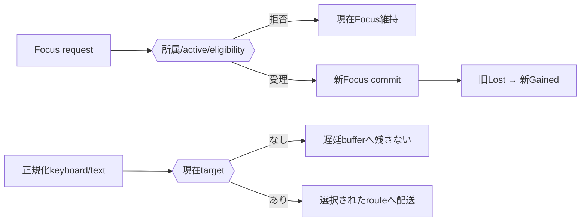

# SEP-D13 / DD-13 InputとFocusの責務分離レビュー案

- 文書版: 0.2
- 状態: 全案反映承認済み・正本適用済み（2026-10-17）。具体化未了は適用結果を参照
- 作成日: 2026-10-17
- 対象: [元文書](../../13_detail_design/13-input-focus.md)
- 対象箇所: DD-13 DD-INPUT-01～10、§3/8/10
- 索引: [一括レビュー](index.md)
- 台帳項目: D13

- 現行要求根拠: [RQ-02-009](../../11_requirements/RQ-02_core-features.md#rq-02-009)、[RQ-02-010](../../11_requirements/RQ-02_core-features.md#rq-02-010)、[RQ-09-006](../../11_requirements/RQ-09_ui-scope.md#rq-09-006)、[RQ-09-009](../../11_requirements/RQ-09_ui-scope.md#rq-09-009)、[RQ-09-010](../../11_requirements/RQ-09_ui-scope.md#rq-09-010)、[RQ-10-008](../../11_requirements/RQ-10_accessibility.md#rq-10-008)
- 具体化する基本設計: [BD-05](../../12_design/BD-05_logical-visual-tree-upper-design.md)、[BD-07](../../12_design/BD-07_input-event-boundary-upper-design.md)、[BD-08](../../12_design/BD-08_focus-upper-design.md)、[BD-09](../../12_design/BD-09_ime-focus-transition-upper-design.md)
## 対象本文と既存承認

- 状態: 承認済み（2026-10-12）

作成時点の原文SHA-256: `e900118cefdad1005f4720ee3ef27b3d37747bebe7aabe3f215c3eda1f93501c`。対象は台帳の箇所と、以下の原文・判断ID。正本の本文は今回編集していない。

原文 DD-INPUT-01 / L25:

> Platform AdapterはOSのraw keyboard/text/pointer eventを共通Input eventへ正規化し、Runtime UI thread上へ投入する。keyboard key down/upとtext commitを区別し、CoreはAdapterが渡す安定したkey identity・modifier・source metadataを扱う。event field layoutとABI表現は決めない。

原文 DD-INPUT-02 / L26:

> RuntimeのFocus状態を「active Windowなし」「active Windowあり・active focusなし」「active Windowあり・active focusあり(Control)」に分ける。active Window外またはDetached Controlはactive focusになれない。Focus requestは同じControlならno-op、別Controlなら一つの状態遷移としてcommitする。

原文 DD-INPUT-03 / L27:

> 初期Focus取得条件は、要求元Controlがactive WindowのLogical TreeにAttachedであり、Controlがfocusableかつenabledであることとする。invalid/disabled/nonfocusable/nonactive-window/Detached targetへの要求は失敗し、現在のFocusを変えない。focusable/enabled Propertyの公開面はDD-15へ送る。

原文 DD-INPUT-05 / L29:

> Active Windowがdeactivateされたらactive focusを解除して復帰候補として直前Controlを記録する。再activate時はcandidateが同WindowにAttachedでfocusable/enabledなら復帰し、そうでなければfocusなしとする。detachされたControlは復帰candidateにも残さない。

## 改訂判断案

| レビューID | 変更対象 | 提案 |
|---|---|---|
| SEP-D13-01 | 外部契約と要求の根拠 | [SEP-RQ-036 有効性とFocusの共通結果](rq-candidates.md#candidate-036)、[SEP-RQ-037 初期機能の除外とButton未接続](rq-candidates.md#candidate-037)、[SEP-RQ-038 Focus通知と入力route](rq-candidates.md#candidate-038)へ対応付ける。既存RQで定まる結果は上流参照にし、補足/選択要は要求承認後に設計前提へ反映する |
| SEP-D13-02 | 実現手段の本文 | 下記の責務・data/ownership flow・stateを本文案として収録する。個別の公開名・signatureを新たに確定する判断とは分ける |
| SEP-D13-03 | 未決・承認粒度 | routeのbubble推奨/tunnel非採用を未決方式として明示。Tab/ShiftTab/Ctrl+Z等の対応付けは既存将来メモのまま。状態図をMermaidとして維持する。 |

## 設計本文の改訂案

Runtime Focus stateはNone/WindowOnly/Focused(Control)を持つ。requestはAttached/active Window/focusable/enabledを検証し、新stateをcommitした後に旧FocusLost→新FocusGainedをdispatchする。Adapter入力はkeyboardとtext commitを分け、現在targetとLogical routeへ渡す。同一遷移のOS折返しを抑止し、callback起因の再入入力は後続処理へ送る。

## 移管・ID・検証への影響

- 既存ID: DD-INPUT-01、DD-INPUT-02、DD-INPUT-03、DD-INPUT-04、DD-INPUT-05、DD-INPUT-06、DD-INPUT-07、DD-INPUT-08、DD-INPUT-09、DD-INPUT-10。方式として残る意味は旧IDを維持し、要求へ分ける文だけを仮候補IDに対応付ける。正式RQ IDの発番は[移行案](id-migration.md)による。
- 移管先: 利用者可視条件は上記RQ候補、C/言語APIの具体形はDD内、脅威と防御はSD、試験操作と判定手順はrequirements-test/unit-test、着手順と下流割当はto-do。
- 設計を説明する所有・state・call図と計算例は保持する。対象本文の試験節は、[検証改訂案](test-impact.md)へ対応付けてから移す。失敗時の状態表・cleanup順まで検証扱いで削除しない。
- 上流RQ/ADR/BDへの参照は該当記述に直接置く。後続の着手割当は計画へ移し、DD間のinterface依存参照は実際の定義側へ向けて循環を解く。文書番号の大小だけで依存を判定しない。

## 承認履歴

| 日付 | 対象 | 承認者 | 結果 |
|---|---|---|---|
| 2026-10-17 | SEP-D13 | — | 一括作成指示に基づくレビュー案。採用・正本適用は未承認 |

## 改訂履歴

| 版 | 日付 | 内容 | 状態 |
|---|---|---|---|
| 0.1 | 2026-10-17 | 現行文書から責務分離・改訂文案・影響を作成 | レビュー待ち |

## 2026-10-17 適用結果

[適用先](../../13_detail_design/13-input-focus.md) の版0.1へ反映した。補足要求は正式IDへ対応付け、未設計事項は [後続課題](../requirements-design-separation-follow-up.md) に移した。

### 承認履歴

| 日付 | 範囲 | 承認者 | 結果 |
| --- | --- | --- | --- |
| 2026-10-17 | 全レビュー案の反映 | 利用者 | 「すべて反映して下さい。」により採用・正本適用を承認 |

### 改訂履歴

| 版 | 日付 | 内容 |
| --- | --- | --- |
| 0.2 | 2026-10-17 | 承認と正本適用結果を追記。作成時点の比較・引用を保持 |
