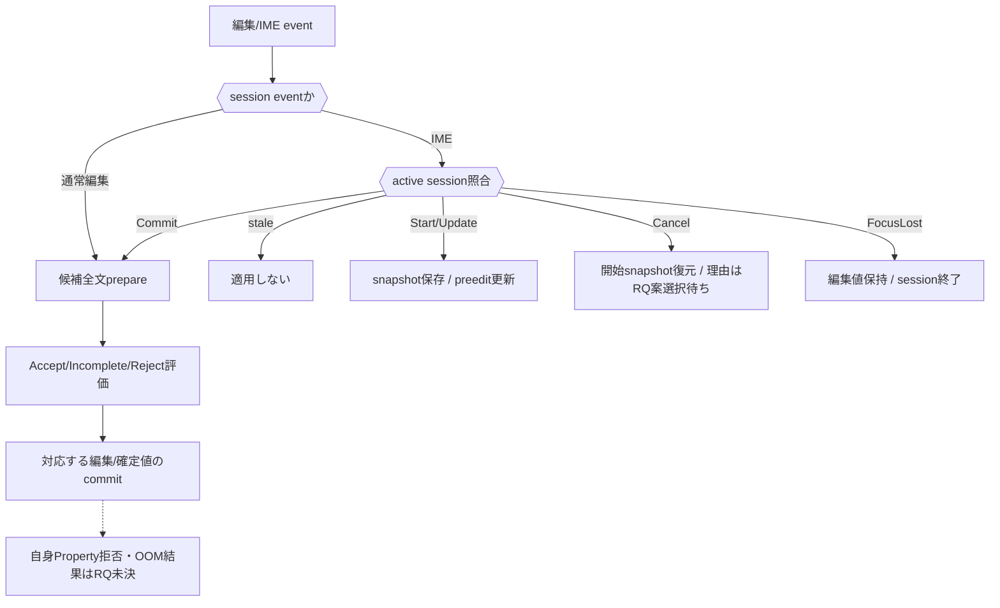

# SEP-D14 / DD-14 TextBoxとIMEの責務分離レビュー案

- 文書版: 0.2
- 状態: 全案反映承認済み・正本適用済み（2026-10-17）。具体化未了は適用結果を参照
- 作成日: 2026-10-17
- 対象: [元文書](../../13_detail_design/14-textbox-ime.md)
- 対象箇所: DD-14 DD-TEXT-01～12、§5/7/8
- 索引: [一括レビュー](index.md)
- 台帳項目: D14

- 現行要求根拠: [RQ-09-005](../../11_requirements/RQ-09_ui-scope.md#rq-09-005)、[RQ-15-005](../../11_requirements/RQ-15_requirement-decisions.md#rq-15-005)、[RQ-15-006](../../11_requirements/RQ-15_requirement-decisions.md#rq-15-006)
- 具体化する基本設計: [BD-09](../../12_design/BD-09_ime-focus-transition-upper-design.md)、[BD-10](../../12_design/BD-10_ime-platform-boundary-upper-design.md)、[BD-23](../../12_design/BD-23_text-shaping-upper-design.md)、[BD-24](../../12_design/BD-24_ime-edit-session-upper-design.md)
## 対象本文と既存承認

- 状態: 承認済み（2026-10-12）

作成時点の原文SHA-256: `c3b4542cd2786402a3175a74b10c15998987207ec22aef50f0183ce0597dda7d`。対象は台帳の箇所と、以下の原文・判断ID。正本の本文は今回編集していない。

原文 DD-TEXT-06 / L38:

> Explicit CancelはBD-24に従い、session開始直前のediting text・caret・selectionを復元し、Validator・確定Property・Bindingを動かさない。開始時のinput state/reasonもsnapshotへ含めて戻す案と、編集位置のみ復元しcancel状態を別通知する案を比較する。

原文 DD-TEXT-09 / L41:

> ユーザー候補がDD-09 input ValidatorでAccept後、TextBox確定値Property自身のValidatorで拒否された場合の扱いは未決とする。選択肢は (A) 編集前へ戻し入力拒否を記録、(B)候補編集値を保持し確定値は旧値のままBinding error相当を記録、(C) Property Validator拒否を別の入力状態/errorとして可視化する。既存の未決境界を詳細化する。

原文 DD-TEXT-10 / L42:

> Commit candidateの確保またはValidator実行前準備が失敗しても入力文字列を失わない。通常編集は編集前snapshotを保つ。IME commitでは候補をCore所有のpending recovery状態へ退避してからsessionを終了する案と、Adapterが再送可能な状態を保つ案を比較し、復旧可能な境界を定める。

原文 DD-TEXT-11 / L43:

> caret/selectionの内部位置単位を未確定として、UTF-8 byte offset、Unicode scalar boundary、extended grapheme boundaryと変換層の有無を比較する。全位置は少なくとも有効UTF-8境界を守り、A25 callbackには承認済みUTF-8 byte offsetで変換して渡す。

## 改訂判断案

| レビューID | 変更対象 | 提案 |
|---|---|---|
| SEP-D14-01 | 外部契約と要求の根拠 | [SEP-RQ-026 TextBox入力三値の結果](rq-candidates.md#candidate-026)、[SEP-RQ-027 TextBox自身のProperty検証拒否](rq-candidates.md#candidate-027)、[SEP-RQ-028 IME cancel後の入力理由](rq-candidates.md#candidate-028)、[SEP-RQ-029 IME commit準備失敗](rq-candidates.md#candidate-029)、[SEP-RQ-030 外部更新と編集中の値](rq-candidates.md#candidate-030)、[SEP-RQ-058 text coverageと編集位置](rq-candidates.md#candidate-058)へ対応付ける。既存RQで定まる結果は上流参照にし、補足/選択要は要求承認後に設計前提へ反映する |
| SEP-D14-02 | 実現手段の本文 | 下記の責務・data/ownership flow・stateを本文案として収録する。個別の公開名・signatureを新たに確定する判断とは分ける |
| SEP-D14-03 | 未決・承認粒度 | DD-TEXT-06/09/10/11/12に含む選択肢の提示承認を採用承認と扱わない。拒否後結果・cancel理由・OOM回復はRQ候補、内部位置単位とcallback順はDD待ち。 |

## 設計本文の改訂案

TextBoxは確定Property、編集全文、selection/caret、composition/session、入力state/reasonを分けて保持する。編集操作から候補全文をprepareし、判定結果に応じた組を一editing transactionでcommitする。Start snapshot、Update range置換、Commit候補評価、Cancel復元、FocusLost保持をsession IDで分岐し、外部確定値変更は旧sessionを無効化する。

## 移管・ID・検証への影響

- 既存ID: DD-TEXT-01、DD-TEXT-02、DD-TEXT-03、DD-TEXT-04、DD-TEXT-05、DD-TEXT-06、DD-TEXT-07、DD-TEXT-08、DD-TEXT-09、DD-TEXT-10、DD-TEXT-11、DD-TEXT-12。方式として残る意味は旧IDを維持し、要求へ分ける文だけを仮候補IDに対応付ける。正式RQ IDの発番は[移行案](id-migration.md)による。
- 移管先: 利用者可視条件は上記RQ候補、C/言語APIの具体形はDD内、脅威と防御はSD、試験操作と判定手順はrequirements-test/unit-test、着手順と下流割当はto-do。
- 設計を説明する所有・state・call図と計算例は保持する。対象本文の試験節は、[検証改訂案](test-impact.md)へ対応付けてから移す。失敗時の状態表・cleanup順まで検証扱いで削除しない。
- 上流RQ/ADR/BDへの参照は該当記述に直接置く。後続の着手割当は計画へ移し、DD間のinterface依存参照は実際の定義側へ向けて循環を解く。文書番号の大小だけで依存を判定しない。

## 承認履歴

| 日付 | 対象 | 承認者 | 結果 |
|---|---|---|---|
| 2026-10-17 | SEP-D14 | — | 一括作成指示に基づくレビュー案。採用・正本適用は未承認 |

## 改訂履歴

| 版 | 日付 | 内容 | 状態 |
|---|---|---|---|
| 0.1 | 2026-10-17 | 現行文書から責務分離・改訂文案・影響を作成 | レビュー待ち |

## 2026-10-17 適用結果

[適用先](../../13_detail_design/14-textbox-ime.md) の版0.1へ反映した。補足要求は正式IDへ対応付け、未設計事項は [後続課題](../requirements-design-separation-follow-up.md) に移した。

### 承認履歴

| 日付 | 範囲 | 承認者 | 結果 |
| --- | --- | --- | --- |
| 2026-10-17 | 全レビュー案の反映 | 利用者 | 「すべて反映して下さい。」により採用・正本適用を承認 |

### 改訂履歴

| 版 | 日付 | 内容 |
| --- | --- | --- |
| 0.2 | 2026-10-17 | 承認と正本適用結果を追記。作成時点の比較・引用を保持 |
